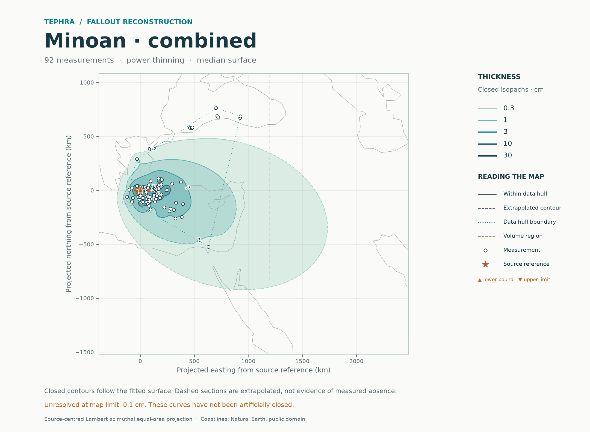

# Tephra fallout reconstruction

Reproducible isopachs and regional deposit volumes from measured thicknesses and documented bounds. Upload a new eruption dataset and source notes in chat; the accepted inputs, audit, calculations and report are then added to this repository.

**Latest: [Minoan combined fallout](reports/minoan/README.md).** One fitted field combines all Plinian and co-ignimbrite fallout fans. Identified turbidites are excluded, incomplete cores enter as lower bounds, and source conflicts are tested separately.



## Reports and data

| Eruption | Exact thickness records | Documented lower bounds | Report | Input audit |
|---|---:|---:|---|---|
| Minoan | 92 | 9 | [Combined fallout and sensitivities](reports/minoan/README.md) | [Source decisions](data/audits/Minoan/README.md) |
| YTT | 43 | 0 | [Method comparison](reports/ytt/README.md) | [Audited workbook](data/audits/YTT/README.md) |
| Mazama | 45 | 0 | [Reconstruction](reports/mazama/README.md) | Original supplied flags |
| Tambora | 26 | 0 | [Reconstruction](reports/tambora/README.md) | Original supplied flags |
| Aso-4 | 87 | 0 | [Reconstruction](reports/aso-4/README.md) | Original supplied flags |
| B-Tm | 84 | 0 | [Reconstruction](reports/b-tm/README.md) | Original supplied flags |

Legacy pseudo rows are excluded. All volumes refer to stated finite regions; they are not automatically total erupted volumes or dense-rock equivalents. Sparse sectors and distant tails remain assumption-dependent. [Read the output definitions](docs/OUTPUTS.md).

## Workflow

1. Preserve the source and record units, locations, thickness meanings and provenance.
2. Prepare one accepted input table, keeping missing data, exact thicknesses, upper limits and lower bounds distinct.
3. Fit the directional trend and spatial residual field, select candidates using geographic holdouts, and assess them with nested validation.
4. Publish a Markdown report with maps, tables, full numerical records and a reproducible command.

There is no atlas command, browser application, HTML report generator or local server. Reports render directly on GitHub. The established `selected` method remains the default; `--method stacked` runs the experimental predictive ensemble. [Methods](docs/METHODS.md) · [Empirical ensemble](docs/EMPIRICAL_METHODS.md) · [Validation](docs/VALIDATION.md).

## Reproduce

Python 3.10 or later, from the repository root:

```sh
python -m pip install '.[test]'
python -m benchmarks.minoan --output results/minoan
python -m benchmarks.ytt --output results/ytt
tephra-isopachs fit Minoan --output results/minoan-single --nested-cv
tephra-isopachs fit path/to/measurements.csv --output results/new-eruption --nested-cv
```

Use a new output directory for each run. Open its `README.md` and figures. Dataset profiles record known analysis settings; explicit command options override them. [Quick start](docs/QUICKSTART.md) · [Input format](data/README.md).

## Repository structure

```text
data/
  sources/               Unchanged published source files and attribution
  audits/                Selection manifests, provenance and sensitivity inputs
  eruptions/             Accepted model input CSVs
  datasets.json          Dataset profiles
reports/                 One directory per eruption, with reports and exports
src/probabilistic_isopach/
  data.py                Observation definitions and input validation
  model.py               Conditional spatial model and censored likelihoods
  validation.py          Geographic selection and nested validation
  ensemble.py            Optional predictive stacking
  distributions.py       Exact mixture calculations
  contours.py, volume.py  Level sets and checked finite-region integration
  figures.py, publication.py  Scientific figures and Markdown reports
  cli.py                 Reproducible calculation command
benchmarks/              Real-data reproduction and synthetic experiments
tests/                   Numerical, statistical and provenance checks
docs/                    Methods, interpretation and archived research history
results/                 Local runs and regenerable large arrays; ignored by Git
```

The original `src/spline_isopach/` GUI and normalized spline-prior estimator are retained as research code, separate from the main fitting workflow. Historical numerical results remain available even when interfaces are retired.

```sh
python -m pytest -q
python -m benchmarks.empirical --output results/empirical --repeats 10
```

Read [CONTRIBUTING.md](CONTRIBUTING.md) before changing likelihoods, validation or numerical reporting. Source and map-data attribution is recorded in [THIRD_PARTY_NOTICES.md](THIRD_PARTY_NOTICES.md).
