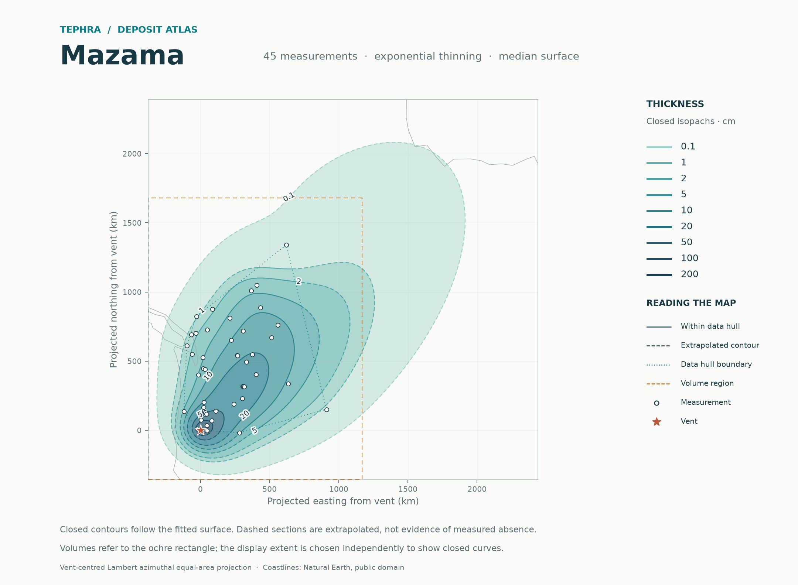

# Tephra fallout isopachs

**Send measurements in chat → reproducible calculations → data and reports on GitHub.**

A small statistical workflow for reconstructing tephra deposits without hand-placed pseudo-data. The repository includes Mazama, Tambora, Aso-4, B-Tm, and the audited 43-observation YTT dataset, with maps and explicit extrapolation diagnostics.

[Read the YTT comparison](reports/ytt/README.md) · [Quick start](docs/QUICKSTART.md) · [Understand the outputs](docs/OUTPUTS.md) · [Methods](docs/METHODS.md) · [Validation](docs/VALIDATION.md)

**Experimental empirical ensemble:** add `--method stacked` to a fit or atlas command. It learns weights across thinning models from withheld geographic regions, preserves their joint predictive mixture, and reports a separate observation-calibration experiment. The established single-model fit remains the default. See [the method and measured results](docs/EMPIRICAL_METHODS.md).



## Add another eruption

Upload the measurements and available source/audit notes in chat. The assistant checks units, measurement meanings and exclusions, saves the source and accepted data in `data/`, runs the model and geographic validation, and adds a report under `reports/<eruption>/` to this repository. No browser upload application or local server is needed.

Reports render directly on GitHub as Markdown, with PNG maps, downloadable PDFs, CSV tables and full numerical JSON records. New methods replace the default only when matched validation supports the change; apparent contour plausibility is not a validation criterion.

**YTT result:** retain `selected`. The ensemble slightly improves log RMSE but worsens the predictive log score and does not improve coverage. Both final fits produce the same surface. [Data qualifications, comparison and sensitivity runs](reports/ytt/README.md).

## Reproduce from the command line

Use Python 3.10 or later and install with `python -m pip install '.[test]'`.

```sh
# All five catalogued deposits, including nested geographic validation.
tephra-isopachs atlas --output results/atlas

# One bundled deposit or a new CSV.
tephra-isopachs fit Mazama --output results/mazama --nested-cv
tephra-isopachs fit path/to/measurements.csv --output results/my-deposit --nested-cv
```

Read the resulting `README.md` and maps. Existing nonempty output directories are refused. `python -m src.probabilistic_isopach` is equivalent to `tephra-isopachs`; the original `tephra-isopachs CSV --output DIR` syntax still works.

## Included deposits

| Deposit | Measurements | Excluded pseudo rows | Report | Map |
|---|---:|---:|---|---|
| Mazama | 45 | 7 | [Report](docs/atlas/mazama/short_report.md) | [PNG](docs/atlas/mazama/isopachs.png) · [PDF](docs/atlas/mazama/isopachs.pdf) |
| Tambora | 26 | 2 | [Report](docs/atlas/tambora/short_report.md) | [PNG](docs/atlas/tambora/isopachs.png) · [PDF](docs/atlas/tambora/isopachs.pdf) |
| Aso-4 | 87 | 6 | [Report](docs/atlas/aso-4/short_report.md) | [PNG](docs/atlas/aso-4/isopachs.png) · [PDF](docs/atlas/aso-4/isopachs.pdf) |
| B-Tm | 84 | 7 | [Report](docs/atlas/b-tm/short_report.md) | [PNG](docs/atlas/b-tm/isopachs.png) · [PDF](docs/atlas/b-tm/isopachs.pdf) |
| YTT | 43 | 0 (45 audited records excluded) | [Comparison](reports/ytt/README.md) | [PNG](reports/ytt/main43_selected/isopachs.png) · [PDF](reports/ytt/main43_selected/isopachs.pdf) |

[Compare the original four volume summaries](docs/atlas/summary.csv). These are **bulk deposit volumes inside defined regions**, not total erupted volumes or dense-rock equivalents.

## What the workflow does

- Uses a directional thinning trend plus spatial residual model. The default selects one candidate; the optional ensemble combines competing candidates using geographic predictive scores.
- Excludes legacy pseudo-data from fitting, validation and domain selection.
- Expands the map to resolve closed contours. Extrapolated sections are dashed; unresolved levels receive no fabricated closure or area.
- Refines volume integrals and compares three integration regions and both thinning families.
- Exports PDF/SVG/PNG maps, geographic contour lines, area and volume tables, a short report, and complete numerical records.

**Research scope:** an unsampled region remains assumption-dependent. Intervals omit fitted-parameter uncertainty; the ensemble represents disagreement only among retained candidates. Aso-4 and the synthetic missing-sector experiment still fail important uncertainty checks. Closing a curve does not validate the missing deposit. The checked-in atlas shows the established method. See [the output guide](docs/OUTPUTS.md) and [executed checks](docs/ATLAS_VALIDATION.md).

## Repository map

```text
data/
  datasets.json                 Dataset catalogue
  eruptions/                    Accepted model input CSVs
  audits/YTT/                   Original audit workbook and exact selection manifest
reports/ytt/                    YTT comparison, maps, tables and decision
docs/
  atlas/                        Ready-to-browse reports and exports
  archive/original-isopachs/     Historical reference figures
  QUICKSTART.md, OUTPUTS.md      User workflow and interpretation
  METHODS.md, VALIDATION.md     Statistical definitions and benchmark
src/probabilistic_isopach/
  model.py, validation.py        Existing fit and selection
  ensemble.py, distributions.py  Predictive stacking and exact mixture summaries
  data.py, catalog.py            Observation semantics and datasets
  contours.py, volume.py         Closed level sets and checked integration
  figures.py, publication.py     Maps and reports
  cli.py, atlas.py               Reproducible single and batch runs
  regularized_spline.py          Optional spline-prior estimator
src/spline_isopach/              Original interactive spline and solver
tests/                          Numerical and statistical checks
benchmarks/                     Real-data and synthetic benchmark
results/                        Local runs and large arrays; not in Git
```

## Development and legacy interface

```sh
python -m pytest -q
python -m benchmarks.run --output results/benchmark --repeats 10
python -m benchmarks.empirical --output results/empirical --repeats 10
```

The historical spline GUI is available with `pip install '.[legacy-map]'` and `python -m src.spline_isopach`. It retains manual pseudo-points and is separate from the default workflow. Its optional GUI is not part of the automated atlas validation.

Read [CONTRIBUTING.md](CONTRIBUTING.md) before changing fitting or numerical reporting. Coastline attribution is in [THIRD_PARTY_NOTICES.md](THIRD_PARTY_NOTICES.md).
