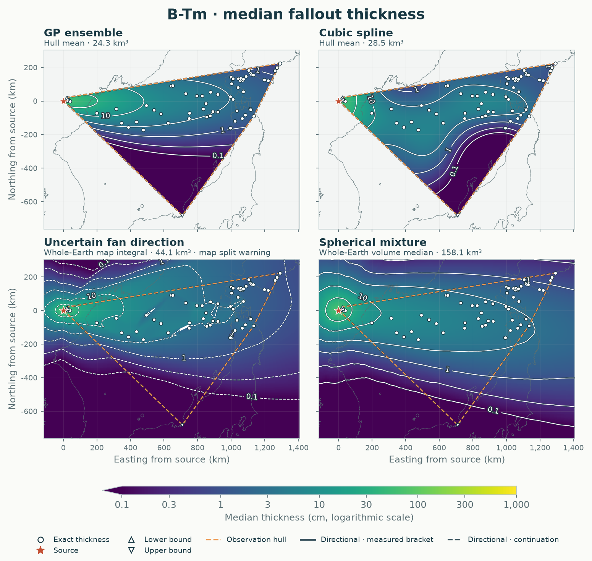
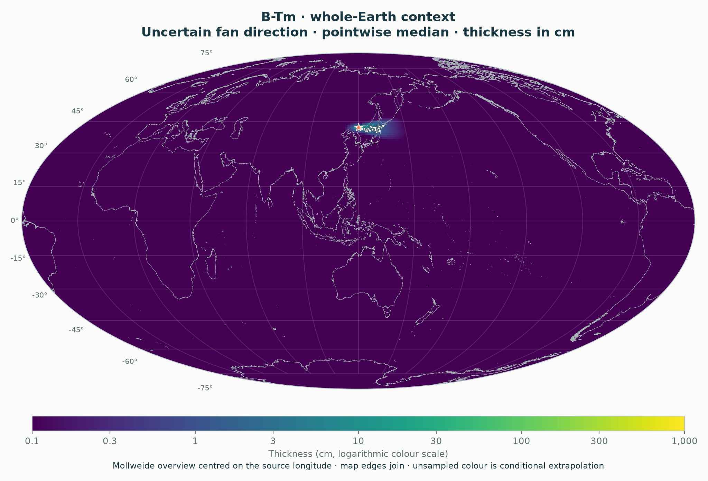
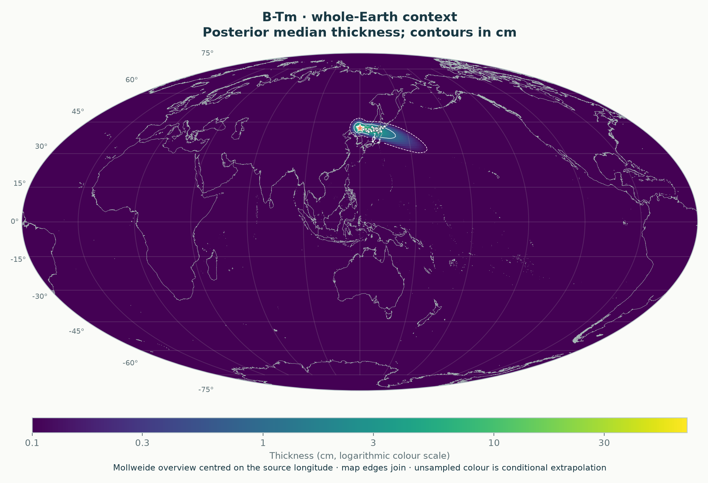
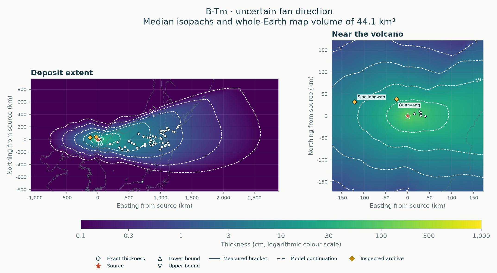
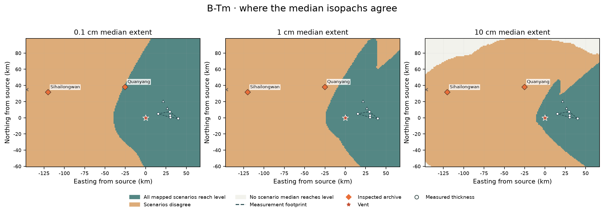

# B-Tm fallout reconstruction

The 946 CE Millennium eruption of Paektu / Changbaishan left fallout from two phases. All four methods fit the combined deposit using **64 measured thicknesses, three lower bounds and one upper bound**. [Accepted observations](../../data/eruptions/B-Tm_reviewed.csv)

## Four matched thickness-only fits

All four maps use the same frame, contour levels and thickness scale. Thickness below the first colour-bar tick shares the lowest shade. The dashed line encloses the observation hull. The regional fits stop there. The global fits also show how thickness continues into unsampled ground. On the directional map, white dashes show conditional continuation. Solid white segments connect thicknesses bracketed by measured sites in a supported triangle. Gaps inside the hull can still be poorly constrained.

## Volume and predictive performance

| Method | Bulk volume (km³) | Conditional 95% interval (km³) | Held-out score ↓ | 95% coverage |
|---|---|---:|---:|---:|
| GP ensemble | Hull mean **24.33** | 15.66–37.07 | 1.512 | 89.1% |
| Cubic spline | Hull mean **28.47** | 15.52–66.18 | 1.803 | 98.4% |
| [Directional ensemble · uncertain fan direction](results/directional/README.md) | Whole-Earth median map **44.1** · volume median 72.9 | 31.0–1,507.8 | 1.293 † | 93.8% |
| [Spherical mixture](results/spherical-mixture/README.md) | Whole-Earth volume median **158.1** | 40.7–4,461.6 | 1.490 † | 93.8% |

A lower negative log predictive score means better prediction across withheld regions. Each region gets equal weight. Coverage is the share of exact held-out observations inside the 95% predictive interval. † A geographic fit had a numerical warning or incomplete scoring.

The directional map integrates pointwise median thickness. Measured interpolation triangles account for **10.0%** of its volume. The directional volume interval comes from complete simulated deposits. The regional intervals condition on fitted settings. [Regional maps, fits and diagnostics](results/README.md)

Compare the two whole-Earth maps

| Uncertain fan direction | Spherical mixture |
|---|---|
|  |  |

Both maps use the vent longitude as their central meridian. Read the thickness key under each map.

With the same observations and structure weights, fixing the fan directions gives a median-map volume of **56.2 km³**.

Split posterior draws flagged 100 cm (24% area disagreement).

View the directional deposit extent and source area

## Directional assumptions and inspected sites

The principal fit above uses quantitative thicknesses and bounds. The measured-fan model extends fallout along sampled bearings. A visible-bed scenario also asks how much ash would have been preserved and recognized at inspected sites.

| Fan direction | Evidence assumption | Median-map volume (km³) | Complete-deposit median (km³) | Conditional 95% interval (km³) |
|---|---|---:|---:|---:|
| Uncertain fan direction | Comparable visible fallout beds | 40.7 | 59.0 | 28.5–149.7 |
| Measured fan directions | Thicknesses and bounds | 42.5 | 52.3 | 28.0–120.8 |
| Measured fan directions | Comparable visible fallout beds | 35.8 | 43.5 | 24.8–70.4 |

View agreement between the directional sensitivities

[Measured-fan maps, held-out tests and site evidence](results/directional/bearing/README.md)

## What the sites constrain

Six proximal sections and four Japanese lake cores supplied new thickness evidence. At Lake Suigetsu, the description supports an upper bound below 0.1 cm. At Sihailongwan and Quanyang, shards establish that ash reached the west. [Source decisions and site map](../../data/audits/B-Tm/README.md)

The western profiles challenge a continuous decimetre bed at those sites. They also leave room for a broader deposit than the comparable-bed map suggests. At an independent Ulleung Basin core, only 3.3% of the measured-fan comparable-bed predictions reach the thickness implied **if** the published shard-count conversion applies there. The original local thickness is unknown. [Western cores, marine check and independent spherical refit](results/directional/bearing/field-evidence.md)

The standard interpolation footprint covers 96,131 km². None of the twelve checks across four methods and three support policies found a complete band of isopachs bracketed by observations. Every whole-Earth estimate therefore depends on how the model fills unsampled ground. [Local support audit](results/support/README.md)

All six underlying structures passed the full-data sampling checks. Geographic fold 0 carried a sampling warning. Only two of four directional-sector holdouts had observations, and one of those fits had a warning. The spherical baseline passed, while the wide-geography and five-fan prior refits retained warnings.

## How do alternative source readings affect volume?

In the fixed-direction source-sensitivity study, restoring the twelve thickness ranges at their low or high endpoints gives median-map volumes of 50.8 and 59.2 km³. Withholding 26 thicknesses carried from compilations gives 48.9 km³. The report also tests alternative thicknesses at Tianwenfeng and Dongfanghong and gives the conditional interval for each fit. [Source-sensitivity results](results/source-audit/README.md)

The earlier 84-record fit used a different observation hull and geographic folds. Its directional median map integrated to 59.3 km³, compared with 54.0 km³ in the audited fixed-direction fit. [Earlier B-Tm release](https://github.com/siyulai21/tephra-fallout-isopachs/tree/2a52e062b7db84699d5229a25b01282c10301b3e/eruptions/b-tm)
