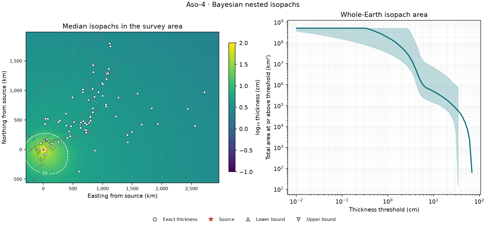

# Aso-4 · Bayesian nested isopachs

**5,657.1 km³ of bulk fallout**, with a conditional 95% interval of **1,274.9–18,756.5 km³**. Each sample integrates one complete deposit over the Earth.

The 87 accepted rows include 83 exact thicknesses, 3 lower bounds, 1 upper bounds and 0 two-sided intervals.

Dashed contours show model predictions. Shading in the area panel gives pointwise conditional 95% limits wherever the lower area is positive. [Whole-Earth map](world.png) · [Complete contour support decisions](support.json)

## Validation

The matched geographic score is 1.558. 4/4 training-fold fits passed the population check. The full-fit population check passed. Direct spatial integration passed.

At withheld exact sites, 74/83 measurements fell inside their 95% predictive intervals. The median fraction of a draw’s volume inside the retained exact-site triangles is 0.5%. The median fraction beyond the farthest exact site is 80.7%. Geographic classes describe sampling coverage.

No complete contour band passed the shared support screen. The global estimate remains conditional on unsampled sectors, the unmeasured core and the distal thinning law.

## What contributes to volume

A thickness slab counts the stated slice everywhere the deposit reaches it. The highest slice can occur near or far from the source. Each draw conserves volume across all slices. Marginal medians need not add to the total median.

| Thickness slice (cm) | Median [conditional 95%], km³ |
|---|---:|
| 0–0.01 | 51.01 [44.82–51.01] |
| 0.01–0.1 | 459.06 [194.67–459.06] |
| 0.1–1 | 3,230.25 [584.19–4,590.59] |
| 1–10 | 1,800.95 [398.52–13,021.23] |
| 10–100 | 51.98 [17.48–656.47] |
| 100–1000 | 0.00 [0.00–9.14] |
| >1000 | 0.00 [0.00–0.00] |

## Prior sensitivity

| Assumption | Median [conditional 95%], km³ | Effective draws |
|---|---:|---:|
| baseline | 5,657.1 [1,274.9–18,756.5] | 12,288 |
| weak profile transfer | 8,653.8 [1,844.4–18,950.3] | 963 |
| broader peak prior | 5,727.0 [1,276.3–18,757.5] | 12,152 |
| power tail prior 80pct | 7,899.9 [1,444.8–18,850.2] | 7,867 |
| exponential tail prior 80pct | 4,833.8 [1,218.3–18,635.8] | 10,857 |
| detached prior 50pct | 6,290.7 [1,299.4–17,657.7] | 6,886 |

## Compatibility with fitted bounds

Of 4 documented thickness bounds, 0 had a posterior-predictive probability below 5% under the fitted model. Each bound entered the likelihood once. This check includes field scatter and known measurement error.

The numerical report gives the latent and observation probabilities at every fitted bound. A poorly predicted bound identifies a limitation of the fitted thinning geometry or error model.

## Additional distal thinning

Beyond the largest equivalent isopach radius of any training site in a draw, a smooth extra thinning term tests progressive loss of transported ash. The three fixed scenarios reach an additional e-fold of attenuation after one, two or four more sampled radii. All three integrate to the antipode. The same rule is applied to the training sites in each geographic fold.

| Additional range | Median [conditional 95%], km³ | Geographic score ↓ |
|---|---:|---:|
| 1 × sampled radius | 2,485.5 [879.8–18,016.3] | 1.549 |
| 2 × sampled radius | 3,793.3 [1,082.9–18,450.1] | 1.555 |
| 4 × sampled radius | 4,993.4 [1,214.6–18,604.2] | 1.557 |

The accepted sites give each scenario the same fitted likelihood. The difference in global volume measures sensitivity to the unobserved continuation. [Quadrature and withheld-site checks](distal-taper.json)

The intervals condition on the recorded sampling locations and the specified shape family. Preservation, reworking and the far-field transfer of analogue slopes can introduce additional uncertainty.

[Numerical report and archive probes](report.json) · [Withheld thickness predictions](heldout.csv) · [Geographic training IDs](geographic.json) · [Full posterior](full.npz) · [Per-draw thickness budgets](volume-budget.npz)
