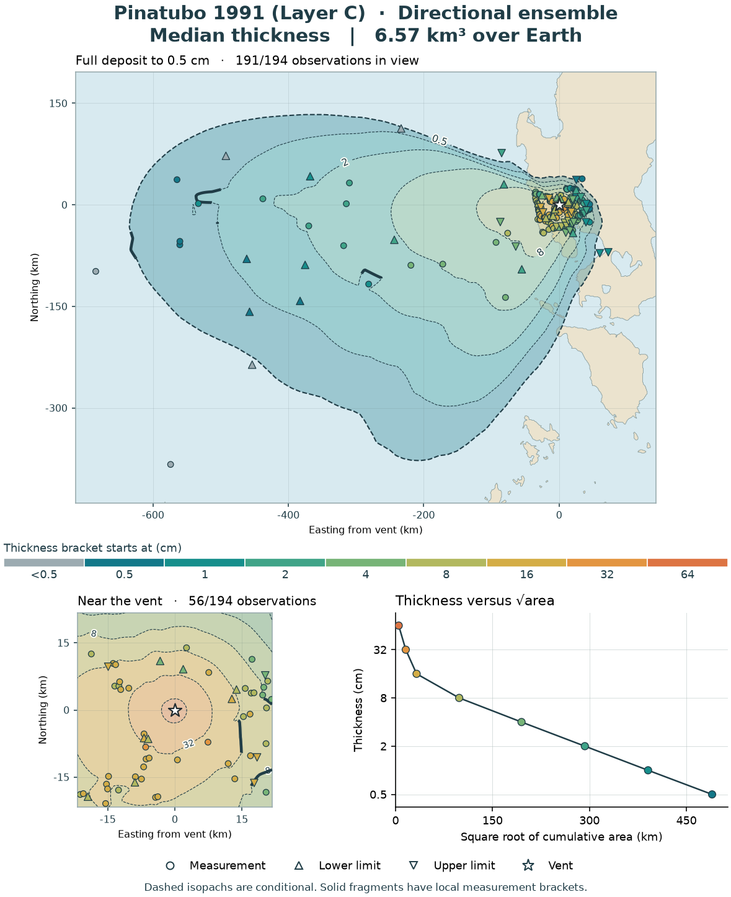
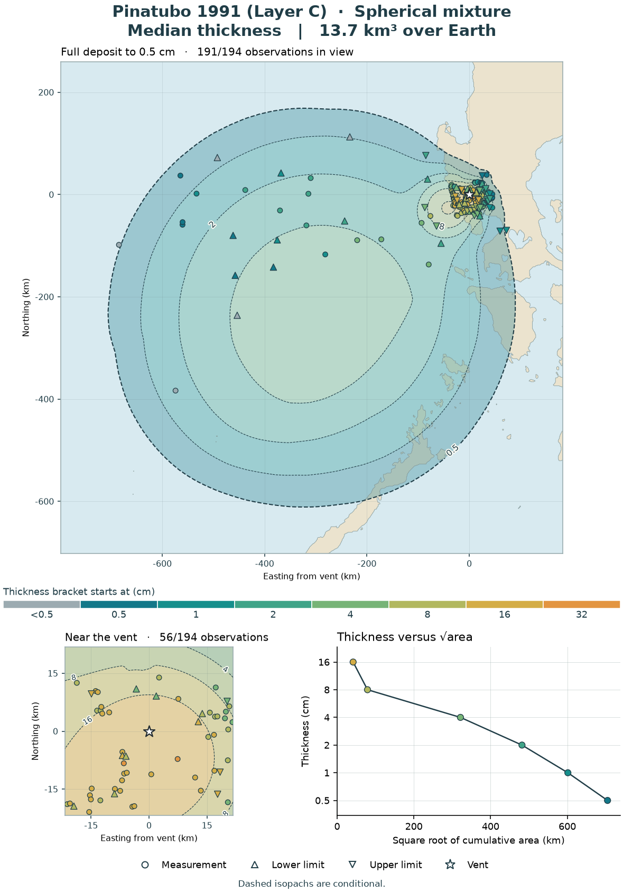
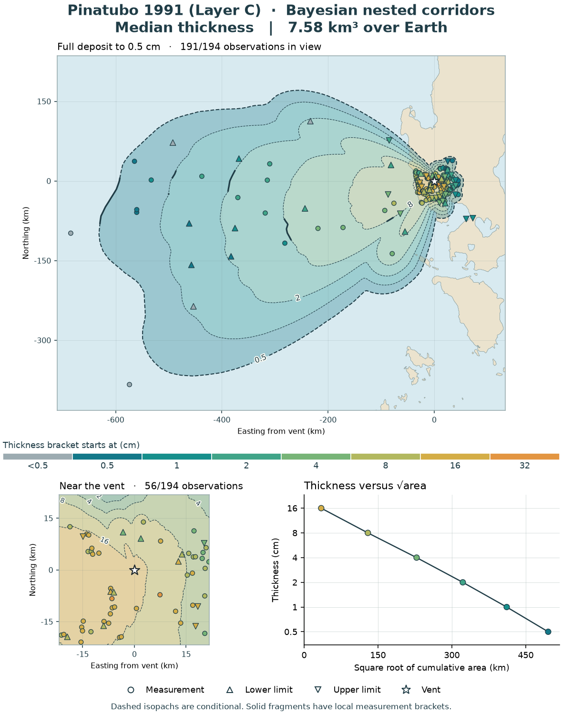
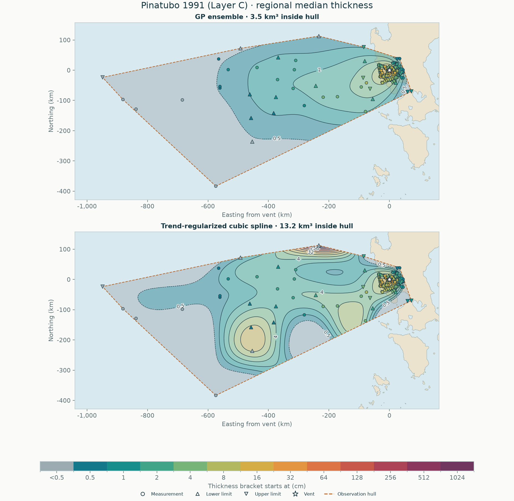
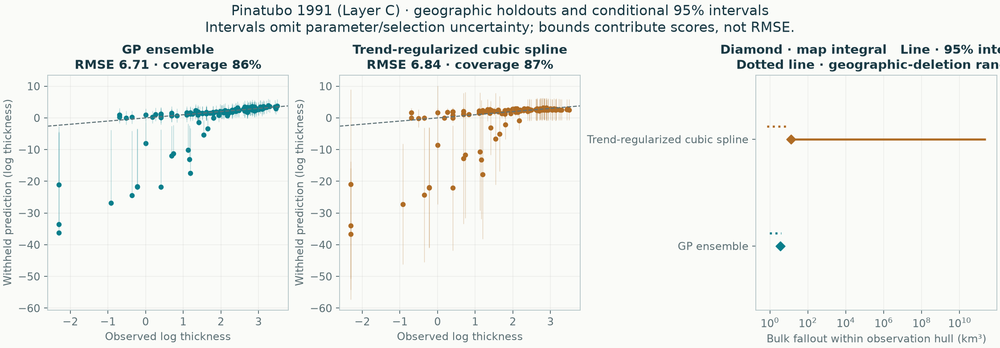

# Pinatubo 1991 (Layer C) fallout reconstruction

## Volumes and geographic prediction

Each volume integrates its method’s median-thickness map. The GP and spline cover the same observation hull. The other three methods cover Earth, including fallout below 0.5 cm. Conditional 95% intervals describe variation in whole-deposit volume across posterior draws.

| Method | Median-map volume (km³) | Conditional 95% interval (km³) | Held-out score ↓ | 95% coverage |
|---|---:|---:|---:|---:|
| GP ensemble | **3.5** | 3–5.05 | 4.300 | 86.4% |
| Cubic spline | **13.2** | 11.3–2.43e+11 (provisional) | 1.599 | 87.1% |
| [Directional ensemble](directional/README.md) | **6.57** | 5–11.8 (provisional) | 1.447 † | 89.3% |
| [Spherical mixture](spherical-mixture/README.md) | **13.7** | 8.79–25.4 (provisional) | 0.986 † | 97.1% |
| [Bayesian nested corridors](nested-isopachs/README.md) | **7.58** | 5.7–9.08 | 3.018 † | 60.7% |

Lower scores indicate better predictions in withheld geographic regions. Coverage counts exact withheld measurements. A dagger marks a numerical or geographic validation warning. Provisional intervals retain their fit or integration warnings.

## Full deposits and near-vent detail

The outer line is 0.5 cm. Contours and observation colours double from there. All three methods use the same near-vent window for this eruption. Each curve counts the combined area of all patches at or above a thickness.







## Inside the observation hull



The dashed boundary encloses all accepted sites. Gaps inside it can still be poorly constrained.

[Volume and geographic prediction plot](overview.png)

## Regional fit details

All methods use the same accepted observations, geographic holdouts and integration area. No method is designated preferred.

**140 exact measurements, 26 lower bounds, 28 upper limits.** The observation hull covers 279,806 km². The automatic validation buffer is 2.05 km.


The full observation hull and every accepted location are in view. The coloured field is clipped to the exact hull; fine coastlines are context only. [Map frame and rendering provenance](map-display.json).

| Quantity | GP ensemble | Trend-regularized cubic spline |
|---|---:|---:|
| Principal median-map volume inside hull (km³) | 3.50 | 13.17 |
| Conditional 95% volume interval (km³) | 3.00–5.05 | 11.28–243206617382.37 |
| Outer equal-region negative log score ↓ | 4.300 | 1.599 |
| Outer log-thickness RMSE ↓ | 6.713 | 6.844 |
| Outer 95% observation-interval coverage | 86.4% | 87.1% |

Lower predictive score and RMSE are better. Coverage must be read with interval width and predictive score; wider intervals alone are not improvement.



## Scope

The footprint is the convex hull of measured/bounded locations, with no source point or invented observations added. It can contain large unsampled gaps and can exclude proximal deposits. These are **regional bulk fallout volumes, not total eruption volumes or dense-rock equivalents**. No global extrapolation enters this comparison.

Volume integrates pointwise median thickness over the observation hull. The interval uses the 2.5th and 97.5th percentiles of spatially correlated volume draws.

## Fitted methods

### GP ensemble

```json
{
  "candidate": {
    "tail": "stacked"
  },
  "components": [
    {
      "weight": 1.0,
      "model": {
        "candidate": {
          "tail": "power",
          "length_factor": 1.5,
          "noise_ratio": 1.5
        },
        "beta": [
          4.484714069710353,
          3.497456296335601,
          -1.4218441646345348,
          -0.4698207488208634
        ],
        "radius_scale_km": 31.316630953439937,
        "length_km": 67.83852333066935,
        "amplitude_log": 0.6568062536478659,
        "noise_log": 0.985209380471799,
        "jitter": 4.3139445483094485e-10,
        "trend_on_constraint_boundary": true,
        "uncertainty": "conditional Laplace"
      }
    }
  ],
  "dominant_tail": "power",
  "observation_discrepancy_variance_log": 1.9929872133836535,
  "trend_on_constraint_boundary": true,
  "uncertainty": "Predictive mixture; includes disagreement among retained candidates, conditional on each fit and estimated weights. Fitted-parameter uncertainty is not integrated."
}
```

### Trend-regularized cubic spline

```json
{
  "method": "spline",
  "candidate": {
    "tail": "power",
    "knot_intervals": 6,
    "tension": 1.0,
    "smoothing": 0.0001,
    "trend_strength": 0.01,
    "noise_ratio": 0.75
  },
  "bounds_km": [
    -999.4560309065577,
    -408.2282413420416,
    123.76605171399694,
    137.6115034530784
  ],
  "knot_intervals_xy": [
    6,
    3
  ],
  "n_coefficients": 54,
  "noise_log": 0.37717493829908333,
  "amplitude_log": 0.5028999177321111,
  "trend_beta": [
    3.7815253097213857,
    2.690165565740689,
    -1.1670581538115934,
    -0.7575812112487085
  ],
  "trend_radius_scale_km": 31.316630953439937,
  "trend_on_constraint_boundary": false,
  "effective_df_exact": 19.568962048616704,
  "newton_decrement": 1.4377205822920714e-17,
  "newton_iterations": 8,
  "quadrature_order": 6,
  "uncertainty": "Conditional Laplace",
  "uncertainty_omits": [
    "fitted trend",
    "noise and smoothing estimation",
    "knot/trend selection",
    "sampling and preservation bias",
    "vent location error"
  ],
  "pseudo_observations": 0
}
```

Every explored candidate is retained in the selection tables. All response-dependent choices are retuned within training folds; no hand-placed pseudo-data enter the likelihood.

## Reliability checks

- All probability intervals condition on fitted parameters and selected settings; they omit parameter/selection and preservation/sampling uncertainty.
- Four geographic outer folds evaluate the entire tuning procedure; this is development evidence, not independent external validation.
- Geographic-deletion volume ranges show refitting sensitivity and are not confidence intervals.
- GP ensemble: held-out 95% observation coverage is only 86.4%; uncertainty is undercovered.
- Trend-regularized cubic spline: the analytic expected volume exceeds the 97.5th percentile of complete deposits. Rare thick fields influence the conditional uncertainty calculation.
- Trend-regularized cubic spline regional integration did not reach the stated refinement tolerance.
- Trend-regularized cubic spline joint-draw quadrature needs further refinement; inspect its grid checks before using intervals.
- Trend-regularized cubic spline: held-out 95% observation coverage is only 87.1%; uncertainty is undercovered.

## Reproduce and inspect

```sh
tephra-isopachs compare 'Pinatubo 1991 (Layer C)' --output results/new-regional-run
```

[Complete numerical report](report.json) · [Withheld predictions](heldout_predictions.csv) · [Accepted observation semantics](accepted_observations.csv) · [Selection tables](selection/README.md)

The JSON records input/source hashes, package versions, all fold memberships, regional integration refinements, conditional-volume sampling precision and geographic-deletion sensitivity. Historical GP global calculations remain separate.

## Which parts are actually supported?

Read the [local support and complete-contour audit](support/README.md) before extrapolating these hull volumes. It screens unsampled gaps, tests closure under geographic deletion, and separates interpolation from proximal/distal assumptions.
