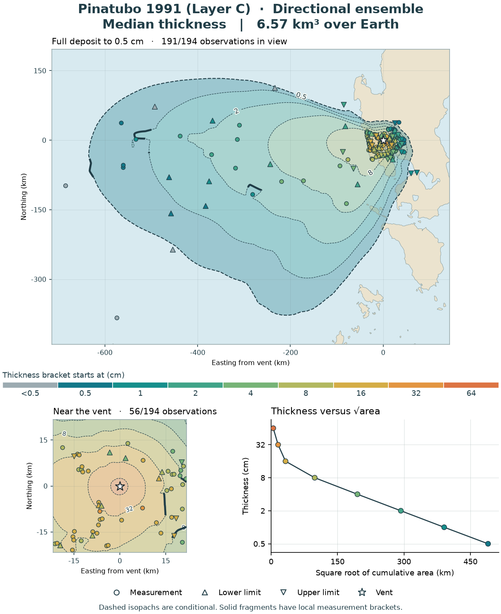
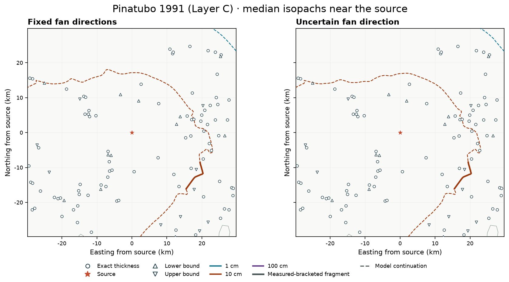
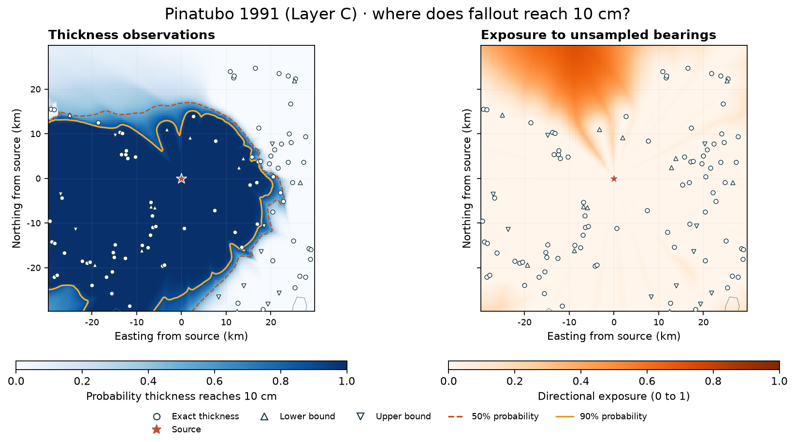

# Pinatubo 1991 (Layer C) · Directional ensemble

The principal bulk volume is **6.57 km³**, the whole-Earth integral of the median-thickness map. The conditional 95% interval for total fallout volume is **5–11.8 km³** across complete posterior draws. **Numerical warning on the fitted deposit distribution.**

Each circle shows a measurement. Bounded sites take the colour of their stated limit. The curve counts every patch at or above each thickness. The volume also includes thinner fallout beyond the 0.5 cm line. [Thickness and cumulative area](thickness-area.csv) · [Map integral, resolution and source hashes](deposit.json)

Fixing the fan directions gives a median-map volume of 6.87 km³. Solid fragments require thicknesses on opposite sides of the contour and at least 90% posterior crossing probability. [Whole-Earth context](azimuth/world.png) · [Earlier 0.1 cm extent and its edge checks](azimuth/map-display.json)

## Reach from the volcano

Distances are great-circle kilometres to the first outward crossing on each compass ray. The area columns give the entire 10 cm footprint in the corresponding 45° sector, including detached areas. Together they distinguish a long point on a contour from an entire broad lobe.

| Bearing | Fixed 10 cm reach (km) | Uncertain 10 cm reach (km) | Fixed ≥10 cm area (km²) | Uncertain ≥10 cm area (km²) |
|---|---:|---:|---:|---:|
| N | 17.2 | 16.9 | 119 | 112 |
| NE | 17.3 | 17.3 | 117 | 117 |
| E | 21.8 | 21.8 | 165 | 165 |
| SE | 22.3 | 22.3 | 204 | 204 |
| S | 32.6 | 32.6 | 518 | 492 |
| SW | 55.1 | 50.1 | 1,396 | 1,341 |
| W | 81.1 | 81.1 | 2,109 | 2,109 |
| NW | 20.5 | 20.4 | 219 | 209 |

The 50% and 90% probability lines answer different questions. At a location on the 90% line, nine in ten model draws reach 10 cm. These are pointwise probabilities conditional on the model. Joint confidence over an entire region requires a different calculation.

## Withheld observations

Each row averages negative log predictive scores over equally weighted folds. Lower scores predict the withheld thicknesses and limits better. The passing-only columns exclude numerical failures. Coverage counts exact withheld thicknesses inside the uncertain-direction 95% predictive interval. A dash marks an unavailable score or coverage.

| Deletion | All estimable folds | Fixed | Uncertain | Passing folds | Fixed, passing | Uncertain, passing | Exact-site 95% coverage |
|---|---:|---:|---:|---:|---:|---:|---:|
| Geographic regions | 4 | 1.349 | 1.447 | 0 | — | — | 125/140 (89.3%) |
| Source quadrants | 4 | 1.395 | 1.261 | 1 | 2.431 | 1.606 | 127/140 (90.7%) |

[Predictions for every estimable held-out site](azimuth/heldout.csv). The numerical record includes all planned folds, row identities, unscorable directions, fit warnings and phase-integration checks.

## Independent archive predictions

These locations have reported ash occurrences or tentative correlations. The fitted thickness data supply the predictions. The intervals describe latent bulk thickness at each location.

| Archive | Identification | Median thickness (cm) | Conditional 95% interval (cm) |
|---|---|---:|---:|
| WW-open-01 | secure | 1.32e-18 | 3.67e-43–2.91e-07 |
| WW-open-02 | secure | 2.35e-14 | 4.08e-46–0.00147 |
| WW-open-03 | secure | 8.76e-14 | 2.65e-43–0.00334 |
| WW-open-04 | secure | 1.78e-13 | 4.86e-38–0.00013 |
| WW-open-05 | secure | 2.19e-13 | 2.48e-41–0.00459 |
| WW-open-06 | secure | 4.23e-13 | 1.22e-36–0.000239 |
| WW-open-07 | secure | 6.7e-13 | 1.41e-37–0.00619 |
| WW-open-08 | secure | 9.4e-13 | 4.87e-35–0.000321 |
| WW-open-09 | secure | 1.82e-14 | 2.31e-31–1.95e-05 |
| WW-open-10 | secure | 2.51e-12 | 3.67e-35–0.00946 |
| WW-open-11 | secure | 4.52e-12 | 1.09e-32–0.00082 |
| WW-open-12 | secure | 9.38e-12 | 6.89e-30–7.75e-06 |
| WW-open-13 | secure | 1.05e-08 | 1.12e-19–0.00486 |
| WW-open-14 | secure | 1.35e-10 | 1.59e-23–0.0208 |
| WW-open-15 | secure | 3.77e-10 | 2.44e-26–4.1e-05 |
| WW-open-16 | secure | 9.12e-11 | 1.84e-29–0.0122 |
| WW-open-17 | secure | 1.24e-09 | 2.61e-20–0.0298 |
| WW-open-18 | secure | 4.14e-10 | 1.56e-26–0.0455 |
| WW-open-19 | secure | 2.02e-07 | 6e-20–0.0394 |
| WW-open-20 | secure | 1.24e-11 | 6.36e-20–0.000922 |
| WW-open-21 | secure | 0.000643 | 1.62e-07–0.0362 |
| WW-open-22 | secure | 0.000182 | 8.71e-08–0.0414 |
| WW-open-23 | secure | 0.0295 | 0.000136–0.201 |
| WW-open-24 | secure | 2.66e-06 | 8.78e-15–0.0126 |
| WW-open-25 | secure | 0.133 | 0.00766–0.499 |
| WW-open-26 | secure | 0.17 | 0.0147–0.598 |
| WW-open-27 | secure | 0.147 | 0.00541–0.608 |
| WW-open-28 | secure | 0.132 | 0.0055–0.527 |
| WW-open-29 | secure | 0.0814 | 0.0131–0.199 |
| WW-open-30 | secure | 0.0701 | 0.00198–0.195 |
| WW-open-31 | secure | 0.0447 | 0.000104–0.304 |
| WW-open-32 | secure | 0.00337 | 5.19e-05–0.0215 |
| WW-open-33 | secure | 0.00115 | 9.52e-11–0.0126 |
| WW-open-34 | secure | 0.00109 | 1.54e-10–0.0139 |
| WW-open-35 | secure | 0.000828 | 4.99e-08–0.0168 |
| WW-open-36 | secure | 0.000918 | 2.31e-07–0.023 |
| WW-open-37 | secure | 0.000651 | 1.86e-08–0.0132 |
| SO132_10 | secure | 0.465 | 0.299–0.709 |
| SO132_11 | secure | 1.23 | 0.878–1.69 |
| SO132_12 | secure | 1.63 | 1.3–2.18 |
| SO132_12A | secure | 1.7 | 1.38–2.23 |
| SO132_13 | secure | 2.82 | 1.91–4.14 |
| SO132_14 | secure | 2.58 | 1.75–3.75 |
| SO132_15 | secure | 2.15 | 1.45–3.11 |
| SO132_16 | secure | 1.8 | 1.36–2.69 |
| SO132_17 | secure | 0.86 | 0.226–1.98 |
| SO132_19 | secure | 0.307 | 0.00624–1.5 |
| SO132_2 | secure | 0.0194 | 0.00614–0.0582 |
| SO132_20 | secure | 1.97 | 1.32–3.19 |
| SO132_21 | secure | 2.29 | 1.53–3.25 |
| SO132_22 | tentative | 2.43 | 1.66–3.56 |
| SO132_23 | secure | 4.04 | 3.41–4.98 |
| SO132_24 | tentative | 3.28 | 2.47–4.79 |
| SO132_25 | secure | 4.99 | 4.35–5.82 |
| SO132_26 | secure | 4.44 | 3.87–5.15 |
| SO132_27 | secure | 3.77 | 3.22–4.61 |
| SO132_28 | secure | 3.95 | 2.7–5.84 |
| SO132_29 | secure | 4.62 | 3.17–6.98 |
| SO132_3 | secure | 0.0515 | 0.0238–0.117 |
| SO132_30 | secure | 3.26 | 2.56–4.08 |
| SO132_31 | secure | 2.35 | 1.75–3.04 |
| SO132_32 | secure | 2.24 | 0.0776–7.75 |
| SO132_33 | secure | 2.06 | 0.00596–10.4 |
| SO132_34 | secure | 1.52 | 0.00193–8.46 |
| SO132_35 | secure | 2.11 | 0.0388–9.12 |
| SO132_36 | secure | 4.81 | 3.01–8.83 |
| SO132_37 | secure | 4.44 | 2.88–7.1 |
| SO132_37A | secure | 4.71 | 3.26–7.4 |
| SO132_38 | secure | 5.26 | 2.94–8.64 |
| SO132_39 | secure | 5.44 | 4.15–7.09 |
| SO132_4 | secure | 0.144 | 0.029–0.378 |
| SO132_40 | secure | 7.69 | 2.06–9.15 |
| SO132_41 | secure | 6.66 | 4.59–9.98 |
| SO132_42 | secure | 9.21 | 7.9–10.7 |
| SO132_43 | secure | 10 | 8.59–11.9 |
| SO132_44 | secure | 8.89 | 7.61–10.6 |
| SO132_44A | secure | 9.39 | 8.05–11.2 |
| SO132_47 | secure | 0.0224 | 7.92e-07–2.48 |
| SO132_48 | secure | 0.122 | 0.00173–2.83 |
| SO132_49 | secure | 6 | 2.29–10.7 |
| SO132_5 | secure | 0.378 | 0.26–0.566 |
| SO132_50 | secure | 7.09 | 4.79–8.58 |
| SO132_7 | secure | 1.12 | 0.765–1.66 |
| SO132_8 | secure | 1.15 | 0.941–1.5 |
| SO132_9 | secure | 0.828 | 0.59–1.18 |
| GIK18429 | secure | 0.0165 | 0.000766–0.0875 |
| GIK18430 | secure | 0.0185 | 0.00597–0.0556 |
| SO140B_10 | secure | 3.77 | 3.22–4.61 |
| SO140B_11 | secure | 3.93 | 2.71–5.76 |
| SO140B_12 | secure | 4.45 | 2.94–7.14 |
| SO140B_13 | secure | 5.11 | 3.04–8.27 |
| SO140B_14 | secure | 7.68 | 2.05–9.14 |
| SO140B_23 | secure | 10.9 | 9.36–12.9 |
| SO140B_24 | secure | 9.21 | 7.89–10.7 |
| SO140B_25 | secure | 8.61 | 5.72–12.6 |
| SO140B_3 | secure | 0.679 | 0.449–1.05 |
| SO140B_4 | secure | 2.17 | 1.45–3.17 |
| SO140B_5 | secure | 2.31 | 1.74–3.06 |
| SO140B_6 | secure | 2.58 | 1.75–3.75 |
| SO140B_7 | secure | 2.97 | 2.57–3.53 |
| SO140B_8 | secure | 2.29 | 1.53–3.25 |
| SO140B_9 | tentative | 3.28 | 2.47–4.8 |

## Checks and reproducibility

The shared contour audit found eligible bands under none of the screened support policies. Audit status is completed. [All contour decisions and deletion failures](azimuth/complete-contour-audit.json)

The spatial integration check passed at 32,768 points per scramble. The map used up to 64 posterior draws per chain and structure. Resolved contour areas passed the split-packet check. The joint-volume quantiles passed the split check.

Full-fit sampling warnings occurred for reference, broad_fans.

[Numerical report, all sector volumes and sensitivities](azimuth/report.json) · [Complete fields and per-field volumes](azimuth/fields.npz) · [Principal map grids](azimuth/median-grids.npz) · [Near-source comparison grids](azimuth/map-grid.npz) · [Fragment decisions](azimuth/fragment-decisions.csv) · [Bracketed coordinates](azimuth/bracketed-fragments.csv) · [File hashes](azimuth/artifacts.json)

## Related directional studies

- [Earlier fixed-direction ensemble and its separate calibration](ensemble/README.md)
- [Single-structure and proximal-cap sensitivities](single-structure/README.md)
- [Measured-fan continuation and inspected-site evidence](bearing/README.md)
