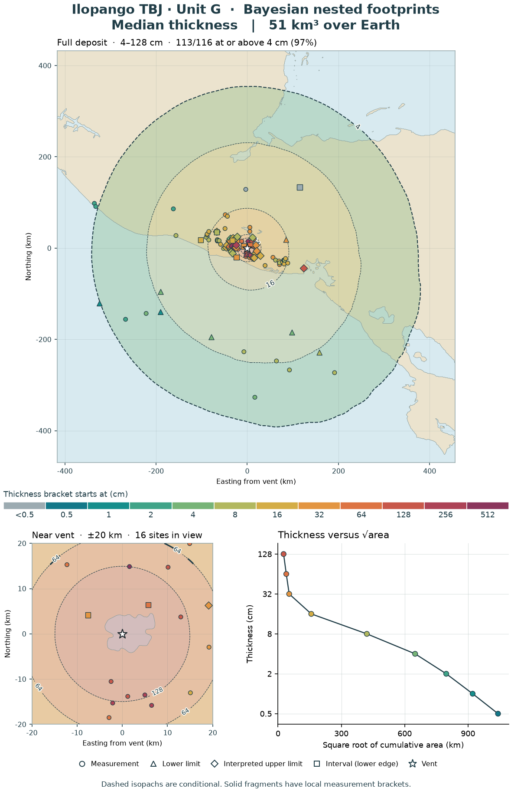

# Ilopango Unit G · 116-locality nested footprints

[Edition history](../README.md) · [Current case](../../../eruptions/ilopango-tbj/README.md)

The principal bulk volume is **51 km³**, the whole-Earth integral of the median-thickness map. The conditional thickness-band range is **35.4–99.6 km³**. Its endpoints integrate the pointwise 25th and 75th percentiles of latent thickness over Earth. **Numerical warning on the fitted deposit distribution.**

Each circle shows a measurement. Each bounded site is scored as its stated inequality or finite interval. The curve counts every patch at or above each thickness. The 4 cm footprint includes 113 of 116 modeled locations. The thickest displayed line is 128 cm and encloses 6 fitted locations. The volume includes fallout beyond the displayed contours. [Median thickness grid](median-grid.npz) · [Thickness and cumulative area](thickness-area.csv) · [Map integral, resolution and source hashes](deposit.json)

The fitted model predicts the four buffered geographic groups with an equal-group negative log score of 1.589. 4 of four independent deletion fits passed their numerical checks.

Each deposit draw expands one or more dispersal footprints. Stations enter through their thickness evidence. The direction and extent of each phase are inferred jointly with the area–thickness curve.

[Joint fit, structural sensitivities and numerical checks](footprints/report.json) · [Held-out predictions](footprints/heldout.csv.gz) · [Contour support and all rejection reasons](footprints/support.json.gz) · [Archive-site predictions](footprints/archive-probes.json) · [Volume and observations by compass sector](footprints/sector-volumes.csv)

## Geographic support and extrapolation

Across draws, the median volume share inside the first measured area rank is 1.4%. The median share outside the last positive rank is 19.8%, with a conditional 95% range of 2.7%–82.9%. A measured site can constrain one part of a perimeter while its opposite side remains unsampled.

The shared geographic screen accepts a complete contour band under 0 of 3 policies.

[Sector-by-sector evidence and volume](footprints/sector-volumes.csv) · [Volume sensitivity to the priors](footprints/report.json) · [Complete contour decisions](footprints/support.json.gz)

## What the new field evidence changes

The fit uses **74 point readings, 27 upper bounds, 7 lower bounds and 8 finite intervals**. The eight intervals enter as the probability between their two endpoints. The 95% interval across whole-deposit draws is **34.0–684 km³**, with median **69.3 km³**. The map integrates to **51.0 km³**. A median taken at each map cell and a median taken across integrated deposits answer different questions. The independent map integration and grid checks passed. The independent particle populations in the full fit still disagreed at the enlarged budget of 12,288 particles per population. Both attempts are preserved. [Volume draws and prior sensitivities](footprints/report.json) · [Map integration](deposit.json) · [Initial fit attempts](attempts/initial)

The 95% predictive intervals contained 65 of 74 held-out point readings (87.8%). Local predictive failures matter even with four numerically successful folds. Lake Yojoa reports 0.2–0.3 cm. The principal field predicts a local median of 10.6 cm there, and the geographic holdout assigns just **0.081%** probability to the observed interval. At Cerro El Carmen the held-out probability of 110–180 cm is **2.15%**. These probabilities depend on the width of each reported range. [All eight interval predictions](interval-validation.csv) · [All 116 withheld records](footprints/heldout.csv.gz)

An independent full-data refit using 80 observations omits Kitamura’s 34 additional field sites, the El Trapiche excavation and the Cerro El Carmen section. Its median map integrates to **50.7 km³**, close to 51.0 km³, but the spatial response is substantial. Along the Yojoa bearing, the modelled 1 mm crossing shifts from **451 to 720 km** and the site median from **6.0 to 10.6 cm**. On the eastern K09-46 bearing the crossing moves from **1,023 to 926 km**. Both full fits have numerical warnings. The 1 mm crossings and the outer tail depend on the continuation assumptions. [Matched transects and posterior quantiles](independent-refit.csv) · [Reduced input, fitted draws and run identity](without-later-surveys)

Separate one-at-a-time checks cover the ambiguous F/G contacts, capped zeros, land and marine map registration, regional site codes, western lakes, disputed eastern thickness, archaeological sites and marine transfers. Removing the three anonymous offshore sites moves the median across whole-deposit draws from 69.3 to **60.5 km³**. Removing the entire marine group or the Kitamura survey exhausted the effective-sample criterion for reweighting. Those rows have blank alternative estimates. The independent reduced-data refit above provides a direct check on the later group of field additions. [Site-group diagnostics and effective sample sizes](field-sensitivity.csv) · [Predictions at five archive queries](archive-predictions.csv) · [Geological decisions and primary references](../../../data/audits/Ilopango-TBJ/reaudit/README.md)

Reproduce the numerical audit with `python -m benchmarks.ilopango_nested_review --verify`. This edition runs the principal nested family. The shared-site five-family comparison retains its 56-row input and original estimates. [Comparison and history](../../../eruptions/ilopango-tbj/README.md)
