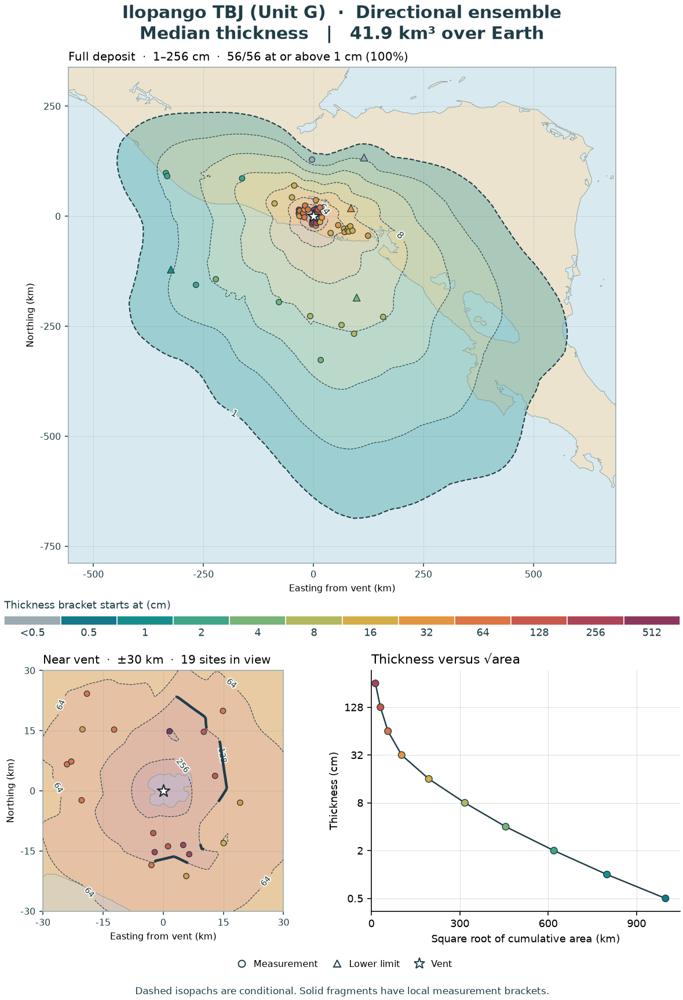
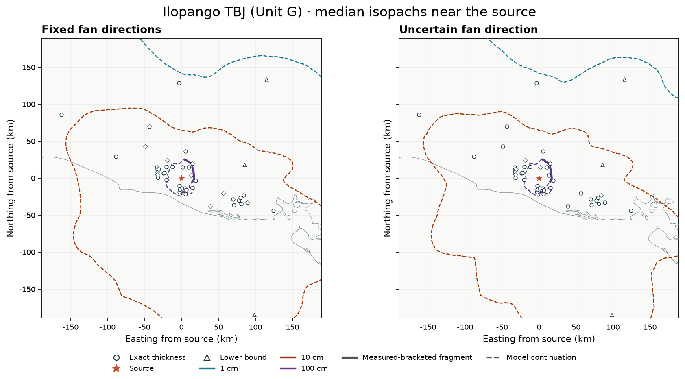
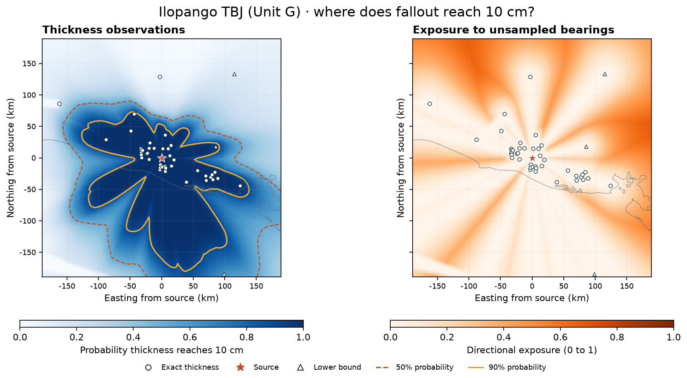

# Ilopango TBJ (Unit G) · Directional ensemble

The principal bulk volume is **41.9 km³**, the whole-Earth integral of the median-thickness map. The conditional thickness-band range is **25.4–77.4 km³**. Its endpoints integrate the pointwise 25th and 75th percentiles of latent thickness over Earth.

Each circle shows a measurement. Bounded sites take the colour of their stated limit. The curve counts every patch at or above each thickness. The 1 cm footprint includes 56 of 56 modeled locations. The thickest displayed line is 256 cm and encloses 1 fitted locations. The volume includes fallout beyond the displayed contours. [Median thickness grid](median-grid.npz) · [Thickness and cumulative area](thickness-area.csv) · [Map integral, resolution and source hashes](deposit.json)

The principal map uses the geographic continuation evaluated on all registered eruptions. [Geographic holdouts, structural alternatives and numerical checks](extent/report.json) · [Complete contour decisions](extent/support.json.gz) · [Predictions at withheld observations](extent/heldout.csv.gz)

## Earlier continuation and its diagnostics

The following figures and statistics describe the fitted parent and its broader continuation. The principal estimate and its interval appear above.

## Reach from the volcano

Distances are great-circle kilometres to the first outward crossing on each compass ray. The area columns give the entire 10 cm footprint in the corresponding 45° sector, including detached areas. Together they distinguish a long point on a contour from an entire broad lobe.

| Bearing | Fixed 10 cm reach (km) | Uncertain 10 cm reach (km) | Fixed ≥10 cm area (km²) | Uncertain ≥10 cm area (km²) |
|---|---:|---:|---:|---:|
| N | 65.0 | 65.0 | 1,889 | 1,840 |
| NE | 87.5 | 87.9 | 3,095 | 2,773 |
| E | 139.3 | 115.6 | 11,383 | 8,473 |
| SE | 231.7 | 216.5 | 22,506 | 18,953 |
| S | 213.5 | 212.9 | 17,752 | 17,258 |
| SW | 162.3 | 148.7 | 10,952 | 10,075 |
| W | 140.8 | 129.2 | 8,568 | 8,158 |
| NW | 131.7 | 121.2 | 6,963 | 6,430 |

The 50% and 90% probability lines answer different questions. At a location on the 90% line, nine in ten model draws reach 10 cm. These are pointwise probabilities conditional on the model. Joint confidence over an entire region requires a different calculation.

## Withheld observations

Each row averages negative log predictive scores over equally weighted folds. Lower scores predict the withheld thicknesses and limits better. The passing-only columns exclude numerical failures. Coverage counts exact withheld thicknesses inside the uncertain-direction 95% predictive interval. A dash marks an unavailable score or coverage.

| Deletion | All estimable folds | Fixed | Uncertain | Passing folds | Fixed, passing | Uncertain, passing | Exact-site 95% coverage |
|---|---:|---:|---:|---:|---:|---:|---:|
| Geographic regions | 4 | 1.491 | 1.528 | 4 | 1.491 | 1.528 | 48/52 (92.3%) |
| Source quadrants | 4 | 1.417 | 1.532 | 3 | 1.456 | 1.527 | 51/52 (98.1%) |

[Predictions for every estimable held-out site](azimuth/heldout.csv). The numerical record includes all planned folds, row identities, unscorable directions, fit warnings and phase-integration checks.

## Checks and reproducibility

The shared contour audit found eligible bands under none of the screened support policies. Audit status is completed. [All contour decisions and deletion failures](azimuth/complete-contour-audit.json)

The spatial integration check passed at 8,192 points per scramble. The map used up to 128 posterior draws per chain and structure. Resolved contour areas passed the split-packet check. The joint-volume quantiles passed the split check.

All six full fits passed their sampling diagnostics.

[Numerical report, all sector volumes and sensitivities](azimuth/report.json) · [Complete fields and per-field volumes](azimuth/fields.npz) · [Principal map grids](azimuth/median-grids.npz) · [Near-source comparison grids](azimuth/map-grid.npz) · [Fragment decisions](azimuth/fragment-decisions.csv) · [Bracketed coordinates](azimuth/bracketed-fragments.csv) · [File hashes](azimuth/artifacts.json)

## Related directional studies

- [Earlier fixed-direction ensemble and its separate calibration](ensemble/README.md)
- [Single-structure and proximal-cap sensitivities](single-structure/README.md)
- [Measured-fan continuation and inspected-site evidence](bearing/README.md)
