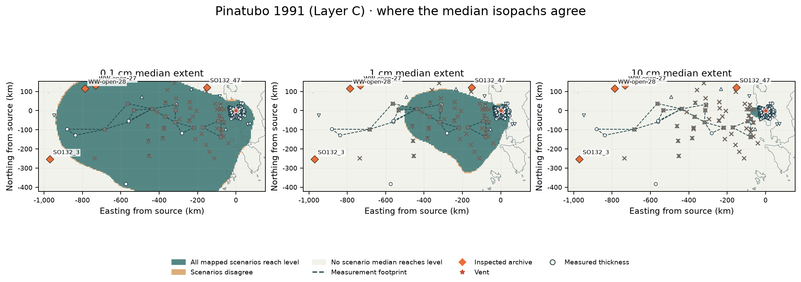
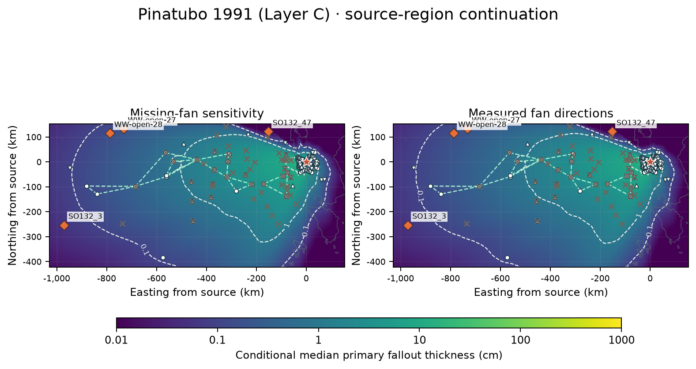
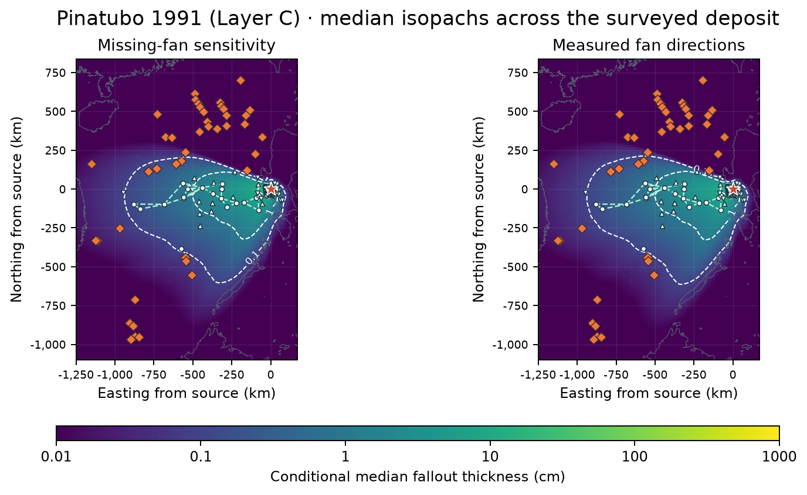
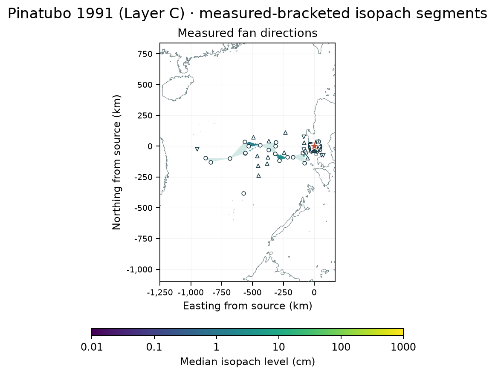

# Pinatubo 1991 (Layer C) directional continuation

The median of the ensemble using measured fan directions integrates to **6.8 km³ of bulk fallout**. Angular reach varies across extrapolation assumptions. Changing reach alone preserves the field inside measured triangles. Conditioning on archive evidence can update the fitted thicknesses. A hypothetical extra fan in the largest sampling gap remains a separate structural sensitivity.

Each panel compares the same thickness level across the mapped scenarios. Ochre marks locations where changing the assumptions changes which side of an isopach the site occupies. The dashed outline encloses the measured interpolation footprint. The diamond marks an inspected archive where one is available. A scenario median below a level still permits ash at that site.

The colour scale is shared across panels. Values below 0.01 cm share the lowest colour. Diamonds mark inspected archives. The full-deposit integrals extend beyond the displayed survey area through the antipode.

Each segment lies inside an accepted interpolation triangle with measurements on both sides of the level and at least 90% conditional probability that the level crosses its nodes. Gaps and disconnected patches remain. Candidate narrow rays in the full-field panels can extend beyond the station that fixes their bearing. Only the segments here passed the local bracketing test.

| Continuation | Integral of median map (km³) | Conditional 95% volume interval (km³) | Numerical checks |
|---|---:|---:|---|
| Measured fan directions | 6.79 | 5.9–11.0 | 4 member diagnostics |

### Bulk volume of the median map by direction

Each entry is km³ in a 45° sector centred on the named bearing from the vent.

| Continuation | N | NE | E | SE | S | SW | W | NW |
|---|---:|---:|---:|---:|---:|---:|---:|---:|
| Measured fan directions | 0.0419 | 0.0473 | 0.0661 | 0.114 | 0.594 | 2.29 | 3.46 | 0.184 |

The sector volumes sum through the antipode and include extrapolated proximal, unsampled and distal fallout. The conditional intervals integrate individual deposits. The sector draws are retained for each fitted deposit. Agreement among medians cannot establish an observation-supported closed band.

**Measured fan directions** scored geographic 1.566, quadrants 1.517. Geographic sampling warnings occurred in 1. The shared screen accepted 0 complete bands across its policies. [Geographic and directional folds](quantitative/validation.json) · [Contour decisions](quantitative/complete-contour-audit.json)

## Reproducible results

- [Measured fan directions](quantitative/result.json) · [Median field packet](quantitative/map-fields.npz) · [Complete-field sector draws](quantitative/sector-draws.npz)

[Map design](map-design.json) · [Numerical map grids](grids-log10-cm.npz)
