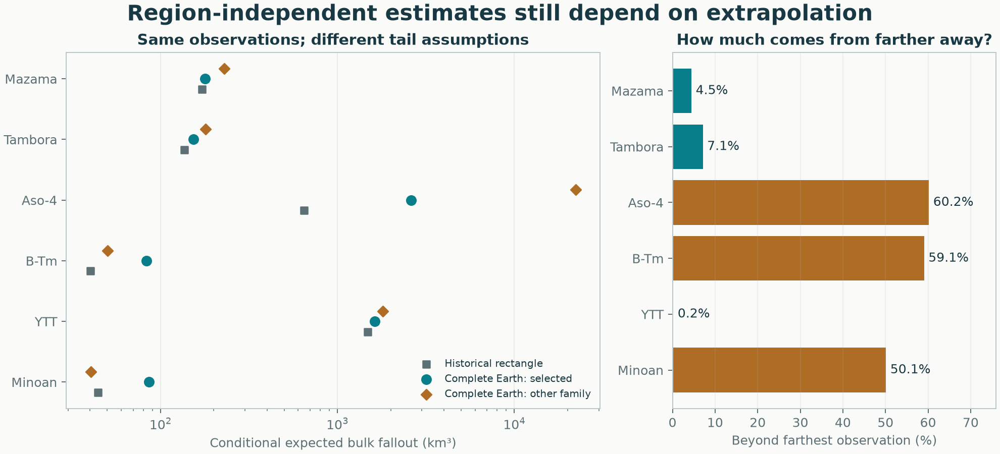

# Complete-Earth fallout volumes: all six eruptions

**The primary volume calculation no longer depends on an arbitrary rectangle.** Version 0.7 integrates the fitted fallout field over the complete WGS84 Earth, using the exact equal-area projection domain. Changing `--bounds`, map extent or contour levels cannot change that integral. Regional calculations remain separately labelled diagnostics.

**This removes a numerical-domain choice; it does not establish reliable global extrapolation.** Minoan, Aso-4 and B-Tm place half or more of their selected global expected volume beyond the farthest observation. Their totals remain strongly dependent on the assumed tails. No global probability interval is estimated.

[Method and derivation](../../../docs/methods/global-volume.md) · [All numerical comparisons](comparison.csv) · [Geographic deletion results](geographic_deletions.json) · [Known-truth trials](synthetic.json) · [Verification](validation.json) · [Recorded decision](method_decision.json)



## Selected-model results

All values below are **conditional expected bulk fallout**, in km³. The other-family column is a different fitted tail integrated over the same complete Earth; it is not an uncertainty bound. Accepted observations and fitted models are unchanged by this integration revision.

| Eruption | Historical rectangle | Complete Earth | Other tail family, complete Earth | Beyond farthest observation |
|---|---:|---:|---:|---:|
| [Mazama](../../../eruptions/mazama/README.md) | 171.7 | **178.2** | 229.7 | 4.5% |
| [Tambora](../../../eruptions/tambora/README.md) | 136.3 | **153.5** | 180.0 | 7.1% |
| [Aso-4](../../../eruptions/aso-4/README.md) | 646.5 | **2,609.3** | 22,291.7 | 60.2% |
| [B-Tm](../../../eruptions/b-tm/README.md) | 40.1 | **83.5** | 50.2 | 59.1% |
| [YTT](../../../eruptions/ytt/README.md) | 1,481.3 | **1,624.8** | 1,802.9 | 0.2% |
| [Minoan](../../../eruptions/minoan/README.md) | 44.2 | **86.1** | 40.3 | 50.1% |

The latest YTT principal selection contains **46 observations**, including reviewed Maninjau and U1445B records. Minoan remains **one combined field for all Plinian and co-ignimbrite fallout fans**, with 92 exact measurements and nine lower bounds. Identified turbidites remain excluded. Source audits and historical calculations are preserved.

Aso-4 is especially unresolved: the two tail families disagree by a factor of about 8.5, and selected-method nominal 95% observation coverage is only 79.3%. Its global number should not be treated as an established eruption volume. Minoan's 86.1 versus 40.3 km³ disagreement likewise prevents a precise global-volume claim. The paper's combined bulk-fallout range, 47.8–55.5 km³, shares source observations and is not independent validation. The source study's total-eruption DRE headline includes different products and units. [Karstens et al. (2023)](https://doi.org/10.1038/s41467-023-38176-3).

YTT's small beyond-farthest fraction does not show that its sampled footprint is complete: its most distant observation is far away, while many directions remain unsampled. Removing geographic groups raises its fitted global volume substantially. Distance-based tail accounting is one diagnostic, not a coverage map or accuracy guarantee.

## Data and model sensitivity

Both single-GP `selected` and experimental `stacked` methods were rerun on the same inputs and geographic folds. Their global totals are:

| Eruption | Selected, km³ | Stacked, km³ | Four geographic-deletion/refit totals, km³ |
|---|---:|---:|---:|
| Mazama | 178.2 | 218.1 | 162.9–315.9 |
| Tambora | 153.5 | 155.3 | 138.4–257.4 |
| Aso-4 | 2,609.3 | 2,618.8 | 1,379.5–3,582.4 |
| B-Tm | 83.5 | 81.6 | 47.7–102.4 |
| YTT | 1,624.8 | 1,624.8 | 1,671.4–4,164.5 |
| Minoan | 86.1 | 81.3 | 59.0–92.8 |

Each deletion removes one outer geographic group and its configured buffer, then refits using the candidate chosen inside that training set. These ranges measure sensitivity to available observations and model selection. **They are not confidence intervals.** The mixture integrates component expectations correctly; it is never replaced by a Gaussian with matching log moments.

The integration revision leaves all six selected fitted models and their common held-out predictions/scores unchanged. The selected-GP default is retained, with both methods published. No family is chosen because its volume is closer to a preferred number. The new default concerns the physical integration domain, not a claim that predictive accuracy has improved.

## Why the integral is independent of the calculation region

The complete Earth occupies a known ellipse in the existing ellipsoidal Lambert azimuthal equal-area coordinates. Integrating that ellipse covers the physical surface exactly once. An infinite flat plane would include locations that have no corresponding point on Earth. Near-critical power-law tails can assign enormous volume to those fictitious distances; the analytic infinite-plane background diagnostic is retained in JSON to expose this problem, rather than being called fallout volume.

Positive quadrature integrates all angles and radii. Two consecutive refinements must agree to 0.1% for expected and median-surface totals and annular contributions, followed by a shifted-angle check. All 12 main fits, their alternative-family integrals and the 24 geographic-deletion integrals pass. Numerical tolerance is not geological uncertainty. The median-surface integral is also not the median of random total volume.

The complete-Earth domain fixes the geographic endpoint. The existing trend and covariance remain a global extrapolation assumption; they are not an atmospheric transport model. In particular, far-field projection distortion, preservation and unobserved deposit structure remain unresolved. Other eruption products and DRE require separate evidence. Regional simulation intervals are explicitly kept regional and are never attached to the new global estimate.

## Known-truth experiments and verification

Thirty synthetic fits use ten seeds each for a smooth deposit, a secondary lobe and a missing sampled sector. The true global integral is evaluated at tighter numerical tolerance. Mean relative errors of the fitted global expectation are **+6.9%, +15.4% and −21.9%**, respectively. Individual errors range from −3.3% to +31.0% for the smooth case, −11.6% to +59.2% with a secondary lobe, and −30.7% to −14.6% when its sector is unsampled. The missing-lobe failure is retained: integration cannot recover data that were never collected.

**69 tests passed**, including independent WGS84 area/projection checks, analytic uniform/exponential/critical-power integrals, mixture expectations, numerical-failure handling and changing CLI rectangles while obtaining exactly the same global result. The existing four-eruption and 30-trial empirical benchmark reproduces its earlier numerical arrays exactly. A clean installed package was checked outside the checkout. Report source hashes match the published code; figures and links were checked. See the [verification record](validation.json).

```sh
python -m pip install '.[test]'
python -m benchmarks.global_fallout --output results/global-fallout
python -m pytest -q
```

Use a fresh output directory. Each eruption now has `global/selected/` and `global/stacked/` reports with maps, numerical records, GIS contours and tables. Earlier summaries are preserved as `REGIONAL_REPORT.md`, with their original artifacts and source discussion. Future uploaded eruptions automatically receive the global integral through the ordinary calculation command.
