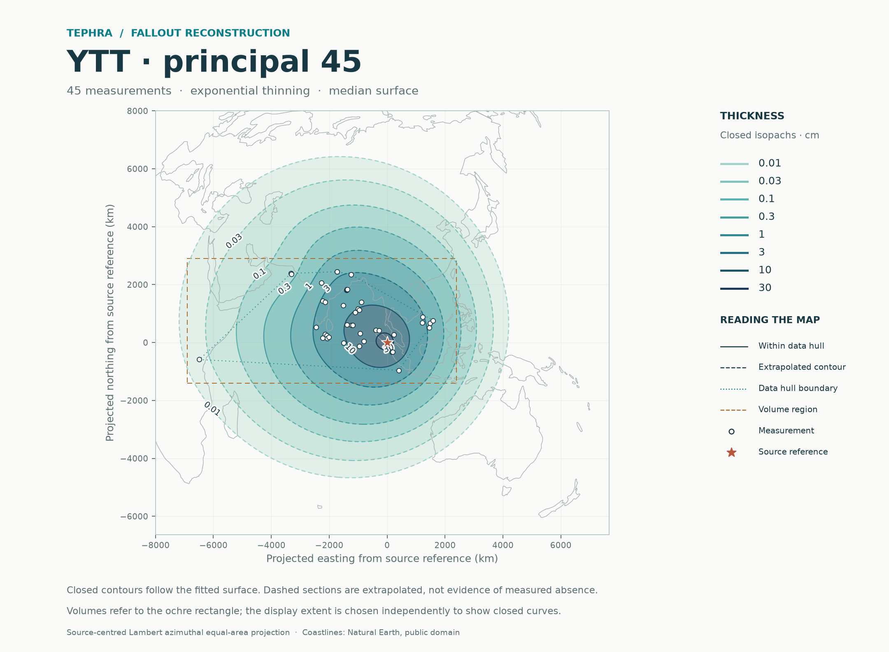
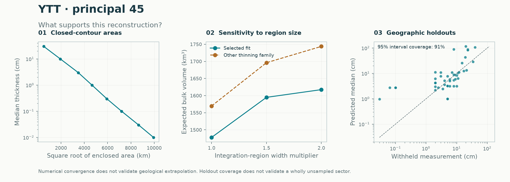

# YTT: principal dataset including Maninjau

**The principal input now includes 45 thickness records, including Maninjau A40 and A64 at approximately 23 cm each.** They are documented primary YTT airfall beds. Their coordinates remain approximate and explicitly qualified. Inclusion follows the geological evidence and the 2026-11-03 selection revision; it is not chosen to improve a model score or reproduce a target volume.

The expected regional bulk-fallout estimate is **1,477.9 km³**, compared with 1,502.3 km³ when both Maninjau records are omitted: a **1.6% decrease**. The original 43-record dataset is now the exclusion sensitivity. These are finite-region bulk-deposit estimates, not total erupted volumes or dense-rock equivalents.

[Principal input and source audit](../../../../../data/audits/YTT/README.md) · [Main calculation](main45_selected/README.md) · [Ensemble comparison](main45_stacked/README.md) · [Selection and method record](method_decision.json) · [Earlier 43-record report](../2026-11-02/README.md)



## Why Maninjau belongs in the principal input

The inherited audit records approximately 0.23 m of primary silicic airfall at sections A40 and A64 beneath younger Maninjau flow deposits, with glass correlated with YTT. It cites Alloway et al. (2004), section 3.3 and Figs. 2–3. The [paper's publisher abstract](https://doi.org/10.1016/j.epsl.2004.08.014) independently confirms the two underlying beds' correlation with YTT. These are preserved fallout thicknesses with a documented attribution, not invented pseudo-data.

The former exclusion concerned unresolved section positions. A40 retains the approximate workbook coordinate 100.5377° E, −0.3362° N, and A64 retains 100.3013° E, −0.3157° N. Their displayed decimal places do not imply surveyed precision. **Coordinate uncertainty is not propagated in the present intervals**, and the primary-source positions still need verification. This qualification remains in the audit and numerical reports. No location distribution or measurement-error standard deviation is invented.

The unchanged original workbook still has blank `fit_cm` entries for these two records. The [provenance revision](../../../../../data/audits/YTT/provenance.json) records their explicit inclusion, and the [88-row manifest](../../../../../data/audits/YTT/selection_manifest.csv) preserves all original evidence and adds current principal/sensitivity memberships. All other thickness decisions remain as before, including the exclusions of assumed Malawi and Huguangyan values.

## Recalculated results and sensitivities

Every run uses the same equal-area rectangle: easting −6,900 to 2,400 km and northing −1,400 to 2,900 km from the supplied Toba reference. It is a comparison region, not an observed deposit boundary.

| Input / method | Records | Expected regional bulk, km³ | Median-surface integral, km³ |
|---|---:|---:|---:|
| [Principal, selected](main45_selected/README.md) | 45 | **1,477.9** | 1,313.1 |
| [Principal, stacked](main45_stacked/README.md) | 45 | 1,477.9 | 1,313.1 |
| [Omit Maninjau, selected](without_maninjau43_selected/README.md) | 43 | 1,502.3 | 1,313.9 |
| [Omit five MD161 additions, retain Maninjau](no_md16140_selected/README.md) | 40 | 1,465.9 | 1,299.8 |

About **19.3%** of expected principal-region volume lies outside the observation hull. Doubling both region widths increases the estimate to **1,617.5 km³**. The last numerical refinement changes the main integral by 0.013%, meeting the 0.5% criterion. These numerical and selection sensitivities do not capture all preservation, source-position or far-field uncertainty. The integral of the median thickness surface is not the median of total random volume.

## Updated method comparison

Both principal methods use the same 45 observations, four outer geographic folds, three inner folds and a 50 km buffer. The two Maninjau sections are withheld together in fold 2. Final all-data weights are not used to score held-out observations.

| Geographic holdout metric | Selected | Stacked |
|---|---:|---:|
| Negative log score; lower is better | 2.641 | **2.037** |
| Equal-region negative log score | 2.671 | **2.053** |
| Natural-log RMSE | 1.336 | **1.270** |
| Nominal 95% observation coverage | 41/45 (91.1%) | 41/45 (91.1%) |
| Mean interval width, natural-log cm | 4.550 | 4.677 |

The ensemble performs better on predictive score and point error for this revised input, with slightly wider intervals and unchanged coverage. This differs from the former 43-record comparison. Adding observations changes the geographic partition and the training fits, so the two dataset versions' scores are not a matched test of whether Maninjau inclusion improves accuracy. Inclusion rests on geological evidence.

This dataset-selection revision keeps the established `selected` default. It does not establish a general method replacement across eruptions. For the final all-data fit, the ensemble assigns 100% weight to the same exponential component selected by the established method; fitted coefficients and expected-thickness grids agree. Their principal volumes are therefore identical. Differences in joint Monte Carlo quantiles reflect sampling paths. The ensemble's extra discrepancy adjustment worsens its score to 2.189 and remains diagnostic.

[All metrics](comparison.csv) · [Every held-out site](site_holdouts.csv) · [Geographic folds](fold_comparison.csv)



The selected model still misses the same four western thin records: Lake Chala, SO130-284KL, SO130-289KL and SO130-287KL. Its held-out Maninjau medians are about 83 and 88 cm against the observed approximately 23 cm, with broad intervals of approximately 4–1,680 and 4–1,794 cm. Covering those observations is not precise prediction. All uncertainties remain conditional on fitted trend/covariance and do not integrate parameter or location uncertainty.

## Reproduce

```sh
python -m pip install '.[test]'
python -m benchmarks.ytt --output results/ytt
python -m pytest -q
```

Use a new output directory. The benchmark verifies the original workbook, manifest and all current/historical input checksums, then runs the four calculations above. `tephra-isopachs fit YTT` now resolves the principal 45-record input. Settings remain 4 outer/3 inner folds, 50 km buffer, 128×128 prediction grid, 481×481 contour grid, 48×48 joint-volume grid, 1,500 draws, seed 1729 and an 8,000 km map limit.

Each run records its input, source-code and benchmark hashes, environment, model settings and held-out predictions. Compact reports include maps, numerical JSON, GIS contours and observation/volume/area tables. The original workbook and all earlier scientific report folders are preserved. **All 51 automated tests pass**, including exact reconstruction of the revised input selections and unchanged fitting of the historical 43-record input.
