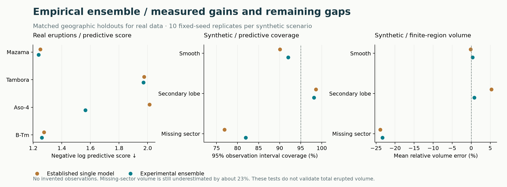

# GP ensemble development benchmark

[Validation catalogue](../../../docs/validation/README.md) · [Method and interpretation](../../../docs/methods/gp-ensemble.md)

These are the historical four-eruption and 30-trial **Gaussian-process selected-versus-stacked** comparisons. They are not cubic-spline eruption reports and do not include the later audited YTT/Minoan applications.

- [Complete numerical record](benchmark.json)
- [Real-eruption comparison](real_comparison.csv)
- [Synthetic comparison](synthetic_comparison.csv)

Files retain their original numerical contents and provenance. Reproduce the experiment with `python -m benchmarks.empirical --output results/empirical --repeats 10`; the output records the code version used for that new run.
