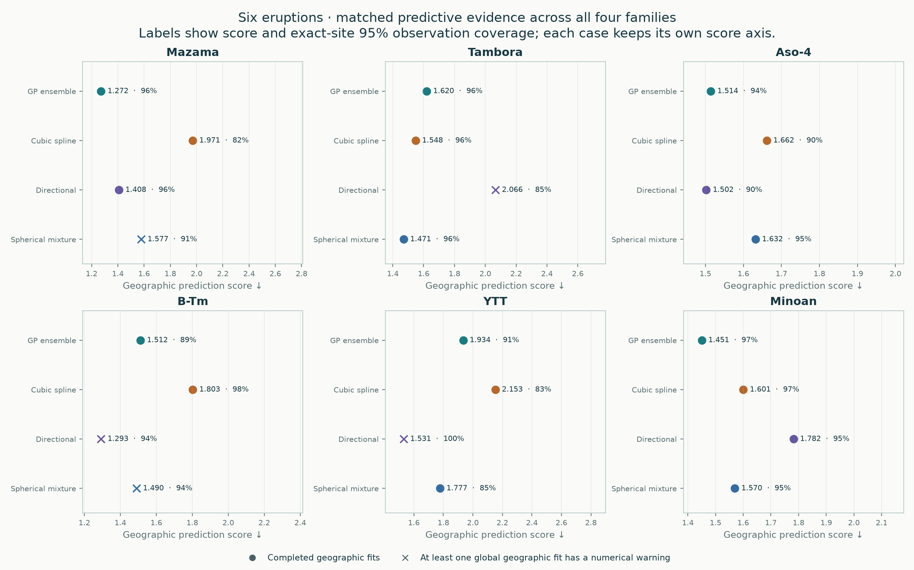

# How well do the four methods predict fallout?

The figure compares predictions in withheld geographic regions across the six eruptions, including the audited B-Tm input. The directional row shows uncertain fan direction. Each region has equal weight. A lower score means better prediction. Percentages show how often a 95% predictive interval covered an exact held-out thickness. A cross flags a numerical warning or incomplete scoring.

## Find a comparison

| Question | Study |
|---|---|
| How much of an isopach in an unsampled direction is extrapolated? | [Uncertain azimuth, measured contour fragments and hidden-lobe tests](azimuth-continuation/README.md) |
| How much does the regional volume depend on interpolation inside the same hull? | [GP ensemble and cubic spline](regional/README.md) |
| How well do directional fans predict held-out thickness and recover known simulated volumes? | [Six-structure ensemble](directional-ensemble/README.md) · [Single-structure sensitivities](directional/README.md) |
| How well does fallout continue into an unsampled direction? | [Measured-fan and possible-missing-fan holdouts](bearing-continuation/README.md) |
| How sensitive is spherical-mixture volume to the fan geometry and priors? | [Whole-Earth posterior and prior refits](spherical-mixture/README.md) · [Source-geometry experiment](source-revision/README.md) |
| Where do observations support a contour or a partial volume? | [Local support and geographic deletions](support/README.md) |

The earlier fixed-direction ensemble’s conditional volume intervals covered the known total in 7 of 14 simulated trials. It missed the larger hidden-fan total in both trials that allowed one. Real-eruption totals are unknown. Each study identifies the measurements it used. Several original comparisons used the previous 84-record B-Tm selection. [Known-deposit trials](directional-ensemble/README.md#known-deposits-and-unseen-fans)

For a result tied to an individual eruption, start with its case. B-Tm links its current source audit and tests of disputed thicknesses. Aso-4 links its marine-site and influence study. [Eruption catalogue](../eruptions/README.md)
