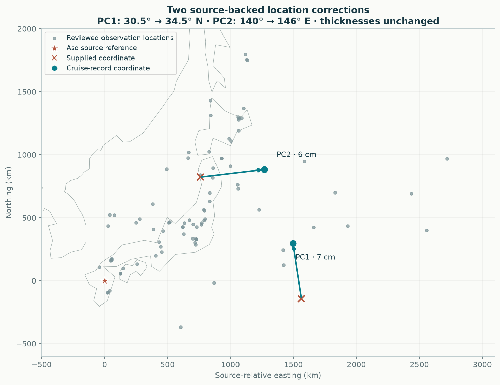
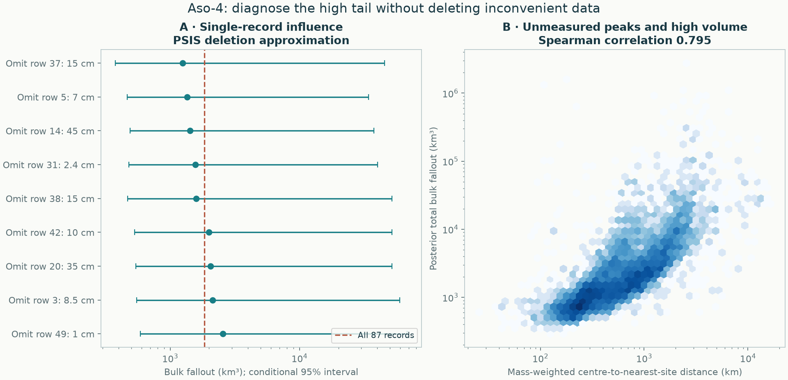
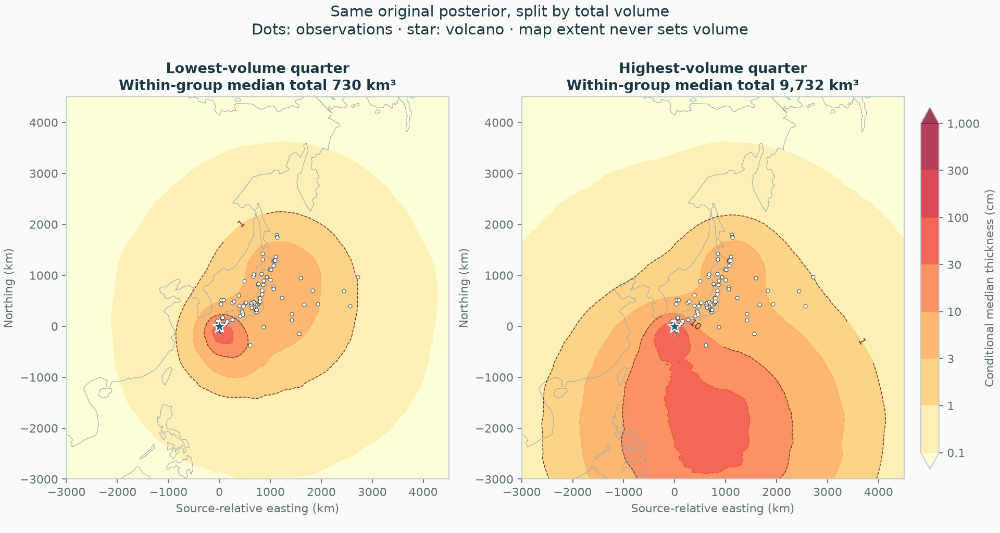
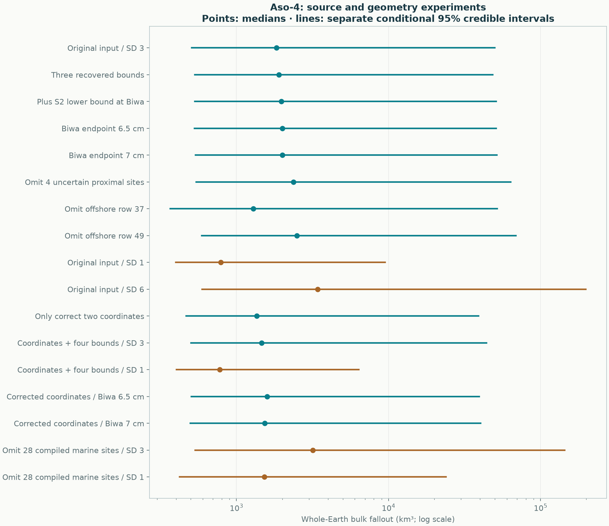
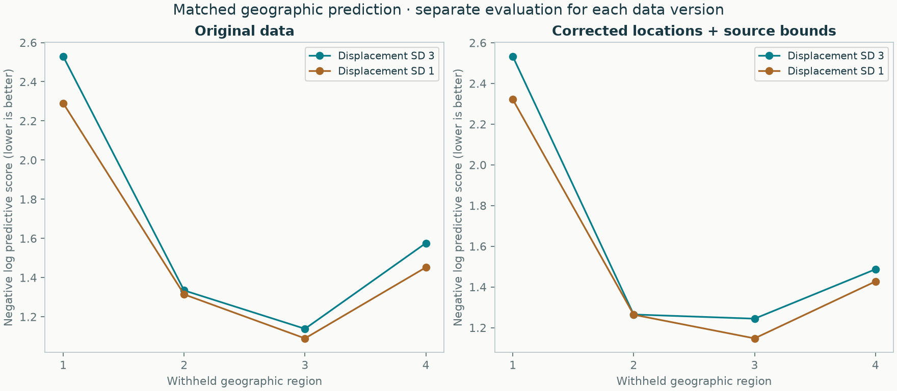

# Aso-4: source errors, marine observations and the high-volume tail

[Current eruption report](../../eruptions/aso-4/README.md) · [Source audit and primary references](../../data/audits/Aso-4/README.md) · [Global calculation](../../eruptions/aso-4/results/global/README.md) · [Earlier geometry experiments](../source-revision/README.md)

**Two large coordinate errors are corrected. The global volume remains weakly constrained.** The source-qualified reference scenario gives **1,466 km³**, with a **501–44,173 km³ conditional 95% credible interval**. A tighter, separately tested fan-position prior gives **777 km³ [403–6,382]** and better geographic predictions. It remains a development alternative: neither model has independently validated the missing global mass, and neither interval automatically includes unknown marine redistribution.

The accepted input is now [Aso-4_reviewed.csv](../../data/eruptions/Aso-4_reviewed.csv). The [original input](../../data/eruptions/Aso-4_tephra.csv) and [required pre-audit reference](reference/README.md) remain unchanged scientific records. The reference retains the existing geometry prior so that source corrections are not conflated with choosing a lower-volume prior. All other eruptions' case artifacts are unchanged.

## What the source audit changed

52 of 87 quantitative records trace to Takarada & Hoshizumi's **published Table S2**. The audit recovered its original workbook, matched every one of those rows, and checked key primary tables and cruise records. The other 19 S2 occurrences lack quantitative thicknesses. The remaining 35 observations come from separately supplied citations and are not all independently verified here.

MR00-K05 PC1 was placed at **30.5° N instead of 34.5° N**; PC2 at **140° E instead of 146° E**. The corrections move them approximately **444 and 512 km**, respectively. Primary ash intervals confirm their unchanged **7 and 6 cm** thicknesses. Correcting just these locations gives **1,358 [466–39,100] km³**, compared with **1,836 [507–49,960] km³** on the original data. Both use the same prior family; these are separate conditional posteriors, not paired causal effect intervals.



The reviewed reference also encodes one upper and three lower bounds. One is explicitly disputed: Table S2 reports Biwa B43-1 as `>6.7 cm`, while Danhara's primary table gives **6.5–7 cm**. Another lower bound assumes a partly eroded Hokkaido layer was not thickened through redeposition. These are qualified observation scenarios, not a claim of source certainty. Both primary-table endpoints are tested with the original coordinates and again with the corrected coordinates. No range is converted into an invented measurement standard deviation. With the corrected coordinates, the two endpoint fits give 1,592 [505–39,552] and 1,536 [496–40,377] km³; neither resolves the broad upper tail. [Every decision, caveat, source page and row](../../data/audits/Aso-4/README.md).

## What drives the high tail

The original posterior's strongest measured association with total volume is how far its mass-carrying fan centres lie from observations: **Spearman correlation 0.795**. The mass-weighted centre-to-nearest-observation distance has a median of about **236 km in the lowest-volume quarter**, compared with **1,734 km in the highest-volume quarter**. The corresponding association with the power-tail exponent is only **0.046**. These correlations diagnose this posterior; they are not a general causal decomposition.

The mechanism is an extrapolation ambiguity. In a locally planar Gaussian component,

`T(d) = 10⁵ V_component / (2π s²) × exp[−d²/(2s²)]`,

with thickness in cm, volume in km³ and distance/scale in km. A measured thickness on the flank can coexist with a much larger unseen peak as `d/s` increases. A finite Earth integral makes that volume well defined; it does not make the unseen peak observed. This equation illustrates the ambiguity; the actual inference uses normalized spherical components.





The latter panels summarize the **same original posterior**, split into its lowest and highest total-volume quarters. They are not new fitted models. Pointwise median thickness is drawn from 192 deterministically spaced fields per group; its integral is not the group's median volume. Dashed model contours do not pass the local support screen. The display extent never sets the whole-Earth total.

## Source and geometry experiments



[All estimates, including numerical status](experiments.csv) · [Matched validation and interpretation](summary.json) · [Complete experiment inputs, protocols and posterior attempts](runs/README.md).

The original-data single-record analysis uses Pareto-smoothed importance sampling, with its reliability statistics retained for all 87 records. Exact refits check the strongest downward and upward median influences. Removing the valid 15 cm offshore KH76-2-7 layer gives **1,289 [367–51,784] km³**; removing the thin 1 cm KH82-4-23 layer instead gives **2,498 [592–68,810] km³**. Their approximate deletion medians were 1,247 and 2,554 km³. The tail differences show why the approximation is a screening tool, not a substitute for these refits. Influence is not evidence that a datum is erroneous.

Removing four uncertain proximal flow/fall classifications raises the original-coordinate median to **2,364 km³**. They are not demonstrated causes of the high total. Conversely, increasing only the displacement prior SD from 3 to 6 raises it to **3,415 km³** with an upper conditional endpoint near **199,000 km³**. These tests were not used to remove inconvenient observations or select a preferred published volume.

The displacement parameter is measured in each component's scale units in the source-relative stereographic parameterization. Changing its coordinate SD from 3 to 1 discourages distant unseen component peaks while still allowing secondary maxima. It is a **stronger structural assumption**, not a pseudo-observation, a hard source-maximum constraint, or a newly measured geological fact. Every other prior and likelihood term is unchanged within each matched comparison.

## Does the tighter prior predict better?



On the original data, the equal-region negative log predictive score improves from **1.644 to 1.536**. On the reviewed data it improves from **1.632 to 1.540**, log-thickness RMSE from **1.254 to 1.201**, with the same **95.2% coverage of the exact observations**. Bounds contribute their likelihood-event scores. Both alternatives use identical observations, geographic fold assignments, buffers and training rows within each data version; all eight reviewed-data holdout fits pass numerical checks.

All four reviewed-data fold scores are numerically lower under SD 1, but one difference is only **0.0011** and should not be treated as a meaningful win. Four overlapping training-fold experiments are development evidence, not independent replication or an external global-volume validation. Original-versus-reviewed scores also use different coordinates, likelihood semantics and folds and are **not** a matched estimate of predictive improvement caused by the data corrections.

The tighter prior is therefore retained as a promising conditional alternative. We have not replaced the universal default across eruptions or declared its smaller volume more accurate. Generalizing it would require independent eruption-level validation and misspecified/hidden-mass trials. The reference global report retains all seven standard prior sensitivities, including geologically extreme outcomes from an inadequate one-fan shape; passing numerical checks does not make those totals geologically plausible.

## What about the Kuroshio hypothesis?

The user's literature lead was relevant. [Machida & Arai (1988)](https://doi.org/10.4116/jaqua.26.3_227) tentatively links sparse detected tephra near the Nankai Trough to the Kuroshio and identifies its wider depositional effects as an open question. [Ikehara (2015)](https://doi.org/10.18940/kazan.60.2_181) provides later indirect evidence from modern seabed glass distribution along the current. These findings support a possible observation-process problem; they do not quantify Aso-4 enrichment at a given core. The [source audit](../../data/audits/Aso-4/README.md#marine-transport-and-the-literature) distinguishes these statements and records the newer work checked.

Removing **all 28 explicitly submarine S2 records**, irrespective of thickness, produces:

| Reviewed-data stress test | Median bulk km³ | Conditional 95% interval km³ |
|---|---:|---:|
| Existing displacement prior, SD 3 | 3,184 | 536–143,867 |
| Tighter displacement prior, SD 1 | 1,527 | 422–23,856 |

Thus removing the marine subset raises the central estimate and widens the uncertainty under both tested priors. This does **not** prove the cores are unbiased: removal also loses spatial constraints, and 35 retained records lack independently audited settings. The 59 retained observations are not a certified terrestrial-only sample. The source-verified terrestrial Hokkaido maximum remains and cannot be explained by ocean transport.

We do not discount marine measurements by an arbitrary factor. The [mass-conserving observation-operator discussion](../../docs/methods/marine-observations.md) separates atmospheric loading, water-column transport, preservation, contamination and thickness conversion. It specifies what evidence a fitted extension would need. That transport model is **not implemented or fitted** in this release; the implemented numerical check is the explicit setting-removal experiment.

## Regional results and remaining failures

The revised GP and spline fits use the same **3,482,991 km²** observation hull. Their expected regional bulk volumes are **202.65 and 248.15 km³**, with conditional intervals **155.87–266.97** and **168.43–452.02 km³**. Their geographic scores are **1.514 and 1.662**, respectively. These are regional volumes, not independent estimates of total fallout.

Neither family has a complete supported isopach band. The standard footprint covers **711,348 km²**, with partial volumes **27.94 and 26.90 km³**. One geographic omission makes the spline partial volume reach approximately **192,882 km³** on that same footprint. The instability is retained and is a reason not to extrapolate its apparently smooth contours. [Regional maps, tuning and validation](../../eruptions/aso-4/results/README.md) · [All support/deletion failures](../../eruptions/aso-4/results/support/README.md).

## Reproduce

Install the repository environment and run from its root. Use a fresh directory in place of `results/aso-reproduction`. Every protocol records its inputs, priors, sampling settings and code hashes before its experiment set. This is a recorded development sequence, not independent preregistration. Source corrections, geometry comparisons, source-conflict endpoints and the later user-motivated marine experiment remain separate.

```sh
python -m benchmarks.aso_evidence --prepare --sources data/audits/Aso-4 --output results/aso-reproduction/study
python -m benchmarks.aso_evidence --output results/aso-reproduction/study --cases bounds_only s2_bounds primary_6p5 primary_7 omit_ambiguous omit_row37 omit_row49 offset_sd6
python -m benchmarks.aso_evidence --output results/aso-reproduction/study --cases offset_sd1 --validation
python -m benchmarks.aso_revision --prepare --ledger results/aso-reproduction/study/row-ledger.csv --output results/aso-reproduction/revision
python -m benchmarks.aso_revision --output results/aso-reproduction/revision --modes coordinate_only baseline offset_sd1
python -m benchmarks.aso_conflict --input results/aso-reproduction/revision/reviewed.csv --output results/aso-reproduction/conflict
python -m benchmarks.aso_marine --input results/aso-reproduction/revision/reviewed.csv --ledger results/aso-reproduction/study/row-ledger.csv --output results/aso-reproduction/marine
python -m benchmarks.aso_diagnosis --output results/aso-reproduction/diagnosis
python -m benchmarks.aso_evidence_report --root results/aso-reproduction --output results/aso-reproduction/summary
tephra-isopachs compare Aso-4 --output results/aso-reproduction/current-case
python -m benchmarks.verify_aso_evidence
```

The published development runs use seed **20261108**; failed numerical attempts are retained and retried under the fixed numerical policy. The ordinary case command uses its documented default seed. Reproduction on a different runtime may differ within Monte Carlo error; cached draws require matching input arrays, model hashes, priors and runtime. [Verification record](verification.json).

The artifact-verification command is read-only by default. Add `--output results/aso-reproduction/verification.json` to save a fresh check record without rewriting the published verification.
