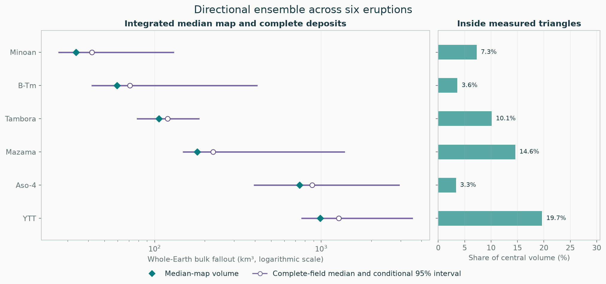

# Directional ensemble results

The directional headline is the bulk volume obtained by integrating the **pointwise median isopachs** over the Earth. A second summary gives the median and conditional 95% interval across complete simulated deposits. Each of the six combinations of fan width and gap treatment is fitted to the same accepted observations. The reported eruption contributes no holdout scores to its own predictive weights.

| Eruption | Median-map km³ | Complete-field median [95%], km³ | Median map inside measured triangles | Full structures passing | Map checks |
|---|---:|---:|---:|---:|---|
| [Mazama](../../eruptions/mazama/results/directional/ensemble/README.md) | **179.9** | 224.3 [149.1–1,371.9] | 14.6% | 6/6 | passed |
| [Tambora](../../eruptions/tambora/results/directional/ensemble/README.md) | **105.8** | 119.6 [78.6–184.0] | 10.1% | 2/6 | passed |
| [Aso-4](../../eruptions/aso-4/results/directional/ensemble/README.md) | **740.0** | 882.7 [397.5–2,931.7] | 3.3% | 6/6 | passed |
| [B-Tm](../../eruptions/b-tm/results/directional/ensemble/README.md) | **59.3** | 71.0 [42.2–410.0] | 3.6% | 6/6 | passed |
| [YTT](../../eruptions/ytt/results/directional/ensemble/README.md) | **985.7** | 1,274.1 [765.6–3,514.0] | 19.7% | 6/6 | passed |
| [Minoan](../../eruptions/minoan/results/directional/ensemble/README.md) | **33.7** | 42.0 [26.6–129.1] | 7.3% | 6/6 | passed |

These are model-conditional bulk fallout estimates. A median map can combine common features from incompatible deposits. The joint-field interval describes plausible complete-deposit volumes. Thick unmeasured source caps, hidden lobes, distal tails, reworking and preservation can sit outside it.

## Geographic thickness prediction

| Eruption | Ensemble score ↓ | Equal weights ↓ | Single reference ↓ | Exact-site 95% coverage | Geographic rows scored | All fitted geographic members passed |
|---|---:|---:|---:|---:|---:|---|
| Mazama | 1.407 | 1.413 | 1.451 | 95.6% | 45/45 | yes |
| Tambora | 1.964 | 1.979 | 1.953 | 84.6% | 26/26 | **review** |
| Aso-4 | 1.507 | 1.501 | 1.555 | 86.7% | 87/87 | yes |
| B-Tm | 1.295 | 1.297 | 1.316 | 95.2% | 84/84 | yes |
| YTT | 1.777 | 1.782 | 1.811 | 93.5% | 46/46 | **review** |
| Minoan | 1.695 | 1.684 | 1.732 | 91.3% | 101/101 | yes |

The ensemble improved the buffered geographic score over the single reference in **5/6** cases and over equal weights in **4/6**. The equal-eruption mean scores were 1.608, 1.609 and 1.636 for the weighted ensemble, equal weights and single reference respectively. These are retrospective comparisons of thickness predictions. The real eruptions have no known whole-deposit truth.

The three shared support policies produced 0 qualifying complete median-map bands across all six cases. Each case links its full rejection log and both geographic and quadrant deletion tests. The matched GP/spline real and synthetic benchmark tables reproduced byte for byte.

## Known deposits and unseen fans

| Scenario | True km³ | Median-map km³ by seed (90 / 91) | Conditional interval contains truth | All 6 fitted members passed |
|---|---:|---:|---:|---:|
| diffuse global tail | 120.0 | 108.9 / 77.8 | 1/2 | 2/2 |
| invisible sector | 33.6 | 33.7 / 33.9 | 2/2 | 0/2 |
| matched two fans | 120.0 | 120.7 / 114.7 | 2/2 | 1/2 |
| missing core | 55.7 | 37.8 / 38.4 | 0/2 | 0/2 |
| missing sector | 52.4 | 34.0 / 33.2 | 0/2 | 0/2 |
| multi lobe | 52.4 | 84.2 / 85.3 | 0/2 | 2/2 |
| smooth | 33.6 | 33.7 / 33.8 | 2/2 | 0/2 |

The primary simulated total fell within the conditional interval in **7/14** trials. The two invisible-sector trials also admit a **72.8 km³** deposit with identical observations. The same intervals covered this alternative **0/2** times. These fixed scenarios challenge the extrapolation assumptions and cannot establish nominal coverage.

Isopach accuracy was measured by the fraction of the union area shared by true and estimated exceedance sets. Each area uses full-Earth quadrature at 1, 10 and 100 cm. The table gives the median overlap over primary scenario/seed/level combinations with effective union area sample size at least 64 for both methods.

| Level | Resolved comparisons | Median ensemble overlap | Previous mean-log reference overlap |
|---|---:|---:|---:|
| 1 cm | 14 | 90.6% | 88.5% |
| 10 cm | 14 | 83.9% | 83.9% |
| 100 cm | 12 | 5.9% | 8.4% |

The machine-readable records include both indistinguishable truths, all unresolved levels and the sampler and map-integration warnings.

[Case comparison](comparison.csv) · [Known volumes](known-volumes.csv) · [Contour overlap by scenario and level](contour-accuracy.csv) · [Complete simulation records](simulation-records.json.gz) · [Verification](verification.json)

[Method and equations](../../docs/methods/directional-ensemble.md) · [Single-structure studies](../directional/README.md) · [Two global families](../global/README.md) · [Dated presentation archive](history/2026-11-18/manifest.json)
