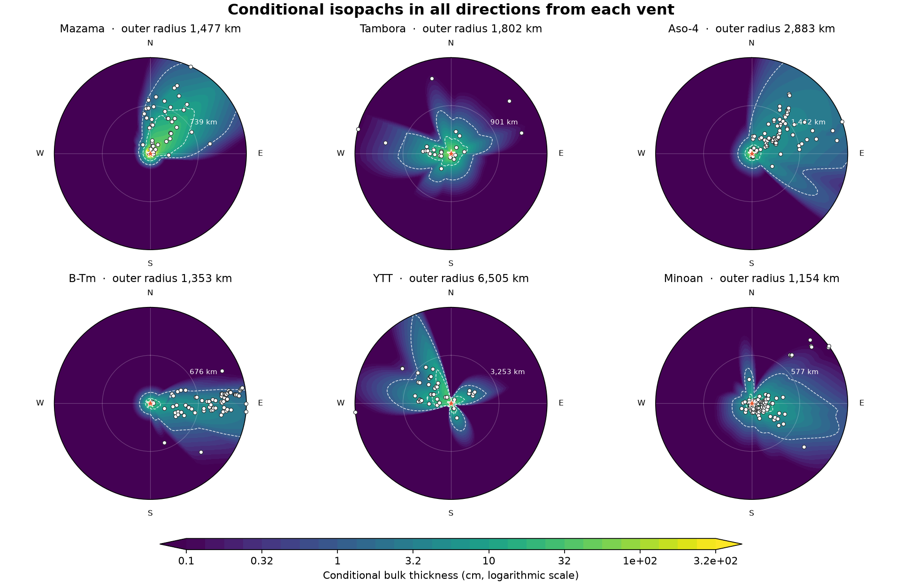
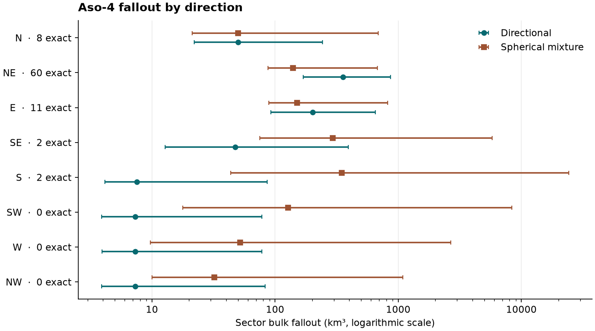
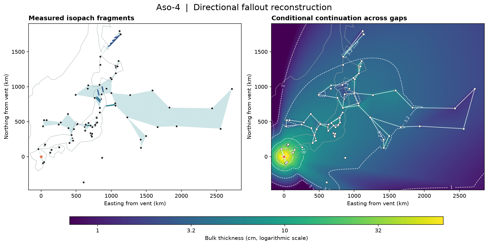

# Single-structure directional sensitivity study

This study retains the original single-structure results and their assumption tests. [Current directional ensemble, six case estimates and median-isopach checks](../directional-ensemble/README.md)

[Four-method geographic prediction comparison](../README.md) · [Map and uncertainty guide](../../docs/OUTPUTS.md)

The directional model interpolates log thickness across locally supported triangles. A positive source-centred thinning law continues across gaps. Its reach can increase towards measured bearings, with less angular spread from isolated sites. The same policies, input acceptance rules and geographic tests apply to all six eruptions. Each case report shows the data-bracketed arcs, the extrapolated field, and its volume by compass direction. [Equations and assumptions](../../docs/methods/directional-continuation.md).

| Eruption | Directional median km³ [conditional 95%] | Spherical-mixture median km³ [95%] | Inside local triangles | Geographic score, directional / spherical | 95% exact-site coverage, directional / spherical |
|---|---:|---:|---:|---:|---:|
| [Mazama](../../eruptions/mazama/results/directional/single-structure.md) | 203.3 [150.6–370.2] | 223.2 [144.7–3,668.8] | 13.5% | 1.451 / 1.577 | 91.1% / 91.1% |
| [Tambora](../../eruptions/tambora/results/directional/single-structure.md) | 112.1 [77.2–172.8] | 179.1 [112.9–1,284.2] | 9.9% | 1.953 / 1.471 | 80.8% / 96.2% |
| [Aso-4](../../eruptions/aso-4/results/directional/single-structure.md) | 743.6 [391.6–2,030.3] | 1,466.0 [501.0–44,172.9] | 3.4% | 1.555 / 1.632 | 86.7% / 95.2% |
| [B-Tm](../../eruptions/b-tm/results/directional/single-structure.md) | 61.6 [39.7–109.0] | 106.3 [53.2–2,159.2] | 3.6% | 1.316 / 1.162 | 94.0% / 92.9% |
| [YTT](../../eruptions/ytt/results/directional/single-structure.md) | 1,170.3 [848.9–1,926.9] | 1,674.2 [1,203.6–54,906.9] | 16.9% | 1.811 / 1.777 | 91.3% / 84.8% |
| [Minoan](../../eruptions/minoan/results/directional/single-structure.md) | 42.5 [26.2–126.9] | 46.0 [28.1–2,529.2] | 6.4% | 1.732 / 1.570 | 91.3% / 94.6% |

Lower scores mean better prediction of held-out thickness or a documented bound. The directional score is lower in **2/6** eruptions overall and **1/4** where both models passed sampling checks on every geographic fold. Each case report lists numerical warnings and quadrant-deletion results. These are development comparisons using four matched outer folds within each eruption. The true global volume of each real eruption remains unknown. Both global estimates are published as conditional alternatives.

The shared complete-contour screen was also run on both global families, using the same bracketing, support, resolution and four-deletion criteria as the regional peers. The directional model has a qualifying band in 0/6 cases and the spherical mixture in 0/6. Each case contains its directional decisions. The spherical packet includes all rejected levels, numerical fold flags and checksum-verified field subsets for replay. [Spherical support evidence](spherical-support/) · [Regional support evidence](../support/README.md).

These compass plots are local radial windows ending at the farthest accepted site; contours can continue outside them. Each [case report](../../eruptions/README.md) now supplies an expanded global overview, a complete local detail and a whole-Earth view.

Each circle shows all compass directions to the most distant accepted observation in that eruption. White symbols locate the observations and bounds. Dashed contours mark 1, 10 and 100 cm where present. The star marks the vent. Colours in empty sectors show the reference continuation. The circle edge is only a display limit. The bulk-volume integral continues across the whole Earth.

## Sensitivity to unmeasured fallout

The reference interval conditions on one policy. The next table compares the same 13 predeclared policies in every eruption. The endpoint range runs from the lowest 2.5th percentile to the highest 97.5th percentile among numerically passing fits. It has no joint probability attached. The individual case reports retain every fit, including failures.

| Eruption | Passing policies | Median range km³ | Endpoint range km³ | Extra missing-fan median km³ |
|---|---:|---:|---:|---:|
| Mazama | 13/13 | 180–637 | 133–1,742 | 255 |
| Tambora | 8/13 | 113–297 | 76–614 | 116 (warning) |
| Aso-4 | 13/13 | 630–1,214 | 351–3,172 | 827 |
| B-Tm | 13/13 | 50–143 | 36–556 | 82 |
| YTT | 13/13 | 909–2,688 | 696–7,367 | 1,541 |
| Minoan | 13/13 | 35–190 | 25–455 | 43 |

### A source cap invisible to the observations

Local triangles or their transition can cross the vent even when all measurements are some distance away. This additional sensitivity places a compact proximal deposit inside the nearest accepted radius, with amplitude equal to the positive difference between the fitted background and local vent thickness. Each accepted site and bound receives exactly zero addition. Its analytic volume is added to each coherent posterior field. Geographic scores use training-only cap radii and the same held-out rows.

| Eruption | Nearest site km | Median added km³ | Cap-inclusive median km³ | Geographic score with cap |
|---|---:|---:|---:|---:|
| Mazama | 24.5 | 3.38 | 208.1 | 1.451 |
| Tambora | 15.6 | 0.02 | 112.2 (warning) | 1.543 |
| Aso-4 | 88.3 | 8.16 | 756.2 | 1.555 |
| B-Tm | 2.6 | 0.00 | 61.6 | 1.316 |
| YTT | 362.0 | 90.49 | 1,336.6 | 1.811 |
| Minoan | 16.5 | 0.00 | 42.5 | 1.732 |

## Independent numerical replication

A residual divergence in the Tambora reference prompted one additional run for **every** eruption. The separate run used the same statistical model, a fresh fixed seed, 1,800 warmup iterations and 4,000 draws in each of four chains. It was executed once per eruption with the original numerical thresholds. The standard run and this check are reported separately. A similar median across runs can coexist with a sampling warning.

| Eruption | Standard reference checks | Independent median km³ [95%] | Independent checks |
|---|---|---:|---|
| Mazama | pass | 202.8 [151.1–365.6] | pass |
| Tambora | warning | 111.5 [76.4–172.3] | warning |
| Aso-4 | pass | 753.3 [385.7–2,251.9] | pass |
| B-Tm | pass | 61.4 [39.7–109.0] | pass |
| YTT | pass | 1,169.5 [843.9–1,936.8] | pass |
| Minoan | pass | 42.5 [26.2–123.0] | pass |

[Independent designs, posterior checksums, convergence and sector results](independent-replications.json.gz).

## Aso-4 and its unsampled directions

The measured distribution is highly asymmetric. SE and S each have two exact rows, W has none, and NE has 60. A 15 cm offshore layer about 709 km to the southeast provides positive evidence in that direction. It cannot determine thickness all around the vent at that radius. [Source-level decisions](../../data/audits/Aso-4/README.md).

| Aso-4 sector | Directional median km³ [95%] | Spherical-mixture median km³ [95%] | Exact rows |
|---|---:|---:|---:|
| N | 50.2 [22.0–243.1] | 49.9 [21.2–686.5] | 8 |
| NE | 356.5 [169.5–863.0] | 139.9 [87.7–675.8] | 60 |
| E | 201.1 [92.5–652.7] | 150.7 [89.1–822.3] | 11 |
| SE | 47.4 [12.8–392.1] | 294.6 [75.1–5,791.2] | 2 |
| S | 7.6 [4.2–86.3] | 348.8 [43.5–24,264.4] | 2 |
| SW | 7.3 [3.9–77.9] | 127.0 [17.8–8,354.9] | 0 |
| W | 7.3 [3.9–77.9] | 52.0 [9.7–2,672.6] | 0 |
| NW | 7.3 [3.9–83.3] | 32.1 [10.0–1,086.6] | 0 |

Together SE, S and W carry a median **9.3%** of directional volume [2.6%–39.3%], calculated by summing the same three sectors within every draw. Only **25.3 km³** lies inside the entire local footprint. The remaining mass depends on the assumed continuation, including in the northeast between scattered measurements. Allowing an extra fan in the largest distal gap gives **827 [412–2,780] km³**. Preferential sampling and marine redistribution introduce additional uncertainty.

The northeast median changes from 140 to 357 km³ and the south from 349 to 7.6 km³. The spherical-mixture sector partition uses 768 fields from its verified posterior and 4,096 integration points per component. Halving the integration points changes the Aso-4 sector fractions by up to 0.0059 in absolute fraction.

The directional rule also risks **underestimating a real off-axis fan**. When all observations from bearings 90–180° were withheld with a buffer, the most distant exact site in the southeast octant (row 37, 709 km, bearing 121.4°) had **15 cm**. The held-out median was **0.067 cm** and the 95% observation interval was **0.0003–1.95 cm**. This site is included in the full-data estimate. In the same fold the more easterly site at 91.1° had 6 cm and a predictive interval of 0.83–15.6 cm. The same position-only selections are published across all eruptions. [Outermost site by octant](octant-extremes.csv) · [Outermost site by quadrant](quadrant-extremes.csv).

## Known-volume and missing-direction tests

The matched trials reuse the exact synthetic deposits and noise seeds 10 and 11 from the spherical-mixture study. Seeds 70 and 71 generate new observations after the final model choice. Tests deliberately include secondary maxima, a missing sector, an invisible proximal cap and a diffuse far tail. The trial table retains numerical failures. The displayed comparison of median errors uses only pairs passing numerical checks in both models.

Of 12 matched trials, 5 passed for both families. Their median absolute log volume errors are **0.404** for the directional model and **0.115** for the spherical mixture. In the 12 fresh trials across the original six scenarios, 8 passed numerical checks. Their conditional intervals contained the true volume in **4/8** passing trials. These small, designed experiments measure specific failure modes.

| Scenario, fresh seeds | True km³ | Median estimates km³ | Numerically usable | Truth in interval among usable |
|---|---:|---:|---:|---:|
| smooth | 33.6 | 35.2, 37.8 | 1/2 | 0/1 |
| multi lobe | 52.4 | 89.1, 97.8 | 2/2 | 0/2 |
| missing sector | 52.4 | 37.3, 40.2 | 1/2 | 1/1 |
| missing core | 55.7 | 38.9, 39.8 | 0/2 | 0/0 |
| matched two fans | 120.0 | 138.0, 146.3 | 2/2 | 2/2 |
| diffuse global tail | 120.0 | 93.0, 84.4 | 2/2 | 1/2 |

The additional paired-truth experiment has *identical observations*: a smooth deposit of **33.6 km³**, or the same deposit with a compact lobe wholly inside the unsampled northeast, giving **72.8 km³**. The true NE sector changes from 4.2 to 43.5 km³. Each data realization yields exactly one posterior for either truth. Across 4 passing realizations, 0 intervals include the larger hidden deposit. A weakly identified lobe remains a separate structural uncertainty even when plotted isopachs look convincing.

[Complete paired results](known-volumes.csv) · [All stress-test fits, policies and retry diagnostics](known-volume-fits.json.gz) · [Development models and failures](development/README.md)

## Reproduce

~~~sh
python -m benchmarks.directional --output results/new-study --reports results/new-cases
for scenario in smooth multi_lobe missing_sector missing_core matched_two_fans diffuse_global_tail invisible_sector; do
  python -m benchmarks.directional --synthetic "$scenario" --output results/new-study
done
python -m benchmarks.regional --output results/new-regional
python -m benchmarks.directional_reference --output results/new-mixture-sectors.json
python -m benchmarks.directional_replication --runs results/new-study --output results/new-replication
python -m benchmarks.directional_spherical_support --replay comparisons/directional/spherical-support --output results/new-spherical-support
python -m benchmarks.directional_comparison --spherical-support results/new-spherical-support --runs results/new-study --cases results/new-cases --replication results/new-replication --regional results/new-regional --reference results/new-mixture-sectors.json --output results/new-comparison
~~~

The normal case command produces the complete plots, checks and report. [Case workflow](../../docs/NEW_ERUPTION.md) · [Comparison CSV](comparison.csv) · [Paired-input and regional regression checks](verification.json) · [Spherical-mixture sector estimates and quadrature refinement](spherical-mixture-sectors.json).
