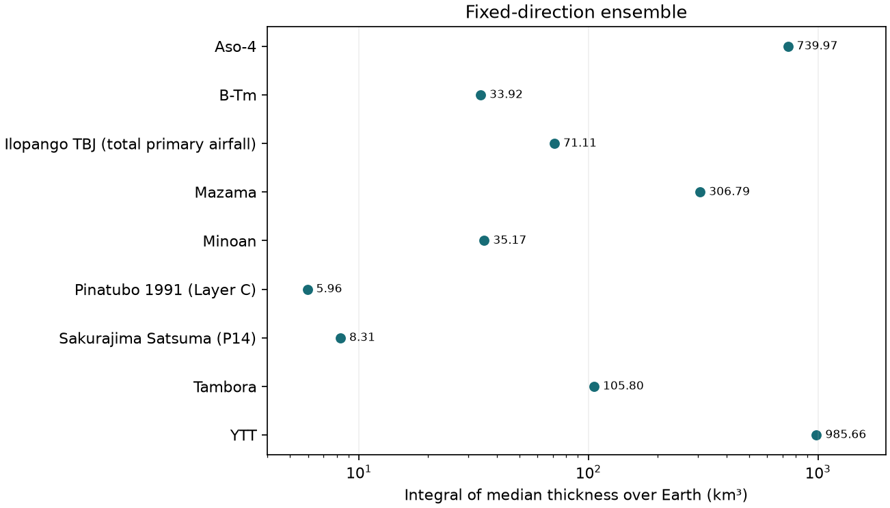

# Directional reference controls

Each row declares the input edition of its saved controls. Where the current edition has no fixed-direction packet, the preceding reported-input edition remains a historical reference; it is not a matched comparison with the current principal fit. The single-structure fit uses the reference fan geometry. The fixed-direction ensemble averages six structures. The measured-fan column gives the quantitative-only bearing fit where published. Lower scores indicate better predictions. [Principal directional fits](../README.md) · [Matched v5/v6 comparison](../geographic-regularity/README.md) · [Control definitions](../../../docs/methods/directional-ensemble.md)

| Eruption | Input edition | Sites | Single-structure score | Fixed-direction score | Measured-fan score | Fixed median map (km³) |
|---|---|---:|---:|---:|---:|---:|
| [Aso-4](../../../eruptions/aso-4/results/directional/ensemble/README.md) | preceding reported-input edition | 87 | 1.555 | 1.507 | — | 739.97 |
| [B-Tm](../../../eruptions/b-tm/results/directional/ensemble/README.md) | preceding reported-input edition | 71 | 1.274 | 1.266 † | 1.244 | 33.92 |
| [Ilopango TBJ (total primary airfall)](../../../eruptions/ilopango-tbj/results/directional/ensemble/README.md) | preceding reported-input edition | 168 | 1.328 | 1.252 | 1.361 | 71.11 |
| [Mazama](../../../eruptions/mazama/results/directional/ensemble/README.md) | preceding reported-input edition | 300 | 1.002 | 0.781 † | 0.898 | 306.79 |
| [Minoan](../../../eruptions/minoan/results/minimum-fit-2026-11-25/directional/ensemble/README.md) | current | 101 | 1.857 | 1.820 | 1.902 | 35.17 |
| [Pinatubo 1991 (Layer C)](../../../eruptions/pinatubo-1991-layer-c/results/directional/ensemble/README.md) | preceding reported-input edition | 235 | 2.072 | 1.014 † | 1.072 | 5.96 |
| [Sakurajima Satsuma (P14)](../../../eruptions/sakurajima-satsuma/results/minimum-fit-2026-11-25/directional/ensemble/README.md) | current | 57 | 1.289 | 1.127 † | 1.295 | 8.31 |
| [Tambora](../../../eruptions/tambora/results/directional/ensemble/README.md) | current | 26 | 1.953 | 1.964 † | — | 105.80 |
| [YTT](../../../eruptions/ytt/results/directional/ensemble/README.md) | current | 46 | 1.811 | 1.777 † | — | 985.66 |

A dagger marks a numerical warning on the fixed ensemble’s geographic fits or its median-map integral. Each case links the individual policies, holdouts and sampling diagnostics. The [uncertain-azimuth control table](../case-comparison.csv) likewise reads each paired report at its declared input edition; it does not substitute the later finite-spread or principal multiscale estimates.

## Known deposits and calibration

The 14 fixed-design trials compare fitted isopach area with known deposits at 1, 10 and 100 cm. Two trials have identical observed thicknesses under two different hidden deposits. Their fitted intervals covered the larger hidden deposit in neither trial. [Known volumes](known-volumes.csv) · [Contour overlap](contour-accuracy.csv) · [Simulation details](simulation-records.json.gz)

The original six-eruption training packet fixes the structure weights for these experiments. A target eruption contributes no scores to its own calibration. [Training inputs and weights](../../../src/empirical_isopach/assets/directional-calibration.json) · [Independent numerical checks](verification.json)
