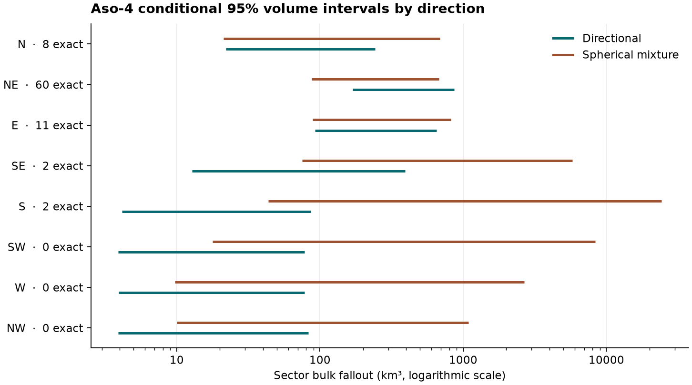
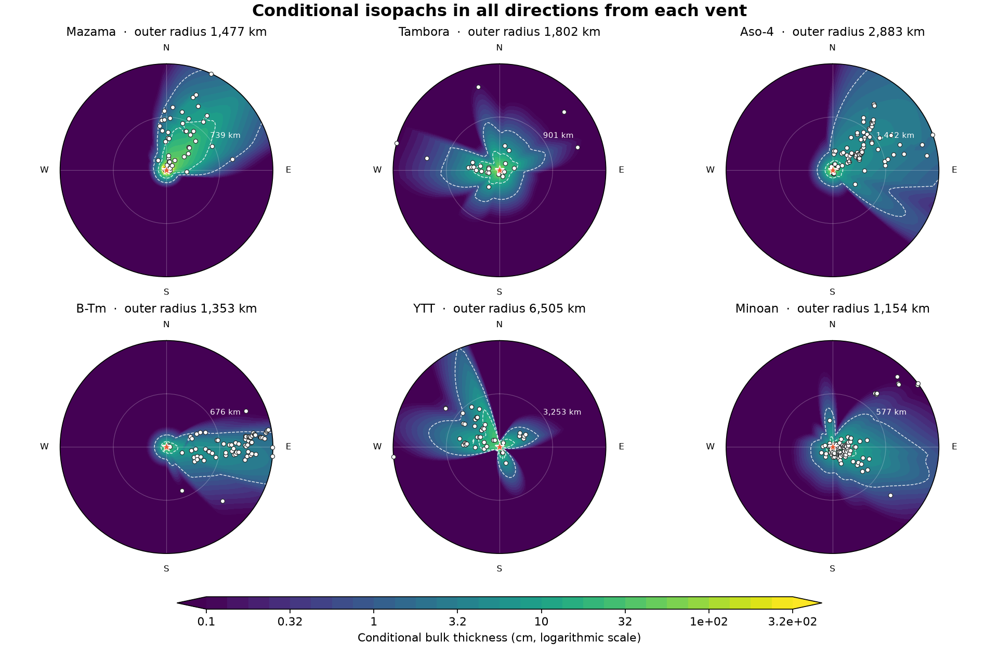

# Single-structure directional sensitivity

This six-eruption study tests the older single-structure continuation against a spherical fit on the same observations. The B-Tm comparison uses the 84-record input. The current case pages give the median-thickness maps and their integrated volumes. [Current directional fits](../README.md) · [B-Tm evidence revision](../../../eruptions/b-tm/README.md)

## Geographic validation and volume uncertainty

| Eruption | Directional 95% interval (km³) | Spherical 95% interval (km³) | Geographic score, directional / spherical | Exact-site coverage, directional / spherical | Passing directional policies |
|---|---:|---:|---:|---:|---:|
| Mazama | 150.6–370.2 | 144.7–3,668.8 | 1.451 / 1.577 | 91.1% / 91.1% | 13/13 |
| Tambora | 77.2–172.8 | 112.9–1,284.2 | 1.953 / 1.471 | 80.8% / 96.2% | 8/13 |
| Aso-4 | 391.6–2,030.3 | 501.0–44,172.9 | 1.555 / 1.632 | 86.7% / 95.2% | 13/13 |
| B-Tm | 39.7–109.0 | 53.2–2,159.2 | 1.316 / 1.162 | 94.0% / 92.9% | 13/13 |
| YTT | 848.9–1,926.9 | 1,203.6–54,906.9 | 1.811 / 1.777 | 91.3% / 84.8% | 13/13 |
| Minoan | 26.2–126.9 | 28.1–2,529.2 | 1.732 / 1.570 | 91.3% / 94.6% | 13/13 |

The CSV includes the independent replication intervals, the envelope across passing policies, and geographic scores with a proximal cap. [Paired cases](comparison.csv) · [Independent fit diagnostics](independent-replications.json.gz) · [Matched-fold verification](verification.json)

## Unsampled sectors at Aso-4

The southeast and south each have two exact readings. The west has none. With the southeast quadrant withheld, a 15 cm offshore observation at 709 km fell above the directional 95% predictive interval of 0.0003–1.95 cm. An unsampled sector can contain a real lobe. [Outermost site by octant](octant-extremes.csv) · [Outermost site by quadrant](quadrant-extremes.csv)

## Known-deposit tests

Of 12 fresh trials, 8 passed the numerical checks. Their conditional volume intervals contained the true volume in 4/8. The full trial table includes failures, deliberately missing directions, and the known volumes of the simulated deposits. [All trials](known-volumes.csv) · [Fit records](known-volume-fits.json.gz)

## Reproduce

Run the single-structure and geographic benchmarks with a fresh results directory. The comparison command pairs geographic folds, rebuilds the two interval tables and checks each input identity.

~~~sh
python -m benchmarks.directional --help
python -m benchmarks.directional_replication --help
python -m benchmarks.directional_comparison --help
python -m benchmarks.verify_directional
~~~

[Eruption workflow](../../../docs/NEW_ERUPTION.md) · [Benchmark scripts](../../../benchmarks/README.md)
