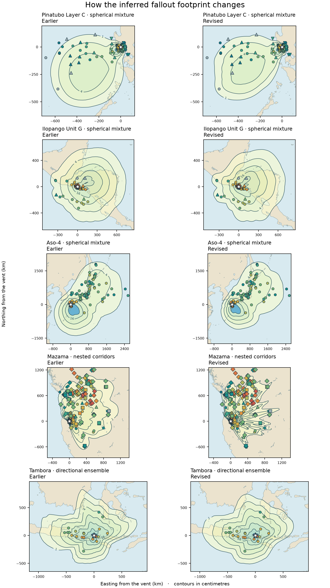

# Global fallout models and geographic validation

## Historical Mazama comparison on 271 localities

The fits use 271 distinct locations. Each pair shares the same observations, geography and training folds. The two map integrals measure the effect of the assumed continuation into unsampled areas. Volumes are in km³. [Current case](../../eruptions/mazama/README.md) · [Matched outcomes](paired-results.csv) · [Parent map calculations](../../eruptions/mazama/results/source-audit/paired-continuation-checks.json)

| Family | Parent map | Revised map | Revised conditional 95% | Geographic score, parent → revised | Withheld 95% coverage |
|---|---:|---:|---:|---:|---:|
| Directional ensemble | 213.8 | 214.5 | 153.7–641.7 · provisional | 0.538 → 0.530 | 96.8% |
| Spherical mixture | 246.5 | 240.6 | 154.4–1,579.3 | 0.494 → 0.532 | 74.2% |
| Bayesian nested corridors | 183.3 | 175.3 | 106.1–604.9 | 0.384 → 0.430 | 87.1% |

The independent spherical-kernel integral passed. The case pages retain the sampling, spatial-integration and contour-support diagnostics for each family. [Kernel diagnostics](kernel-integrals.json)

## Original nine-eruption experiment

The following experiment used the earlier 45-observation Mazama dataset. Its maps, sector areas and study-wide averages retain that input. [Original publication](https://github.com/siyulai21/tephra-fallout-isopachs/blob/0a53d0211f2ac9cfc9fbeaff95217fc0d319a18b/comparisons/global-extent/README.md)

<!-- original study -->

All nine registered eruptions were rerun. The GP and spline results on their common observation hull reproduced byte for byte in the matched benchmark. The three global families use the same accepted sites, limits and buffered geographic holdouts as their earlier fits. Every fitted log thickness was identical at every training location in the deletion checks. Each global map integrates over the physical Earth, including its thin tail. [All 45 estimates](https://github.com/siyulai21/tephra-fallout-isopachs/blob/0a53d0211f2ac9cfc9fbeaff95217fc0d319a18b/comparisons/global-extent/../principal-volumes.csv) · [Paired results for the 27 global fits](https://github.com/siyulai21/tephra-fallout-isopachs/blob/0a53d0211f2ac9cfc9fbeaff95217fc0d319a18b/comparisons/global-extent/paired-results.csv) · [Regional replay](regional-replay.json)

| Eruption and family | Earlier map (km³) | Revised map (km³) | Earlier conditional 95% (km³) | Revised conditional 95% (km³) | Geographic score, earlier → revised |
|---|---:|---:|---:|---:|---:|
| [Pinatubo Layer C, spherical](../../eruptions/pinatubo-1991-layer-c/README.md) | 13.9 | **11.1** | 9.22–26.1 | 7.33–20.2 | 0.904 → 0.965 |
| [Ilopango Unit G, spherical](../../eruptions/ilopango-tbj/README.md) | 145 | **133** | 62.9–3,301 | 59.7–1,950 · provisional | 1.229 → 1.284 |
| [Aso-4, spherical](../../eruptions/aso-4/README.md) | 599 | **473** | 403–27,837 | 333–6,989 | 1.636 → 1.636 |
| [Mazama, nested corridors](../../eruptions/mazama/README.md) | 245 | **219** | 129–938 | 116–960 | 1.365 → 1.369 |
| [Tambora, directional](../../eruptions/tambora/README.md) | 95.7 | **95.7** | 73.2–204 | 68.8–192 · provisional | 2.070 → 2.029 |

Each map value is the volume of the pointwise median deposit. The interval comes from integrating each complete posterior deposit. Geographic scores use identical retained posterior samples for both predictions within each fold and give each fold equal weight. Lower is better. Small differences from previously printed scores reflect that paired sampling rule. At Pinatubo only one of four spherical geographic fits passed its numerical checks. At Tambora one of four directional geographic fits and none of its four quadrant fits passed.

The white circles locate accepted observations and bounds. The red triangle marks the vent. Each pair uses the same coordinates, contour levels and posterior subset. Full-resolution principal plates and near-vent views are on the eruption pages.

## What produces the anomalies

**Displaced spherical kernels.** A narrow set of measurements can intersect the flank of a circular component even when its centre is far away. Raising its amplitude can fit those measurements and add substantial mass elsewhere. At Aso-4 the mass-weighted distance from the centres to the nearest positive sites has a median of 437 km. In the top 2.5% of the earlier paired volume draws it is 2,505 km. Its rank correlation with volume is 0.75. The corresponding correlation for the tail exponent is about 0.00. The revised model limits a component’s rise above its sampled flank and reduces the width an isolated long transect can imply. The source-focused B-Tm spherical field satisfies the condition by construction and gives the same map and interval. [Paired spherical diagnostics and independent integrals](https://github.com/siyulai21/tephra-fallout-isopachs/blob/0a53d0211f2ac9cfc9fbeaff95217fc0d319a18b/comparisons/global-extent/kernel-integrals.json)

**Pinatubo and Ilopango.** Pinatubo’s modeled 1 cm area in the southern 45° sector falls from about 52,500 to 12,900 km². The weaker score when the offshore group is removed is a reason to retain the broader result as a sensitivity. The marine field study itself identifies incomplete distal and southern sampling. At Ilopango there are sites around the source, but their ranges differ sharply by bearing. The revised interval still permits a large distal deposit. The published physical-model estimate of 85–188 km³ uses overlapping thickness evidence. It supplies geological context and never enters the calibration. [Sector integrals from two independent grids](sector-areas.csv.gz) · [Pinatubo marine core study](https://pubs.usgs.gov/pinatubo/wiesner/) · [Ilopango physical-model study](https://pmc.ncbi.nlm.nih.gov/articles/PMC7584997/)

**Mazama corridors.** A single positive distal finding previously allowed transverse width to grow linearly throughout its corridor. The turning shapes could also place their thick ridge on the unsampled side of the measured sites. The revised finite laws slow transverse growth and limit the unsupported rise above thickness on sampled bearings. The modeled 1 cm area falls from about 700,000 to 587,000 km² in the east and from 176,000 to 126,000 km² in the southeast. The retained broad-shape draws still support an upper interval near 960 km³. The site scores provide little evidence for choosing between the two Mazama maps. [All bearings and both quadrature scrambles](sector-areas.csv.gz)

**Tambora fan resolution.** Twenty-six sites generated 9–15 fan-range terms across the six ensemble members. The compact angular basis allowed scallops between observations. Smoothing the range basis within each coherent deposit reduces the fraction of 1 cm contour-radius variation in angular harmonics five and above from 12.5% to 7.1%. The integral of the median map changes by less than 0.05 km³. Four of the six full-data samplers still have warnings. [Angular variation by contour level](angular-variation.csv) · [Full fit and quadrant results](../../eruptions/tambora/results/directional/extent/report.json)

## Predictive costs and limits

| Family | Mean earlier geographic score | Mean revised score | Eruptions with improved score |
|---|---:|---:|---:|
| Directional | 1.557 | **1.528** | 9 of 9 |
| Spherical mixture | **1.445** | 1.467 | 3 of 9, with one exact field identity |
| Nested corridors | **1.621** | 1.668 | 2 of 9 |

All eruptions have equal weight in these averages. The spherical and nested rules reduce unsupported area at the cost of missing some genuine spread. The four frozen nested survey transfers show both effects. Across 43 independently surveyed Calbuco sites the negative log score improves from 1.972 to 1.939. Across the three interpreted B-Tm archive limits it improves from 0.247 to 0.048. The 28 withheld Aso-4 marine sites favor the earlier corridors, 1.544 versus 1.626. The ten offshore sites in the earlier Pinatubo intake give 5.295 under both continuations. That transfer uses the archived 137-row intake. The main Pinatubo result uses all 208 accepted records. [Row-level external survey scores](external-surveys.csv)

Six simulated designs per family cover smooth fallout, an unsampled sector and a wholly invisible extra lobe. For the latter, exactly the same sampled thicknesses are compatible with totals of 33.6 and 72.8 km³. Across the tested thresholds and both scrambles, the mean excess contour area decreased for spherical and nested fits while their missed area increased. Directional fits showed the opposite tradeoff. All six spherical parent samplers passed, while the directional and nested synthetic fits retain numerical warnings. [False and missed area, truth, numerical flags and map volume](known-deposits.csv.gz)

All 27 median-map integrals passed independent replay and resolution checks. Eight complete-draw distributions retain numerical warnings. No complete contour band passed the shared support screen under any of the three support policies. The eight spherical prior fits give much wider sensitivity envelopes than the baseline interval in several cases. At Aso-4 their combined endpoints span about 317–34,354 km³, including flagged fits. No-data sectors can still contain substantial fallout. [Aso-4 prior fits and refinement histories](../../eruptions/aso-4/results/spherical-mixture/extent/prior-sensitivity.json) · [Model, assumptions and reproduction](../../docs/methods/finite-spread.md) · [Preceding release](../../archive/2026-11-22-global-extent/README.md)
