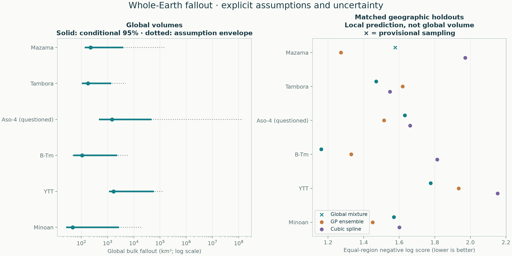

# Global fallout estimates across six eruptions

[Project home](../../README.md) · [Method, equations and priors](../../docs/methods/probabilistic-global.md) · [Regional peers](../regional/README.md) · [Local support diagnostic](../support/README.md)

The complete-contour screen was too conservative as a prerequisite for conditional global estimation. It remains useful for local evidence checks. The replacement global calculation fits positive, finite-mass fallout fans jointly on the whole Earth. **No closing pseudo-data, chosen calculation rectangle or distal cutoff determines these totals.**

**Reviewed revisions:** B-Tm uses source-focused fans to remove an unsupported off-volcano maximum. Aso-4 retains the displaced field family but now uses two corrected cruise coordinates and source-qualified bounds. Its high global total remains questioned; the separately tested tighter displacement prior is a development alternative, not a demonstrated global-mass correction. See the [Aso-4 evidence audit](../aso-4-audit/README.md) and [earlier geometry review](../source-revision/README.md). The other four results are unchanged. This table is a record of reviewed case calculations, not a new common-geometry experiment across all six eruptions.

## Global estimates and uncertainty

| Eruption | Geometry | Median bulk km³ | Conditional 95% credible interval | Assumption-sensitivity envelope km³ | Baseline numerical checks |
|---|---|---:|---:|---:|---|
| [Mazama](../../eruptions/mazama/results/global/README.md) | displaced | 223 | 145–3.67e+03 | 142–1.52e+05 | pass |
| [Tambora](../../eruptions/tambora/results/global/README.md) | displaced | 179 | 113–1.28e+03 | 104–4.97e+03 | pass |
| [Aso-4](../../eruptions/aso-4/results/global/README.md) | displaced · **questioned** | 1.47e+03 | 501–4.42e+04 | 465–1.41e+08 | pass |
| [B-Tm](../../eruptions/b-tm/results/global/README.md) | source-fans | 106 | 53.2–2.16e+03 | 45.8–6.49e+03 | pass |
| [YTT](../../eruptions/ytt/results/global/README.md) | displaced | 1.67e+03 | 1.2e+03–5.49e+04 | 1.14e+03–1.37e+05 | pass |
| [Minoan](../../eruptions/minoan/results/global/README.md) | displaced | 46 | 28.1–2.53e+03 | 26.4–2.12e+04 | pass |

The credible interval is conditional on the baseline field, likelihood and priors. The assumption-sensitivity envelope spans the endpoints from seven alternative refits plus the baseline; **it is not a 95% interval or an exhaustive bound**. All accepted fans, including Minoan's Plinian and co-ignimbrite fallout, are fitted together. Ignimbrite deposits and dense-rock-equivalent conversion are excluded.

**Assumption refits with remaining numerical warnings:** Mazama: wide geography, gaussian errors; B-Tm: wide geography. Their provisional summaries remain in the envelope and are marked in the individual reports; the envelope's endpoints therefore need the corresponding numerical qualification. Holdout-fit warnings are reported separately below.

Some restrictive alternatives allow geologically extreme totals, particularly the one-fan Aso-4 model. Those outcomes expose weak identification or an inadequate shape assumption; **the envelope is not a range of certified geologically plausible volumes**. Numerical convergence alone does not rescue an unsuitable geological model. The baseline remains the jointly fitted multi-fan specification, with every alternative visible in its eruption report.

Every individual posterior field is normalized to its fitted volume parameter over WGS84. Source-focused fans have analytical radial integrals and automatically refined angular quadrature; displaced circular fields have analytical integrals. This removes an arbitrary calculation region, not the need for geological assumptions. Sparse measurements cannot exclude arbitrarily large deposits in unsampled places. General smoothness, source-related fan structure, finite mass, alternative thinning shapes and proper priors make the conditional inference possible. Each named geometry has a fixed specification, without fitting to published volume targets.

Each eruption report includes the baseline field, its uncertainty, all assumption refits, whole-field samples, mass in unsampled sectors/proximal/distal areas, and all numerical attempts. **6/6 baseline fits pass the declared sampling checks.** Numerical warnings on any sensitivity or withheld fit remain visible. Passing those checks does not establish geological correctness.

## Same-data geographic prediction

| Eruption | Global-model negative log score ↓ | GP score ↓ | Spline score ↓ | Global heldout 95% coverage | Holdout sampling |
|---|---:|---:|---:|---:|---|
| Mazama | 1.577 | 1.272 | 1.971 | 91.1% | **provisional** |
| Tambora | 1.471 | 1.620 | 1.548 | 96.2% | pass |
| Aso-4 | 1.632 | 1.514 | 1.662 | 95.2% | pass |
| B-Tm | 1.162 | 1.331 | 1.814 | 92.9% | pass |
| YTT | 1.777 | 1.934 | 2.153 | 84.8% | pass |
| Minoan | 1.570 | 1.451 | 1.601 | 94.6% | pass |

Scores use identical accepted inputs, four geographic folds, buffers, training rows and heldout observation/bound semantics. Lower score is better. Global-model fitting is repeated inside every training fold with the fixed priors. Better local prediction does not prove an accurate global total; the regional peers retain their own purpose and no automatic winner is selected by volume.

## Evidence and reproducibility

- [Displaced-model known-truth stress tests and retained failures](stress-tests.md)
- [Source-focused stress tests and limits of the new constraint](../source-revision/stress-tests.md)
- [Development decisions and numerical equivalence checks](development/README.md)
- [Machine-readable estimates](comparison.csv) and [matched comparison record](report.json)
- [Regional rerun and input-preservation verification](verification.json)

Aso-4 now uses its separately named reviewed input; the original CSV and preceding results remain archived. Mazama, Tambora and B-Tm retain their supplied source flags, while YTT and Minoan retain their documented audits. Global uncertainty does not automatically cover unrecorded erosion, marine transport, preferential sampling or source misattribution. The older rerun-verification record above describes its original date and inputs, not the later Aso-4 revision.

For new data, upload measurements and source notes in chat. The assistant audits them, runs the regional and global protocols, and adds the data and illustrated reports to GitHub. No browser workflow is needed.
