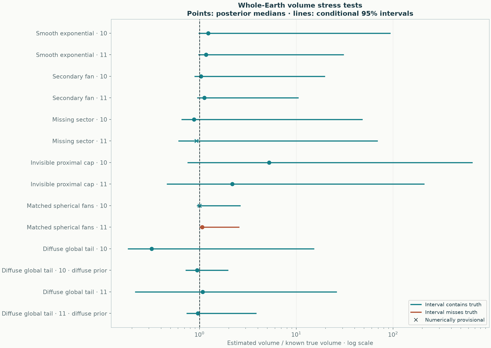

# Global-volume known-truth stress tests

[All-eruption results](README.md) · [Method and assumptions](../../docs/methods/probabilistic-global.md) · [Earlier development failures](development/README.md)

The final physical model and priors were fixed before these runs. There are **12 baseline trials**, six scenarios with fresh seeds 10 and 11. The two diffuse-tail cases also receive the predeclared diffuse-tail sensitivity. No trial is omitted because its interval misses the truth or its sampler fails a numerical check.

**11/12 baseline intervals contain the known total. 10/12 baseline fits pass numerical checks.** Among those passing, 9/10 intervals contain the truth. These small development counts do not establish 95% calibration. A numerical pass also does not establish model correctness; provisional trial intervals remain uncertain computational summaries.

| Scenario · seed · assumption | True km³ | Median km³ | Conditional 95% interval km³ | Contains truth | Sampling |
|---|---:|---:|---:|---|---|
| Smooth exponential · 10 · baseline | 33.6 | 41.4 | 33.2–3.12e+03 | yes | pass |
| Smooth exponential · 11 · baseline | 33.6 | 39.3 | 33.1–1.02e+03 | yes | pass |
| Secondary fan · 10 · baseline | 52.4 | 54.5 | 47.2–1.03e+03 | yes | pass |
| Secondary fan · 11 · baseline | 52.4 | 58.8 | 50.2–546 | yes | pass |
| Missing sector · 10 · baseline | 52.4 | 46.1 | 34.5–2.51e+03 | yes | pass |
| Missing sector · 11 · baseline | 52.4 | 48.9 | 32.1–3.6e+03 | yes | **provisional** |
| Invisible proximal cap · 10 · baseline | 55.7 | 293 | 42.5–3.65e+04 | yes | pass |
| Invisible proximal cap · 11 · baseline | 55.7 | 121 | 25.9–1.16e+04 | yes | pass |
| Matched spherical fans · 10 · baseline | 120 | 120 | 114–315 | yes | **provisional** |
| Matched spherical fans · 11 · baseline | 120 | 128 | 122–306 | **no** | pass |
| Diffuse global tail · 10 · baseline | 120 | 38.4 | 22.1–1.81e+03 | yes | pass |
| Diffuse global tail · 10 · diffuse-tail prior | 120 | 114 | 87.2–235 | yes | pass |
| Diffuse global tail · 11 · baseline | 120 | 130 | 26.2–3.11e+03 | yes | pass |
| Diffuse global tail · 11 · diffuse-tail prior | 120 | 116 | 89.2–460 | yes | pass |



## What is being challenged

- **Smooth exponential:** a simple radial deposit, sampled along twelve directions and six radii. This shape exposed the initial Gaussian/power and diffuse-weight problems; the final trials use new noise/location seeds.
- **Secondary fan:** adds a displaced anisotropic lobe. The whole field is fitted jointly, without identifying fan membership from the synthetic truth.
- **Missing sector:** removes observations from a quadrant containing a secondary fan. Unobserved mass depends on modelling assumptions.
- **Invisible proximal cap:** adds a compact positive deposit that is exactly zero at every sampled location. The data cannot identify its volume. A broad interval that includes this particular cap is not evidence that all invisible caps would be covered.
- **Matched spherical fans:** two normalized spherical components, fixed total 120 km³. It tests the model in a relatively favorable setting but is still not a draw from the full fitting prior.
- **Diffuse global tail:** a spherical power tail with exponent 0.7 and total 120 km³. Its infinite-plane analogue is nonintegrable. The Earth-normalized truth is finite; the baseline exponent restriction and the alternative allowing exponents below one are both retained.

The original four truths use an equal-area chart; the exponential/Gaussian mass omitted beyond the physical Earth chart is below 10⁻⁸⁰ of the total. The compact proximal cap is wholly inside it. The two spherical truths use exact whole-Earth normalizers. Each scenario adds independent log-observation noise with SD 0.15. True volumes are calculated analytically, not from the fitting model's posterior or a plotting window.

Large upper tails and biased medians can coexist. A conditional credible interval is not a data-only bound, and a finite prior cannot guarantee coverage of every unseen deposit. The results support continuing to report explicit assumptions and sensitivity, rather than presenting the new global model as universally calibrated or as a demonstrated improvement over GP/spline for regional prediction.

## Reproduce and inspect

```sh
python -m benchmarks.mass_mixture --output results/global-stress
python -m benchmarks.global_stress_report --source results/global-stress --output results/global-stress-report
```

The reporting command requires all twelve fixed trials and every declared alternative. [Complete priors, attempts, diagnostics and source identities](stress-report.json) · [Numerical table](stress-comparison.csv). The regional benchmark was also rerun: all six eruption fits/holdouts and all 40 regional synthetic trial records reproduce exactly; see [verification](verification.json).
