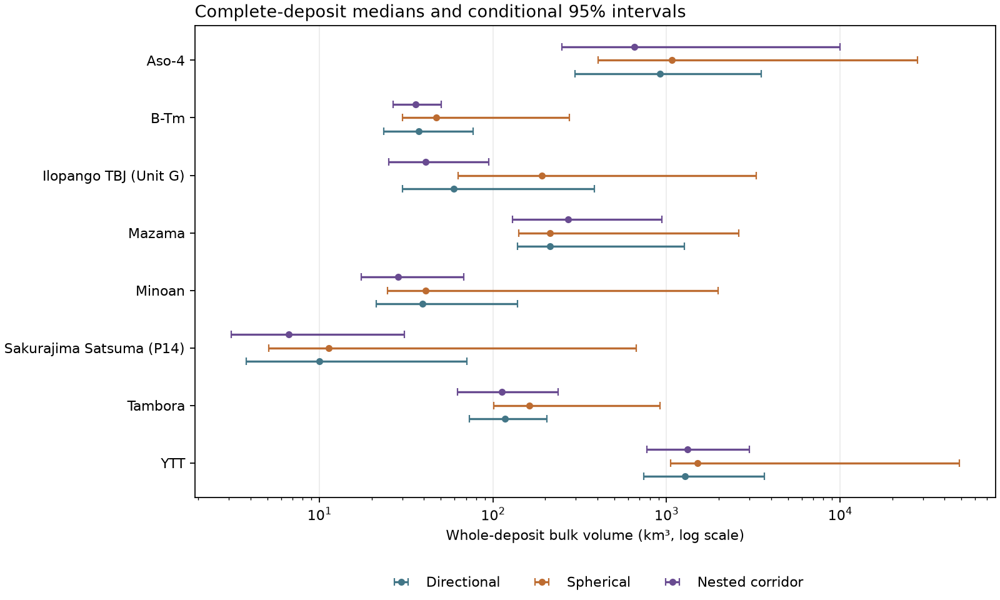

# Global fallout volume from nested dispersal corridors

The principal Bayesian nested estimate is the median bulk volume obtained by integrating each posterior deposit over Earth. The published isopachs trace the pointwise median thickness. Each case also reports the integral of that map.

| Eruption | Corridor median [conditional 95%], km³ | Whole-area sensitivity median, km³ | Corridor geographic score ↓ | Withheld exact readings inside 95% | Full-data checks | Geographic fits passing |
|---|---:|---:|---:|---:|---|---:|
| [Aso-4](../../eruptions/aso-4/results/nested-isopachs/README.md) | **652.5** [249.5–9,990.1] | 2,513.9 | 1.556 | 76/83 | passed | 3/4 |
| [B-Tm](../../eruptions/b-tm/results/nested-isopachs/README.md) | **35.9** [26.6–50.2] | 90.4 | 1.544 | 59/64 | **warning** (fit) | 4/4 |
| [Ilopango TBJ (Unit G)](../../eruptions/ilopango-tbj/results/nested-isopachs/README.md) | **40.9** [25.1–94.2] | 50.5 | 1.274 | 49/52 | **warning** (fit) | 1/4 |
| [Mazama](../../eruptions/mazama/results/nested-isopachs/README.md) | **271.4** [129.2–938.0] | 411.2 | 1.365 | 43/45 | passed | 4/4 |
| [Minoan](../../eruptions/minoan/results/nested-isopachs/README.md) | **28.4** [17.4–67.6] | 37.6 | 1.621 | 86/92 | passed | 4/4 |
| [Sakurajima Satsuma (P14)](../../eruptions/sakurajima-satsuma/results/nested-isopachs/README.md) | **6.7** [3.1–30.7] | 12.5 | 1.016 | 49/50 | **warning** (fit) | 1/4 |
| [Tambora](../../eruptions/tambora/results/nested-isopachs/README.md) | **112.7** [62.5–237.7] | 146.9 | 1.646 | 26/26 | passed | 4/4 |
| [YTT](../../eruptions/ytt/results/nested-isopachs/README.md) | **1,322.2** [771.0–3,000.8] | 1,543.0 | 1.429 | 45/46 | **warning** (fit, populations) | 3/4 |

All three global families use identical buffered geographic holdouts. Across these 8 eruptions, each given equal weight, the mean negative log predictive score is 1.431 for the corridor and 1.366 for the whole-area sensitivity. Lower scores favor a model’s predictions. A complete band passed at least one nested support policy in 0 of 8 eruptions. [Three-family estimates and scores](cases.csv) · [Matched regional replay](regional-replay.csv)

## What the observations constrain

Local contour fragments drawn solid have exact measurements on both sides and at least 90% posterior probability of crossing in a retained triangle. Gaps and sectors without observations retain conditional predictions. The common prior gives 25% probability to broad continuation. The data can update those odds. Each case reports sensitivity to alternative prior odds.

| Eruption | Median volume fraction in retained triangles | Median fraction beyond the farthest exact site | Median-map integral (km³) |
|---|---:|---:|---:|
| Aso-4 | 4.1% | 29.3% | 544.7 |
| B-Tm | 13.0% | 12.0% | 33.7 |
| Ilopango TBJ (Unit G) | 3.8% | 5.8% | 39.1 |
| Mazama | 7.8% | 6.4% | 244.6 |
| Minoan | 8.6% | 2.7% | 24.9 |
| Sakurajima Satsuma (P14) | 3.0% | 14.7% | 6.3 |
| Tambora | 10.1% | 1.9% | 94.9 |
| YTT | 15.1% | 0.3% | 1,246.2 |

The distance and triangle diagnostics use different spatial definitions. Sector budgets, support rejections and the full-compass maps are in the case reports.

The separate Calbuco campaign and the withheld B-Tm archive bounds favor the corridor in those tests. Withheld Aso-4 and Pinatubo marine observations favor the broader continuation. These checks bear directly on whether a mapped deposit reached the sampled sites. Ancient total volumes remain conditional on thickness in unobserved regions. [Field-survey and mapped-contour checks](../nested-reach/field-surveys/README.md) · [Matched reach tests and areas by bearing](../nested-reach/README.md)

The Pinatubo Layer C snapshot has its own principal corridor estimate and is outside the registered-case averages. [Pinatubo evidence and estimates](pinatubo-preview/README.md)

[Whole-area sensitivity, earlier profiles and their validation](whole-area-study.md) · [Corridor model and reproduction](../../docs/methods/nested-reach.md) · [Previous release](../../archive/2026-11-21-corridor-principal/README.md)
