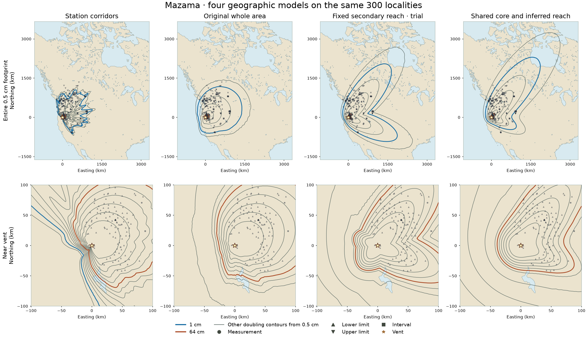
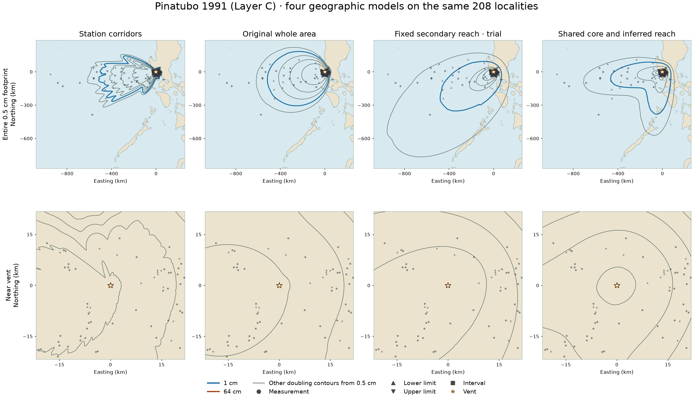
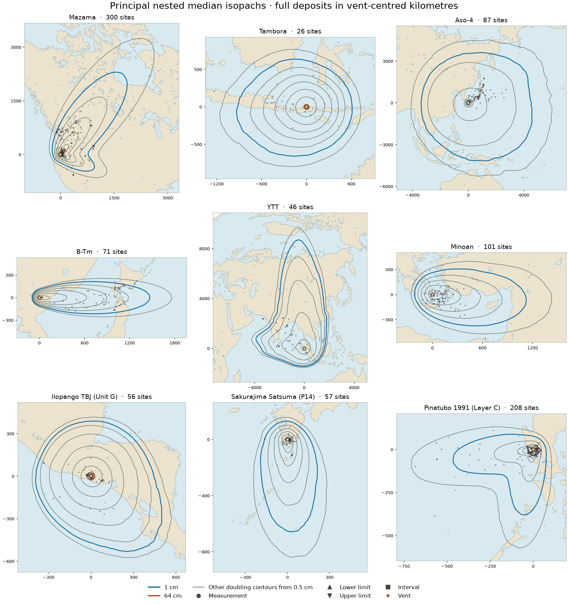

# What made the Mazama and Pinatubo contours grow fingers?

The preceding nested model gave every positive station a ridge from the vent. The revised model fits the geography of an entire deposit jointly with its Bayesian area–thickness curve. It eliminated the station-aligned fingers on both maps. On Mazama’s 300 accepted localities, the southwest indentation of the 64 cm contour fell from 54% to less than 1%. On Pinatubo, the 1 cm contour went from nine prominent radial peaks to two. Across nine eruptions, the original whole-area model remains competitive, particularly for volume recovery on known deposits. [Model and priors](../../../docs/methods/nested-footprints.md) · [All principal estimates](../README.md) · [Case-by-case results for all three geographies](paired-results.csv)

## Two deposits on identical observations

The corridor median at Mazama has 12 radial peaks on its 1 cm contour. Its southwest 64 cm radius is 54% shorter at the deepest indentation than the local convex-hull radius. Simply removing the corridor led to a much smaller, approximately 4% indentation in the original whole-area fit. A first replacement with two phases removed most fingers, but forced the second phase to reach 80% of the primary phase’s scale. Its 0.5 cm southeastern arm reached into Mexico. That trial also produced four protrusions at 64 cm. Adding the sector areas of two expanding phases, with a common proximal deposit and an inferred secondary reach, gives two principal lobes. In the current fit, 98.7% of draws use two phases. Within that class, 89.5% favor a distal secondary scale of 0.3 times the primary. The thin northeastern extension remains a geographic extrapolation and its location is conditional. [Localities and present nested result](../../../eruptions/mazama/results/primary-ranges/nested-isopachs/README.md) · [Rejected trial and receipts](../../../archive/2026-11-23-nested-geography/README.md)

At Pinatubo, the near-vent serrations and narrow offshore paths largely disappear. The new model still permits a broad southern lobe and a trough between the southern and western lobes. The maximum southwest indentation at 1 cm stays about 36%. Its *frequency* changes: the circular high-frequency log-radius amplitude drops from 0.140 to 0.084. The two geometries allocate virtually the same central volume, 6.77 and 6.70 km³, despite the very different distributions. The original whole-area result is smoother and gives 11.4 km³ (9.75–27.7). For the new model, four independent population estimates of the 97.5th volume percentile span 35–104 km³ at the highest resolution. Treat its pooled 4.97–65.4 km³ interval as provisional. [Pinatubo plates, predictive scores and draws](../../../eruptions/pinatubo-1991-layer-c/results/nested-isopachs/README.md)

## An intervention on the sampling pattern

Holding the thickness profile, volume parameters, intrinsic dispersal directions and selected draws fixed, we rotated **only** the station corridors. With ±22.5° rotations, 40–41% of the union of the two Mazama 1 cm footprints switched between ash and no exceedance. At Pinatubo the corresponding figure was 40–42%, rising to 68% at 45°. These results use two independent spatial integrations. In either whole-area formulation a station rotation at fixed deposit parameters changes no cells. Refitting to differently located observations can still change either estimate. [Intervention data](station-rotation.csv.gz)

The morphology table gives the first exit from the vent-connected patch on 360 bearings, then repeats at 180 bearings and half the radial resolution. Peaks have at least 10% or 20% radial prominence. The southwest diagnostic takes the largest radial deficit against the convex hull between 202.5° and 247.5°. Harmonics of order five and above quantify short angular structure. The table includes the whole-area control, the corridor before finite spread, and the underlying unattenuated field of the same corridor particles. Detached areas enter all volume and area totals. These shape descriptors test the mechanism revealed by the maps. A real split plume can have a concave margin. [All levels and ablations](contour-morphology.csv.gz)

## Does the geography improve prediction?

Using the same accepted measurements and bounds, the same four buffered geographic deletions and equal weight per eruption, mean negative log scores were **1.362 for footprints, 1.367 for original whole area and 1.607 for finite corridors**. Lower is better. The footprint beat corridors in seven of nine and original whole area in four of nine. Satsuma and YTT favored the corridor over the footprint. Among the 36 current-case footprint geographic fits, 26 passed the independent-population checks. All scores include unsuccessful checks and each row identifies them. The ten input revisions also had 40 separate compass-quadrant challenges. Thirty-six were estimable, with 24 numerical passes. The other four retained their empty or inadequate partitions. [Paired scores and volume intervals](paired-results.csv) · [Quadrants](quadrants.csv) · [Quadrant rows, scores and fit attempts](quadrant-fits.json.gz)

| Withheld campaign | Rows | Finite corridors | Original whole area | Revised footprints |
|---|---:|---:|---:|---:|
| Calbuco independent survey | 43 | 1.94 | 2.02 | 1.97 |
| Aso-4 withheld marine survey | 28 | 1.63 | 1.41 | 1.58 |
| B-Tm withheld archive bounds | 3 | 0.05 | 4.75 | 3.67 |
| Earlier Pinatubo intake, withheld offshore beds | 10 | 5.30 | 3.62 | 3.42 |
| Current Pinatubo, all accepted offshore records | 34 | 7.68 | 5.53 | 5.00 |

The Pinatubo campaigns overlap and should be read separately. All three models retained numerical warnings on both offshore deletions. The B-Tm bounds are genuine evidence for a narrower deposit at those sites. They do not establish a universal detection threshold elsewhere. [Every campaign prediction and fit flag](withheld-surveys.csv.gz) · [Survey fit histories](surveys-fit-receipts.json.gz)

## Recovery of known area and volume

Twenty fitted observation designs represent 22 possible true deposits. Two designs each conceal a second possible deposit in an entirely unsampled sector, so the same observations must receive the same fitted answer under both truths. On two additional circular controls the source-relative station bearings rotate by 23° while the radii, true thicknesses and noise are identical. For those circular controls the corridor recovered about half the true volume and misclassified 42% of true 1 cm area. The footprint recovered 104% of volume under both designs, with corresponding area errors of 0.38% and 0.65%. [All trials, scrambles and levels](known-deposits.csv.gz)

| Across the 22 specified truths | Finite corridors | Original whole area | Revised footprints |
|---|---:|---:|---:|
| Median multiplicative error in median-map volume | 1.46× | 1.18× | 1.28× |
| Median 1 cm false plus missed area, divided by true area | 0.22 | 1.59 | 1.07 |
| Truth inside the conditional volume interval | — | 20/22 | 17/22 |

The ratio for volume is the larger of estimated/true and true/estimated, computed after averaging the two integration scrambles for each truth. The finite-corridor comparison here evaluates its median map. The spatial loss includes every false or missed patch. Excess predicted thin area accounts for most of the footprint loss. It is an important failure even when the volume error is small. The original whole-area model recovered volume best overall. Only 8 of the 20 footprint fits and 2 of the 20 fits for each reference passed their respective numerical checks in these development trials. These counts are descriptive and the trials do not establish frequentist coverage at 95%. [Known-truth data](known-deposits.csv.gz) · [Footprint numerical histories](truths-fit-receipts.json.gz)

## Where volumes depend on assumptions

- **Mazama.** On the same 300 localities the old corridor, original whole area and revised footprint give 241, 279 and 291 km³. The revised interval is 221–833 km³. On the preceding 271 localities the three estimates were 175, 210 and 510 km³. The contrast shows why the input version matters. One empty southwest sector receives 3.4% of the current median-map volume. [Current sector allocations](../../../eruptions/mazama/results/primary-ranges/nested-isopachs/footprints/sector-volumes.csv)
- **Aso-4.** The footprint gives 1,924 km³ (538–16,846), the original whole area 2,007 and the corridor 432. About 29% of the footprint volume lies in the W, SW and NW sectors, all without accepted localities. The median fraction beyond the last positive whole-area rank is 41%. Neither area allocation is measured from the southern or western deposit. The estimate is strongly geography- and distal-tail-dependent. [Sector volumes and evidence](../../../eruptions/aso-4/results/nested-isopachs/footprints/sector-volumes.csv)
- **YTT.** The northern sector contains no accepted locality but receives 44% of the footprint’s median-map volume. Its geographic score is worse than both references. The long northern lobe is a weakly constrained extrapolation. [Sector volumes and evidence](../../../eruptions/ytt/results/nested-isopachs/footprints/sector-volumes.csv)
- **Pinatubo and Ilopango.** All released median-map spatial checks pass. The complete-volume population checks still fail in these two eruptions. All four Ilopango geographic fits retain warnings. The evidence for Pinatubo depends on the criterion: full-data marginal likelihood strongly favors the original whole area, whereas geographic prediction and the offshore challenges favor the revised footprint. At equal prior odds the two-geography sensitivity for Pinatubo has a 9.75–27.7 km³ interval, close to the original whole-area result. [Two-geography prior sensitivity](geography-prior-sensitivity.csv)

The sensitivity calculation combines evidences on the same robust likelihood, using equal prior odds and quarter/fourfold changes. For each geographic holdout its weights use training data only. The table includes the spread among independent population weights and a conditional mixture interval. Case reports also show how the separate footprint prior and outer transfer affect volume. These alternative assumptions can give different limits even with an accurately integrated median map. No current eruption passed the shared screen for a complete data-supported band. All nine global intervals remain conditional. [Contour support criteria](../../../docs/methods/supported-isopachs.md)

## Reproduce or verify

The current nine inputs use their audited source rows. Mazama’s preceding 271-row revision is a tenth paired case, excluded from the nine-eruption averages. GP and spline were rerun on the same current inputs and common hulls. The other eight case volumes match the previously published regional values at numerical precision. Four of 80 regional synthetic method attempts had insufficient usable training evidence. [Matched regional rerun](regional-benchmark.csv) · [Regional synthetic trials](regional-known-deposits.csv)

Run from the repository root with its scientific dependencies installed. Each output directory below belongs to a new study run. The preceding geographies on the current Mazama data are stored in the dated archive. The other controls and their fold packets are published with their eruption. All reported maps use whole-Earth integration regardless of display windows.

~~~sh
python -m benchmarks.nested_footprints --output results/geography/fits --workers 4
python -m benchmarks.footprint_release --fits results/geography/fits --output results/geography/release --workers 4
python -m benchmarks.nested_footprints --design quadrants --output results/geography/quadrants --workers 4
python -m benchmarks.footprint_challenges --design known --output results/geography/truths --workers 4
python -m benchmarks.footprint_challenges --design surveys --output results/geography/surveys --workers 4
python -m benchmarks.footprint_morphology --scratch results/geography --output results/geography/morphology --workers 4
python -m benchmarks.regional --output results/geography/regional
python -m benchmarks.footprint_study --scratch results/geography --regional results/geography/regional --output results/geography/study
python -m benchmarks.footprint_plates --scratch results/geography --output results/geography/study
python -m benchmarks.verify_footprints
~~~

[Archived corridor release and rejected fixed-reach trial](../../../archive/2026-11-23-nested-geography/README.md) · [Principal reports for every eruption](../README.md)
