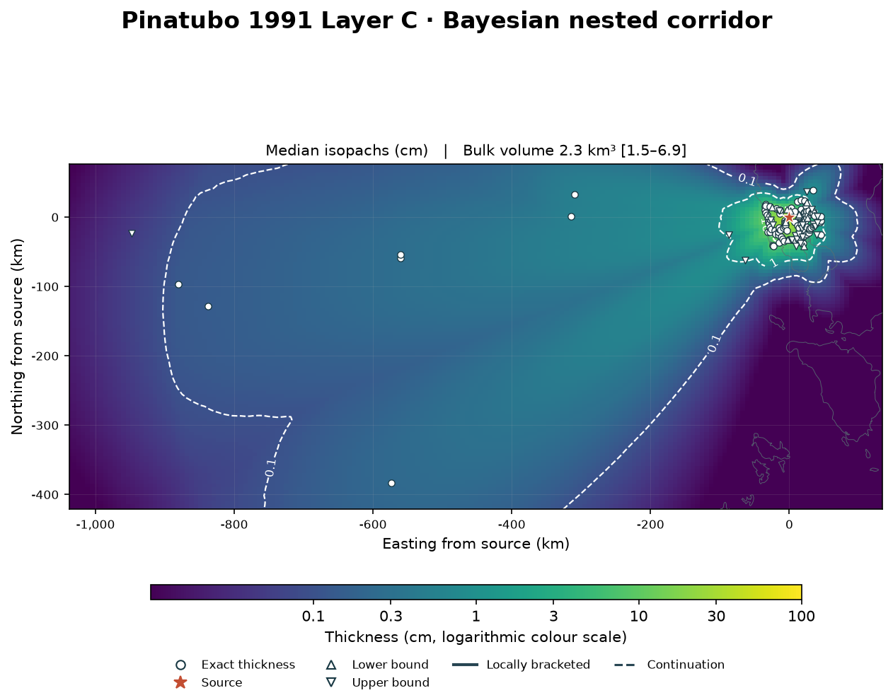

# Mount Pinatubo, 15 June 1991 · Layer C

**Principal Bayesian nested estimate.** The corridor model gives 2.3 km³ of bulk fallout (conditional 95% interval 1.5–6.9), compared with 6.1 km³ under the whole-area continuation. When all ten marine readings are withheld, the land-only corridor fit underpredicts offshore fallout. That fit retained a numerical warning. [Corridor map, volume and checks](nested-isopachs/README.md) · [Full-compass isopachs](nested-isopachs/compass.png)

This separate intake snapshot combines C1 and C2 and the attributed marine fallout. Its 137 accepted rows comprise 102 exact thicknesses, 13 lower bounds and 22 upper bounds. The original source records, decisions about cross-map matches and source hashes accompany the calculation. The eight-case catalogue comparison uses registered eruptions. [Thickness CSV](data/Pinatubo_1991_layer_C.csv) · [Source-row decisions](data/audit/selection.csv) · [Geographic coverage](data/audit/coverage.csv) · [Source and input hashes](data/audit/provenance.json)

The median corridor map integrates to 2.12 km³. The full-data checks passed. Two of four geographic refits passed, and 84 of 102 withheld exact measurements fell inside the 95% predictive interval. The broader whole-area sensitivity gives 6.14 km³. [Principal field and folds](nested-isopachs/README.md) · [Whole-area sensitivity](nested-whole-area/README.md)

Paladio-Melosantos and colleagues reported 3.4–4.4 km³ bulk for Layer C. That published range falls inside the corridor’s conditional 95% interval and above its median. Both analyses draw on some of the same field evidence. Paladio-Melosantos et al. also describe loss of proximal fallout to erosion and incorporation into moving pyroclastic flows. The preserved record and the choice of distal thinning both matter for the comparison. [Layer C descriptions and reconstruction](https://pubs.usgs.gov/pinatubo/paladio/index.html) · [C1 and C2 field maps](https://pubs.usgs.gov/pinatubo/koya/) · [South China Sea cores](https://pubs.usgs.gov/pinatubo/wiesner/index.html)

Inside the common observation hull, the GP gives an expected volume of 2.74 km³ and a conditional interval of 1.74–5.98 km³. The spline mean failed the integration-refinement check and its conditional volume distribution is extremely right-skewed. Its median-thickness map integrates to 6.03 km³ inside the hull. The held-out scores are 2.632 for GP and 6.844 for spline. [Regional isopachs](regional/isopachs.png) · [Regional predictions](regional/heldout_predictions.csv) · [Supported volumes and contour audits](regional/support/README.md) · [Regional diagnostics and numerical warnings](regional/report.json)

The data are transcribed from published sections, sublayer maps and core readings. The model uses each accepted source row once. The analogue prior for the nested model excludes the Pinatubo thinning estimates. [Koyaguchi map readings](data/sources/koyaguchi-figure-3.csv) · [Paladio map readings](data/sources/paladio-figure-7.csv) · [Paladio section thicknesses](data/sources/paladio-table-2.csv) · [Wiesner and Wang core thicknesses](data/sources/wiesner-wang-table-1.csv)

[Original source scans and hashes](data/originals/sources.json) · [Original Paladio-Melosantos source text](../../../data/sources/nested-isopachs/paladio-table-source.html.gz)

## Global fits on the same Layer C evidence

The three models predicted the same four geographically withheld sets. The volume column gives the median and conditional 95% interval from whole deposits. The directional median-thickness map integrates to a separate value of 4.92 km³.

| Family | Whole-deposit bulk volume (km³) | Geographic score ↓ |
|---|---:|---:|
| [Directional](directional/README.md) | 5.68 [3.20–11.04] | 1.804 |
| [Spherical mixture](spherical-mixture/README.md) | 6.21 [4.05–28.71] | 0.813 |
| [Nested corridor](nested-isopachs/README.md) | 2.27 [1.46–6.93] | 1.440 |

The family reports retain the sampler warnings, contour-support decisions and separate sensitivity to poorly sampled bearings. [Directional gap amount](directional/sensitivity-study/README.md) · [Spherical source displacement](spherical-mixture/sensitivity-study/README.md) · [Removal of the core controlling the whole-area continuation](nested-whole-area/edge-deletion/README.md) · [Regional comparison](regional/README.md)
