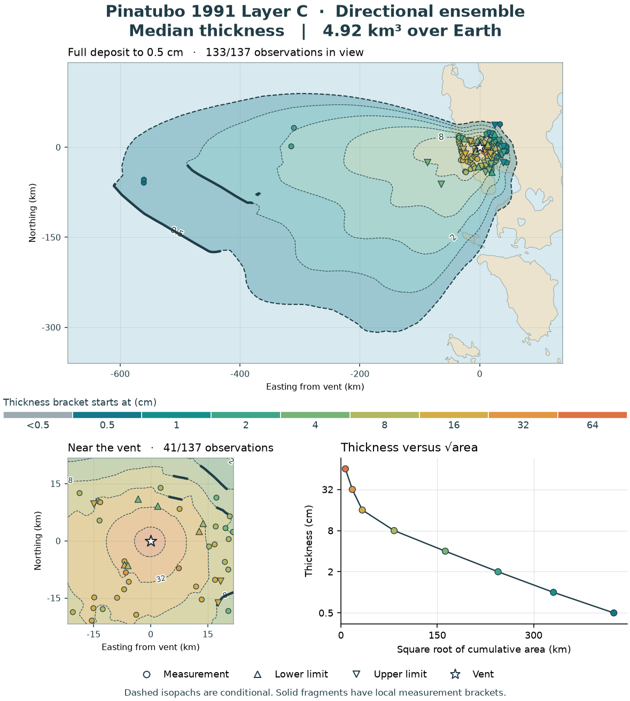
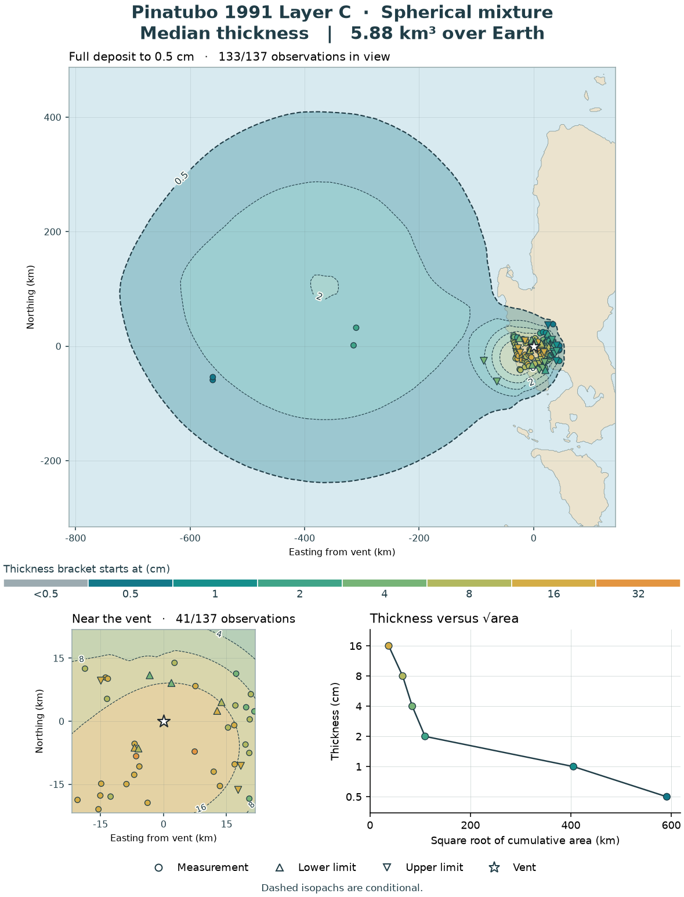
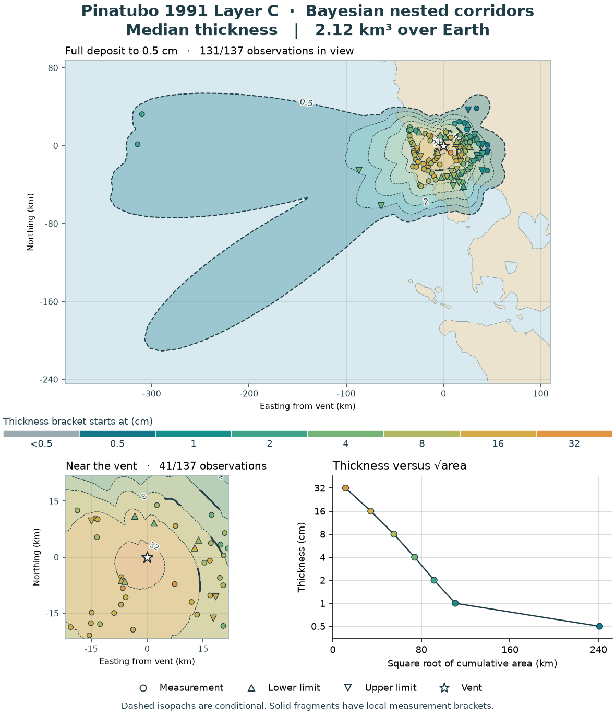
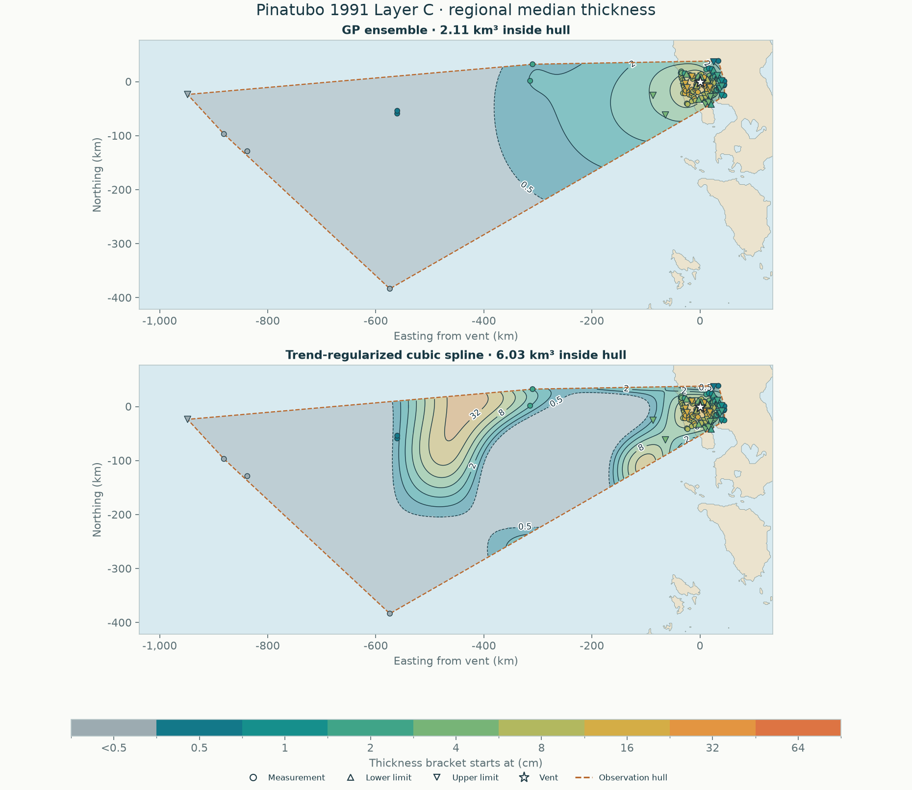

# Mount Pinatubo, 15 June 1991 · Layer C

This separate intake snapshot combines C1 and C2 and the attributed marine fallout. Its 137 accepted rows comprise 102 exact thicknesses, 13 lower bounds and 22 upper bounds. The original source records, decisions about cross-map matches and source hashes accompany the calculation. The eight-case catalogue comparison uses registered eruptions. [Thickness CSV](data/Pinatubo_1991_layer_C.csv) · [Source-row decisions](data/audit/selection.csv) · [Geographic coverage](data/audit/coverage.csv) · [Source and input hashes](data/audit/provenance.json)

## Volumes and geographic prediction

Each volume integrates its method’s median-thickness map. The GP and spline cover the same observation hull. The other three methods cover Earth, including fallout below 0.5 cm. Conditional 95% intervals describe variation in whole-deposit volume across posterior draws.

| Method | Median-map volume (km³) | Conditional 95% interval (km³) | Held-out score ↓ | 95% coverage |
|---|---:|---:|---:|---:|
| GP ensemble | **2.11** | 1.74–5.98 | 2.632 | 93.1% |
| Cubic spline | **6.03** | 19.6–1.15e+13 (provisional) | 6.844 | 87.3% |
| [Directional ensemble](directional/README.md) | **4.92** | 3.2–11 (provisional) | 1.804 † | 93.1% |
| [Spherical mixture](spherical-mixture/README.md) | **5.88** | 4.05–28.7 | 0.813 | 97.1% |
| [Bayesian nested corridors](nested-isopachs/README.md) | **2.12** | 1.46–6.93 | 1.440 † | 82.4% |

Lower scores indicate better predictions in withheld geographic regions. Coverage counts exact withheld measurements. A dagger marks a numerical or geographic validation warning. Provisional intervals retain their fit or integration warnings.

## Full deposits and near-vent detail

The outer line is 0.5 cm. Contours and observation colours double from there. All three methods use the same near-vent window for this eruption. Each curve counts the combined area of all patches at or above a thickness.

## Inside the observation hull

The dashed boundary encloses all accepted sites. Gaps inside it can still be poorly constrained. [Regional fits and numerical checks](regional/README.md)

## Source evidence and continuation checks

The median corridor map integrates to 2.12 km³. The full-data checks passed. Two of four geographic refits passed, and 84 of 102 withheld exact measurements fell inside the 95% predictive interval. The broader whole-area median-thickness map integrates to 5.82 km³. [Principal field and folds](nested-isopachs/README.md) · [Whole-area sensitivity](nested-whole-area/README.md)

Paladio-Melosantos and colleagues reported 3.4–4.4 km³ bulk for Layer C. That published range falls inside the corridor’s conditional 95% interval and above its median-map integral. Both analyses draw on some of the same field evidence. Paladio-Melosantos et al. also describe loss of proximal fallout to erosion and incorporation into moving pyroclastic flows. The preserved record and the choice of distal thinning both matter for the comparison. [Layer C descriptions and reconstruction](https://pubs.usgs.gov/pinatubo/paladio/index.html) · [C1 and C2 field maps](https://pubs.usgs.gov/pinatubo/koya/) · [South China Sea cores](https://pubs.usgs.gov/pinatubo/wiesner/index.html)

Inside the common observation hull, the GP median field integrates to 2.11 km³. The spline mean failed the integration-refinement check and its conditional volume distribution is extremely right-skewed. Its median-thickness map integrates to 6.03 km³ inside the hull. The held-out scores are 2.632 for GP and 6.844 for spline. [Regional isopachs](regional/isopachs.png) · [Regional predictions](regional/heldout_predictions.csv) · [Supported volumes and contour audits](regional/support/README.md) · [Regional diagnostics and numerical warnings](regional/report.json)

The data are transcribed from published sections, sublayer maps and core readings. The model uses each accepted source row once. The analogue prior for the nested model excludes the Pinatubo thinning estimates. [Koyaguchi map readings](data/sources/koyaguchi-figure-3.csv) · [Paladio map readings](data/sources/paladio-figure-7.csv) · [Paladio section thicknesses](data/sources/paladio-table-2.csv) · [Wiesner and Wang core thicknesses](data/sources/wiesner-wang-table-1.csv)

[Original source scans and hashes](data/originals/sources.json) · [Original Paladio-Melosantos source text](../../../data/sources/nested-isopachs/paladio-table-source.html.gz)

When all ten marine readings are withheld, the land-only corridor fit underpredicts offshore fallout. That fit retained a numerical warning. [Withheld field surveys](../../nested-reach/field-surveys/README.md) · [Whole-area sensitivity](nested-whole-area/README.md)
