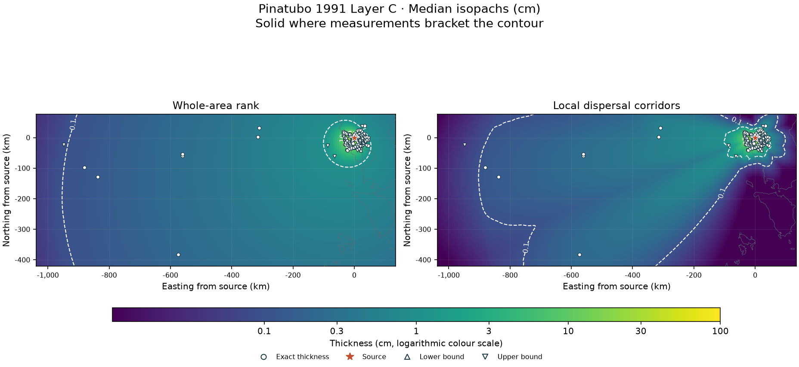
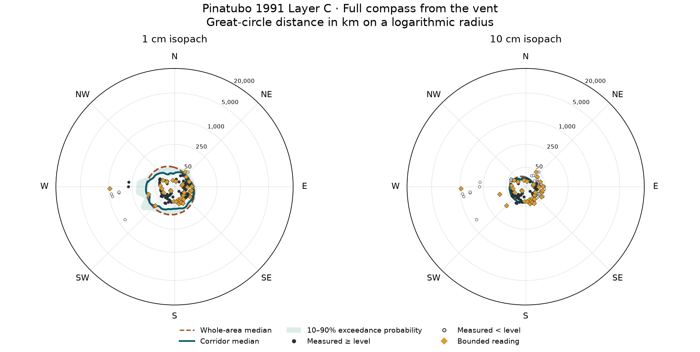

# Pinatubo 1991 Layer C · Geographic reach of nested isopachs

The conditional bulk fallout estimate is **2.3 km³** (95% interval **1.5–6.9**). The median thickness map integrates to 2.1 km³. The earlier whole-area rank gives 6.1 km³ (3.6–14.9).

Solid portions cross a retained triangle with thicknesses on either side at distinct measured sites and at least 90% posterior crossing probability. Dashed portions depend on the continuation. The triangles diagnose spatial coverage. The shared contour screen also checks thickness bracketing and deletion stability. [Whole-Earth field](world.png) · [Every local bracket](local-brackets.csv.gz) · [Complete contour checks](support.json)

The buffered geographic score is 1.440, compared with 1.076 previously. Lower scores indicate better predictions at withheld sites. 2 of 4 geographic fits passed their sampling checks. The full-data proposal and importance check passed, the final volume populations passed, and the integration check passed. The shared screen accepted a complete contour band under 0 policies. [Prediction scores and row identities](report.json) · [Full fit diagnostics](full.json)

## Where the volume lies

The full-compass view includes all bearings through the antipode. Its logarithmic distance scale makes the proximal flanks visible. Areas in the table use the physical equal-area integral.

| Compass sector | Exact sites | Bounded sites | Old 1 cm area (km²) | Revised 1 cm area (km²) | Revised volume (km³), median [95%] |
|---|---:|---:|---:|---:|---:|
| N | 1 | 2 | 1,056 | 367 | 0.0 [0.0–0.3] |
| NE | 8 | 2 | 606 | 522 | 0.0 [0.0–0.2] |
| E | 28 | 8 | 905 | 830 | 0.1 [0.0–0.3] |
| SE | 17 | 7 | 2,002 | 1,441 | 0.1 [0.1–0.8] |
| S | 7 | 6 | 3,589 | 1,680 | 0.2 [0.1–1.3] |
| SW | 20 | 4 | 4,510 | 3,204 | 0.8 [0.5–1.8] |
| W | 14 | 4 | 3,911 | 3,347 | 0.9 [0.5–1.6] |
| NW | 7 | 2 | 2,333 | 966 | 0.1 [0.1–0.8] |

At 1 cm, the two median maps enclose 18,911 and 12,357 km² across Earth. Of these, 18,004 and 11,449 km² fall outside the retained exact-site triangles. An unsampled sector can contain ash. Its allocation depends on the assumed continuation.

The prior assigns 25% to continuation across all bearings. The remaining probability spans three fan widths and three down-range extensions. The fitted probability of whole-bearing continuation is 9.6%. The widths and extensions are shared structural assumptions. A bound supplies a likelihood event. Only positive evidence supplies a potential dispersal corridor.

[Volume and sector draws](volume-budget.npz) · [Complete field draws](full.npz) · [Areas, assumptions, bounds and diagnostics](report.json)

## Structural uncertainty

| Prior probability of broad continuation | Median bulk volume, km³ [conditional 95%] |
|---:|---:|
| 10% | 2.2 [1.5–5.7] |
| 25% | 2.3 [1.5–6.9] |
| 50% | 2.4 [1.5–8.1] |
| 75% | 3.5 [1.5–10.2] |

The prior odds vary under the same observed likelihood. The numerical report also gives the volume by individual corridor law where the saved draws resolve it.
