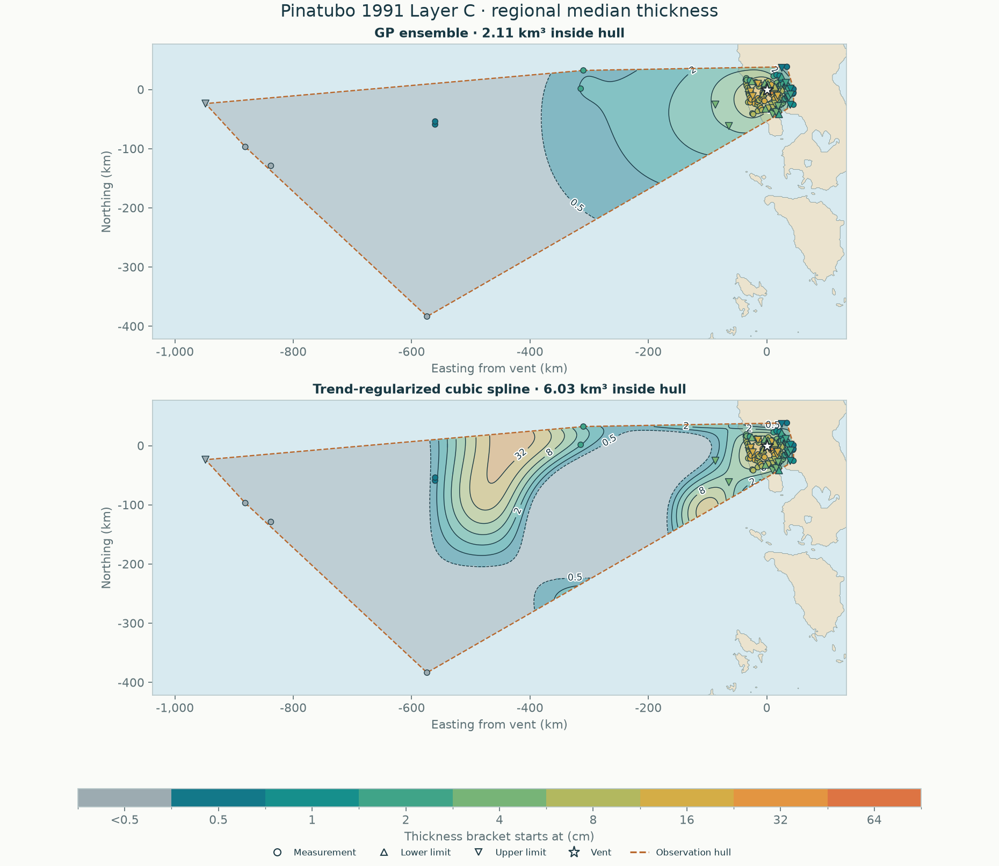
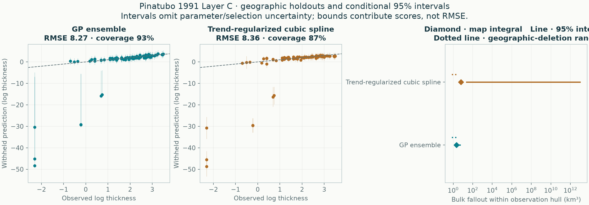

# Pinatubo 1991 Layer C · regional fits inside the observation hull

The GP and cubic spline use the same accepted observations, geographic holdouts and observation hull.

**102 exact measurements, 13 lower bounds, 22 upper limits.** The observation hull covers 220,180 km². The automatic validation buffer is 2.88 km.



The full observation hull and every accepted location are in view. The coloured field is clipped to the exact hull; fine coastlines are context only. [Map frame and rendering provenance](map-display.json).

| Quantity | GP ensemble | Trend-regularized cubic spline |
|---|---:|---:|
| Principal median-map volume inside hull (km³) | 2.11 | 6.03 |
| Complete-draw conditional 95% volume interval (km³) | 1.74–5.98 | 19.60–11504483111227.75 |
| Outer equal-region negative log score ↓ | 2.632 | 6.844 |
| Outer log-thickness RMSE ↓ | 8.266 | 8.358 |
| Outer 95% observation-interval coverage | 93.1% | 87.3% |

Lower predictive score and RMSE are better. Coverage must be read with interval width and predictive score; wider intervals alone are not improvement.



## Scope

The footprint is the convex hull of measured/bounded locations, with no source point or invented observations added. It can contain large unsampled gaps and can exclude proximal deposits. These are **regional bulk fallout volumes, not total eruption volumes or dense-rock equivalents**. No global extrapolation enters this comparison.

Volume integrates pointwise median thickness over the observation hull. The uncertainty interval uses the 2.5th and 97.5th percentiles of spatially correlated volume draws.

## Fitted methods


### GP ensemble

```json
{
  "candidate": {
    "tail": "stacked"
  },
  "components": [
    {
      "weight": 0.1960193299600794,
      "model": {
        "candidate": {
          "tail": "exponential",
          "length_factor": 0.75,
          "noise_ratio": 1.5
        },
        "beta": [
          3.1665733841500527,
          1.0904103171725343,
          -0.8584074114728572,
          -0.293466269953837
        ],
        "radius_scale_km": 31.111275638393472,
        "length_km": 30.240002730926424,
        "amplitude_log": 0.46770920033166175,
        "noise_log": 0.7015638004974927,
        "jitter": 2.187518960748825e-10,
        "trend_on_constraint_boundary": false,
        "uncertainty": "conditional Laplace"
      }
    },
    {
      "weight": 0.39016015959578126,
      "model": {
        "candidate": {
          "tail": "power",
          "length_factor": 0.75,
          "noise_ratio": 1.5
        },
        "beta": [
          4.326089073943515,
          3.3024572628151105,
          -1.203612026931195,
          -0.4977051387849976
        ],
        "radius_scale_km": 31.111275638393472,
        "length_km": 30.240002730926424,
        "amplitude_log": 0.5139023877639821,
        "noise_log": 0.7708535816459732,
        "jitter": 2.6409566414952223e-10,
        "trend_on_constraint_boundary": true,
        "uncertainty": "conditional Laplace"
      }
    },
    {
      "weight": 0.4138205104441393,
      "model": {
        "candidate": {
          "tail": "power",
          "length_factor": 1.5,
          "noise_ratio": 1.5
        },
        "beta": [
          4.326089073943515,
          3.3024572628151105,
          -1.203612026931195,
          -0.4977051387849976
        ],
        "radius_scale_km": 31.111275638393472,
        "length_km": 60.48000546185285,
        "amplitude_log": 0.5139023877639821,
        "noise_log": 0.7708535816459732,
        "jitter": 2.6409566414952223e-10,
        "trend_on_constraint_boundary": true,
        "uncertainty": "conditional Laplace"
      }
    }
  ],
  "dominant_tail": "power",
  "observation_discrepancy_variance_log": 1.904011104962656,
  "trend_on_constraint_boundary": true,
  "uncertainty": "Predictive mixture; includes disagreement among retained candidates, conditional on each fit and estimated weights. Fitted-parameter uncertainty is not integrated."
}
```

### Trend-regularized cubic spline

```json
{
  "method": "spline",
  "candidate": {
    "tail": "power",
    "knot_intervals": 6,
    "tension": 1.0,
    "smoothing": 0.0001,
    "trend_strength": 0.01,
    "noise_ratio": 0.75
  },
  "bounds_km": [
    -998.0820371708731,
    -404.5100839483061,
    94.91218326462203,
    59.530198184632795
  ],
  "knot_intervals_xy": [
    6,
    3
  ],
  "n_coefficients": 54,
  "noise_log": 0.34616268935870587,
  "amplitude_log": 0.46155025247827447,
  "trend_beta": [
    3.9496880638975123,
    2.8655788531812445,
    -1.0917638416751756,
    -0.6974941401586195
  ],
  "trend_radius_scale_km": 31.111275638393472,
  "trend_on_constraint_boundary": false,
  "effective_df_exact": 13.82387545825846,
  "newton_decrement": 2.9430751067656517e-18,
  "newton_iterations": 9,
  "quadrature_order": 6,
  "uncertainty": "Conditional Laplace",
  "uncertainty_omits": [
    "fitted trend",
    "noise and smoothing estimation",
    "knot/trend selection",
    "sampling and preservation bias",
    "vent location error"
  ],
  "pseudo_observations": 0
}
```

Every explored candidate is retained in the selection tables. All response-dependent choices are retuned within training folds; no hand-placed pseudo-data enter the likelihood.

## Reliability checks

- All probability intervals condition on fitted parameters and selected settings; they omit parameter/selection and preservation/sampling uncertainty.
- Four geographic outer folds evaluate the entire tuning procedure; this is development evidence, not independent external validation.
- Geographic-deletion volume ranges show refitting sensitivity and are not confidence intervals.
- Trend-regularized cubic spline: the analytic expected volume exceeds the 97.5th percentile of complete deposits. Rare thick fields dominate the expectation. The conditional interval remains sensitive to the upper tail.
- Trend-regularized cubic spline regional integration did not reach the stated refinement tolerance.
- Trend-regularized cubic spline joint-draw quadrature needs further refinement; inspect its grid checks before using intervals.
- Trend-regularized cubic spline: held-out 95% observation coverage is only 87.3%; uncertainty is undercovered.

## Reproduce and inspect

```sh
tephra-isopachs compare Pinatubo_1991_layer_C.csv --output results/new-regional-run
```

[Complete numerical report](report.json) · [Withheld predictions](heldout_predictions.csv) · [Accepted observation semantics](accepted_observations.csv) · [Selection tables](selection/README.md)

The JSON records input/source hashes, package versions, all fold memberships, regional integration refinements, conditional-volume sampling precision and geographic-deletion sensitivity. Historical GP global calculations remain separate.

## Which parts are actually supported?

Read the [local support and complete-contour audit](support/README.md) before extrapolating these hull volumes. It screens unsampled gaps, tests closure under geographic deletion, and separates interpolation from proximal/distal assumptions.
