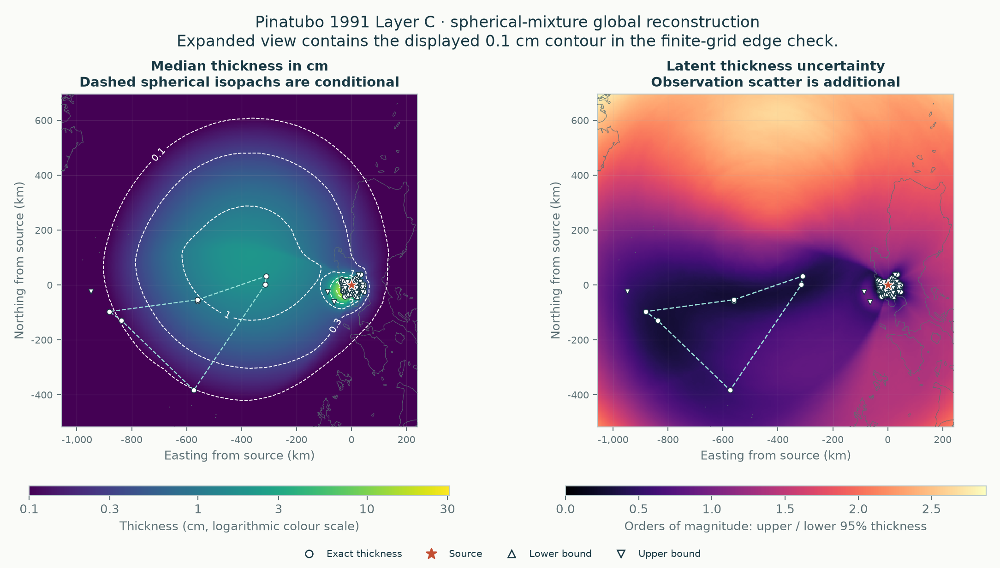

# Pinatubo 1991 Layer C spherical-mixture fallout

**6.2 km³ of bulk fallout** is the principal whole-Earth volume. The conditional 95% interval is **4.1–28.7 km³**. Each simulated deposit carries one fan direction through the unsampled ground. The map shows median thickness at each location. The volume and its interval summarize the integrals of complete deposits.

The underlying spherical mixture gave 7.5 [5.0–37.5] km³. The extension leaves thickness at each accepted site and inside supported interpolation triangles unchanged. Beyond finite measured bearings it averages three assumptions with equal weight. A deposit can retain the original broad field, or continue preferentially along one broad or narrower fan. A site carrying only an upper limit constrains its own location and supplies no positive ray.

[Near-observation field](local.png) · [Source region](source.png) · [Whole-Earth map](world.png) · [Sector-by-sector isopach areas](bearing/sector-areas.csv) · [All crossings along eight bearings](bearing/ray-crossings.json)

## What the unobserved directions contribute

| Continuation assumption | Whole-deposit median [conditional 95%], km³ |
|---|---:|
| Broad parent continuation | 7.5 [5.0–37.6] |
| Unknown fan, 90° half-thickness angle | 6.0 [4.1–26.6] |
| Unknown fan, 47° half-thickness angle | 5.2 [3.9–20.9] |
| Enhanced narrow hidden fan, separate sensitivity | 6.5 [4.2–41.9] |

The three principal assumptions allow local thickness up to the parent prediction in the same draw. The enhanced-fan sensitivity allows extra ash along a hidden axis. Changing the angular spread of measured reach also changes the inferred mass.

| Angle at which measured reach halves | Whole-deposit median [conditional 95%], km³ | Numerical checks |
|---|---:|---|
| 11.25° | 5.6 [2.9–25.0] | Passed |
| 45° | 7.1 [4.8–35.3] | Passed |

The median fraction inside the screened measurement footprint is **10.3%**. The median fraction beyond the farthest exact site is **2.6%**. Other mass lies in the intervening gaps and the unmeasured proximal cap. These are sampling classes.

## Prediction and uncertainty

The equal-region held-out log score is **0.813**, compared with 0.826 for the original geometry. Lower scores indicate better predictions. The 95% predictive interval covered **97.1%** of exact held-out thicknesses. Every buffered training fold builds its own bearing support. Censored sites contribute their reported limit events to the score.

Across 56 held-out readings with gap exposure of at least 0.5, mean negative log score was 1.161 for the principal field and 1.204 for its parent. This subset weights individual sites equally.

The shared contour audit identified no qualifying standard-policy band. [Complete decisions and geographic deletions](complete-contour-audit.json)

| Spherical prior | Whole-deposit median [conditional 95%], km³ | Numerical checks |
|---|---:|---|
| baseline | 6.2 [4.1–28.7] | Passed |
| diffuse tail | 6.7 [4.1–53.9] | Passed |
| wide geography | 7.1 [4.1–291.4] | Passed |
| volume prior shift | 6.2 [4.1–25.2] | Passed |
| one fan | 1.3 [0.9–1.9] | Passed |
| five fans | 7.7 [4.3–703.0] | Passed |
| gaussian errors | 6.0 [4.0–26.0] | parent sampler warning |
| diffuse mixture weights | 5.5 [3.8–10.8] | Passed |

The resolved 1, 10 and 100 cm contour areas passed the split-draw test at 192 parent draws per chain. Sparsely represented or empty contour unions remain unresolved.

All four geographic training fits passed their sampling checks.
The tail and overall scale can remain weakly identified even when numerical checks pass. The reference-amplitude prior induces a prior on retained volume. Reworking, incomplete sampling and source attribution can add uncertainty beyond these conditional intervals.

[Prior sensitivity and mass partition](volume.png) · [Derived-volume chains](sampling.png) · [Numerical report](report.json) · [Held-out sites](heldout_predictions.csv) · [Whole-deposit draws](volume_draws.csv.gz) · [Joint sector and support-class volumes](bearing/baseline.npz) · [Original spherical fit and all attempts](bearing/parent-report.json)
