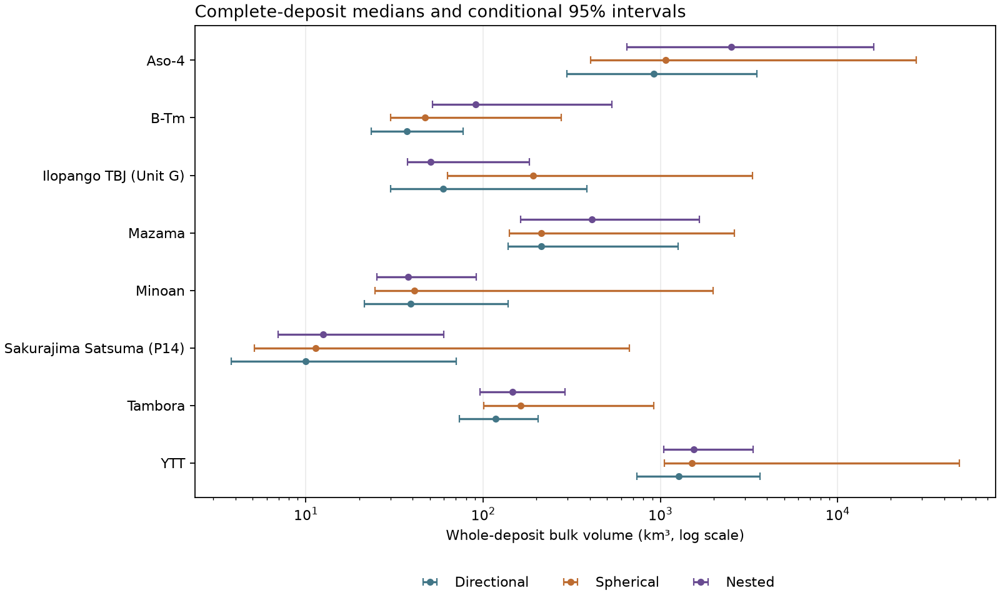

# Whole-area sensitivity for Bayesian nested isopachs

This study uses the broad whole-area continuation throughout. [Principal corridor estimates and maps](README.md)

Each row compares the same accepted thickness measurements and bounds. Each interval integrates complete simulated deposits over the Earth. The directional case home also reports the integral of its median map. Those two summaries can differ appreciably when a fan can turn.

| Eruption | Directional median | Spherical median | Nested median [conditional 95%], km³ | Nested site coverage | Full fit · geographic fits passing |
|---|---:|---:|---:|---:|---|
| [Aso-4](../../eruptions/aso-4/results/nested-whole-area/README.md) | 916.3 | 1,069.7 | **2,513.9** [648.8–15,969.9] | 75/83 | passed · 3/4 |
| [B-Tm](../../eruptions/b-tm/results/nested-whole-area/README.md) | 37.2 | 47.0 | **90.4** [52.0–534.5] | 60/64 | passed · 4/4 |
| [Ilopango TBJ (Unit G)](../../eruptions/ilopango-tbj/results/nested-whole-area/README.md) | 59.4 | 190.9 | **50.5** [37.5–181.8] | 49/52 | **warning** · 1/4 |
| [Mazama](../../eruptions/mazama/results/nested-whole-area/README.md) | 213.5 | 212.9 | **411.2** [162.2–1,663.6] | 41/45 | passed · 4/4 |
| [Minoan](../../eruptions/minoan/results/nested-whole-area/README.md) | 39.1 | 40.8 | **37.6** [25.1–91.8] | 85/92 | passed · 4/4 |
| [Sakurajima Satsuma (P14)](../../eruptions/sakurajima-satsuma/results/nested-whole-area/README.md) | 10.0 | 11.3 | **12.5** [7.0–60.2] | 49/50 | **warning** · 1/4 |
| [Tambora](../../eruptions/tambora/results/nested-whole-area/README.md) | 117.5 | 162.3 | **146.9** [96.1–290.7] | 26/26 | passed · 4/4 |
| [YTT](../../eruptions/ytt/results/nested-whole-area/README.md) | 1,272.1 | 1,510.5 | **1,543.0** [1,048.5–3,339.5] | 43/46 | **warning** · 3/4 |

The equal-eruption mean geographic negative log scores are 1.528 for directional, 1.511 for spherical and 1.366 for nested. Each case gives its four buffered regions equal weight. Lower scores indicate better prediction at the withheld sites. Complete contour bands qualified under at least one nested support policy in 0 of 8 cases. Ancient global volumes have no independent measured total here. [Case volumes and scores](whole-area-cases.csv) · [Matched regional rerun](regional-replay.csv)

## Where the nested estimate comes from

| Eruption | Median volume fraction in measured triangles | Median fraction beyond the farthest exact site | That distal fraction among the largest 5% of volumes | Median if exponential / power tail (km³) |
|---|---:|---:|---:|---:|
| Aso-4 | 1.2% | 55.1% | 88.6% | 2,543 / 2,440 |
| B-Tm | 4.9% | 21.7% | 83.8% | 89 / 96 |
| Ilopango TBJ (Unit G) | 3.4% | 11.3% | 78.4% | 55 / 49 |
| Mazama | 5.4% | 15.3% | 71.6% | 401 / 436 |
| Minoan | 6.7% | 9.5% | 57.0% | 36 / 39 |
| Sakurajima Satsuma (P14) | 1.4% | 45.9% | 89.9% | 12 / 13 |
| Tambora | 8.0% | 5.1% | 15.6% | 154 / 145 |
| YTT | 13.2% | 0.9% | 4.1% | 2,986 / 1,420 |

The circle through the farthest exact measurement is a diagnostic. Individual parts of that circle can have very different sampling density. Each case reports the volume per compass sector, the full profile and archive checks. Minoan includes the accepted Plinian and co-ignimbrite fans together.

## What changed in the nested fit

Three versions use identical observations and geographic training partitions. The initial version put a prior on thinning slopes. The second sets a prior on the ratio of distal to core volume using independently mapped deposits. The third uses that fitted profile throughout the observed area ranks and transfers a separate remaining mass budget beyond the last sampled rank. The last two produce exactly the same fitted thickness at every training site. The test in the last column withholds the farthest fifth of observations by source distance and removes nearby training sites with the standard geographic buffer. Lower scores indicate better prediction.

| Eruption | Initial median (km³) | Distal/core prior alone | Refined median | Fraction beyond last sampled rank, refined | Farthest-fifth scores, initial / prior alone / refined |
|---|---:|---:|---:|---:|---|
| Aso-4 | 5,657.1 | 6,493.5 | 2,513.9 | 43.4% | 1.757 / 1.735 / 1.836 |
| B-Tm | 78.1 | 87.5 | 90.4 | 13.8% | 1.235 / 1.289 / 1.287 |
| Ilopango TBJ (Unit G) | 1,000.6 | 87.2 | 50.5 | 10.5% | 1.727 / 1.371 / 1.424 |
| Mazama | 350.2 | 375.7 | 411.2 | 13.6% | 2.172 / 2.249 / 2.255 |
| Minoan | 38.3 | 46.3 | 37.6 | 7.6% | 1.902 / 1.870 / 1.965 |
| Sakurajima Satsuma (P14) | 10.5 | 12.8 | 12.5 | 39.5% | 0.831 / 0.799 / 0.796 |
| Tambora | 149.1 | 168.5 | 146.9 | 2.6% | 1.912 / 1.835 / 1.966 |
| YTT | 1,763.5 | 1,538.2 | 1,543.0 | 0.8% | 2.670 / 2.629 / 2.027 |

### Uncertainty across three thinning assumptions

The span below goes from the smallest lower endpoint to the largest upper endpoint across the three nested fits. Each individual interval is conditional on its own transport assumptions. The combined span has no assigned posterior probability. It shows how much narrower an answer can appear when only one thinning law is reported.

| Eruption | Span of conditional 95% endpoints (km³) | Range of scenario medians (km³) |
|---|---:|---:|
| Aso-4 | 648.8–20,663.7 | 2,513.9–6,493.5 |
| B-Tm | 52.0–1,049.4 | 78.1–90.4 |
| Ilopango TBJ (Unit G) | 37.5–2,384.3 | 50.5–1,000.6 |
| Mazama | 151.2–1,731.1 | 350.2–411.2 |
| Minoan | 25.1–248.6 | 37.6–46.3 |
| Sakurajima Satsuma (P14) | 6.6–709.8 | 10.5–12.8 |
| Tambora | 96.1–460.2 | 146.9–168.5 |
| YTT | 1,046.0–3,339.5 | 1,538.2–1,763.5 |

The initial Aso-4 and Ilopango posteriors placed a median 81% and 96% of their volumes beyond the farthest exact site. Aso-4's median rose with the distal/core prior alone. Applying the remaining-mass transfer exposes the volume that could still lie inside broadly continued, poorly sampled directions. The four mapped donor volcanoes offer limited evidence for giant co-ignimbrite falls. Their distal thickness profiles are reconstructions with their own extrapolation error. [Archived initial estimates and draws](../../archive/2026-11-21-nested-initial/README.md) · [Equations and donor assumptions](../../docs/methods/nested-isopachs.md)

## Influence of the site setting the last sampled isopach

The test identifies the row setting the outermost sampled rank most often across posterior draws. It refits after withholding that row, then after withholding its local buffered cluster. A change reflects the observations and the revised geographic rank at which the analogue mass budget begins. These diagnostic deletions preserve the original accepted dataset.

| Eruption | Principal median (km³) | One site withheld | Local cluster withheld | Cluster size | Single / cluster numerical checks |
|---|---:|---:|---:|---:|---|
| [Aso-4](../../eruptions/aso-4/results/nested-whole-area/edge-deletion/README.md) | 2,513.9 | 2,438.8 | 2,438.8 | 1 | passed / passed |
| [B-Tm](../../eruptions/b-tm/results/nested-whole-area/edge-deletion/README.md) | 90.4 | 172.3 | 172.3 | 1 | passed / passed |
| [Ilopango TBJ (Unit G)](../../eruptions/ilopango-tbj/results/nested-whole-area/edge-deletion/README.md) | 50.5 | 52.0 | 52.5 | 2 | passed / warning |
| [Mazama](../../eruptions/mazama/results/nested-whole-area/edge-deletion/README.md) | 411.2 | 569.0 | 569.0 | 1 | warning / warning |
| [Minoan](../../eruptions/minoan/results/nested-whole-area/edge-deletion/README.md) | 37.6 | 37.6 | 37.6 | 1 | passed / passed |
| [Sakurajima Satsuma (P14)](../../eruptions/sakurajima-satsuma/results/nested-whole-area/edge-deletion/README.md) | 12.5 | 11.0 | 11.0 | 1 | passed / passed |
| [Tambora](../../eruptions/tambora/results/nested-whole-area/edge-deletion/README.md) | 146.9 | 157.8 | 157.8 | 1 | passed / passed |
| [YTT](../../eruptions/ytt/results/nested-whole-area/edge-deletion/README.md) | 1,543.0 | 1,463.4 | 1,463.4 | 1 | passed / passed |

At Aso-4 the refined model assigns the following median shares of complete-deposit volume to poorly sampled sectors. The shares are SE 14.0% (2 exact), S 13.3% (2 exact), W 12.5% (0 exact). Its median area above 1 mm covers 44.3% of the Earth. These values expose the direction and scale of the remaining extrapolation. [Compass-sector evidence for all eruptions](sector-evidence.csv)

## Testing extra thinning beyond the observations

A further sensitivity makes ash thin progressively faster beyond the largest equal-area rank of any training site. The three scenarios have identical fitted likelihoods and each integrates over the whole Earth. Stronger or weaker distal removal can change total volume without leaving a measurable signal at the fitted sites.

| Eruption | Original median | One extra sampled radius | Two | Four | Geographic score, original → one-radius |
|---|---:|---:|---:|---:|---:|
| Aso-4 | 2,513.9 | 1,845.0 | 2,172.9 | 2,392.6 | 1.540 → 1.539 |
| B-Tm | 90.4 | 80.7 | 85.0 | 88.0 | 1.570 → 1.568 |
| Ilopango TBJ (Unit G) | 50.5 | 48.8 | 49.6 | 50.0 | 1.159 → 1.159 |
| Mazama | 411.2 | 356.0 | 372.6 | 389.7 | 1.503 → 1.501 |
| Minoan | 37.6 | 34.5 | 35.7 | 36.6 | 1.536 → 1.541 |
| Sakurajima Satsuma (P14) | 12.5 | 9.2 | 10.3 | 11.2 | 0.742 → 0.741 |
| Tambora | 146.9 | 142.3 | 144.0 | 145.6 | 1.368 → 1.372 |
| YTT | 1,543.0 | 1,538.2 | 1,541.1 | 1,542.5 | 1.507 → 1.501 |

Lake Sihailongwan has a conditional upper bound of 0.06 cm in the accepted B-Tm table. The nested median field gives 1.12 cm there, and the fitted model assigns the upper-bound event a probability of 0.77%. Its western contours merit particular caution. [B-Tm bounds and predictions](../../eruptions/b-tm/results/nested-whole-area/README.md)

## How sensitive are the nested volumes to unmeasured bearings?

This comparison keeps the fitted thickness at every training site. It allows a hidden fan to turn in poorly sampled bearings. A separate high-ash scenario increases its thickness along its unknown axis. The two columns give the medians of the corresponding complete deposits.

| Eruption | Principal (km³) | Uncertain bearing (km³) | Enhanced hidden fan (km³) | Paired site scores, principal / uncertain bearing |
|---|---:|---:|---:|---:|
| [Aso-4](../../eruptions/aso-4/results/nested-whole-area/bearing-study/README.md) | 2,513.9 | 1,637.0 | 2,238.4 | 1.543 / 1.569 |
| [B-Tm](../../eruptions/b-tm/results/nested-whole-area/bearing-study/README.md) | 90.4 | 78.3 | 86.7 | 1.570 / 1.519 |
| [Ilopango TBJ (Unit G)](../../eruptions/ilopango-tbj/results/nested-whole-area/bearing-study/README.md) | 50.5 | 46.5 | 51.0 | 1.169 / 1.257 |
| [Mazama](../../eruptions/mazama/results/nested-whole-area/bearing-study/README.md) | 411.2 | 361.1 | 394.1 | 1.505 / 1.407 |
| [Minoan](../../eruptions/minoan/results/nested-whole-area/bearing-study/README.md) | 37.6 | 33.8 | 37.1 | 1.538 / 1.549 |
| [Sakurajima Satsuma (P14)](../../eruptions/sakurajima-satsuma/results/nested-whole-area/bearing-study/README.md) | 12.5 | 10.2 | 12.7 | 0.743 / 0.868 |
| [Tambora](../../eruptions/tambora/results/nested-whole-area/bearing-study/README.md) | 146.9 | 133.7 | 139.8 | 1.375 / 1.400 |
| [YTT](../../eruptions/ytt/results/nested-whole-area/bearing-study/README.md) | 1,543.0 | 1,423.6 | 1,550.3 | 1.505 / 1.507 |

## Experiments with the two existing methods

| Family | Mean control score | Mean candidate score | Eruptions improved / tied / worsened | All numerical checks passed |
|---|---:|---:|---:|---:|
| Directional | 1.528 | 1.536 | 2 / 0 / 6 | 4/8 |
| Spherical | 1.506 | 1.488 | 5 / 1 / 2 | 5/8 |

For directional deposits the new sensitivity allows the amount of ash in a poorly sampled bearing to vary coherently across a draw. For the spherical mixture it gives less prior weight to fans whose centres are far from the vent relative to their widths. B-Tm’s source-focused spherical geometry receives exactly unit weight. Each paired control uses the same sample of posterior fields as its candidate. Both changes are published as named sensitivities. The changes in predictive score and remaining parent-fit warnings give insufficient grounds to promote either as the new principal estimate. [Per-case changes and conditional intervals](peer-sensitivities.csv) · [Equations and priors](../../docs/methods/continuation-sensitivities.md)

## Known-volume deposits

The original suite has six deposit and sampling designs. They include a missing proximal core, an unsampled sector, two fans and a diffuse distal component. The second suite also uses identical sample values with two possible true deposits, one carrying a lobe invisible to every sample. Each seed and sampling design counts once. Its two possible truths each count half in the averages. Predictions are conditional nominal 95% intervals. Coverage shows the unweighted count of displayed truths. Mean absolute log error measures central-volume error. The interval score adds log interval width to 40 times the log distance of a truth outside its interval. Smaller values are better. Numerical warnings remain in all comparisons.

| Sampling seeds | Family | Truths covered | Mean absolute log error | Mean log interval width | Mean log interval score | Fits with warnings / designs |
|---|---|---:|---:|---:|---:|---:|
| 10, 11 | Spherical | 11/12 | 0.371 | 3.835 | 3.870 | 4/12 |
| 10, 11 | Nested | 10/12 | 0.460 | 1.792 | 3.992 | 8/12 |
| 10, 11 | Nested initial | 12/12 | 0.194 | 2.616 | 2.616 | 7/12 |
| 90, 91 | Directional | 9/16 | 0.279 | 0.879 | 2.743 | 9/14 |
| 90, 91 | Spherical | 16/16 | 0.438 | 3.489 | 3.489 | 10/14 |
| 90, 91 | Nested | 14/16 | 0.397 | 1.827 | 2.408 | 11/14 |
| 90, 91 | Nested initial | 16/16 | 0.355 | 2.734 | 2.734 | 11/14 |
| 90, 91 | Directional gap amount | 11/16 | 0.280 | 0.943 | 1.706 | 9/14 |
| 90, 91 | Spherical source prior | 15/16 | 0.415 | 2.693 | 4.635 | 10/14 |

The simulated diffuse distal deposit contained 120 km³. Across four independent sampling seeds the refined nested medians were 22.4–27.5 km³. Its conditional 95% interval covered the truth in 0/4 cases. Historical thinning donors provide weak protection against a thin, widespread component. A revised central estimate for Aso-4 or Ilopango cannot establish that this failure mode is absent.

For one identical set of thickness readings, two deposits contain 33.6 and 72.8 km³. The nested fit necessarily gives both the same median of 56.8 km³ and the same interval of 30.2–231.1 km³. This tests the ability of an interval to accommodate an unobserved lobe.

Contour recovery is evaluated independently at 1, 10 and 100 cm. The table shows the mean ratio of area correctly predicted above threshold to area above threshold in either the prediction or truth. It includes only paired cases with at least 64 effective quadrature nodes in both unions. The two hidden-lobe truths share the weight of one sampling design. The detailed table records overextended and missed area separately. Pairings use the published geographic quadrature for each suite.

| Seeds | Comparator | Level (cm) | Paired truths | Nested overlap | Comparator overlap |
|---|---|---:|---:|---:|---:|
| 10, 11 | Spherical | 1 | 12 | 0.545 | 0.881 |
| 10, 11 | Spherical | 10 | 12 | 0.905 | 0.924 |
| 10, 11 | Spherical | 100 | 10 | 0.277 | 0.623 |
| 90, 91 | Directional | 1 | 16 | 0.524 | 0.805 |
| 90, 91 | Directional | 10 | 16 | 0.906 | 0.788 |
| 90, 91 | Directional | 100 | 14 | 0.397 | 0.109 |

These designed stress tests reuse published sampling geometries. They exercise failure modes and give no population-level frequency for those modes in nature. The directional, spherical and nested estimates remain separate. A wide conditional interval can cover a true volume even when its median misses a large lobe. The geographically withheld tests and the known-volume tests answer different questions.

[Known-volume predictions and truths](known-volumes.csv) · [False and missed isopach areas](known-areas.csv) · [Raw challenge diagnostics](challenge-receipts.json.gz) · [Nested model and prior calibration](../../docs/methods/nested-isopachs.md)

## Recovery on the Aso-4 and Ilopango survey layouts

These four tests were specified after freezing the final model. Only the actual site coordinates and source locations are used. Every thickness and detection limit is simulated. Each design has the same three-component deposit in units of its median survey distance. The paired version adds a localized positive signal to the observed archive while the true primary fallout volume stays fixed. This tests how easily the method mistakes local thickening for primary ash elsewhere.

| Survey | Local archive thickening | True primary (km³) | Initial median [95%] | Refined median [95%] | Initial / refined checks |
|---|---|---:|---:|---:|---|
| aso-4 | yes | 298.0 | 325.7 [258.3–661.9] | 294.8 [260.9–586.9] | passed / warning |
| aso-4 | no | 298.0 | 281.4 [216.8–627.5] | 250.8 [210.7–407.3] | warning / passed |
| ilopango-tbj | yes | 1.2 | 1.1 [0.8–1.5] | 1.1 [0.8–1.6] | passed / warning |
| ilopango-tbj | no | 1.2 | 1.0 [0.8–1.5] | 1.0 [0.7–2.1] | passed / passed |

The synthetic archive signal is a diagnostic scenario. It supplies no evidence that any particular site was redistributed. The earlier panels use all matched trials, including poorly covered and numerically uncertain outcomes. [Simulation field, observation process and reference integrals](../../benchmarks/nested_deposit_recovery.py) · [Regional known-deposit replay](regional-known.csv)
