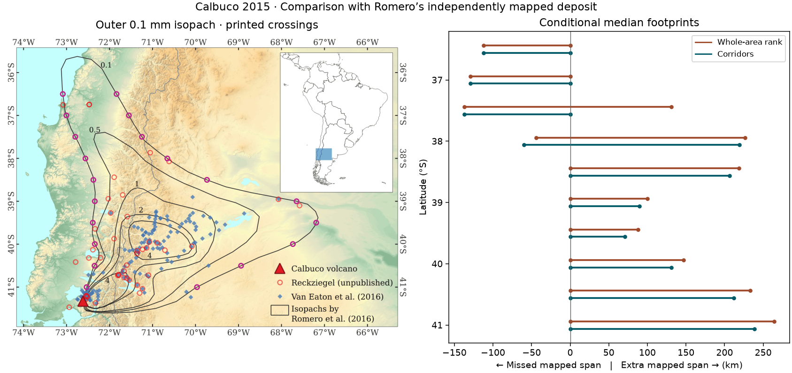

# Tests against real fallout deposits

Each fit below omits the survey or archive it predicts. The same reach assumptions were frozen before the external Calbuco test. The checked quantities are site thickness, documented bounds and mapped contour intersections. No eruption has a direct measurement of its complete deposited volume.

| Training evidence | Withheld evidence | Sites or bounds tested | Whole-area score | Corridor score |
|---|---|---:|---:|---:|
| Calbuco · Van Eaton survey | [Reckziegel survey](calbuco-2015/held-survey.csv) | 43 | 2.018 | 1.972 |
| Aso-4 · verified subaerial settings | [verified submarine cores](aso-4/held-survey.csv) | 28 | 1.405 | 1.544 |
| B-Tm · all other accepted rows | [three interpreted archive limits](b-tm/held-survey.csv) | 3 | 4.754 | 0.247 |
| Pinatubo · land sections and sublayer maps | [Wiesner–Wang marine cores](pinatubo-1991/held-survey.csv) | 10 | 3.622 | 5.295 |

Lower scores indicate better held-survey predictions. The score averages the negative log predictive density of an exact measurement or the negative log probability of a reported bound. Compare models within a row. Pinatubo’s land-only fit retained a numerical warning. [Scores, spatial buffers, block deletion checks and numerical flags](survey-scores.csv)

## Calbuco 2015 · A separate eruption and independent surveys

The training likelihood uses 100 exact and 59 interval readings from the Van Eaton compilation. Four reported zeros lack a site-specific detection limit. The independent Reckziegel file contains 45 rows. One reports zero and two share both coordinates and the same thickness. The 43 distinct positive readings supply the quantitative test. Each source row and exclusion is traceable. [Original archive](../../../data/sources/nested-reach/README.md) · [Source-row decisions](calbuco-2015/row-decisions.csv) · [Accepted observations](calbuco-2015/field-observations.csv)

On all 43 test sites the score changes from 2.018 to 1.972. The original and revised 95% predictive intervals contained 38 and 39 exact readings. At the 18 sites farther than the training-derived 5.87 km buffer from every training observation, the score changes from 2.405 to 2.295. Leaving out each geographic test block in turn gives a new-minus-old score change from -0.076 to -0.005. The independent campaign contains closely spaced sites, and this is one eruption. [Per-site predictions](calbuco-2015/held-survey.csv) · [Measured threshold crossings](calbuco-2015/validation.json)

Romero and colleagues’ field reconstruction provides a separate map comparison. At ten parallels from 36.5° to 41°S, the mean extra length of the modeled 0.1 mm footprint falls from 140.8 to 116.7 km. The mean missed mapped length changes from 42.3 to 43.8 km. The reference line is an expert interpretation between field sites. The magenta rings give the digitized crossings. The sampling campaign and the reference line stayed outside the fit. [Printed figure and attribution](../../../data/sources/nested-reach/README.md) · [Transect measurements](calbuco-2015/mapped-01mm-transects.csv) · [Mingari et al., Figure 2](https://gmd.copernicus.org/articles/16/3459/2023/)

Integrating median thickness on the Van Eaton training survey gives 0.556 km³ [0.465–1.080] under whole-area continuation and 0.509 km³ [0.401–0.823] under the principal corridor model. Published field reconstructions span approximately 0.27–0.58 km³ bulk. One of those reconstructions uses the Van Eaton observations. Romero et al.’s Table 3 gives 0.270 km³ for the whole deposit under two-segment exponential thinning. These estimates provide geological context and have their own distal extrapolation assumptions. [Review of the field estimates](https://gmd.copernicus.org/articles/16/3459/2023/) · [Romero et al., original reconstruction](https://doi.org/10.1016/j.jvolgeores.2016.02.027)

## What the named eruptions establish

At B-Tm, all three interpreted limits were omitted together. The probability of satisfying the Sihailongwan upper limit rises from 0.18% to 97.85%. These archives helped motivate the revision, so this is a retrospective check. The lake supplies an inferred upper bound on equivalent bed thickness. Calbuco supplies the external survey test. [B-Tm predictions by archive](b-tm/held-survey.csv)

At Aso-4 the 22 verified terrestrial rows predict the thicknesses of 28 verified submarine cores. Rows with unknown settings and lake cores were excluded from this transfer experiment. The whole-area sensitivity predicts the withheld marine thicknesses better. The survey provides measurements chiefly east and northeast of the vent. It leaves the western volume unresolved. [Aso-4 marine predictions](aso-4/held-survey.csv)

For Pinatubo, 127 accepted land sites and bounds predict ten withheld marine-core readings, including seven exact thicknesses. The corridor model underpredicts offshore reach. Neither model captures the offshore survey adequately and the land-only fit retained a sampling warning. This is direct evidence that a sampling boundary can truncate real distal fallout. [Marine-core predictions](pinatubo-1991/held-survey.csv) · [Original marine survey](https://pubs.usgs.gov/pinatubo/wiesner/index.html)

Mazama’s supplied thickness table lacks survey identifiers. Its evidence comes from buffered geographic and compass holdouts of actual measurements. The southwestern sector has no exact thicknesses or bounds, so the modeled southwestern closure remains conditional. [Mazama maps and spatial checks](../../../eruptions/mazama/results/nested-isopachs/README.md)
