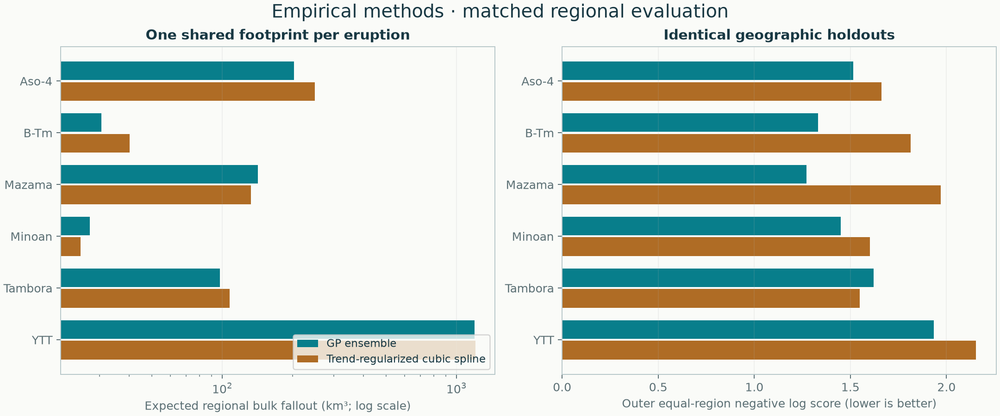

# Regional comparison of empirical methods

All methods are reported as peers. Every eruption uses its accepted data, identical nested geographic holdouts and one shared observation hull. No global volume enters this comparison. Aso-4 uses its 2026-11-08 source-qualified revision; the other five case calculations and the synthetic trials are unchanged. Read the [Aso-4 audit](../aso-4-audit/README.md) and [support checks](../support/README.md).

| Eruption | Method | Expected regional volume (km³) | Outer equal-region score ↓ | 95% observation coverage |
|---|---|---:|---:|---:|
| [Aso-4](../../eruptions/aso-4/results/README.md) | GP ensemble | 202.7 | 1.514 | 94.0% |
| [Aso-4](../../eruptions/aso-4/results/README.md) | Trend-regularized cubic spline | 248.2 | 1.662 | 90.4% |
| [B-Tm](../../eruptions/b-tm/results/README.md) | GP ensemble | 30.5 | 1.331 | 97.6% |
| [B-Tm](../../eruptions/b-tm/results/README.md) | Trend-regularized cubic spline | 40.2 | 1.814 | 90.5% |
| [Mazama](../../eruptions/mazama/results/README.md) | GP ensemble | 141.6 | 1.272 | 95.6% |
| [Mazama](../../eruptions/mazama/results/README.md) | Trend-regularized cubic spline | 132.6 | 1.971 | 82.2% |
| [Minoan](../../eruptions/minoan/results/README.md) | GP ensemble | 27.2 | 1.451 | 96.7% |
| [Minoan](../../eruptions/minoan/results/README.md) | Trend-regularized cubic spline | 24.8 | 1.601 | 96.7% |
| [Tambora](../../eruptions/tambora/results/README.md) | GP ensemble | 97.9 | 1.620 | 96.2% |
| [Tambora](../../eruptions/tambora/results/README.md) | Trend-regularized cubic spline | 107.7 | 1.548 | 96.2% |
| [YTT](../../eruptions/ytt/results/README.md) | GP ensemble | 1196.1 | 1.934 | 91.3% |
| [YTT](../../eruptions/ytt/results/README.md) | Trend-regularized cubic spline | 1203.0 | 2.153 | 82.6% |

These are bulk fallout volumes inside each dataset’s observation hull, not total eruption volumes. Different eruptions have different footprints. Lower predictive scores are better; close differences across four folds do not establish superiority.



[Machine-readable real-data comparison](comparison.csv). Each eruption report includes full tuning tables, fold assignments, conditional joint-volume draws, numerical refinements and deletion sensitivity.

## Known-truth development trials

10 fixed seeds per scenario; each model is tuned from training observations, then tested at 400 independent sites in the same hull. Conditional volume intervals are also checked against the known integral.

| Scenario / method | Completed / attempted | Predictive score ↓ | Observation coverage | Mean absolute volume error | Volume interval coverage |
|---|---:|---:|---:|---:|---:|
| censored / Trend-regularized cubic spline | 8 / 10 | 0.441 | 90.3% | 18.2% | 38% |
| censored / GP ensemble | 8 / 10 | 0.346 | 91.8% | 17.7% | 50% |
| missing_sector / Trend-regularized cubic spline | 10 / 10 | 0.605 | 88.4% | 10.7% | 40% |
| missing_sector / GP ensemble | 10 / 10 | 0.286 | 93.2% | 10.9% | 60% |
| secondary_lobe / Trend-regularized cubic spline | 10 / 10 | 0.752 | 97.7% | 16.1% | 40% |
| secondary_lobe / GP ensemble | 10 / 10 | 0.714 | 98.6% | 13.4% | 100% |
| smooth / Trend-regularized cubic spline | 10 / 10 | 0.210 | 91.2% | 6.2% | 50% |
| smooth / GP ensemble | 10 / 10 | 0.171 | 91.7% | 6.6% | 90% |

Metrics describe completed trials only; unestimable censored trials remain in the attempted count and JSON with their failure reason. No censoring threshold or training requirement was relaxed to make these trials pass.

These small development experiments cannot certify coverage for real eruptions. Poor conditional coverage is retained rather than repaired after seeing test outcomes.

[All synthetic results and design](synthetic/synthetic.json) · [Per-run comparison](synthetic/comparison.csv)

## Reproduce

```sh
python -m benchmarks.regional --output results/regional-methods
```

No manually placed pseudo-points, smoothing settings, knot spacings or preferred method are requested. Fixed algorithmic assumptions and search limits remain explicit in the method documentation.
