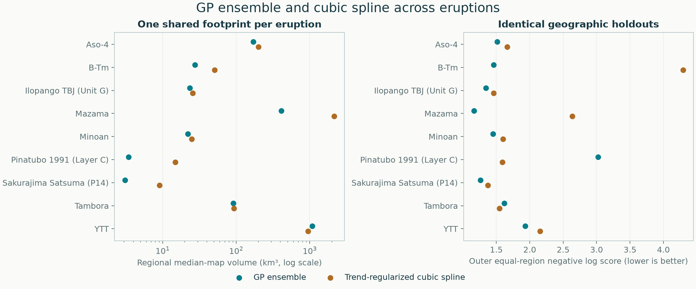

# GP and cubic spline inside the observation hull

Each pair uses the same accepted sites, geographic holdouts and integration area. The volume integrates each model’s median thickness. The table download includes the integrals of the pointwise Q25 and Q75 maps.

| Eruption | Regional method | Median-map volume (km³) | Held-out score ↓ | Exact-site 95% coverage |
|---|---|---:|---:|---:|
| [Aso-4](../../eruptions/aso-4/results/README.md) | GP ensemble | 170.96 | 1.514 | 94.0% |
| [Aso-4](../../eruptions/aso-4/results/README.md) | Trend-regularized cubic spline | 200.94 | 1.662 | 90.4% |
| [B-Tm](../../eruptions/b-tm/results/README.md) | GP ensemble | 27.64 † | 1.459 | 89.1% |
| [B-Tm](../../eruptions/b-tm/results/README.md) | Trend-regularized cubic spline | 50.75 | 4.295 | 75.0% |
| [Ilopango TBJ (Unit G)](../../eruptions/ilopango-tbj/results/README.md) | GP ensemble | 23.31 | 1.343 | 98.1% |
| [Ilopango TBJ (Unit G)](../../eruptions/ilopango-tbj/results/README.md) | Trend-regularized cubic spline | 25.67 | 1.462 | 92.3% |
| [Minoan](../../eruptions/minoan/results/README.md) | GP ensemble | 22.05 | 1.451 | 96.7% |
| [Minoan](../../eruptions/minoan/results/README.md) | Trend-regularized cubic spline | 24.78 | 1.601 | 96.7% |
| [Pinatubo 1991 (Layer C)](../../eruptions/pinatubo-1991-layer-c/results/README.md) | GP ensemble | 3.45 | 3.023 | 87.3% |
| [Pinatubo 1991 (Layer C)](../../eruptions/pinatubo-1991-layer-c/results/README.md) | Trend-regularized cubic spline | 14.82 † | 1.590 | 85.3% |
| [Sakurajima Satsuma (P14)](../../eruptions/sakurajima-satsuma/results/README.md) | GP ensemble | 3.08 | 1.264 | 94.0% |
| [Sakurajima Satsuma (P14)](../../eruptions/sakurajima-satsuma/results/README.md) | Trend-regularized cubic spline | 9.12 | 1.371 | 90.0% |
| [Tambora](../../eruptions/tambora/results/README.md) | GP ensemble | 91.14 | 1.620 | 96.2% |
| [Tambora](../../eruptions/tambora/results/README.md) | Trend-regularized cubic spline | 93.46 | 1.548 | 96.2% |
| [YTT](../../eruptions/ytt/results/README.md) | GP ensemble | 1079.21 | 1.934 | 91.3% |
| [YTT](../../eruptions/ytt/results/README.md) | Trend-regularized cubic spline | 943.74 | 2.153 | 82.6% |

Lower negative log predictive scores indicate better predictions in withheld regions. Coverage counts measured thicknesses within the predictive interval. A dagger marks a numerical volume integration warning. [Regional volumes, thickness bands and held-out scores](comparison.csv)



At B-Tm, three interpreted upper bounds expand the hull. The spline’s arithmetic mean is dominated by a poorly constrained upper tail near Lake Suigetsu. The case study compares the median map with 20,000 complete-surface draws and reports the integration diagnostics. [Spline sensitivity and regional footprint](../../eruptions/b-tm/results/cryptotephra/README.md#regional-footprint-and-the-splines-upper-tail)

The known-deposit benchmark retains all 40 attempted datasets, including two where both methods had insufficient training support. [Simulation results](synthetic/README.md) · [Matched regional protocol](../../docs/methods/regional-comparison.md)

## Reproduce

```sh
python -m benchmarks.regional --summarize-only --published --output results/regional-summary
```
