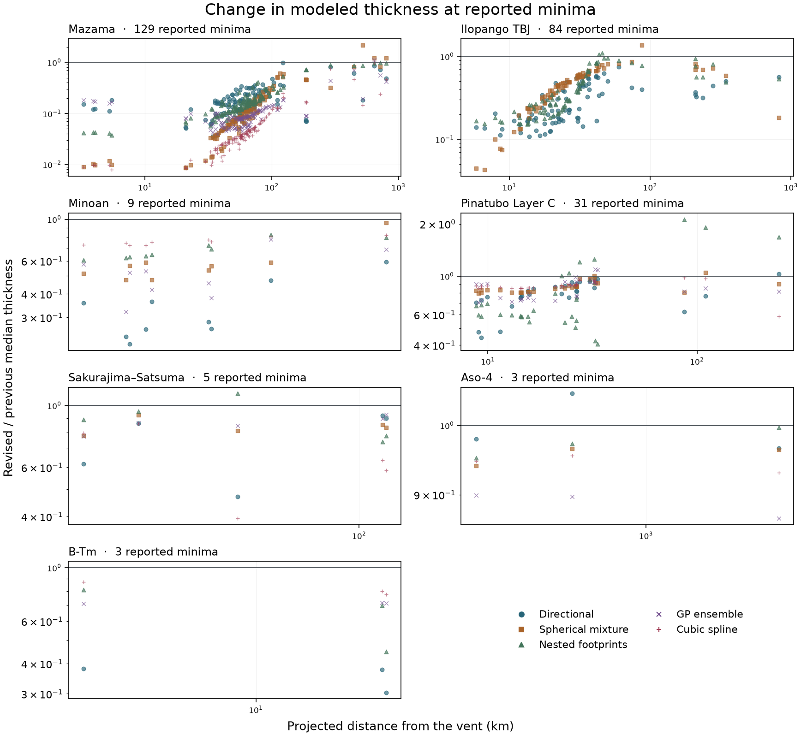

# Fitting reported lower limits as point thicknesses

These 7 eruptions have accepted fallout sites with a numeric lower limit. Each fit uses that value as a point thickness at its actual location. Upper limits retain a one-sided probability and ranges use the probability between both endpoints. The source tables retain the original qualifiers. [Fitting and plotting convention](../../docs/methods/reported-minimum-fitting.md)

Each symbol compares two map estimates at the same reported minimum. A ratio below one indicates a thinner revised estimate. The 25 km division below describes where the sites lie. All distances enter the same likelihood. A blank comparison means the previous edition had no map on the same audited input. The current nested maps use continuous area growth, and the directional maps include the v6 revision. Their ratios therefore include model changes as well as the fitting convention. [Nested comparison](../nested-isopachs/adaptive-growth/README.md) · [Directional comparison](../directional/geographic-regularity/README.md) · [Values by case and method](all-distances.csv)

| Eruption | Source minima | Within 25 km | Beyond 25 km | Directional vent, previous → revised (cm) | Spherical vent, previous → revised (cm) | Nested vent, previous → revised (cm) |
|---|---:|---:|---:|---:|---:|---:|
| [Mazama](../../eruptions/mazama/README.md) | 129 | 8 | 121 | 5,815.9 → 878.7 | 7,186.0 → 72.6 | 11,707.7 → 433.2 |
| [Ilopango TBJ](../../eruptions/ilopango-tbj/README.md) | 84 | 43 | 41 | 868.7 → 164.2 | 16,382.4 → 325.1 | 2,696.3 → 395.2 |
| [Minoan](../../eruptions/minoan/README.md) | 9 | 5 | 4 | 26.6 → 13.3 | 25.2 → 9.3 | 33.0 → 19.0 |
| [Pinatubo Layer C](../../eruptions/pinatubo-1991-layer-c/README.md) | 31 | 17 | 14 | 35.6 → 14.1 | 24.3 → 19.3 | 39.8 → 20.3 |
| [Sakurajima–Satsuma](../../eruptions/sakurajima-satsuma/README.md) | 5 | 2 | 3 | 69.8 → 71.4 | 63.5 → 89.0 | 72.7 → 72.5 |
| [Aso-4](../../eruptions/aso-4/README.md) | 3 | 0 | 3 | 57.0 → 65.0 | 43.3 → 44.1 | 85.0 → 85.3 |
| [B-Tm](../../eruptions/b-tm/README.md) | 3 | 1 | 2 | 106.6 → 45.6 | — | 76.8 → 66.7 |

Vent values in the table are modeled median thicknesses at the vent coordinates. A model can place its thickest deposit elsewhere. Observed sections can preserve only part of the deposit. Fitting their minima as points can therefore underestimate total local fallout. Each case links its original sources and separate validation coverage for directly measured thicknesses and minima fitted as points.

Each published method uses the same accepted observations and four geographic holdouts within its case. B-Tm currently has four local method packets; its separate spherical preview remains linked from the case home. An annotation-removal check compares the median field at the vent and every accepted site with and without the provenance marker. The case comparison tables record the maximum absolute difference. The global estimates include extrapolation into unsampled regions. Numerical warnings and unsupported contour bands are retained in the individual case reports. [Method scores and volumes](../principal-volumes.csv) · [Matched regional benchmark](regional-benchmark/README.md)
