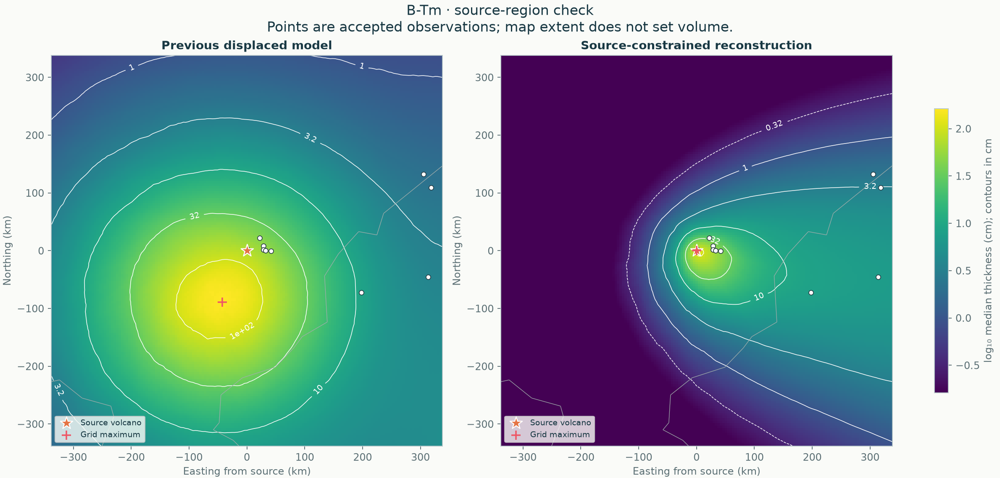
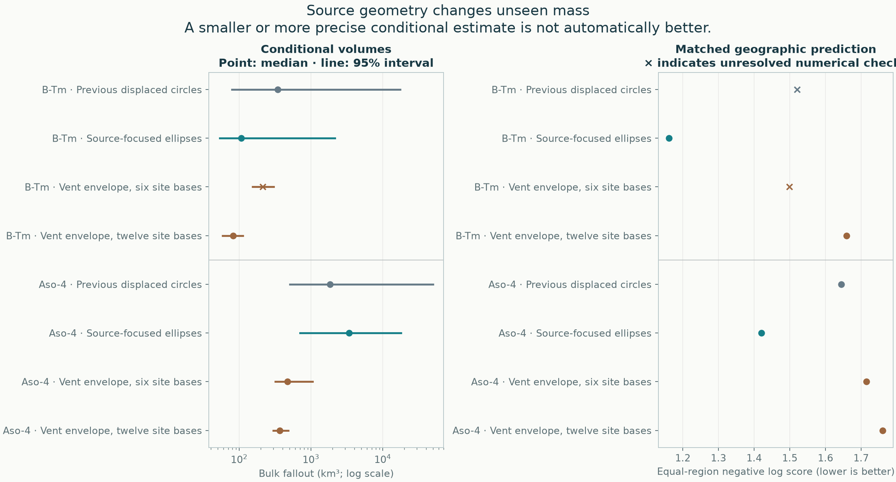
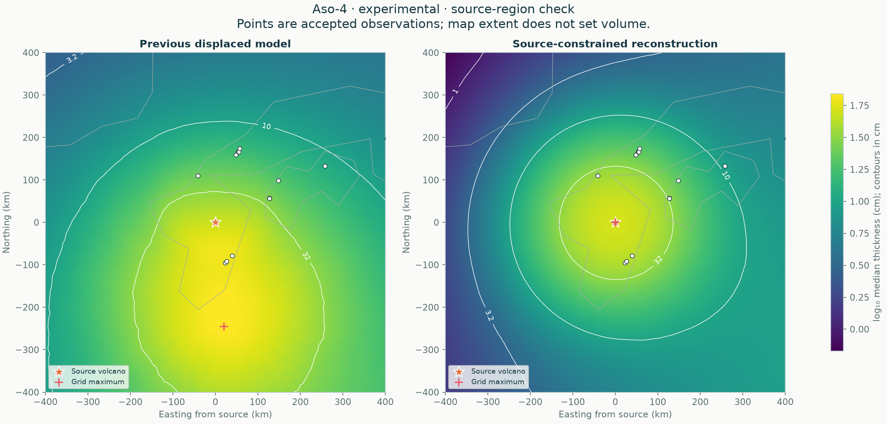

# B-Tm source correction and Aso-4 volume review

**Later Aso-4 update:** this review retains its original input and geometry experiments. The subsequent [source audit](../aso-4-audit/README.md) corrects cruise coordinates, recovers bounds and reruns the current case. Its numbers supersede this page only as the current Aso-4 reference, not as a redefinition of these historical experiments.

[Project home](../../README.md) · [Current global estimates](../global/README.md) · [Equations and assumptions](../../docs/methods/source-anchored-fans.md)

**The B-Tm problem was the thickest contour, not the volcano coordinates.** The preceding median field peaked about 94 km southwest of the vent on a 5 km local grid, at about 163 cm; it predicted 73 cm at the vent. The nearest accepted observation is 150 cm at 2.6 km distance. This unsupported displaced maximum motivated a source-focused geometry, without adding a vent thickness, missing-data zeros, a volume cap or a closing boundary.

The source-focused B-Tm fit has a median of **106 km³** and a **53–2,159 km³ conditional 95% interval**, compared with the preceding **344 km³ (80–17,485 km³)**. Its maximum is at the supplied source by construction. Its geographic negative log score improves from **1.520 to 1.162**; lower is better. Coverage changes from **95.2% to 92.9%**, so the improvement is not uniform across every metric. The same-data GP and spline scores are 1.331 and 1.814. The preceding B-Tm score also has one numerically provisional fold, so its exact difference is uncertain. These are development comparisons, not proof of superior global-volume accuracy or independent validation of the subsequent family choice.



The [current B-Tm report](../../eruptions/b-tm/results/global/README.md) contains the complete seven-alternative sensitivity protocol, fresh production fit, geographic checks and automatic integration refinement. The catalogue records its reviewed `source-fans` geometry, so the normal B-Tm command reproduces that choice. This changes the geometry, not eruption-specific wind or particle inputs. The upper volume tail remains broad and must be reported.

**Aso-4 does not yet have a defensible lower replacement.** Source-focused ellipses improve its geographic score from **1.644 to 1.421**, with 94.3% coverage, but increase the conditional median to **3,418 km³**. The six- and twelve-site envelope models reduce it to **472 and 369 km³**, but their scores worsen to **1.715 and 1.760**, and coverage falls to **86.2%**. That is not a demonstration that 369–472 km³ is the correct global mass. The preceding 1,836 km³ calculation remains visible as a questioned conditional estimate, alongside these alternatives; it is not endorsed as a precise geological total.



## B-Tm · every tested geometry

| Geometry | Median bulk km³ | Conditional 95% interval km³ | Fit numerical checks | Geographic score ↓ | Heldout 95% coverage | Holdout checks |
|---|---:|---:|---|---:|---:|---|
| Previous displaced circles | 344 | 79.5–1.75e+04 | pass | 1.520 | 95.2% | **provisional** |
| Anchored harmonic fans | 143 | 58.7–1.98e+03 | pass | not run | — | — |
| Source-focused ellipses | 106 | 53.2–2.16e+03 | pass | 1.162 | 92.9% | pass |
| One source-focused fan | 67.6 | 54.8–81.5 | pass | not run | — | — |
| Vent envelope, free centres | 92.6 | 58.1–724 | **provisional** | not run | — | — |
| Vent envelope, six site bases | 213 | 153–303 | **provisional** | 1.499 | 96.4% | **provisional** |
| Vent envelope, twelve site bases | 81.8 | 58.9–112 | pass | 1.659 | 92.9% | pass |

## Aso-4 · every tested geometry

| Geometry | Median bulk km³ | Conditional 95% interval km³ | Fit numerical checks | Geographic score ↓ | Heldout 95% coverage | Holdout checks |
|---|---:|---:|---|---:|---:|---|
| Previous displaced circles | 1.84e+03 | 507–5e+04 | pass | 1.644 | 94.3% | pass |
| Anchored harmonic fans | 3.35e+03 | 706–1.5e+04 | pass | not run | — | — |
| Source-focused ellipses | 3.42e+03 | 700–1.79e+04 | pass | 1.421 | 94.3% | pass |
| One source-focused fan | 2.36e+03 | 451–1.24e+04 | pass | not run | — | — |
| Vent envelope, free centres | 1.34e+03 | 359–2e+04 | pass | not run | — | — |
| Vent envelope, six site bases | 472 | 317–1.05e+03 | pass | 1.715 | 86.2% | pass |
| Vent envelope, twelve site bases | 369 | 298–482 | pass | 1.760 | 86.2% | pass |

All volumes are bulk fallout, not dense-rock equivalent, PDC/ignimbrite deposit volume, or a whole-eruption total. Each interval is conditional on its own model and priors. They are not probability-weighted alternatives and their combined span is not a 95% interval. No model was selected because its volume agreed with published estimates.

The source-focused model assumes nonincreasing thickness along source rays. The envelope allows smaller secondary peaks and uses Gaussian tails. Fixed measured-location basis centres restrict the functions but do not make every secondary peak data-supported: overlap can create peaks between sites. The narrow envelope intervals omit the possibility of unseen independent fans. All six new geometric variants, including unvalidated exploratory fits and numerical failures, remain in the tables. Only the three new main candidates received the complete geographic comparison; a blank score means no holdout assessment was run.



This Aso-4 image shows the **experimental twelve-site envelope**, not a promoted replacement. A visually reasonable source contour is insufficient evidence of an accurate whole-deposit volume.

## Where Aso-4's inferred mass goes

The preceding model assigns a median **80.3% fraction** to other gaps and sectors outside the local sampling footprint. Source-focused ellipses instead place a median **61.4% beyond the farthest exact site**, roughly 2,909 km from the vent. The twelve-site Gaussian envelope puts only **1.7%** beyond that distance, but still places **84.5%** in other gaps and sectors. Much of the disagreement is extrapolation geometry, not an observed change in deposit mass.

| Geometry | Local sampling footprint | Unsampled proximal cap | Beyond farthest exact site | Other gaps and sectors |
|---|---:|---:|---:|---:|
| Preceding displaced circles | 2.3% | 0.7% | 14.2% | 80.3% |
| Source-focused ellipses | 1.0% | 0.3% | 61.4% | 35.9% |
| Six site bases | 8.2% | 2.1% | 10.1% | 78.9% |
| Twelve site bases | 10.4% | 2.8% | 1.7% | 84.5% |

These are posterior median mass fractions, whose separate medians need not add to 100%. The categories are mutually exclusive in each draw and use the same sampling geometry, including a nearest exact site about 88 km from the vent. They are not fractions certified by data or confidence regions. The complete fraction/volume intervals and quadrature refinement errors are retained in `aso4_mass_partition_comparison` in the [review record](report.json). The lower envelope totals depend especially on their Gaussian tails and restricted unseen shape; they do not establish that the unmeasured sectors contain little mass.

## Why uncertainty remains

A smooth, positive deposit can be added inside a completely unsampled proximal cap without changing any observed thickness. Even a vent maximum and monotone thinning do not identify every possible cap. Similarly, sparse distal measurements do not uniquely determine thinning in unmeasured sectors. Proper priors make conditional estimation possible; they cannot convert missing evidence into observed zero deposit. [Known-truth tests](stress-tests.md) challenge these limits explicitly.

Published estimates are context rather than training targets. [Rougier et al. (2022)](https://doi.org/10.1093/gji/ggac131) and [Takarada and Hoshizumi (2020)](https://www.frontiersin.org/journals/earth-science/articles/10.3389/feart.2020.00170/full) give different Aso-4 bulk-fallout ranges under different data and assumptions. The accepted collection here contains later reference labels, including 2023 and 2025, so it is not a same-data replication of either paper. [Costa et al. (2024)](https://www.nature.com/articles/s43247-023-01162-0) report Paektu fallout in DRE; those values must not be compared directly with bulk fallout or with a total that includes PDC deposits. Real secondary thickness maxima are documented by [Watt et al. (2015)](https://agupubs.onlinelibrary.wiley.com/doi/full/10.1002/2015JB012116), so the point-source maximum is an explicit approximation, not a universal law.

## Input and numerical audit

Accepted inputs, source coordinates, centimetre units and exclusion flags are unchanged. The main B-Tm table supplies no reference labels; 52 of Aso-4's 87 accepted rows lack them. The [B-Tm inventory](input-inventory/b-tm.csv), [Aso-4 inventory](input-inventory/aso-4.csv) and [summary](input-inventory/summary.json) preserve supplied row identities and labels. This is an integrity/provenance inventory, not an independent source-table verification. Unlabelled side columns are not silently converted into measurements.

A subsequent [published-source comparison for B-Tm](input-inventory/b-tm-workbook-review/README.md) recovers 76 unique site correspondences and exposes lost observation qualifications: thirteen ranges, two spot occurrences, Suigetsu's upper bound and Kushu's cryptotephra occurrence without a visible layer. The [two-site sensitivity](btm-input-sensitivity/README.md) changes Suigetsu to the documented upper bound and removes Kushu from the quantitative thickness likelihood without treating it as zero. That two-site sensitivity gives **100 km³ (46–2,390 km³ conditional 95% interval)**. The main 106 km³ result isolates geometry on the preserved input; it is not a claim that all its observation meanings have now been validated. Eight additional sites, including the nearest proximal observation, are not independently verified by that distal compilation.

A targeted source check subsequently confirmed that Aso-4 CSV row 55 matches an eroded site in Shibata et al. (2025). Its exact 7 cm entry needs a separate observation-semantics sensitivity. Nearby records also include potential repeated sites. The [targeted input review](input-inventory/README.md) records the evidence, the lower-bound calculation, and a recovered 2021 source workbook with 98 thickness entries and 11 reported absences. The workbook distinguishes trace placeholders and preservation/reporting uncertainty, so those entries cannot simply be appended as exact thicknesses or zeros. Candidate correspondences and unresolved source differences are retained. No observations were silently dropped or absent-layer records fabricated to reduce a volume.

Each geographic comparison matches the regional accepted rows, four outer folds, buffers and training/withheld sets. Site-basis designs are rebuilt from training coordinates only. Whole-Earth totals do not use the map extent. Source-fan normalization is checked by angular refinement; the production workflow refits at higher resolution when needed and retains the lower-resolution attempts. Source-region plots include the vent exactly in the grid.

The original numerical diagnostics are retained. Review diagnostics also check individual weights of the identified site bases; those labels are not exchangeable. A numerical pass does not prove global mode exploration or geological correctness. No chains are selected, trimmed or pooled to manufacture a pass.

All six regional GP/spline fits and geographic evaluations, and all 40 regional synthetic attempt records, reproduce exactly. [Verification](verification.json). At the time of this geometry study, the original four datasets lacked the source-level audit available for YTT and Minoan. Aso-4 subsequently received the separately linked source-qualified revision.

## Reproduce and inspect

```sh
python -m benchmarks.source_review --dataset b-tm --output results/source-review
python -m benchmarks.source_review --dataset aso-4 --output results/source-review
tephra-isopachs global B-Tm --geometry source-fans --output results/btm-source
python -m benchmarks.source_fans --output results/source-stress
```

The first commands rerun the three main candidates with current numerical checks. Historical exploratory attempts have their exact model-source snapshots and serialized priors/settings preserved; later changes are not relabelled as their execution source.

- [Full review, priors, predictions and original/reviewed diagnostics](report.json)
- [Numerical comparison](comparison.csv) and [whole-volume draws by candidate and chain](volume_draws.csv.gz)
- [Experimental Aso-4 envelope posterior](aso-4-experimental-posterior.npz)
- [Complete failed and successful attempt manifests](development/completed-attempts.json.gz) and [verified source-code manifest](development/source-manifest.json)
- [Reporting script snapshot](reporting.py.txt)
- [Archived B-Tm calculation](https://github.com/siyulai21/tephra-fallout-isopachs/blob/41b8f2f28ac8b1c877810b782005ff243e101c63/archive/reports/b-tm/2026-11-06-displaced-global/README.md), [Aso-4 calculation](https://github.com/siyulai21/tephra-fallout-isopachs/blob/41b8f2f28ac8b1c877810b782005ff243e101c63/archive/reports/aso-4/2026-11-06-displaced-global/README.md) and [preceding common-geometry comparison](https://github.com/siyulai21/tephra-fallout-isopachs/blob/41b8f2f28ac8b1c877810b782005ff243e101c63/archive/reports/global/2026-11-06-displaced-comparison/README.md)
