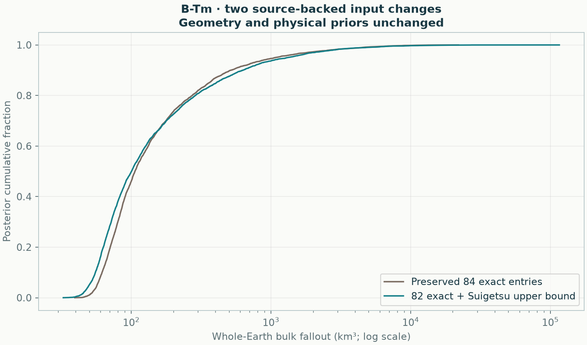

# B-Tm: two source-backed distal observation changes

[Published source and row crosswalk](../input-inventory/b-tm-workbook-review/README.md) · [Geometry comparison](../README.md)

Treating Suigetsu as the published **<0.1 cm upper bound**, and removing Kushu's unsupported exact 0.1 cm value from the quantitative likelihood, gives **100 km³** with a **46–2,390 km³ conditional 95% interval**. Numerical checks **pass**. The unchanged-input source-focused calculation gives **106 km³ (53–2,159 km³)**.

| Input interpretation | Quantitative observations | Median bulk km³ | Conditional 95% interval km³ |
|---|---:|---:|---:|
| Preserved accepted input | 84 exact entries | 106 | 53–2,159 |
| Two-site source sensitivity | 82 exact entries + 1 upper bound | 100 | 46–2,390 |



This is an observation-semantics sensitivity, not a full source-audited replacement or a new geographic validation. The source-focused geometry and physical priors are unchanged. The accepted CSV is preserved for the controlled geometry comparison. Both distributions remain conditional on uncertain extrapolation and the remaining input meanings; their medians are not a formal significance test of a data effect.

The [published workbook](../input-inventory/b-tm-workbook-review/yang2021-thickness.xlsx), `thickness_data!A48:F49`, distinguishes Kushu's cryptotephra occurrence without a visible layer from Suigetsu's upper-bound thickness. Excluding Kushu from this thickness likelihood does not assert zero original fallout or deny its presence. No 0.1 cm detection limit is invented. Thirteen other reported ranges, two spot occurrences, and eight sites absent from this distal compilation still need further source interpretation. Their values are not silently changed here.

Original CSV row 82 changes from an exact value to an upper-bound event; row 84 is omitted from quantitative fitting. Every retained coordinate, numerical value, error and original row identity is unchanged. The [used-observation table](used-observations.csv) retains `OriginalCSVRow`; it is an audit table, not a drop-in intake CSV. Use the runner below to reproduce the transformation with original identities intact.

```sh
python -m benchmarks.btm_input_review --output results/btm-input-review
```

The final four-chain fit has maximum R-hat 1.00227, minimum bulk/tail ESS 1890/2042, 0 divergences and minimum energy BFMI 0.765. Integration checks and every completed numerical attempt are retained in the [report](report.json). [Whole-field samples](posterior.npz) · [Volume draws by chain](volume_draws.csv.gz) · [Checksums](artifacts.json).
