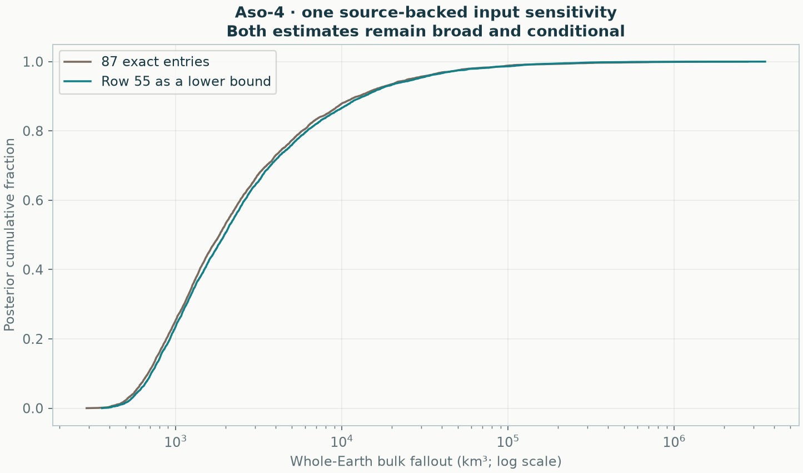

# Aso-4: a documented erosion sensitivity

[Targeted input review](../input-inventory/README.md) · [Geometry comparison](../README.md)

Changing the source-confirmed eroded row 55 from an exact 7 cm thickness to a 7 cm lower bound gives **1,962 km³**, with a **536–50,819 km³ conditional 95% interval**, under the preceding displaced geometry. Numerical checks **pass**. This one observation interpretation does **not** explain away the high Aso-4 volume.

| Input interpretation | Median bulk km³ | Conditional 95% interval km³ |
|---|---:|---:|
| Preceding 87 exact entries | 1,836 | 507–49,960 |
| 86 exact entries + row 55 as a lower bound | 1,962 | 536–50,819 |



The source-backed alternative changes one likelihood event, not its coordinates, the reported maximum, the other observations, or the priors. It does not assign an invented amount of erosion or a standard deviation. The principal input remains the preserved original for the controlled geometry comparison; this separate derived input is explicitly labelled. The row's original depositional thickness is not identified by the paper's preserved range, and the remaining records still need a complete source audit.

This is a sensitivity calculation, not a newly validated global model or a new four-fold evaluation. The apparent difference in medians is not a formal test of an erosion effect. Both distributions are broad and conditional; Monte Carlo uncertainty remains in their endpoints. No lower total was used as a target or an acceptance criterion.

The final four-chain calculation has maximum R-hat 1.00952, minimum bulk/tail ESS 667/1032, zero divergences and minimum energy BFMI 0.511. Original attempt diagnostics and settings are retained in the [report](report.json).

```sh
python -m benchmarks.aso_input_review --output results/aso-input-review
```

[Derived CSV](aso-4-row55-lower-bound.csv) · [Whole-field samples](posterior.npz) · [Volume draws by chain](volume_draws.csv.gz). The runner verifies the original input checksum and source coordinates. The [source paper](https://doi.org/10.1186/s40623-025-02230-9) and the exact row correspondence are recorded in the report. Numerical checks confirm that all other accepted coordinates, values, errors and source-row identities are unchanged.
