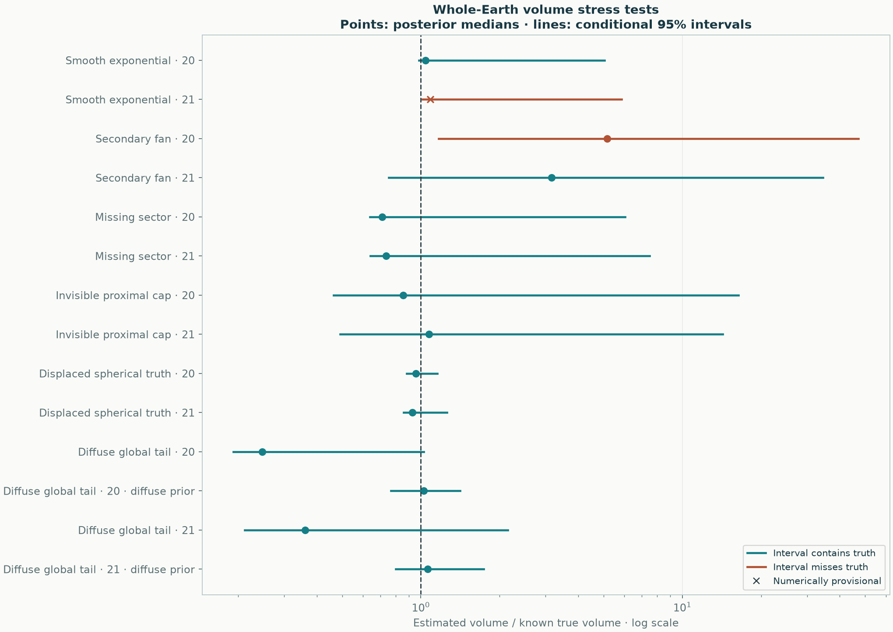

# Source-focused model: known-truth challenges

[Source and volume review](README.md) · [Shape assumptions](../../docs/methods/source-anchored-fans.md)

These are all **12 declared baseline trials**, six scenarios with seeds 20 and 21, plus the two declared diffuse-tail alternatives. No trial-specific prior, target volume or closing boundary is supplied. Every failure is retained. The three-fan source-focused model is fitted to each complete collection of observations without using true fan membership.

**10/12 baseline intervals contain the true total; 11/12 pass the sampling and mass-normalization checks.** Among numerically passing fits, 10/11 intervals contain the truth. This small development suite does not establish 95% calibration or superior global-volume accuracy. Intervals from failed samplers are provisional computational summaries.

| Scenario · seed · prior | True bulk km³ | Median km³ | Conditional 95% interval km³ | Contains truth | Numerical checks |
|---|---:|---:|---:|---|---|
| Smooth exponential · 20 · baseline | 33.6 | 35 | 32.9–169 | yes | pass |
| Smooth exponential · 21 · baseline | 33.6 | 36.4 | 34.1–196 | **no** | **provisional** |
| Secondary fan · 20 · baseline | 52.4 | 270 | 61.3–2.48e+03 | **no** | pass |
| Secondary fan · 21 · baseline | 52.4 | 165 | 39.6–1.81e+03 | yes | pass |
| Missing sector · 20 · baseline | 52.4 | 37.2 | 33.5–316 | yes | pass |
| Missing sector · 21 · baseline | 52.4 | 38.6 | 33.6–392 | yes | pass |
| Invisible proximal cap · 20 · baseline | 55.7 | 47.6 | 25.8–912 | yes | pass |
| Invisible proximal cap · 21 · baseline | 55.7 | 59.8 | 27.4–794 | yes | pass |
| Displaced spherical truth · 20 · baseline | 120 | 115 | 106–138 | yes | pass |
| Displaced spherical truth · 21 · baseline | 120 | 111 | 103–151 | yes | pass |
| Diffuse global tail · 20 · baseline | 120 | 29.6 | 23–123 | yes | pass |
| Diffuse global tail · 20 · diffuse_tail | 120 | 123 | 92.2–169 | yes | pass |
| Diffuse global tail · 21 · baseline | 120 | 43.4 | 25.4–258 | yes | pass |
| Diffuse global tail · 21 · diffuse_tail | 120 | 127 | 96.3–209 | yes | pass |



## What the scenarios test

The smooth exponential gives the constraint a favorable case. The secondary fan and missing-sector cases add a displaced anisotropic lobe; they can violate nonincreasing thickness along source rays. The invisible proximal cap contributes positive mass while being exactly zero at every sampled site. Its amplitude cannot be inferred from those observations. The displaced spherical truth has total 120 km³ and uses the preceding freely displaced model; despite the historical scenario identifier `matched_two_fans`, it is **not matched to the new source-focused model**. The diffuse global tail has exponent 0.7 and total 120 km³; both the restricted baseline and the alternative allowing exponents below one are shown.

The original four truths use an equal-area chart and analytic total masses; the tiny mass outside the physical Earth chart is below 10⁻⁸⁰ of the total. The compact cap is wholly inside the Earth chart. The last two use whole-Earth normalized kernels. Independent log-observation noise has SD 0.15. The truth is never obtained from the fitted posterior or the map extent. Shape violations and hidden mass are deliberate challenges, not grounds to omit trials.

Requiring a source maximum fixes one unsupported geometric freedom. It does not establish a universal law, identify unseen proximal caps, recover missing sectors, or ensure correct distal thinning. A broad interval that contains one invisible cap cannot guarantee coverage of every possible cap. These limitations apply to the B-Tm interpretation even when its real-data sampler and geographic prediction checks pass.

## Reproduce and audit

```sh
python -m benchmarks.source_fans --output results/source-stress
python -m benchmarks.source_stress_report --source results/source-stress --output results/source-stress-report
```

Four independent chains, the fixed retry protocol, every attempted resolution and diagnostics for every complete run are recorded in the [full report](stress-report.json). Angular integration is independently refined for every retained posterior; inadequate resolution triggers a complete refit without changing the physical priors. [Numerical table](stress-comparison.csv) · [Complete final volume chains with chain identities](stress-volume-draws.csv.gz). Full parameter samples, including failed attempts, remain in the reproducible local run caches; the public sample file contains volume draws. No chain trimming, convergence-selected pooling or volume-based choice is used.
