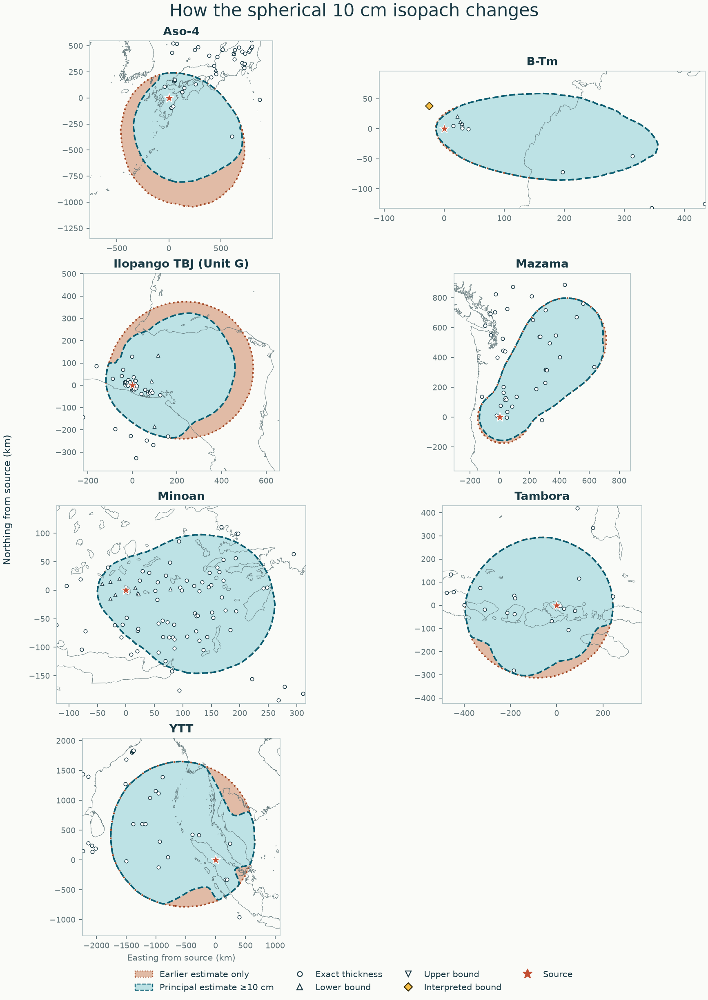
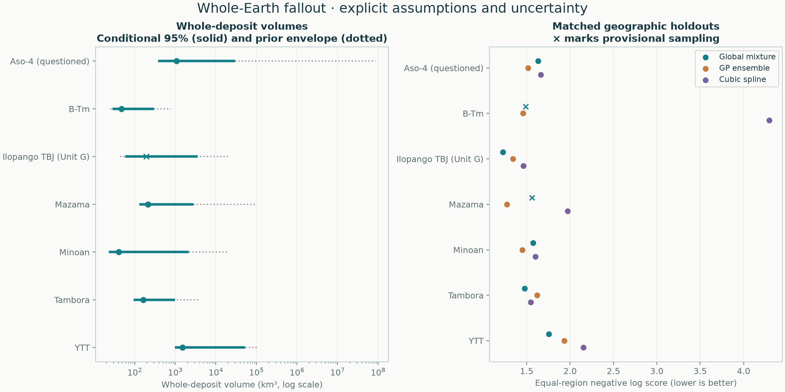

# Spherical-mixture maps and volumes

Each eruption uses the same observations for the broad control and the principal spherical fit. In one third of simulated deposits the kernels extend broadly into unsampled directions. In the others, the thickness depends on the orientation of an unseen fan. Each simulated deposit gives one whole-Earth bulk fallout volume. The table shows the median volume under each continuation, the principal conditional interval and the envelope across all eight prior fits. [Model and assumptions](../../docs/methods/spherical-bearings.md)

| Eruption | Kernel geometry | Broad → principal volume (km³) | Principal 95% interval (km³) | Prior-sensitivity envelope (km³) |
|---|---|---:|---:|---:|
| [Aso-4](../../eruptions/aso-4/README.md) | displaced · **questioned** | 1,466.0 → **1,069.7** | 402.9–27,836.6 | 380–8.51e+07 |
| [B-Tm](../../eruptions/b-tm/README.md) | source-fans | 49.1 → **47.0** | 30.2–275.5 | 25.2–783 |
| [Ilopango TBJ (Unit G)](../../eruptions/ilopango-tbj/README.md) | displaced | 255.6 → **190.9** · **provisional** | 62.9–3,300.8 | 43.3–2.11e+04 |
| [Mazama](../../eruptions/mazama/README.md) | displaced | 223.2 → **212.9** | 140.1–2,614.3 | 137–9.27e+04 |
| [Minoan](../../eruptions/minoan/README.md) | displaced | 46.0 → **40.8** | 24.6–1,989.1 | 23.1–1.91e+04 |
| [Tambora](../../eruptions/tambora/README.md) | displaced | 179.1 → **162.3** | 100.8–920.1 | 93–3.85e+03 |
| [YTT](../../eruptions/ytt/README.md) | displaced | 1,674.2 → **1,510.5** | 1,054.3–48,708.5 | 1.01e+03–1.09e+05 |

6 of 7 baseline fits passed the sampling and integration checks. Numerical warnings occurred in Aso-4 (diffuse tail, one fan, five fans, gaussian errors), B-Tm (wide geography, five fans, gaussian errors), Ilopango TBJ (Unit G) (baseline, volume prior shift), Mazama (wide geography, one fan, gaussian errors), Minoan (wide geography), Tambora (wide geography, five fans). Their results contribute to the envelope. Aso-4’s source audit questions the displaced peak and its large upper tail. B-Tm’s source-focused fit includes three interpreted upper bounds. [Aso-4 source audit](../aso-4-audit/README.md) · [B-Tm evidence](../../data/audits/B-Tm/README.md)

## Where the map changes

Each panel compares the same 10 cm threshold. Tan shading identifies ground where only the earlier median reaches 10 cm. Blue shading identifies ground where both medians reach it. Only sites inside each frame are visible. The area calculations below cover the entire Earth.

| Eruption and compass sector | Area ≥10 cm, earlier → principal (km²) | Split-draw area disagreement |
|---|---:|---:|
| Aso-4, S | 393,291 → 233,542 | 10.1% |
| Aso-4, SE | 358,352 → 273,568 | 6.2% |
| Aso-4, W | 56,454 → 27,251 | 6.3% |
| B-Tm, W | 79 → 69 | Unresolved |
| Mazama, SW | 9,989 → 8,041 | 2.9% |

These are modelled areas in 45° sectors, averaged over two scrambled whole-Earth integration grids. The sites do not establish the actual deposit edge. The downloadable tables give both grid results, contour-area split checks and all eight bearings at 1, 10 and 100 cm.

## Predictions in withheld regions

All methods faced the same held-out observations, bounds, regions and buffers for each eruption. Lower scores indicate better prediction. Coverage is the fraction of exact thickness readings inside the principal spherical 95% predictive interval.

| Eruption | Spherical score, broad → principal | GP score | Spline score | Spherical coverage | Spherical holdout checks |
|---|---:|---:|---:|---:|---|
| Aso-4 | 1.632 → 1.632 | 1.514 | 1.662 | 95.2% | pass |
| B-Tm | 1.492 → 1.487 | 1.459 | 4.295 | 93.8% | **provisional** |
| Ilopango TBJ (Unit G) | 1.173 → 1.225 | 1.343 | 1.462 | 94.2% | pass |
| Mazama | 1.577 → 1.561 | 1.272 | 1.971 | 88.9% | **provisional** |
| Minoan | 1.570 → 1.575 | 1.451 | 1.601 | 94.6% | pass |
| Tambora | 1.471 → 1.477 | 1.620 | 1.548 | 100.0% | pass |
| YTT | 1.777 → 1.756 | 1.934 | 2.153 | 84.8% | pass |

The geographic score averaged equally across eruptions changed from 1.527 to 1.530. Of the withheld readings, 89 had gap exposure of at least 0.5. Within those readings the site-weighted score was 1.569 → 1.611. Giving each represented eruption equal weight gives 1.645 → 1.636. [Paired predictions and gap-exposure scores](bearings/paired-cases.csv)

## Deposits with known volumes

The existing spherical tests contain 24 fits across two kernel geometries, six deposit designs and two seeds per geometry. On the 24 original truths, the earlier and principal conditional intervals contained the true volume in **21/24 and 21/24** fits, respectively. Mean absolute log volume error was **0.448 → 0.451**. At 10 cm the principal fit reduced false extension and increased missed fallout in the simulations.

| Area tested | Threshold | Resolved pairs / 24 | False-positive area, earlier → principal (km²) | Missed fallout area, earlier → principal (km²) |
|---|---:|---:|---:|---:|
| Whole Earth | 1 cm | 24 | 214,354 → 206,848 | 4,188 → 4,689 |
| Whole Earth | 10 cm | 24 | 26,557 → 24,427 | 4,640 → 5,056 |
| Whole Earth | 100 cm | 20 | 741 → 739 | 4,726 → 4,727 |
| Gap exposure ≥0.5 | 1 cm | 4 | 7,613 → 1,130 | 0 → 761 |
| Gap exposure ≥0.5 | 10 cm | 4 | 37 → 0 | 11,577 → 13,513 |
| Gap exposure ≥0.5 | 100 cm | 0 | — | — |

Each resolved fit receives equal weight. Both model–truth unions must have at least 64 effective area nodes. Empty or inadequately resolved unions are listed in the CSV. 3 parent fits had sampling warnings and 5 bearing-volume estimates retained split-draw warnings. The scores describe these development simulations.

Four missing-quadrant fits also have a second compatible truth. Within an 80 km disk centred 110 km east and north of the source, a weaker hidden fan gives identical thickness at every sampled site. The tables retain both truths. [Volume errors and failures](bearings/known-volumes.csv) · [Contour errors by threshold and truth](bearings/known-areas.csv) · [Quadrature replicates and numerical checks](bearings/known-deposits.json.gz)

## Data and reproduction

[Case estimates and prior diagnostics](comparison.csv) · [Input identities and matched validation](report.json) · [Kernel-geometry experiment](../source-revision/README.md) · [Displaced-kernel trials](stress-tests.md) · [Source-focused trials](../source-revision/stress-tests.md) · [Reproduction commands](../../docs/methods/spherical-bearings.md#integration-validation-and-reproducibility) · [Preceding release](../../archive/2026-11-20-spherical-continuation/README.md)
