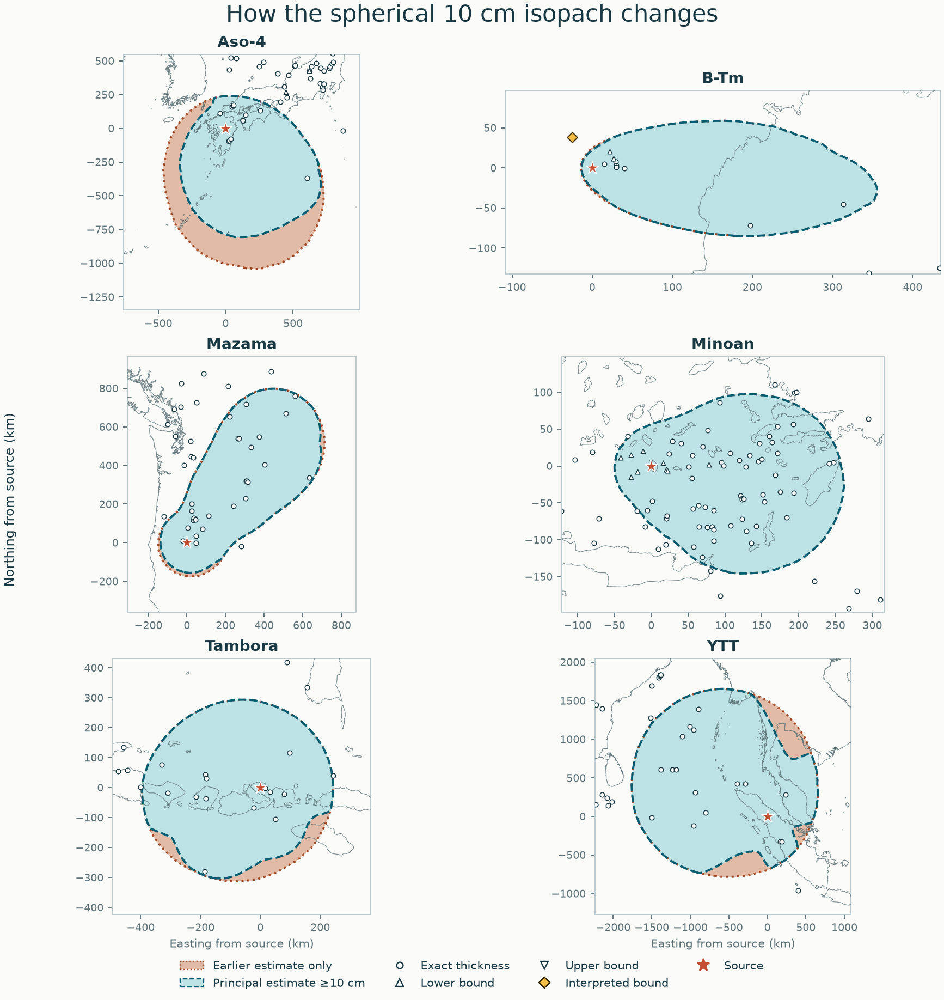

# Spherical isopachs in unsampled directions

Every eruption uses the same continuation of its fitted spherical kernels. The source and measured thicknesses retain their likelihood. The central map allows an unobserved fan to extend in different directions across simulated deposits. A broad continuation remains possible in one third of the mixture. The first column below is the earlier spherical median under the same observations.

| Eruption | Earlier → principal volume (km³) | Principal conditional 95% (km³) | Geographic score, earlier → principal | Exact-site 95% coverage |
|---|---:|---:|---:|---:|
| [Aso-4](../../../eruptions/aso-4/results/spherical-mixture/README.md) | 1,466.0 → **1,069.7** | 402.9–27,836.6 | 1.632 → 1.632 | 95.2% |
| [B-Tm](../../../eruptions/b-tm/results/spherical-mixture/README.md) | 49.1 → **47.0** | 30.2–275.5 | 1.492 → 1.487 | 93.8% |
| [Mazama](../../../eruptions/mazama/results/spherical-mixture/README.md) | 223.2 → **212.9** | 140.1–2,614.3 | 1.577 → 1.561 | 88.9% |
| [Minoan](../../../eruptions/minoan/results/spherical-mixture/README.md) | 46.0 → **40.8** | 24.6–1,989.1 | 1.570 → 1.575 | 94.6% |
| [Tambora](../../../eruptions/tambora/results/spherical-mixture/README.md) | 179.1 → **162.3** | 100.8–920.1 | 1.471 → 1.477 | 100.0% |
| [YTT](../../../eruptions/ytt/results/spherical-mixture/README.md) | 1,674.2 → **1,510.5** | 1,054.3–48,708.5 | 1.777 → 1.756 | 84.8% |

Averaging geographic scores equally across eruptions gives 1.586 → 1.581. Lower is better. The matched predictions retain all limit events and numerical warnings. 71 withheld readings had gap exposure of at least 0.5. Within those readings the site-weighted score was 1.664 → 1.675. Giving each represented eruption equal weight gives 1.721 → 1.682. [Paired results, including poorly supported held-out sites](paired-cases.csv)

## Where the map changes

Each panel zooms to the same thickness threshold. Tan shading identifies ground where only the earlier median reaches 10 cm. Blue shading identifies ground where both medians reach it. Only sites inside each frame are visible. The area calculations below cover the entire Earth.

| Eruption and compass sector | Area ≥10 cm, earlier → principal (km²) | Split-draw area disagreement |
|---|---:|---:|
| Aso-4, S | 393,291 → 233,542 | 10.1% |
| Aso-4, SE | 358,352 → 273,568 | 6.2% |
| Aso-4, W | 56,454 → 27,251 | 6.3% |
| B-Tm, W | 79 → 69 | Unresolved |
| Mazama, SW | 9,989 → 8,041 | 2.9% |

These are modelled areas in 45° sectors, averaged over two scrambled whole-Earth integration grids. The sites do not establish the actual deposit edge. The downloadable tables give both grid results, contour-area split checks and all eight bearings at 1, 10 and 100 cm.

## Deposits with known volumes

The existing spherical tests contain 24 fits across two kernel geometries, six deposit designs and two seeds per geometry. On the 24 original truths, the earlier and principal conditional intervals contained the true volume in **21/24 and 21/24** fits, respectively. Mean absolute log volume error was **0.448 → 0.451**. A smaller footprint does not guarantee a better total.

| Area tested | Threshold | Resolved pairs / 24 | False-positive area, earlier → principal (km²) | Missed fallout area, earlier → principal (km²) |
|---|---:|---:|---:|---:|
| Whole Earth | 1 cm | 24 | 214,354 → 206,848 | 4,188 → 4,689 |
| Whole Earth | 10 cm | 24 | 26,557 → 24,427 | 4,640 → 5,056 |
| Whole Earth | 100 cm | 20 | 741 → 739 | 4,726 → 4,727 |
| Gap exposure ≥0.5 | 1 cm | 4 | 7,613 → 1,130 | 0 → 761 |
| Gap exposure ≥0.5 | 10 cm | 4 | 37 → 0 | 11,577 → 13,513 |
| Gap exposure ≥0.5 | 100 cm | 0 | — | — |

Each resolved fit receives equal weight. Both model–truth unions must have at least 64 effective area nodes. Empty or inadequately resolved unions are listed in the CSV. 3 parent fits had sampling warnings and 5 bearing-volume estimates retained split-draw warnings. The scores describe these development simulations.

Four missing-quadrant fits also have a second compatible truth. Within an 80 km disk centred 110 km east and north of the source, the hidden fan can be substantially weaker while every sampled thickness is identical. Both truths and both changes in error are retained. Diffuse tails and genuine missing lobes remain consequential for a global estimate. [Known volumes and failures](known-volumes.csv) · [Contour errors for every threshold and truth](known-areas.csv) · [Both quadrature replicates and numerical refinements](known-deposits.json.gz)

[Equations, model assumptions and reproduction](../../../docs/methods/spherical-bearings.md) · [All prior sensitivities](../README.md) · [Preceding release](../../../archive/2026-11-20-spherical-continuation/README.md)
