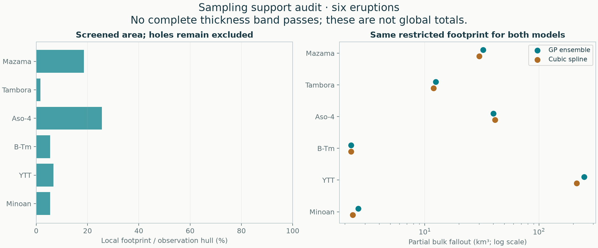

# Supported isopachs and the limits of global volume

**Scope update (0.10):** this remains the local contour-support audit. The [new conditional global estimates](../global/README.md) use a separate mass-normalized posterior; failing this screen no longer vetoes global inference. Aso-4 below reflects its 2026-11-08 source revision; the other five case results and historical stress tests are unchanged.

[Project home](../../README.md) · [Equations and assumptions](../../docs/methods/supported-isopachs.md) · [Matched-hull comparison](../regional/README.md)

**All six eruptions were rerun. None has a complete isopach band that passes the support checks, even under the permissive policy. No preferred global total is produced.** This does not mean zero fallout or zero useful information: local patches remain estimable. It means the present data do not supply the required complete, stable area–thickness bands.



## What changes

The GP and spline fits remain peers and reproduce the preceding fitted settings, held-out predictions and hull volumes. The new analysis changes how their predictions may be used: remove long sampling bridges, preserve holes, audit every whole contour, require stability under geographic deletions, and keep proximal/distal continuation separate. No pseudo-observations or hand-chosen closing rings are added.

A fixed geometric rule defines strict, standard and permissive local footprints. These are development assumptions, not confidence sets. Every candidate contour and failure is retained in its case report; all intermediate levels on the refined grid must also pass. The broader hull volumes remain visible for comparison.

## Same local footprint, two model families

These are **partial bulk fallout volumes on restricted patches**, not revised total eruption volumes or certified lower bounds. The area percentage refers to the observation hull, not the unknown total deposit area.

| Eruption | Standard footprint / hull | GP partial volume (km³) | Spline partial volume (km³) | Complete eligible band |
|---|---:|---:|---:|---|
| [Mazama](../../eruptions/mazama/results/support/README.md) | 18.6% | 32.50 | 29.93 | None |
| [Tambora](../../eruptions/tambora/results/support/README.md) | 1.7% | 12.50 | 11.92 | None |
| [Aso-4](../../eruptions/aso-4/results/support/README.md) | 20.4% | 27.94 | 26.90 | None |
| [B-Tm](../../eruptions/b-tm/results/support/README.md) | 5.4% | 2.27 | 2.27 | None |
| [YTT](../../eruptions/ytt/results/support/README.md) | 6.7% | 249.71 | 214.01 | None |
| [Minoan](../../eruptions/minoan/results/support/README.md) | 5.4% | 2.62 | 2.34 | None |

[All policies and deletion ranges](comparison.csv). Changing the footprint changes the estimand; these ranges are not confidence intervals. Numerical refinements, median-surface integrals and the four refitted deletion volumes appear in each case.

## What the known-truth tests establish—and do not

Twelve development trials use three seeds each for a smooth deposit, a secondary fan, a missing sector and an unmeasured proximal cap. Both families undergo complete nested geographic tuning. The cap is identically invisible at every sampled location: reliable intermediate contours cannot identify that hidden volume.

| Scenario | Method | Trials with usable band / 3 | Qualified contours across trials | Mean absolute partial-volume error |
|---|---|---:|---:|---:|
| smooth | GP ensemble | 3 / 3 | 62 | 1.4% |
| smooth | Cubic spline | 3 / 3 | 59 | 2.0% |
| multi_lobe | GP ensemble | 0 / 3 | 0 | 12.8% |
| multi_lobe | Cubic spline | 0 / 3 | 0 | 6.6% |
| missing_sector | GP ensemble | 0 / 3 | 0 | 2.6% |
| missing_sector | Cubic spline | 0 / 3 | 0 | 2.5% |
| missing_core | GP ensemble | 2 / 3 | 43 | 2.1% |
| missing_core | Cubic spline | 1 / 3 | 37 | 2.3% |

No accepted standard-policy contour in these trials had shape error above 25% against the known truth. Contours from the same fit are correlated; this is **not** a binomial calibration result. The screen also abstains on the fully sampled secondary-fan trials, demonstrating its conservatism. Twelve constructed trials cannot establish a general false-acceptance rate or validate extrapolated totals.

[All trials, failures, contour errors and selection tables](stress-tests/README.md). The separate unchanged-method regional benchmark again attempted 40 trials: 38 completed method pairs and two insufficient-training cases, both retained.

The revised Aso-4 spline has an extreme geographic-deletion partial volume (about 192,882 km³ on the standard footprint); this failure is retained in its current report. No passing contour band is inferred. [Source and geometry audit](../aso-4-audit/README.md).

## Remaining spline fitting-domain dependence

The following padding experiment retains its original 2026-11-04 inputs, including the earlier Aso-4 data. It is historical sensitivity evidence, not a new padding test of the revised Aso-4 input.

The calculation footprint and display window are now separate. Nevertheless the spline basis and penalties depend on its fitting rectangle. Retuning at four padding values while integrating the same standard footprint gives:

| Eruption | 2.5% padding | 5% baseline | 10% padding | 20% padding |
|---|---:|---:|---:|---:|
| Mazama | 30.24 | 29.93 | 30.03 | 29.26 |
| Tambora | 12.03 | 11.92 | 11.58 | 11.91 |
| Aso-4 | 41.99 | 41.37 | 40.16 | 34.54 |
| B-Tm | 2.24 | 2.27 | 2.22 | 2.15 |
| YTT | 209.21 | 214.01 | 199.93 | 155.52 |
| Minoan | 2.36 | 2.34 | 2.33 | 2.58 |

All entries are partial km³. YTT is particularly sensitive (214.01 at baseline versus 155.52 at 20% padding); Aso-4 is also affected. These are sensitivity results, not new outer-test scores or a basis for picking a desired total. The GP has no corresponding fitting rectangle. [Full refits and tuning tables](fitting-domain/README.md).

## Pseudo-data and global extrapolation

Numerical spline penalty nodes have fixed total weight and are not observations. The trend target comes from training data and is refitted within folds. GP mean reversion is also an assumption. Neither justifies declaring an unsampled boundary thin.

If a band qualifies, direct polygon integration is checked with the area–thickness layer-cake identity. Proximal constant/exponential caps and distal exponential/slope-matched power tails remain explicit conditional scenarios. Nonintegrable tails are rejected without arbitrary outer cutoffs. Their scenario range is not an uncertainty interval, and no finite data-identified global upper bound follows from positivity, smoothness and finite mass alone.

The current real datasets do not reach that extension step. The historical complete-Earth totals remain archived as model extrapolations. No global number is promoted simply because it is smooth, finite or independent of a plotting rectangle.

## Validation and reproduction

[Numerical parity with previous fits](validation.json) · [Full protocol and primary literature](../../docs/methods/supported-isopachs.md) · [Preserved preceding reports](https://github.com/siyulai21/tephra-fallout-isopachs/blob/41b8f2f28ac8b1c877810b782005ff243e101c63/archive/2026-11-03-regional/README.md)

```sh
python -m benchmarks.regional --output results/regional-evaluation
python -m benchmarks.support --output results/support-stress-tests
python -m benchmarks.support_domain --base results/regional-evaluation --output results/domain-sensitivity
python -m pytest -q
```

Every normal `tephra-isopachs compare` now produces a support sub-report. Inputs and source audits are unchanged; combined Minoan fans and the 46-record YTT principal dataset remain intact.
