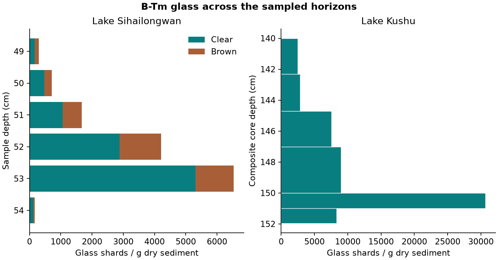

# B-Tm source and cryptotephra audit

The principal dataset contains **64 measured combined-fallout thicknesses, three reported lower bounds, one reported upper bound and three interpreted upper bounds**. The interpreted sites retain blank thickness cells. Each contributes one upper-censored observation to the GP, cubic spline, directional ensemble and spherical mixture. The original 68 quantitative records keep their identities, coordinates, units and values. [Principal data](../../eruptions/B-Tm_cryptotephra.csv) · [Four-method results](../../../eruptions/b-tm/README.md) · [Prior source review](thickness-only.md)

| Site | What was observed | Condition used to constrain original fallout | Upper limit used |
|---|---|---|---:|
| Lake Sihailongwan, west of Paektu | Light-brown and clear glass in centimetre slices of laminated lake sediment. The respective peaks were 669 and 2,657 shards per 0.5 g, at different depths. | Integrate both colour profiles. Apply the B-Tm shard response at Lake Suigetsu. | 0.06 cm |
| Quanyang peat, northwest of Paektu | 20–25 pumice clasts/cm³ at 64 cm, with diameters up to 3 mm. No coarse pumice was reported in the adjoining slices. | Allow the entire dry mass of three slices to be B-Tm, under the stated peat-density and fallout-density assumptions. | 0.64 cm |
| Lake Kushu, Rebun Island | An invisible bed with 30,671 shards/g in the 150–151 cm slice. Glass also occurs outside the peak. | Integrate the plotted high-resolution profile at the actual lake location. Apply the same Suigetsu response as at Sihailongwan. | 0.45 cm |

Each site establishes a positive occurrence. A finite numerical lower limit on total original deposit thickness would require a minimum mass per unit area. An unconditional upper limit would require some minimum archive response. The sources establish neither quantity at these sites. The four fits therefore answer a conditional question. Read the weaker-response and direct-evidence-only results alongside the principal calculation. [Numerical assumptions and source identities](cryptotephra-principal.json) · [Sensitivity results](../../../eruptions/b-tm/results/cryptotephra/README.md)

## Lake counts and the shared reference

At Lake Suigetsu, McLean et al. identified a B-Tm bed thinner than 1 mm in overlapping cores. Costa et al. associate approximately 25,000 shards/g in a 1 cm sample with 1 mm of B-Tm. This gives a reference response of 250,000 shard·cm/g per centimetre of bulk fallout. The Suigetsu upper bound enters the fit once. The reference response is shared by both interpreted lake sites and is held fixed within each scenario. [McLean et al., section 3.1](https://doi.org/10.1016/j.quascirev.2016.08.022) · [Costa et al., Methods and Table S1](https://doi.org/10.1038/s43247-023-01162-0)

For each target lake we calculated $J=\sum_i C_i\,\Delta z_i$ across the published samples, where $C_i$ is glass shards per gram of dry host sediment and $\Delta z_i$ is the slice width in cm. Its units are shard·cm/g. Recovering the areal shard inventory would also require each slice's dry bulk density. The calculation counts all glass in the selected bins, including possible background. At Sihailongwan it counts the two colour groups in each slice. Both protocols first used coarse scans to locate horizons. The principal integral uses the resampled high-resolution event profile. At Kushu the unreported slice edges are approximated by a constant concentration across each plotted bar.

Let $r$ be the target's effective response relative to the Suigetsu reference. This incorporates sediment dry mass per unit depth, grain sizes and composition, capture, extraction, and the proportion recovered in the published window. Conditional on $r\ge r_{\min}>0$, the local bulk-fallout equivalent obeys $T\le J^{+}/(250000\,r_{\min})$, where $J^{+}$ includes the outward allowance for reading plot coordinates. A poorer response permits proportionally thicker fallout. Changes in sorting can make the two lake responses differ even for the same eruption. The principal calculation takes $r_{\min}=1$. The sensitivity takes one tenth of the effective response by scaling the principal rounded threshold tenfold. No probability is assigned to either response assumption. [Digitized bins](cryptotephra-count-profiles.csv) · [Reproduce the limits](../../../benchmarks/btm_cryptotephra.py)

| Lake and source window | Integrated count index $J$ | After outward figure-reading allowance $J^+$ | Conditional upper before outward rounding |
|---|---:|---:|---:|
| Sihailongwan, Fig. 2, depths 49–54 cm | 13,586 | 14,212 | 0.05685 cm |
| Kushu, Fig. 4, approximately 140–152 cm | 95,507 | 111,429 | 0.44572 cm |

The readings use the original embedded figure rasters, 1,312 × 737 pixels for Sun et al. and 1,033 × 590 pixels for Chen et al. The source identities record the exact PDF and extracted-figure hashes. The calculation allows two pixels at each picked edge and uses the printed peak values where available. The final bounds round upward to 0.01 cm. This allowance covers reading resolution. The source papers do not supply replicate-count errors or a between-lake calibration error. [Source and figure hashes](cryptotephra-profile-sources.json) · [Sun et al., Figs. 2–3](https://doi.org/10.1016/j.gr.2015.01.013) · [Chen et al., Figs. 4–5](https://doi.org/10.1016/j.quageo.2016.02.003) · [Chen et al., Table 1](https://doi.org/10.1016/j.quascirev.2019.05.017)

Sihailongwan glass was unabraded. Extraction discarded grains finer than 30 µm. The original profile shows both glass colours, different peak depths, and a tail upwards. The previously compiled 0.00256 cm for Sihailongwan and 0.00144 cm for Kushu use a different choice of source count. Transferring only the published peak at Kushu would give 0.123 cm. Using all plotted bins and allowing for digitization gives the more conservative 0.45 cm. Kushu lies at 45°25′55″ N, 141°02′13″ E, about 314 km west of the Costa P35 coordinate. [Costa supplement](../../sources/b-tm/costa2024-supplement.pdf) · [Earlier proxy crosswalk](costa-table-crosswalk.csv)

Chen et al. describe 1–2 cm point sampling, with the first B-Tm influx at 152–151 cm and the peak at 151–150 cm. Giving those two samples their stated 1 cm widths and each of the other four a width of 1–2 cm gives a concentration-depth index of **60,821–82,666**. Integrating the full plotted high-resolution bars gives the larger 95,507 used above. We also integrated the coarse scan from **50 to 250 cm** independently, including glass from other horizons. Assigning all of it to B-Tm gives a 0.472 cm equivalent, or 0.574 cm after outward digitization, under the same transfer. This comparison shows sensitivity to the choice of stratigraphic window. The two scans overlap. Their counts cannot be added. [Scan coordinates and window sensitivity](kushu-window-sensitivity.json) · [Chen et al., Fig. 4](https://doi.org/10.1016/j.quageo.2016.02.003)

A separate Sihailongwan composite core gives a **0.476 mm average annual lamina thickness** for the centimetre whose bottom age is 1.01488 ka BP and whose preceding bottom age is 0.99266 ka BP. This brackets 946 CE on its corrected chronology. A multi-year mean from another core documents the local sedimentation scale. It supplies no limiting thickness for an individual annual event. [Mingram et al., varve record](https://doi.org/10.1594/PANGAEA.885906) · [Original data](../../sources/b-tm/mingram2018-varves.tsv)

There is a second check on the former 8.02 cm western estimate that uses no shard-count conversion. At a bulk fallout density of at least 0.6 g/cm³, full retention in Sun's six 1 cm samples would require **at least 0.80 g/cm³** of dry ash averaged over the sampled sediment. For comparison, Han et al. measured dry bulk density in the upper 20 cm of a separate Sihailongwan freeze core. The rightmost plotted measurement is near 0.31 g/cm³. Allowing two pixels at every calibration edge and rounding upwards gives **0.34 g/cm³**. If that younger envelope applied at the eruption horizon, and *all* dry sediment were ash, the six slices could hold at most **3.4 cm** of original fallout at full retention. An 8.02 cm fall would then require **at most 42.4%** retention. Compaction, a denser eruption horizon, or redistribution could invalidate the comparison. This check adds no likelihood term. [Han et al., Fig. 2d](https://doi.org/10.1177/20530196231167019) · [Pixel calibration and mass-budget assumptions](cryptotephra-profile-sources.json)

At Sihailongwan, a **10 cm** local deposit would require an effective count response at most **0.57%** of the Suigetsu reference. A **1 cm** deposit would require at most **5.7%**. At Kushu the corresponding maxima are **4.46%** and **44.6%**. These thresholds follow from the core profiles even if one chooses a different minimum transfer response for the map. [Thresholds for the fitted isopachs](../../../eruptions/b-tm/results/cryptotephra/response-required-by-contours.csv)

## Quanyang mass and volume

Han et al. found differently sized pumice clasts dispersed among peat roots. The profile was sampled in contiguous 1 cm slices. Large clasts were absent in the slices centred on 63 and 65 cm. If 3 mm bounds each counted clast's largest three-dimensional diameter, the maximum envelope volume of one clast is $\pi(0.3)^3/6$ cm³. Across 1 cm of peat at 25 clasts/cm³, the **counted coarse clasts occupy at most 0.354 cm³/cm²**. This ceiling includes intraparticle vesicles. The proportion of small ash, material lost and spaces between clasts in the original bed are unknown. A diameter measurement gives no minimum volume for each irregular clast. [Han et al., Fig. 1 and section 1.1](https://www.dzdz.ac.cn/article/2019/0253-4967-41-1-225.html)

For total fallout, let $M$ be the total dry mass in the 63–65 cm samples per unit area and $f$ the fraction of original ash mass captured there. The original bulk thickness is at most $M/(f\,\rho_{\rm fall})$. Xing et al. measured 0.031–0.127 g/cm³ of dry material in the nearby QY3 peat core. We used its reported maximum across all three samples. At full capture the loading budget is $3\times0.127=0.381$ g/cm². At the low 0.6 g/cm³ bulk-density scenario used by Yang et al., the resulting upper equivalent is $0.381/0.6=0.635$ cm, rounded up to **0.64 cm**. Restricting the budget to just the middle sample would give 0.212 cm. [Xing et al., section 2.2](https://doi.org/10.11928/j.issn.1001-7410.2025.03.02) · [Yang et al., discussion of bulk densities](https://doi.org/10.1007/s00445-021-01487-8)

QY3 is about two kilometres from Han's core and ends near 1800 CE. The ancient peat and its mineral-rich horizon could be denser than the younger QY3 material. Coarse-clast confinement does not establish that all fines are in the three samples. The 0.64 cm upper equivalent depends on both assumptions and the deposit-density floor. A factor of ten less capture, or an equivalent combined change in mass budget and density, raises the fitted scale to 6.4 cm. The source-only fit removes this constraint altogether. The inferred co-ignimbrite contribution belongs to the combined airborne-fallout target. [Han et al., interpretation](https://www.dzdz.ac.cn/article/2019/0253-4967-41-1-225.html)

## Other archive evidence

| Site | Quantitative information and role |
|---|---|
| Ulleung Basin 13PT-P4_026 | The 25–27 cm slice contains 9,529 shards/g in the 15–125 µm extraction. Costa's peak transfer gives 0.0381 cm. Multiplying by the actual 2 cm slice width gives a **single-slice index equivalent** of 0.0762 cm. The full profile crosses bioturbated sediment with lateral redistribution. A total primary-fallout ceiling cannot be recovered. The site checks the maps. [Chen et al., Fig. 2 and Table 1](https://doi.org/10.1029/2021JB023243) |
| Pacific cores YK14-01 PC09 and NT13-19 PL01 | Ash spots have 2.5 cm and 1 cm vertical extents. Compaction, focusing and lateral coverage leave original continuous-bed loading unidentified. Both sites check the maps. [Ikehara et al.](https://doi.org/10.1016/j.quaint.2017.08.022) |
| Greenland, NGRIP1 | Across **1,109 observations** spanning 943.78–949.60 CE, integrating all insoluble material against water-equivalent depth gives **5.403 µg/cm² in the two measured size bands** (2.6–4.5 and 4.5–9.5 µm). Assigning every particle to B-Tm gives a preserved, size-limited ceiling under the published mass calibration and trapezoidal reconstruction. Using the larger adjacent endpoint over every interval gives 6.320 µg/cm². The separate two-year calculation is 3.781 µg/cm². At 0.6 g/cm³, 5.403 µg/cm² corresponds to 0.0000090 cm of bulk equivalent in those bands. The fraction of total B-Tm mass outside the measured bands is unknown. T4 and T5 are two samples in the same archive. [Lee et al.](https://doi.org/10.1038/s43247-024-01713-z) · [Particle data](https://doi.org/10.6084/m9.figshare.26549344.v1) · [Recomputed integrals](greenland-size-fraction.json) |
| NEEM-2011-S1 | Sun et al. counted **at least 30** glass shards of 10–50 µm in QUB-1819. Most glass was finer than 10 µm. The field log gives a 98 mm ice-core diameter, or 75.43 cm² for the entire cross-section. This yields **at least 0.397 recovered glass fragments/cm²** in that size band, even using the full core area. Two distinct compositional populations match B-Tm, so at least two matched fragments were present (**≥0.0265/cm²** across all sizes). One analysis is an outlier. Converting the recovered fragments to total fallout would require three-dimensional grain volumes and size-dependent recovery. [Sun et al., section 3 and Table 1](https://doi.org/10.1002/2013GL058642) · [NEEM field log, 22 May 2011](https://neem.dk/field_diaries_folder/uk_diaries_2011/2011-05-22/) |
| Amur Bay shelf | The matched LV66-1 interval is 270–271 cm. The correlated horizons lie at 165 cm in LV66-2 and 119 cm in LV66-3. The authors report up to 10–20% glass in microscope preparations. Grains are chiefly 5–20 µm and reach 50 µm. If 20% were an unbiased volume fraction through the entire 1 cm LV66-1 slice, it would represent 0.2 cm³ of preserved glass per cm². A total-fallout ceiling would require calibration against unsorted bulk sediment and an inventory across the event. The dominant shelf size class would pass through Sihailongwan’s 30 µm sieve. [Akulichev et al., source description and Figs. 1–3](https://doi.org/10.1134/S1028334X16080201) |
| Primorye peat and soils | Larchenkov bog has a reported **2 cm maximum at its margin** and cryptotephra at the centre. The individual core positions are unresolved. At Muta, 1 cm is a pocket thickness. Muravyinaya and Zarya bays have 1 × 2 cm and 0.5 × 1 cm pockets respectively. Their dimensions give local cross-sections, without the lateral coverage or retention needed to recover primary loading. Triozerye’s few millimetres of host sand may have been reworked by a tsunami. [Razjigaeva et al., site descriptions](https://doi.org/10.31857/S268673972010014X) · [Field ledger](additional-evidence.csv) |
| Eastern Hokkaido mixed beds | Nanbuto NB-GS1 has a 1 cm mixed bed and Kiritappu MG-GS1 has a 0–1 cm mixed bed. Each contains ash correlated to both B-Tm and Mashu-b. The geometric share attributable to B-Tm within the logged bed is at most **1 cm** locally. The original B-Tm bulk thickness depends on compaction, redistribution and any material outside the mixed bed. [Furukawa & Nanayama, Table 1](https://doi.org/10.18940/kazan.51.6_351) |
| Harutoriko H3 and Gushantun | H3 records scattered glass in the 787–792 cm varved-silt interval. That interval measures host depth and lacks a bed-recognition calibration. At Gushantun the proposed horizon's published dating conflicts with attribution to B-Tm. Neither adds a thickness term. [Source observations](evidence.csv) · [Harutoriko record](additional-evidence.csv) |

The legacy survey workbooks also contain nominal zeros. They have no documented site-specific recovery and detection model. The original ledgers, measured Suigetsu bound and the profiles of all 117 previously audited records remain available. [Main ledger](evidence.csv) · [Earlier source audit](thickness-only.md) · [Supplemental records](additional-evidence.csv) · [Prediction sites](cryptotephra-probes.json)
