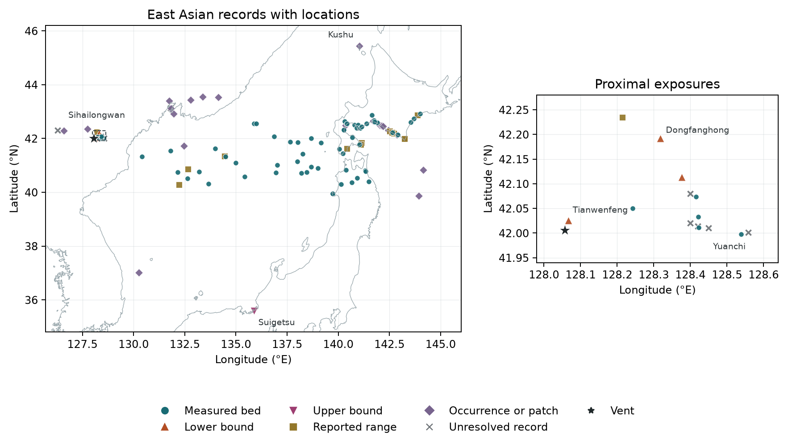

# B-Tm source audit

The revised input for the 946 CE Millennium eruption of Paektu / Changbaishan has **64 measured thicknesses, three lower bounds and one upper bound**. The target is the combined bulk airfall from both eruptive phases, including ash that settled from pyroclastic clouds. Thicknesses are in centimetres. Core depth, ignimbrite thickness, lahar thickness and the dimensions of ash pockets have separate meanings in the evidence ledger. [Reviewed input](../../eruptions/B-Tm_reviewed.csv) · [Updated estimates, maps and geographic tests](../../../eruptions/b-tm/README.md)

## Which records enter the fit?

| Source | Audit decision |
|---|---|
| Original 84 records | 55 measured thicknesses, two lower bounds and one upper bound enter the fit. The ledger gives the reason for withholding each of the other 26. |
| 33 additional ledger records | Nine measured thicknesses and one lower bound enter the fit. The other 23 include patch maxima, glass counts, uncertain positions and disputed horizons. |
| Two published compilations | The crosswalks cover all 76 Yang workbook rows and all 83 Costa Table S1 entries. Phase fractions of the same bed count once. Of the accepted thicknesses, 25 are explicitly compilation-only and one more, Utasai, has checked coordinates and a compiled thickness. |
| 23 supplemental records | The supplemental ledger traces regional locality accounts, the Amur Bay cores and occurrences in Greenland ice. Several sources can describe the same locality. |

Seven flagged artificial points and six extra triplets outside the original CSV schema supplied no field observations. Lake centres locate the two new Megata sites. Some proximal coordinates locate approximate exposures. The fits condition on those positions.

[Main ledger](evidence.csv) · [Supplemental ledger](additional-evidence.csv) · [Costa crosswalk](costa-table-crosswalk.csv) · [Yang crosswalk](../../../comparisons/source-revision/input-inventory/b-tm-workbook-review/source-crosswalk.csv) · [Original CSV](../../eruptions/B-Tm_tephra.csv)

### Which near-vent evidence enters the principal fit?

The Korean summit, valley and plateau descriptions in the supplemental ledger give regional thicknesses. Their spatial extent and stratigraphic attribution limit their use as individual observations. The 68-row analysis uses the measured sections and documented bounds listed below. [Contextual records](additional-evidence.csv)

Eight accepted sites lie within 100 km of the vent. The named sections below explain the three component lower bounds and five totals.

- At **Tianwenfeng**, Costa P77 assigns 35 cm to the rhyolitic component and 115 cm to the other component of a 150 cm stack. The local stratigraphic correlations differ among publications. The principal fit uses the 35 cm contribution as a lower bound. At **Dongfanghong**, the 16 cm trachytic unit provides a lower bound. An alternative fit admits the entire 150 cm stack and both Dongfanghong units (16 + 10 cm). **Yueliangwan** has a 20–40 cm field range and mapped phase-specific observations. These descriptions do not establish a combined scalar at one measured section. [Chen et al.](https://doi.org/10.1016/j.quageo.2016.02.003) · [Sun et al.](https://doi.org/10.1016/j.quascirev.2017.10.021) · [Yang et al., critical review, Fig. 6](https://eartharxiv.org/repository/object/3625/download/7231/) · [Yueliangwan study](https://doi.org/10.1016/j.catena.2021.105857)
- **Heishi River** contributes about 60 cm from two fall units, about 10 and 50 cm. The 13.6 m ignimbrite and 3.8 m lahar are separate deposits. At **Yuanchi**, two published phase partitions give the same 72 cm total. Pan’s trenches 1, 2 and 4 give 90, 50 and 50 cm. Trench 4 explicitly records absence of the lower fall unit in that exposure. At trench 5, a 20 cm fall overlies a flow. Only the observed fall component sets a lower bound. Four unnamed legacy points in this cluster have insufficient section identity for independent totals. [Pan et al., Figs. 4–5 and 12](https://doi.org/10.1016/j.jvolgeores.2020.106870) · [Costa et al., Table S1](../../sources/b-tm/costa2024-supplement.pdf)
- Pan documents a 100 cm fall component at **Tumen River**. The site falls south of 42° N on the primary map and north of it in Costa P76. Trench 3 has a 5 cm component with an unresolved position. Both remain in the ledger. [Pan et al.](https://doi.org/10.1016/j.jvolgeores.2020.106870)

### Japanese lake, coastal and offshore records

- **Ni-no-Megata and San-no-Megata** each contain a 2 mm B-Tm bed in a named core. They are separate maars from the previously fitted Ichi-no-Megata. **Lake Ogawara** has two separate cores. OGA95-2 records about 2 cm and OG12-2 records 1 cm. B-Tm is distinguished from the underlying Towada ash. The lake cluster and multiple Hokkaido coring localities concentrate sampling geographically. The four newly accepted records add much less than four independent regional constraints. [Kamite et al., Figs. 1–2 and Table 1](https://doi.org/10.5575/geosoc.116.349) · [Fukusawa et al.](https://ir.lib.shimane-u.ac.jp/3018) · [Nara et al., Figs. 1–2](https://doi.org/10.2343/geochemj.2.0619)
- Nakanishi’s Hokkaido Table 2 lists a **range from patches to a maximum** for Nakanosawa, Shiomi, Monbetsu, Toyosato, Kabari, Urawa, Higashisizunai and Utoma. Costa used the maxima. We retain the number of surveyed cores and the maximum at each locality as evidence of within-site variation. No maximum of this kind enters the primary fallout likelihood. Kabari’s later 1–2 cm black-peat description may overlap the previous survey. Locality-level scalar entries enter once each. [Nakanishi et al., Table 2](https://doi.org/10.1016/j.dib.2020.106565) · [Kabari study](https://doi.org/10.1371/journal.pone.0298720)
- In **eastern Hokkaido**, the original field table gives Kinashibetsu Kn-3 layer 5 as **0.5–1 cm**. Yang’s 1 cm used the upper endpoint. The range is the twelfth interval in the endpoint tests. Tokachibuto Tkb-01 layer 4 and Yudonuma YDN1 layer 5 are both 1 cm. Pashikurunuma PK-GS1 layer 4 is 0.5 cm. The same table records mixed B-Tm and Mashu ash at Nanbuto and Kiritappu, dispersed glass at Lake Harutori, and a deeper Tokachibuto layer of uncertain eruption identity. These observations document the presence and preservation of ash. [Furukawa & Nanayama, Table 1, pp. 356–357](https://doi.org/10.18940/kazan.51.6_351)
- In the **Japan Sea and Pacific**, the earlier compilation includes 13 numerical ranges. Eleven of those have comparable positive endpoints suitable for a controlled source sensitivity. The two other entries have different source meanings. At **Lv53-29**, 3–4 and 13–15 cm locate analyzed material in a core. Derkachev’s 1–15 cm statement spans several cores. At the **Sergeevskoe Plateau**, a maximum spans bog profiles affected by vertical redistribution. In Amur Bay, three additional cores have identified or correlated cryptotephra horizons with recorded depths. Pit 120 in adjacent coastal peat preserves a discontinuous 1 cm bed. Patches, spots, pooled maxima and sample intervals remain qualified records. [Derkachev et al.](https://doi.org/10.1016/j.quaint.2019.01.043) · [Razjigaeva et al., 2020](https://doi.org/10.31857/S268673972010014X) · [Akulichev et al.](https://doi.org/10.1134/S1028334X16080201) · [Pit 120 stratigraphy](https://sciencejournals.ru/view-article/?a=GeoMorf2301011Razzhigaeva&j=geomorf&n=1&v=54&y=2023)
- Machida & Arai’s Fig. 3 shows **trace** at P82 and P83 (Costa entries P18 and P19, each tabulated as 0.2 cm). It shows **1 cm** at P129 (Costa P08 gives 0.1 cm). An approximately plotted Yang observation already carries 1 cm nearby. We keep it once and flag the possible alias. Tomakomai Port is a geochemically verified distal type locality with published coordinates. The 5 cm figure for southern Hokkaido in Machida and Arai is a regional maximum. The port is recorded separately as an occurrence. Several older map-derived station matches remain uncertain. Costa P28 in the central Kurils cites the Primorye study, whose study area does not cover that coordinate. Other Kuril occurrences cannot verify that specific 1.5 cm bed. Other provisional sites include P01 and P07. At the Kiritappu marsh, a primary table identifies a compound ash horizon and the match to Costa P34 is uncertain. The crosswalk gives the issue for each. The 2021 compilation explicitly screened reports of reworking or non-pyroclastic material. An unlisted station can still be genuine. [Machida & Arai, Fig. 3](https://doi.org/10.1016/0377-0273%2883%2990007-0) · [Yang et al.](https://doi.org/10.1007/s00445-021-01487-8) · [Type-locality coordinates and glass correlation](https://doi.org/10.1016/j.quascirev.2016.08.022) · [Costa crosswalk](costa-table-crosswalk.csv)

### What Longgang and the other cryptotephras measure

These sites also test the geometry of the western isopachs. The archive inventory records the actual observations, the source of each visibility assumption and the evidence for preservation. [Archive inventory](archive-observations.json) · [Revised isopachs and conditional volumes](../../../eruptions/b-tm/results/directional/bearing/README.md)

| Site | Original observation | Use in this revision |
|---|---|---|
| Lake Sihailongwan, Longgang | Colourless peak of 2,657 shards per 0.5 g dry sediment at 53 cm depth and brown peak of 669 per 0.5 g at 52 cm. The protocol discarded the fraction below 30 µm. | A geochemically attributed occurrence west of the vent. The two colour-specific peaks correspond to 5,314 and 1,338 shards/g in different samples. They cannot be summed as a whole-deposit loading. [Sun et al., sections 2–4 and Fig. 2](https://doi.org/10.1016/j.gr.2015.01.013) |
| Lake Kushu, Rebun | Invisible RK12-0151 peak, 30,671 shards/g dry sediment. The lake coordinate is 45°25′55″ N, 141°02′13″ E. Costa P35 is about 314 km east of the named lake. | Occurrence at the lake. The original project coordinate was already near the lake. The published field descriptions do not establish a centimetre value or a calibrated upper bound. [Chen et al., 2016](https://doi.org/10.1016/j.quageo.2016.02.003) · [Chen et al., 2019](https://doi.org/10.1016/j.quascirev.2019.05.017) |
| Ulleung Basin core 13PT-P4 | A peak concentration of 9,529 shards/g in the 25–27 cm depth interval. | Costa P74’s 0.038 cm is a transferred equivalent and closely reproduces the count conversion. Store both quantities. Use occurrence evidence. [Chen et al., Table 1](https://doi.org/10.1029/2021JB023243) |
| Quanyang peat | About 20–25 pumice particles per cm³ of peat at 64 cm core depth. | Retain particle concentration in its original units. The working sheets contain conflicting putative thicknesses. [Han et al., 2019](https://doi.org/10.3969/j.issn.0253-4967.2019.01.015) |
| Lake Suigetsu | An observed ash bed thinner than 1 mm in the SG06 archive. | Upper-censored at 0.1 cm. This field observation supports a numerical bound for this bed. [McLean et al., section 3.1](https://doi.org/10.1016/j.quascirev.2016.08.022) |
| Gushantun and Greenland | The published Gushantun 40–43 cm horizon dates to 260–420 cal yr BP. The Greenland NEEM and NGRIP ice cores independently preserve Millennium glass. | Withhold the disputed Gushantun attribution. Record the two ice-core occurrences separately from regional thickness evidence. [Zhao & Liu](https://doi.org/10.3969/j.issn.0253-4967.2012.03.012) · [Later regional cryptotephra study](https://doi.org/10.1177/0959683615569320) · [Sun et al., Greenland ice cores](https://doi.org/10.1002/2013GL058642) |

Costa’s supplement uses a Lake Suigetsu conversion of 25,000 shards/g per millimetre. Reverse conversion gives approximately 640 and 360 shards/g for Costa’s Sihailongwan and Kushu thicknesses. Those numbers differ from the primary studies’ reported peaks. Sample selection, weighting and normalization would need to be resolved before quantitative reuse. Costa’s two phase estimates from a count conversion share the same calibration. [Table S1 and footnote](../../sources/b-tm/costa2024-supplement.pdf)

For a contiguous, dated core profile with concentrations $C_i$ in shards/g dry sediment, dry bulk sediment density $\rho_{d,i}$ in g/cm³ and slice thickness $\Delta z_i$ in cm, the **recovered shard inventory per area** is $I_N=\sum_i C_i\rho_{d,i}\Delta z_i$ in shards/cm². Estimating deposit thickness requires the missing size fractions, recovery efficiency, representative shard masses and glass-to-total-ash mass fraction. The reconstructed areal ash mass divided by bulk fallout density gives a **preserved equivalent thickness**. To interpret that as original atmospheric fallout also requires a defensible account of sediment focusing, reworking, compaction and loss. A point count, a glass material density, or a statement that the bed was invisible supplies no such conversion or physical upper bound. These conditions also apply to very dilute or very distant records.

At **Sihailongwan**, if $M_{52}$ and $M_{53}$ are the dry sediment masses per unit area of the two respective slices (g/cm²), the contribution from the two reported colour classes at their peaks is $1{,}338 M_{52}+5{,}314 M_{53}$ counted shards/cm². The original 2008 core study describes weighing the freeze-dried samples. I could not verify the dry mass per core area of these two slices or an ash-mass calibration. Published same-lake density measurements for SHLW21 freeze cores concern modern-age strata. Transferring those densities across cores and a millennium would add an untested assumption. [Sun et al., methods](https://doi.org/10.1016/j.gr.2015.01.013) · [Han et al., density data and Fig. 2](https://doi.org/10.1177/20530196231167019)

A physical upper bound could be derived without assigning masses to individual shards. For a measured core interval, the total dry sediment loading $M=\sum_i \rho_{d,i}\Delta z_i$ (g/cm²) bounds the preserved dry ash mass in those slices. To bound the original fallout thickness, one would also need a justified lower limit $f_{\min}>0$ on the fraction of the original local areal ash mass represented in that interval, and a lower limit $\rho_{b,\min}>0$ on fallout bulk density. Under those conditions $T_{\rm fall}\le M/(f_{\min}\rho_{b,\min})$. An incomplete or eroded horizon can have arbitrarily small retention. At Sihailongwan these measurements and limits could not be verified, so the site contributes an occurrence with its two measured concentrations.

The 1993 *Geology of Korea* gives a density of 0.40–0.74 g/cm³ for white pumice (Table 3.36). This is a property of the reported pumice material. Longgang conversion also needs the sediment dry mass sampled per unit area, the dimensions and recovery of the shards, and the bulk density of the reconstructed deposit. The pumice values alone cannot supply any of those quantities. [Original Table 3.36, PDF p. 346](https://web.archive.org/web/20220404171435id_/http://mmtk.ginras.ru/pdf/1993_geology_of_Korea_pyongyang.pdf#page=346)

Lee et al. subsequently measured the compositions of glass recovered from two NGRIP1 ice samples. T4 yielded eight rhyolitic and one trachytic shard. T5 yielded two rhyolitic and four trachytic shards, including one rhyolitic shard inconsistent with B-Tm. These are analyzed shard counts from an already recorded core locality. They support the two-phase attribution without measuring the total ash inventory. [Lee et al., Fig. 1 and Supplementary Data 1](https://doi.org/10.1038/s43247-024-01713-z)

### Reproduction and limits

The [manifest](provenance.json) pins the original and revised CSVs, the original three source scenarios and the [main evidence ledger](evidence.csv). Evidence IDs join every fitted site to its source row. Positive scalar values and explicit one-sided bounds enter the principal likelihood. The twelve [low](range_low.csv) and [high](range_high.csv) endpoints are fitted as joint alternative readings. The [alternative proximal correlations](correlations.csv) change only the summit and Dongfanghong. Their differences measure sensitivity to those stated choices. A further [source-provenance sensitivity](source-class-provenance.json) omits the 25 explicitly flagged compilation scalars and the separate Utasai thickness. Its 42-row selection retains the other measurements and all four bounds. These four alternatives leave additional uncertainty about preservation, site registration and source identification. [Source-sensitivity fits](../../../eruptions/b-tm/results/source-audit/README.md)

The private `B-Tm.xlsx` has SHA-256 `1b4ca94b1b3370c52ab3a0bc31991a65de349247ae8379812f4ebb14ec03e72f`. The reviewed `B-TmR.xlsx` (`be9f9c7a91e591e8e57f1e6e23b935519190af2879fb4225cdc023aabed6e173`) lists 116 nominal zero locations. Site-specific recovery, chronology and detection information would be needed to interpret them as quantitative constraints. [Workbook inventory](../../../comparisons/source-revision/input-inventory/b-tm-workbook-review/README.md)

Approximate bed thicknesses enter at the reported value. Individual error distributions were unavailable. The two Ogawara cores sample the same lake and can share settling and preservation effects. Their separate positions identify the cores, while their thickness difference documents local variation. The conditional model intervals quantify variation under their named assumptions. Sampling in seas and lakes dominates much of the field, and the southwest, west and north have sparse quantitative constraints. The loss of nominal edge measurements changes the observation hull and geographic folds. A change in regional volume or prediction score relative to the 84-row run therefore includes a change in the evaluation domain. The quantity of tephra missing from unsampled directions remains uncertain. [Source catalogue, locators and hashes](sources.json) · [Preserved public originals](../../sources/b-tm/README.md) · [Previous B-Tm release](https://github.com/siyulai21/tephra-fallout-isopachs/tree/2a52e062b7db84699d5229a25b01282c10301b3e/eruptions/b-tm)
