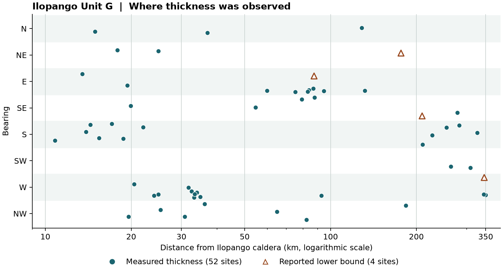

# Ilopango TBJ Unit G thickness audit

This page preserves the source and coverage audit for the 56-locality matched comparison. The November 24 review registers 116 localities and preserves the reconciliation with this edition. [Current site audit, bounds and original field reports](reaudit/README.md)

**52 measured thicknesses and four reported lower bounds** enter each fit. Each accepted row has a distinct published coordinate pair and an evidence ID. The primary observation is the widespread upper co-ignimbrite ash, Unit G. Earlier fallout units A and B have different dispersal axes. Other horizons include flow deposits. Keeping the unit identity fixed makes the thickness at different sites comparable. [Accepted observations](../../eruptions/Ilopango_TBJ_Unit_G.csv) · [Source material](../../sources/ilopango-tbj/README.md)

## How an observation enters the fit

The ledger covers all 107 site rows on sheet `Hoja1` of Pedrazzi et al.'s supplement, the two additional distal thicknesses used by Smith et al., and their Greenland glass occurrence. An ID such as `SM1-P85` identifies the source thickness cell. Longitude and latitude come from cells D85 and C85 of the same row. Conversion divides decimal minutes by 60 and makes west longitude negative. Published precision varies by site. The two Smith coordinates are already decimal degrees. The original numbers, unit identifications, fitted values and exclusion reasons are in the ledger. [All 110 source decisions](selection.csv) · [Original spreadsheet](../../sources/ilopango-tbj/pedrazzi-supplement-1.xls) · [Smith et al., Methods](https://pmc.ncbi.nlm.nih.gov/articles/PMC7584997/)

| Evidence | Treatment in the principal fit |
|---|---|
| 56 positive numerical entries in Unit G column P | 50 retained. Five have only a regional location and one has a conflicting published thickness. |
| Four greater-than readings | Retain the stated limit in the censored likelihood. San Antonio El Mosco exceeds 50 cm, marine cores SO173-11 and M66-228 exceed 7 and 1 cm respectively, and Lake Yojoa exceeds 0.3 cm. Two Yojoa cores share a single published position and reading. |
| 39 zero entries for Unit G | Retain in the ledger. A zero in the unit-by-unit section table gives neither original fallout thickness nor a positive detection threshold at the site. |
| Other unresolved workbook entries | The ledger preserves blanks, question marks and uncertain ranges verbatim. It records all six regional IDs G1, F1–F3, S1 and S3 with their published coordinates. These localities lack identified sections with comparable positional precision. |
| Tazumal, ILO-289 | Column P67 gives 20 cm. The Figure 3o caption gives 40–50 cm at Tazumal. The source does not establish whether the values describe the same section. Both readings remain documented. |
| OC001 and MES001 | Retain the two distinct 3 cm beds using the coordinates printed by Smith et al. Both lie in the western distal area and provide little independent angular leverage. |

The exact readings comprise 40 outcrops, eight marine cores, two lake or pond sites and two additional distal cores. ILO-169 at Istagua has the thickest accepted bed (550 cm). Pedrazzi et al. describe Unit G reaching about 6 m and a transition from Unit F. ILO-303 includes a lahar in the section log and has a separately reported 30 cm Unit G bed. Offshore correlations identify TBJ more securely than any individual pulse. These uncertainties survive transcription and affect interpretation. [Field descriptions and figures](https://doi.org/10.1016/j.jvolgeores.2019.03.006) · [Marine bed correlations](https://doi.org/10.1029/2007GC001631)

### Greenland ice-core occurrence

Smith et al. identified about 14–15 glass shards at TUNU2013 (78.04° N, 33.88° W), about 7,755 km from Ilopango at an initial bearing of 10.5°. The 194.395–194.48 m interval is a depth in the ice. The authors analysed meltwater from a 33 × 33 mm cross-section spanning about 2.5 years. Glass chemistry supports a TBJ origin. The sample does not resolve an individual eruptive phase, and the recovered shard count gives no measured bulk fallout thickness or calibrated bound for Unit G. The ledger records the site as `occurrence_only` with an empty fitted value. Only the 56 quantitative sites enter the fitted hull and the eight-sector counts below. [Original results, Fig. 4, Table 2 and ice-core methods](https://pmc.ncbi.nlm.nih.gov/articles/PMC7584997/)

## What “all directions” means here

Each 45° compass sector centered on a cardinal or intercardinal bearing contains at least two measured sites. Distances and initial bearings use the WGS84 ellipsoid and the Smithsonian caldera position. Positive bounds enter the fits but are counted separately in this coverage check. [Sector calculations](coverage.csv) · [Source, vent and largest angular gaps](provenance.json)

| Bearing | Measured sites | Lower bounds | Distance range of measurements (km) |
|---|---:|---:|---:|
| N | 3 | 0 | 15–129 |
| NE | 2 | 1 | 18–25 |
| E | 9 | 1 | 13–132 |
| SE | 5 | 1 | 20–278 |
| S | 12 | 0 | 11–327 |
| SW | 2 | 0 | 264–309 |
| W | 12 | 1 | 20–349 |
| NW | 7 | 0 | 20–184 |

The largest gap between adjacent measured bearings is 37° across all distances. It grows to 107° for measurements at least 50 km away and 219° beyond 200 km. The two NE measurements are proximal, supplemented by a lower bound 176 km away at Lake Yojoa. The two SW measurements are offshore and leave the intervening sector unsampled. These differences matter when reading a closed contour or a global volume interval.

## Replay

From the project environment, install the optional original Excel reader with `python -m pip install xlrd==2.0.2`. Run `python -m benchmarks.ilopango` to compare the frozen observations, ledger, sector counts and provenance against the source bytes. With Poppler installed, add `--verify-manuscript path/to/smith-accepted.pdf` to check the two distal beds and the Greenland core coordinates against the original PDF text. Use `--prepare` to rebuild those four files or `--figure` to redraw the coverage figure. [Audit implementation](../../../benchmarks/ilopango.py)
