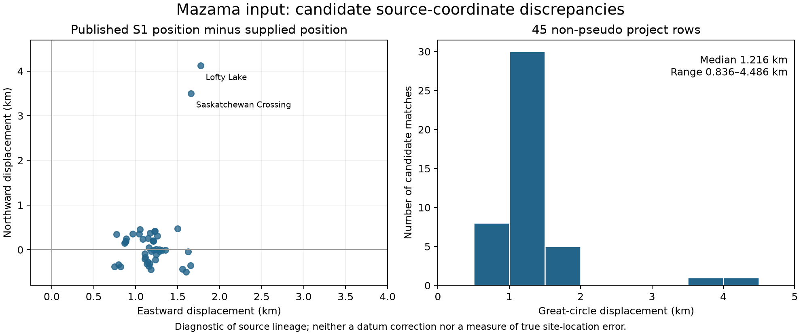

# Mazama source audit — 23 November 2026

[Lake and field section review](LAKE_AND_FIELD_RECORDS.md) · [Numbered field-section locations](marcott-map.png) · [Geographic registration](marcott-registration.json)

[Case and historical calculations](../../../eruptions/mazama/README.md) · [Data guide](../../README.md) · [Preserved sources](../../sources/mazama/README.md)

All 293 Buckland supplement localities and 574 additional records, core samples and controls appear in the ledger. The 52-row supplied table comprises 45 candidate field matches and seven contour-construction points. The 271-location principal input has 31 point values, 137 lower limits and 103 upper limits. Of the 155 fitted positions beyond 100 km, 29 carry point values, 23 minima and 103 ceilings. The facies review documents every change from the 244-position edition and links to the field descriptions. [Deposit-nature review](distal-review/README.md) · [867-record ledger](revised-locality-ledger.csv) · [Accepted input](../../eruptions/Mazama_reviewed.csv) · [Provenance](provenance.json)

Young’s complete thesis contributed 103 mapped upper-pumice sections to the principal fit. The 25 separately numbered distal entries retain his field-check flags and 700 kg/m³ density convention. The follow-up also distinguishes primary pumice from floated pumice in Oregon borings, revisits borehole locations, and records the possible offshore Willapa bed. [Young and the additional field studies](YOUNG_AND_FIELD_SECTIONS.md) · [Thicknessless-site derivations](THICKNESSLESS_SITES.md) · [Input before Young](history/2026-11-23-before-young/README.md)

Original observer verification remains open for 193 of the 293 compilation entries in the source queue. Nine of these are conditionally used in the principal fit. Some other sources confirm only identity, location or the preserved bed. The locality decisions state which link has been checked. [137-reference bibliography screen](bibliography-screen.csv) · [Outstanding observer records](primary-source-work-queue.csv) · [Search coverage](SEARCH_AND_GAPS.md)

The radiocarbon citation crosswalk covers all 81 laboratory entries and both ice-core estimates in Egan’s two tables. Checking the original logs recovered two measured British Columbia beds and four additional conditional field or archive bounds. [Dated sections and their locations](DATED_SECTIONS.md) · [Laboratory age crosswalk](egan-age-crosswalk.csv)

The Great Basin and Carp Lake review adds eight quantitative observations. It checks the 5 cm Oregon Fish Lake bed, distinguishes the two Nevada Fish Lake Valley cores from it and documents redistributed Paisley Cave ash. [Great Basin field and core records](GREAT_BASIN.md)

The [thick distal field assessment](distal-review/FIELD_EVIDENCE.md) follows each of the 29 large numeric S1 entries beyond 300 km and identifies additional independent and conflicting field evidence.

## Deliverables

| Artifact | Contents |
|---|---|
| [Revised locality ledger](revised-locality-ledger.csv) | All 867 records with coordinates/native locations, age basis, identity, observed quantity, bounds, references, quality, caveats and decisions |
| [Readable locality register](LOCALITIES.md) | Compact GitHub-readable index of every record |
| [Original published catalogue](buckland2020-293-localities.csv) | All 293 entries and all 15 original data columns, with Excel row identities |
| [Original cells](buckland2020-cells.json) | Scalar values including nulls; preserves source spelling and numeric precision |
| [Project-to-source crosswalk](supplied-row-crosswalk.csv) | All 52 supplied rows; both data-row and physical CSV-line numbers; seven pseudo rows excluded |
| [Additional records](additional-localities.csv) | 574 additions and controls, including separate cores, correlated profiles, aliases and possible duplicates |
| [Ranges and bounds](bounds-and-ranges.csv) | Source-qualified preserved-deposit quantities; no invented trace thresholds |
| [Unquantified occurrences](occurrences-and-traces.csv) | Traces, cryptotephras, tentative signals and records without thickness |
| [2022 reuse comparison](buckland2022-input-comparison.csv) | Later model-input table, including changed 1 cm values; not independent field evidence |
| [Bibliography](compilation-bibliography.csv) | Complete transcribed S1 reference list; a citation is not a claim of verification |
| [Source manifest](../../sources/mazama/source-manifest.csv) | Download URLs, byte counts and SHA-256 hashes of 221 retrieved source payloads, including 67 bundled originals and 154 linked with their checksums |
| [Search and remaining work](SEARCH_AND_GAPS.md) | Search scope, additional leads, failed retrievals and priority unresolved records |
| [Data dictionary](DATA_DICTIONARY.md) | Quantity, evidence, coordinate and decision semantics |

## What happened to the project table

The unchanged [supplied CSV](Mazama_supplied_52rows.csv) contains 52 data rows: 45 non-pseudo and seven explicitly invented constraints. Thickness is in centimetres. Its provenance did not include locality names or a source-row key.

All 45 non-pseudo values have plausible correspondences in [Buckland et al. (2020), Supplementary S1](https://doi.org/10.1007/s00445-020-1362-1). These are **candidate lineage matches**, supported by location, thickness and selection pattern; the original digitisation/export history is unavailable. Twobit Creek is matched to ID 169 rather than ID 168, which shares its coordinates but lacks thickness. Lavington is matched to ID 205 rather than the slightly nearer ID 206, which also lacks thickness.

All 45 project coordinates differ from the candidate S1 coordinates: median displacement **1.216 km**, range **0.836–4.486 km**. This is not a demonstrated datum transformation. S1 coordinates themselves can be approximate, inherited, shared or inconsistent; their many decimal places do not establish survey precision. The ledger preserves S1 positions and records each revised basis separately. Primary DMS positions correct Portage, Twobit and Lavington; independent source checks correct Moss, Goldeye, Green Lake, Tepee Lake and GISP2. Lake-level locations are not claimed to be surveyed core positions.

| Project data row (CSV line) | Site / S1 ID | Project cm | S1 cm | Interpretation |
|---|---|---:|---:|---|
| 35 (36) | Newman Lake /122 | 23 | 22.5 | Rounding; S1 also gives ±7.5 with unspecified statistical meaning |
| 46 (47) | Day Creek /58 | 60 | 59.5 | Rounding of a summary with an additional internal arithmetic conflict |
| 50 (51) | Huckleberry Springs /33 | 220 | 224 | Coarsened value; original field table still needed |
| 51 (52) | Antelope Unit /26 | 220 | 223 | Coarsened value; original field table still needed |

The seven pseudo rows are retained only in the historical snapshot/crosswalk, never as new geological evidence. The 2020 article discusses eight inferred constraints; that is not the seven-row project set, and no missing pseudo point has been manufactured. The 2022 supplementary Table S4 has 30 listed primary localities and changes Jenny, Lower Joffre and Jesmond from 1 to 1.01 cm. Its main-text discussion of 36 primary localities is not a justification to merge different input lists or treat model inputs as newly measured data.

## Newly recovered thin beds and lake records

[Yellowstone Lake](YELLOWSTONE.md) documents all ten 4–5 mm ash cores at eight locations; seven locations enter the principal fit, with paired cores counted once and the deformed core tested separately. [The follow-up source review](FOLLOWUP_SEARCH.md) includes Overland 8 cm, Soldier 4 cm, Great Salt Lake 1 cm, Goose 1 cm, Effingham 0.5 cm, further Rainier and coastal lake records, conditional component minima, and explicit reasons for retaining other numeric beds outside the fit. The original sources distinguish primary ash from later sediment transport.

The [final citation pass and Lyman review](LATE_SOURCE_REVIEW.md) adds five fitting locations and six ledger records/controls. It also reopens Connley Cave and Montana facies decisions, and preserves the Blue Lake redeposition evidence.

## Material source findings

| Record | Evidence and revised treatment |
|---|---|
| **Muir Creek /28; project row 52** | 850 cm derives from an 8.5 m exposed lapillistone in a radiocarbon locality description. That description does not establish primary airfall. Egan's thesis attributes a related Kittleman charcoal sample to tephra flow. **Quarantine the value from a reviewed fallout selection until facies and sample lineage are resolved**, rather than declaring it either a proven fall or proven flow. The original DMS position also differs from S1. [Valastro et al.1968, Tx-487](https://doi.org/10.1017/S0033822200010985). |
| **Moss Lake /119; project row 22** | Egan 2016 thesis pp.203,215–216 reports **40 mm centrally and approximately 50 mm at the fringe**, with diffuse fringe contacts, and chemistry supporting climactic Mazama. S1 gives 5.5 cm and describes 5–6 cm. The ledger records 4 and~5 cm as core-specific values, not a hard uncertainty interval. The 151–158 cm sampling window is not a 7 cm ash bed. Older MLC-T480 is excluded from the climactic package. [Thesis](https://pure.manchester.ac.uk/ws/portalfiles/portal/54585340/FULL_TEXT.PDF). |
| **Juke Box /6** | Primary report p.11 gives a preserved layer varying **0–3 cm, averaging~2 cm**; Table 4 confirms glass identity. This conflicts with S1's 0.75 cm. Zero is a local pinch-out, not zero original deposition. Underlying anomalously old carbon dates are explicitly discussed as possible hard-water effects or an unconformity. [Oviatt et al.2018](https://ugspub.nr.utah.gov/publications/misc_pubs/mp-18-1.pdf). |
| **Mount Bachelor /46** | 2020 total 64 cm comprises 56 cm pumice and 8 cm fine co-ignimbrite ash. 2024 field notes separate **44 cm UPU and 12 cm NLPU**, alongside a thin divider ash. The newer precursor interpretation changes the target-event question. Retain component evidence; do not silently label 64 cm climactic-only or subtract components inferred elsewhere. [2024 article](https://doi.org/10.30909/vol.07.02.853869), [Table S1](../../sources/mazama/buckland2024-s1.xlsx). |
| **Upper Kirk Road /B2024-UKR** | Additional field notes give **35–40 cm UPU**, overlain by 20 cm reworked/slope-derived pumice and soil. Exclude that overlying material from the measured UPU. This is a component observation, not necessarily total fallout; Fig.1 D also inherits some absolute thicknesses from Young 1990. Same 2024 sources. |
| **Jenny Lake /42** | The JEN13-1C station has a gross physical ceiling of 54.5 cm. JEN13-2E at another position gives a 4 cm photographic envelope. Three further registered stations contribute separate enclosing-section bounds. [Registration and measured image](distal-review/JENNY_LAKE.md) |
| **Carbon River /107** | S1 says 5 cm in its numeric column but 3 inches (=7.62 cm) in its narrative. The recovered primary Table 1 p.8 gives a park-wide maximum of 3 inches in a regional column, not a Carbon River measurement. The reviewed point quantity is therefore empty; neither 5 nor 7.62 cm is accepted for this locality. [Primary report](../../sources/mazama/crandell1967.pdf). |
| **Day Creek /58** | S1's 59.5±12.5 implies 47–72 cm; its narrative instead says it averaged 72 and 40 cm, whose arithmetic mean is 56 cm. This is a source conflict, not a measurement-error distribution. |
| **Jesmond /229; Anthony /63; Simpson /53; Hurricane /68; Moscow /94** | Historical upland-equivalent adjustments, including factor-of-two changes and inferred removal of overthickening, are distinct from observed bed thickness. Do not average observed and corrected values or apply a universal compaction factor. |
| **Dick Springs /76; Meadowwood /77; Creston Bog /120** | Several historical measurements, corrected equivalents or core intervals coexist. Their source/core relationships need resolution; numerical summaries are not automatically exact observations. |
| **Wildcat Lake /103** | S1 describes a 1 cm primary component within a 146 cm total mixed/reworked accumulation. The expanded review admits the 1 cm component as a conditional lower bound while the original log remains pending. The total cannot be used as primary fallout or assumed to be a rigorous upper bound on it. |
| **Mount Rainier /104** | Mullineaux 1974 pp.27–29 describes widespread 1–5 cm ash, locally 8–10 cm, and much thicker pond concentrations. These are regional descriptions, **not a locality-specific censoring bound** for McNeeley. [USGS report](../../sources/mazama/mullineaux1974.pdf). |
| **Trace-coded IDs 2,3,7,51,60,65,112,286** | S1 assigns 0.1 cm to “trace.” No analytical threshold establishes an exact value or `<0.1 cm`. Keephills'23 cm ash-rich host interval is likewise not 23 cm bulk ash. Lofty Lake's 1 mm bed description is different evidence, with its preserved 0.1 cm distinguished from the historical0.2 cm corrected equivalent. |
| **Nordegg /275; Chase /212** | Nordegg's coordinate fields conflict with its embedded field-note coordinates. Chase shares Alberta coordinates with Cartwright despite its BC description. These conflicts remain unresolved. |
| **Portage Inlet /134** | Buckley and Willis1970 p.101, I-3674, gives **½–¾ inch = 1.27–1.905 cm**, not an exact1.5 cm. Primary DMS gives48°27′50″N123°25′20″W. Peat just above is6670±120 conventional14C yr BP. Include the lower endpoint once, conditional on in-place primary ash without focusing; preserve the upper endpoint for a separate interpretation test. [Primary report](https://www.cambridge.org/core/services/aop-cambridge-core/content/view/9FF5EBA7DF6C340CBEA9FC2726BEEA83/S0033822200036225a.pdf/isotopes_radiocarbon_measurements_viii.pdf). |
| **Twobit /169; Lavington /205; Rithets /139** | Lowdon and Blake1970 pp.71,73–74 confirms the separate lower **8 cm** Twobit bed and **10 cm** Lavington bed, with DMS positions resolving the duplicate/wrong compiled coordinates. Their Mazama correlation remains conditional. Rithets has no thickness;6.6 m is core depth. Local ages and sample identities are retained, not silently substituted for eruption age. [Primary report](https://www.cambridge.org/core/services/aop-cambridge-core/content/view/39A2168FD3D0F3FA822CE54B9E8FDB04/S0033822200036213a.pdf/geological_survey_of_canada_radiocarbon_dates_ix.pdf). |
| **Mike Lake /165** | Brown et al.1989 p.210 explicitly reports **approximately3 cm** at425–428 cm; this is not inferred from the dating-sample interval. Pollen and bulk-carbon ages differ. Primary text checked through an author-associated web transcription; exact core coordinates remain unverified. |
| **Lower Joffre /210; Green Lake /257** | Menounos et al.2004 p.1545 gives **1 cm** ash beds at378 and887 cm respectively. Green Lake is near Whistler; S1 locates a different lake about180 km away. Its revised position is the official WGS84 feature centre, not a surveyed core. Physical/stratigraphic identity and unquantified lake focusing remain qualifications. [Primary thickness](https://couplet.unbc.ca/pdfs/8200.pdf), [location context](https://couplet.unbc.ca/pdfs/biogeochem.pdf), [official location](https://apps.gov.bc.ca/pub/bcgnws/names/2693.html). |
| **Goldeye /274** | Yu2006 reports a broader low-organic-matter interval at285–265 cm, but the recovered text does not substantiate S1's2 cm ash bed. Exclude that point. Table2 gives52°27′N116°12′W, which S1 appears to have treated as decimal minutes; these are rounded lake coordinates, with the core described500 m north/upstream. The host interval is not a bulk-ash bound. |
| **Tepee Lake /149** | The named field locality was corrected by about 73 km using the register for the older Glacier Peak tephra. The original Mack core log has not substantiated a 10 cm climactic Mazama fall at that position. The source number is preserved and the principal fit omits it. [Location register](https://static.cambridge.org/content/id/urn%3Acambridge.org%3Aid%3Aarticle%3AS0033589400005779/resource/name/S0033589400005779sup001.pdf) |
| **GISP2 /292** | S1 latitude 73.58 is inconsistent with the authoritative GISP2 D inventory. The reviewed coordinate is **72.5833333 N,38.466667 W**; original values remain in the raw catalogue. Chemistry is supported by the 1999 primary abstract, not independently reprocessed here. [NSF inventory](https://icecores.org/inventory/gisp2). |

## Additional occurrences and their limits

**Securely reported cryptotephra does not supply bulk deposit thickness.** Lake Superior's second core near Isle Royale is retained separately from the compiled Keweenaw Bay core. Jensen 2021 adds Bloomingdale Bog, Sidney Bog core 2 and Thin-Ice Pond and reanalyses Nordan's Pond. Rabett 2019 identifies Balsam Creek BCK-284, while its older BCK-325 is not a climactic Mazama record. Monteath 2023 documents Placentia Bay 10G_195; Davies 2024 identifies Mazama in NGRIP. Coordinates, horizons, local or imported ages and geochemical qualifications are in the ledger. [Spano 2017](https://doi.org/10.1130/G39394.1), [Jensen 2021](https://doi.org/10.1016/j.quascirev.2021.107242), [Rabett 2019](https://doi.org/10.5334/oq.54), [Monteath 2023](https://doi.org/10.5194/gchron-5-229-2023), [Davies 2024](https://doi.org/10.1016/j.quascirev.2024.108707).

**Redden Springs and North Redden are different grades of evidence.** Jones 2025 confirms Mazama glass at 99–100 cm in RSP15B by microprobe; NRS14 A at 65–67 cm has an XRF-index signal without shard/microprobe confirmation in the paper. Neither has a visible ash bed. The separate Great Salt Lake GSL00-4A-2H-2 core has a visible 1 cm bed and now uses the original GLAD1 hole position; it enters the principal fit once. [Primary article](https://doi.org/10.1177/09596836251350232).

**Ireland is retained as a qualified reassignment.** Plunkett and Pilcher 2018 propose that MOR-T12 at An Loch Mor is Mazama rather than Hekla. Its interpolated age (~5300–5350 BCE) and reassigned chemistry need explicit reconciliation with the eruption chronology. It is not treated as an exact or censored thickness, or as proof that the intervening geographic area is supported. Nuangola, Pound Cove and Southwest Pond are retained as primary-excerpt leads; missing thesis/supporting data prevent a full analytical check. [Plunkett and Pilcher 2018](https://doi.org/10.1016/j.earscirev.2018.02.006), [Monteath 2020 thesis](https://eprints.soton.ac.uk/439312/), [Monteath 2025](https://doi.org/10.1029/2024JD042135).

**Patchy and sedimentary occurrences are preserved without converting them to fallout.** Lemke 1975 Table 4 contributes 23 specimen/locality records with native township–range–section descriptions, preserved thicknesses and sedimentary context. Decimal coordinates were not guessed; some may overlap broadly named compiled Craig/Galata occurrences. Several layers pinch out. HS-204 B and HS-206 occupy a shared section and must not be added as independent falls. The table's rounded foot-to-centimetre values and its internal ID/date inconsistencies remain explicit. [USGS Table 4, pp.H 20–H 22](../../sources/mazama/lemke1975.pdf).

Welcher 1993 describes seven Camp Creek profiles with a 2 cm basal fine bed interpreted as likely primary, below an 11–235 cm unit dominated by fluvial reworking. Native land descriptions now locate them within three BLM survey sections. The principal input uses one conditional minimum per section group, with the full section footprints retained; exact core positions remain unresolved. Saltese Flats has a 71 cm geochemically matched bed, but its authors did not establish the amount of reworking or overthickening. Sunset Hill and Latah Creek are qualitative photographed occurrences. Billy Big Spring documents contrasting thick pond and microscopic shore preservation without numerical limits. Malpass clay is retained as weathered/redeposited material, not fallout thickness. [Welcher thesis](https://scholarsbank.uoregon.edu/server/api/core/bitstreams/6466a25c-0b80-4fd8-892c-db28b2cd470d/content), [Saltese poster](https://gsa.confex.com/gsa/2024CD/webprogram/Handout/Paper397061/Saltese%20Mazama%20GSA_2024%20poster.pdf), [Billy Big Spring abstract](https://plainsanthropologicalsociety.org/sites/default/files/2021_PAC_Boulder.pdf), [BLM report](../../sources/mazama/baitis2015.pdf), [Camp Creek georeferencing](camp-creek-georeferencing.json).

The Goldfinger NEHRP report adds eight records: Beaver, Sawyer, Tarboo and Bull Run lakes; Meyers Canyon; and three marine cores. It also supplies primary chemical context for compiled Leland and Spring Gulch. Its typical regional 2–7 cm description is not assigned to individual points. Tarboo core termination, a mixed Leland margin deposit and inconsistent marine sample depths remain explicit. The indexed primary report was readable but the PDF download returned 404, so these are labeled web-only checks. [G13AP00066, pp.20,49–51,62–66](https://earthquake.usgs.gov/cfusion/external_grants/reports/G13AP00066.pdf).

## Later primary-source context

At Williams Lake Fen two tephra horizons are separated by 9 cm of lake sediment. The 46 cm compilation value is outside the principal likelihood. A historical alternative restores it to test sensitivity. [Original observations and decision](WILLIAMS_FEN.md)

## Bounds, chronology and suitability for modeling

The [range/bound table](bounds-and-ranges.csv) separates **bounds on the preserved bed** from bounds on original fallout. Explicit “up to” or “less than” descriptions yield qualified preserved-bed bounds, for example Cypress Hills<10 cm, Mica Creek≤5.08/10.16 cm, Calgary≤10 cm and Brule approximately≤2 cm. These do not become atmospheric-deposition likelihoods merely because an inequality can be written down. Redistribution can add material, erosion can remove it, and weathering/compaction can alter thickness. The [initial expanded review](BOUND_REVIEW.md) admitted14 conditional lower bounds, including primary components, range minima and three Camp Creek section groups. Each requires an explicit preservation transfer. The original four source tests cover omission, coherent half-transfer, the Portage upper endpoint and alternate Independence/Cleveland/Newman upper endpoints. The35–40 cm Upper Kirk UPU range does not cap the total climactic package.

A trace, isolated patch, absence of visible ash, ash-rich soil, shard count, shard diameter, core sampling interval or chemical anomaly alone cannot determine a numerical bulk-thickness limit. Detection depends on sampling volume, preparation, grain-size recovery, concentration and preservation. No missing observation becomes zero. The detailed profiles include inventories, counting intervals and conditional mass or particle-volume calculations. Bulk field thickness requires enough information on mass, area, recovery and density. [Cryptotephra calculations and calibration limits](THICKNESSLESS_SITES.md)

Chronologies retain their original meanings. Conventional radiocarbon years are not calendar years. Local age models are distinct from imported eruption ties, and old-carbon/reworking caveats remain attached. NGRIP's 7562±35 a b1.95k on GICC 05 is not silently averaged with GISP2's older 7627±150 estimate or later 7572±18 chronologies. All ice ages used here identify their 1950 datum. Unknown local ages remain unknown even where a Mazama correlation is reported.

The five-family comparison uses the same principal input, regional hull and outer geographic folds. Regional performance remains separate from extrapolated whole-Earth volume. Every global family retains conditional intervals, fixed-prior sensitivities, numerical failures and the common support audit; a smooth or closed isopach does not establish observational support. [Current results](../../../eruptions/mazama/README.md).

Felker Lake is now an occurrence record: the2011 primary text reports microprobe-identified Mazama at946 cm **core depth**, with no recovered bed thickness. Its8 cm LOI and other sample spacings are not ash-thickness bounds.

## Reproduction and checks

Run `python data/audits/Mazama/build_audit.py` from the repository. It uses the Python standard library, the preserved workbooks, [review decisions](review-decisions.json) and [additional records](additional-records.json). It rewrites only derived audit tables and checks the historical input snapshot. Source judgments are explicit data, not hidden parsing heuristics.

An independent extraction checks all 4,395 source workbook cells, 293 original rows, 867 unique evidence records, the 52-row supplied table, 103 accepted Young section bounds and all 271 input rows. Hashes identify the source material, fitting input and deterministic ledger rebuild. [Validation record](validation.json) · [Checksums of all 221 original payloads verified locally](original-payload-verification.json)

Rebuild the tables with `python data/audits/Mazama/build_audit.py`, then the accepted input and site decisions with `python -m benchmarks.mazama`. Run `python data/audits/Mazama/validate_audit.py` with `openpyxl` for independent source checks. Model and publication checks are recorded with the case results.

The independent workbook checker uses `openpyxl` (3.1.5 in this audit environment). The normal accepted-input builder uses the project dependencies. The CI replay checks the accepted CSV and frozen selection/provenance without downloading publisher copies.
