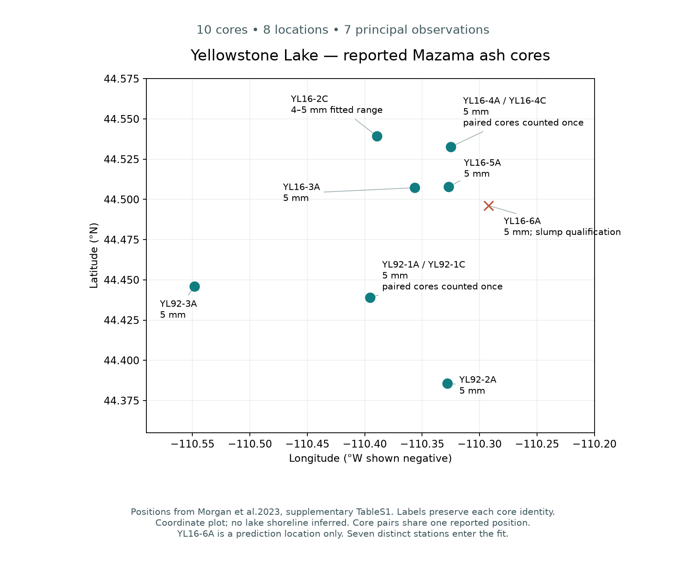

# Yellowstone Lake: ten thin Mazama ash cores

[Audit home](README.md) · [Full ledger](revised-locality-ledger.csv) · [Follow-up lakes](FOLLOWUP_SEARCH.md) · [Current fitting decisions](principal-ranges/locality-decisions.csv)

The earlier audit missed the explicit 4–5 mm beds in [Morgan et al. 2023, published online 2022](https://doi.org/10.1130/B36190.1), *The dynamic floor of Yellowstone Lake, Wyoming, USA: The last 14 k.y. of hydrothermal explosions, venting, doming, and faulting*. They are now retained individually. The ten ash-bearing cores represent eight reported locations. Seven locations enter the fit. Two pairs share coordinates and are counted once. YL16-6A remains in the ledger as a deformation-qualified record. The model excludes it.

| Core | Latitude | Longitude | Reported ash | Mazama depth in main text | Decision |
|---|---:|---:|---:|---:|---|
| YL16-2C |44.53927|−110.38922|4 mm|9.34 m|0.4–0.5 cm interval from Morgan and Schiller|
| YL16-3A |44.50722|−110.35642|5 mm|7.86 m|0.5 cm measurement|
| YL16-4C |44.53264|−110.32492|5 mm|8.20 m|0.5 cm measurement|
| YL16-4A |44.53264|−110.32492|5 mm|7.96 m|Paired with4C; no second likelihood|
| YL16-5A |44.50782|−110.32685|5 mm|7.79 m|0.5 cm measurement|
| YL16-6A |44.49616|−110.29215|5 mm|6.18 m|Slump-toe irregular bed, excluded from the fit|
| YL92-1A |44.4390|−110.3954|5 mm|5.07 m|0.5 cm measurement|
| YL92-1C |44.4390|−110.3954|5 mm|5.25 m|Paired with1A; no second likelihood|
| YL92-2A |44.3856|−110.3282|5 mm|4.26 m|0.5 cm measurement|
| YL92-3A |44.4460|−110.5483|5 mm|7.60 m|0.5 cm measurement|

Coordinates are transcribed from supplementary TableS1, with its reported precision. Thicknesses come from the main text pp.554–563, not the depth intervals of analytical samples. TableS2 confirms glass correlation: Mazama is chemically distinct from Glacier Peak. Its sample depths differ slightly from textual bed depths in several cores (including larger differences in YL92-2A and3A); both are preserved in the ledger. Water depth forYL16-5A also differs between the main text andTableS1. These discrepancies are not silently corrected.

The eruption age7584–7682 cal BP, central7633, is imported through tephra correlation. It is not an independent local age for each core. Glass analyses and stratigraphic coherence support identification; they do not quantify sediment focusing, compaction or deformation. The seven point observations conditionally treat preserved bed thickness as original local fallout. A new-bed lower-limit scenario relaxes complete preservation, while the YL16-6A test adds the stronger deformation-transfer assumption only in its own scenario.

Eight additional core/control records from the same investigation are retained. These include cores that are too short, recover different tephras, or reference older unquantified Alder Lake observations. They are not zero-thickness records. Nearby Goose Lake adds an independent1 cm chemically identified bed from [Schiller et al.2022](https://doi.org/10.1017/qua.2021.42), and Rush Lake's chemically identified occurrence remains unquantified.

Source bytes and hashes are in the [manifest](../../sources/mazama/source-manifest.csv). The unchanged [supplement](https://doi.org/10.1130/GSAB.S.19497224), main-paper access copy, transcription and ledger preserve core identities and the paired-core decisions. The close-up's [provenance](yellowstone-cores.json) records the exact ledger and input hashes.
