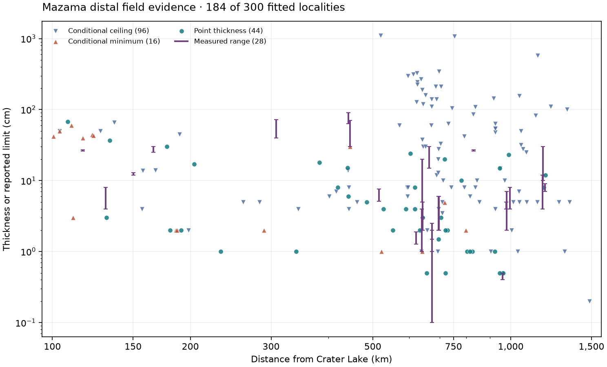

# Distal Mazama ash and local fallout thickness

Buckland et al. define distal as more than **100 km** from Crater Lake. Their workbook contains 293 localities, including 71 coded primary (`P`), 28 secondary (`S`), 21 mixed (`B`) and 173 unclassified (`unk`). Their 45 selected distal thicknesses are a subset of this inventory. The previous project fit used 244 positions, including 128 beyond 100 km. Its wider locality ledger has 733 entries, including core drives, aliases, exclusions, controls and unsurveyed leads. Counts of ledger entries are not counts of independent fallout measurements. [Buckland et al., text and supplements](https://doi.org/10.1007/s00445-020-1362-1) · [Workbook transcription](../buckland2020-293-localities.csv) · [Earlier 244-position input](https://github.com/siyulai21/tephra-fallout-isopachs/blob/d00f7f0d3e0a634020d2898f2c63ef9d225fdb0c/data/eruptions/Mazama_reviewed.csv)

The re-examination found both genuinely thick surviving beds and thick accumulations enlarged by sediment transport. The [field assessment](FIELD_EVIDENCE.md) covers the screened records, the matching core photos and the difference between local and transported thickness. [All 45 flagged thick distal records](thick-distal-records.csv) · [Nine original Alberta core logs](ALBERTA_CORE_LOGS.md)

## What the field records establish

| Locality and distance | Recovered evidence | Implication for local fallout |
|---|---|---|
| Windy Lake, BC, 829 km | Chase et al. Table 1 places ash at 287–373 cm, giving an **86 cm** package. Parallel drives agree visually. This shallow cirque has a fen and avalanche tracks at its eastern shore. Correlation rests on stratigraphy and regional tephra distribution. | The whole package was previously fitted as an 86 cm measurement. Contacts and continuous recovery support a conditional ceiling if local fallout was retained. They do not establish an 86 cm atmospheric blanket. [Chase et al.](https://doi.org/10.1016/j.palaeo.2007.10.020) |
| Thunder Lake, BC, 1,052 km | The same source reports **32 cm** from 170–202 cm in gyttja. Above the Mazama marker the parallel drives correlated poorly. The site is a shallow basin. | The old point assumed a direct transfer. Core uncertainty and the possibility of focusing require a weaker reading. The North Cascades lake of the same name is a separate record. [Chase et al.](https://doi.org/10.1016/j.palaeo.2007.10.020) |
| Round Lake, WA, 670 km | Mark records approximately **60 cm** at 606–666 cm within a carbonate-rich sedimentary sequence. This is a different lake from Round Lake, Oregon. | The former **≥60 cm** constraint required an absence of ash import. The published interval establishes a preserved package and does not demonstrate a positive primary minimum. [Mark, section 5.3.1, Fig. 46](https://d-scholarship.pitt.edu/45138/1/Mark%20Thesis%20ETD%203%201.pdf) |
| Williams Lake Fen, WA, 598 km | Buckland S1 records **46 cm** and **two layers**. The investigator reports 9 cm of lake sediment separating two Mazama horizons. | The 46 cm cannot be assigned to the climactic primary bed from these accounts. No subtraction of the 9 cm separator or invented split is justified. [Mehringer, Williams Lake Fen section](https://www.fs.usda.gov/r6/icbemp/science/mehringe.pdf) |
| Andies Prairie, OR, 446 km | Buckland’s field section has a sharp base, continuous **30 cm** ash, developed topsoil and a position on a major drainage divide. At Pole Bridge and Juniper Canyon, upslope drainage and fan/lens geometry explain much thicker accumulation. | The authors expressly interpret 30 cm as a **minimum** here. Nearby redeposited packages do not invalidate the field section or supply primary thicknesses at their own locations. [Buckland et al., Fig. 3 and drainage supplement S2](https://doi.org/10.1007/s00445-020-1362-1) |
| Flodelle Creek, WA, 718 km | Johnson et al. distinguish a clean, flat-topped **approximately 20 cm** lower-mine bed from contaminated or redeposited deposits in the same valley. | The field description supports retaining this locally thick primary deposit. The larger hole averages and maxima have different meanings. [Johnson et al., Unit G](https://pubs.usgs.gov/of/1985/0443/report.pdf) |
| Overland and Soldier lakes, NV, both about 618 km | Munroe et al. distinguish basal airfall of **8 cm** and **4 cm** from separate **10 cm** and **5 cm** reworked caps. | The authors’ sedimentological distinction supports the basal values. The cores do not independently calibrate lake focusing. [Munroe et al., pp. 41–42 and 47](https://doi.org/10.1130/2018.2536%2803%29) |

The spreadsheet’s row ID and site name are both needed. For example, Rockslide Lake is workbook ID 176 and was called site 174 in the text. Workbook 174 is **Squeah Lake**. South Saskatchewan River is workbook 232 and was called 230 in the text. Marys Pond, Foy and Swiftcurrent show why a single drainage-area correction would be unjustified. Even visibly clean ash can have been redeposited rapidly. Glass chemistry identifies a volcanic source and cannot by itself give the initial bulk thickness. [Buckland et al., pp. 7 and 12–13 and supplement S2](https://doi.org/10.1007/s00445-020-1362-1)

## Deposit classes in the earlier facies review

This table records the earlier facies selection for the 293 original row IDs. The current 300-locality audit revisits every primary-coded record. [Current S1 decisions](../principal-ranges/buckland-primary.csv)

A later core or a better documented section in the same basin can enter under its own ID. The 574 additional evidence records preserve those links and shared positions. A secondary deposit can bound the material in a retained package only under the stated capture assumptions.

| Original S1 code | Source rows | Point thickness | Lower bound | Conditional upper bound | Original row omitted |
|---|---:|---:|---:|---:|---:|
| P (primary) | 71 | 7 | 4 | 15 | 45 |
| S (secondary) | 28 | 0 | 0 | 1 | 27 |
| B (mixed) | 21 | 0 | 2 | 6 | 13 |
| unk (unclassified) | 173 | 1 | 0 | 14 | 158 |

Sheep Mountain Bog is the single S-coded row with a fitted bound. The original profile and pollen archive document the preserved package in a wash-prone fen. The 42 cm cap permits much thinner local fallout. [Measured section and its transfer assumptions](FIELD_EVIDENCE.md) · [Original and revised use for every record](locality-facies-crosswalk.csv)

Vertical bars show the two measured endpoints at a single site. Triangles mark the fitted upper or lower limit. Distances are WGS84 geodesics from the registered vent.

A lake can receive extra ash from its catchment. An upper limit assumes that the local fall survived within the measured package. Erosion or incomplete capture can invalidate that assumption. A 1,080 cm enclosing section consequently provides a ceiling on the primary deposit. A fitted lower limit requires evidence that in-place primary ash accounts for at least the stated thickness. The current decision table gives the evidence for each transfer. [Bound protocol](../../../../docs/methods/sites-without-measured-thickness.md) · [Current locality decisions](../principal-ranges/locality-decisions.csv) · [Facies review by source row](locality-facies-crosswalk.csv)

The Jenny Lake primary supplement registers five core stations. One matched core photograph gives a 4 cm outer envelope; the other stations have weaker, physically bracketed ceilings. The source explicitly distinguishes airfall from turbidites. [Jenny Lake core measurements and photographic registration](JENNY_LAKE.md)

## Further field and core evidence

| Archive | What the source resolves | Interpretation in this edition |
|---|---|---|
| NEL03, southeastern BC, 830 km | Courtney Mustaphi distinguishes a lower **26–27 cm** bed interpreted as airfall from a younger **6.5–8.5 cm** redeposit containing weathered clay. Two tables disagree by 1 cm on the lower contact. | Retain the author’s primary-bed attribution and both readings. The small lake has an inlet. The principal ceiling is **27 cm**, conditional on retention. NEL01 provides a separate **≤6 cm** package. [Thesis, Tables 2.1–2.2 and 3.1](https://carleton.ca/timpatterson/wp-content/uploads/Mustaphi.2013.Ph_.D.pdf) |
| Cathedral Lakes, BC | Four adjacent basins contain 46 cores. Evans reports that 43 reached Mazama. The lower ash was identified by stratigraphy and shard morphology. Preserved beds span **2–70 cm**, typically about **10 cm**. The XRF comparison in Appendix 1 describes the younger tephra. | Use one longest complete central core per lake. Conservative outer graphic endpoints are **≤4 cm** at Lake of the Woods A12, **≤20** at Pyramid B7b, **≤13** at Glacier C5 and **≤28** at Quiniscoe D8. A lake gazetteer point locates each basin. The mapped stations are relative, and the four observations share one study and a small area. A single-basin refit tests dependence. [Evans, Fig. 4.2, Table 5.1, Appendices 1 and 3](https://central.bac-lac.gc.ca/.item?id=NQ25044&op=pdf&app=Library) · [Pixel picks and scale](cathedral-central-core-picks.json) · [Individual core logs and coverage](cathedral-transect.csv) |
| Lake Ksnea, Skagit Valley, WA, 634 km | A primary **2 cm** layer directly overlies lacustrine sediment. The original investigators describe as much as **17 m** of subsequently transported material in the lake. A coauthor's separate account repeats the observation. | Fit the 2 cm bed once, with the mouth of Damnation Creek as a location proxy. The thick volcaniclastic fill is excluded. [Original chapter](https://pubs.usgs.gov/publication/70206119) · [Coauthor’s account](https://www.dnr.wa.gov/Publications/ger_psrc01_pringle_scott.pdf) |
| Roe and Stowell lakes, BC | Lucas photographs a **0.5 cm** chemically correlated ash between 573.0 and 573.5 cm in the central Roe core. Lemmen describes a **2 cm** probable Mazama bed in Stowell gyttja, 330.5–332.5 cm. | Roe is a conditional primary-bed measurement. Stowell contributes **≤2 cm** with weaker identity and local retention. [Roe, Fig. 2 and Tables 1–2](https://dspace.library.uvic.ca/bitstream/handle/1828/4219/Lucas_Jennifer_MSc_2012.pdf) · [Stowell thesis](https://dspace.library.uvic.ca/server/api/core/bitstreams/e636272c-2515-4f1f-91d2-220c4c5b0efa/content) |
| Alberta and Saskatchewan archaeological, core and terrace samples | Jensen’s own workbook separates 30 target-bearing sample accessions, mixed material, seven literature sites and other-eruption controls. Table S3 gives individual chemical analyses. The Stampede sample is **15 cm** in an alluvial fan. In Calgary, one block has **reworked blebs up to 10 cm** and another has a **continuous 10–15 cm bed**. | Province, field sample, site and layer identity matter. Neither Calgary block inherits an uncertain compilational city coordinate. The Nordegg Bridge sample has a sharp base and reworked top, supporting **≤5 cm**. The Hasse core carries a tentative **≤1 cm**. A 10 cm carbonate host near Grande Cache is excluded. [Sample-level crosswalk with chemical analysis rows](jensen-sample-crosswalk.csv) · [Original workbook](https://ars.els-cdn.com/content/image/1-s2.0-S1040618218311911-mmc3.xlsx) |
| On-off Lake, BC | Maurer reports a nonvisible glass peak at 141 cm in core 08-Onoff02. Only one chemical analysis supports its probable Mazama attribution. | The containing organic unit yields a deliberately broad **≤82 cm** at the actual coring position. A half-retention test doubles the ceiling and separate tests omit it. The other two cores supply depth/coverage context. [Maurer, Table 1 and Figs. 5–6](https://couplet.unbc.ca/pdfs/Maurer_et_al_2012.pdf) |
| Castor Lake, WA | Nelson distinguishes rapid accumulation of approximately **30 cm** of ash from subsequent longer-lived wash into the basin. | The initial package supplies an approximate **≤30 cm** on a retention assumption. The later wash and a second coring campaign are separate ledger evidence. [Nelson, thesis pp. 33–34](https://d-scholarship.pitt.edu/10268/1/Nelson_Daniel_B_ETD.pdf) |

At each locality the compilation code is printed only on its own S1 row. A linked later core can strengthen eruption identity without independently verifying the thickness of an earlier section. Ages are carried with their original dating units. An imported eruption age does not count as another radiocarbon determination. The main original-observer queue still contains 193 S1 records, including nine retained conditionally. The source inventory preserves links and acquisition hashes for 222 original payloads. [Observer queue](../primary-source-work-queue.csv) · [Source inventory](../../../sources/mazama/source-manifest.csv) · [Field verification and original units](../revised-locality-ledger.csv)

Tumalo (50 cm), Round Lake in Oregon (14 cm), Shadow (14 cm) and Sunrise (8 cm) each have a real bed reported by a primary investigator. They now contribute upper bounds where a lake-to-land transfer remains uncalibrated. Saban’s Dog Lake record gives conflicting 12–13 cm readings, and White Pine Marsh yields 25–30 cm across the log, chronology table and discussion. The larger endpoints enter as conditional ceilings. The 1–2 mm lapilli and basal fine ash at White Pine support an eruptive bed. The competing lower-bound interpretation remains in the historical refits. [Original-site locators and preserved observations](locality-facies-crosswalk.csv)

The 1995 chronology for Cathy Whitlock’s Davis Lake core reproduces the 6 cm bed recorded in the compilation. A return to the investigator records also distinguishes two different Lofty Lake campaigns and locates the Wildcat and Wildhorse cores. [Archived depth controls and qualifications](OBSERVER_ARCHIVES.md)

## Fitted sites with outstanding original field profiles

Seven distal constraints still depend on an unrecovered original field profile. Wildhorse Lake (≥2 cm) and Wildcat Lake (≥1 cm) retain interpreted primary components of mixed deposits. Young’s published limits apply at site 24 (<5 cm), South Saskatchewan River (<5 cm), Saskatchewan Crossing (<25 cm), Beverley (<5 cm) and Lofty Lake (≤0.2 cm in the specified density conversion). Each is entered once as a one-sided constraint. The two other fitted S1 rows in the observer queue are within 60 km of the vent. Buckland records upland thicknesses of 223 cm at Antelope Unit and 224 cm at Huckleberry Springs. Matz’s Table 6 lists separate C1 and C2 horizons at those named localities, 43 and 64 cm at Antelope, and 61–63.5 and 147–150 cm at Huckleberry. The link between the soil sections and Buckland’s measurement stations remains unresolved. The two points therefore retain their compilation-level qualification. [Source-by-source queue](../primary-source-work-queue.csv) · [Matz, Tables 5–6](https://studylib.net/doc/11985296/an-abstract-of-the-thesis-of) · [Original S1 rows and coordinates](../buckland2020-293-localities.csv)
