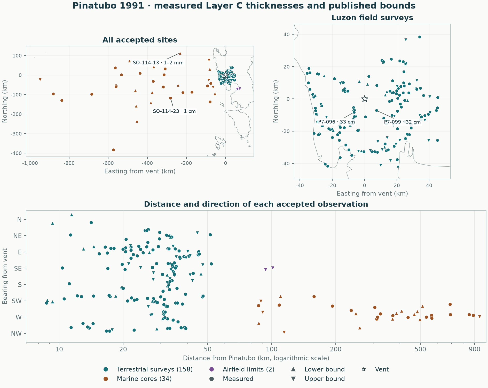

# Pinatubo climactic fallout audit

**Current re-audit, 24 November 2026.** The revised input contains 235 localities. It includes offshore ranges, terrestrial pumice minima, and source-specific limits at cores without a visible bed. The 208-site audit below documents the previous edition. [Current source audit](reaudit/README.md) · [Current locality ledger](reaudit/localities.csv)

## Land-map readings and the 208-locality edition

**208 accepted observations comprise 150 measured thicknesses, 28 lower bounds and 30 upper bounds.** The target is accumulated bulk thickness from the climactic 15 June 1991 airborne fallout on Luzon and its correlated offshore deposit, including co-ignimbrite ash. The input uses centimetres and WGS84 longitude and latitude. [Accepted observations](../../eruptions/Pinatubo_1991_layer_C.csv) · [Full evidence inventory](full-evidence.csv) · [Check a reading by eye](VISUAL-CHECK.md)

| Evidence | Measured | Lower | Upper | Original scope |
|---|---:|---:|---:|---|
| Paladio-Melosantos Table 2 | 12 | 0 | 0 | Whole-deposit thickness at 12 grain-size sections |
| Paladio-Melosantos Figure 7 | 79 | 10 | 20 | Independently legible field markers and whole-section totals |
| Koyaguchi Figure 3 | 40 | 7 | 4 | C1 and C2 sampled at paired sites |
| Wiesner and Wang Table 1 | 7 | 0 | 3 | Ten marine cores |
| Wiesner et al. Table 1 | 11 | 0 | 0 | Bulk beds with documented cruise-station positions |
| Hess et al. Table 1 and discussion | 0 | 11 | 1 | Named station groups after checking repeat visits and disturbed beds |
| SÜDMEER report, section 3.4 | 1 | 0 | 0 | Named core with a chart position and depth profile |
| Casadevall et al. | 0 | 0 | 2 | Manila and Sangley Point airfield accumulations |

Every accepted row has an evidence ID and every candidate numeric reading has a recorded decision. The larger evidence inventory also holds coarse units, reconnaissance reports, revisits and source-map positions with no numeric limit. Several records can describe one station. [Selection decisions](selection.csv) · [Source originals and citations](../../sources/pinatubo-1991/README.md)

The field review resolved four C1 labels. The two sublayers give 8.5 cm at K-07, >5.8 cm at K-23, 20.0 cm at K-34 and 4.0 cm at K-52. [Four original crops and reading decisions](koyaguchi-c1-review.md)

## Map coordinates

Each pixel coordinate starts at the upper-left corner of the **original GIF**. The graticule gives separate linear transforms for longitude and latitude. Figure 7 uses the 120°00′ and 120°45′ E marks at x = 40 and 914 and the 15°30′ and 15°00′ N marks at y = 23 and 623.5. Koyaguchi C1 uses x = 45.5 and 265.5 for 120°00′ and 120°30′ E, and y = 13.5 and 237.5 for 15°30′ and 15°00′ N. C2 uses the corresponding ticks at x = 46.5 and 266.5 and y = 386 and 610.5. The C1 star supplies the common vent at 120.345455° E, 15.142857° N. [Original field map](../../sources/pinatubo-1991/paladio-figure-7.gif) · [Original paired panels](../../sources/pinatubo-1991/koyaguchi-figure-3.gif) · [Transform constants and input hash](provenance.json)

One Koyaguchi source pixel spans about 0.25 km. A Paladio source pixel spans about 0.09 km. Symbol width, the original survey and registration add location uncertainty. The two independently registered sublayer locations differ by up to 0.55 km. The accepted coordinate uses C1 and preserves the two source pixels for inspection. Numeric output precision allows the calculation to replay. It exceeds the accuracy with which either survey can locate a marker. [Reading index](reading-index.csv) · [Sublayer pairs](../../sources/pinatubo-1991/koyaguchi-figure-3.csv) · [Refits using C2 coordinates](../../../archive/2026-11-24-case-editions/pinatubo-layer-c-208/source-checks/README.md#position-on-the-two-sublayer-maps)

The sublayers are in millimetres. Add them once, then divide by ten. A visible component with a questioned partner supplies only a lower bound. The sum of two upper bounds supplies an upper bound. December measurements and the June observations printed in parentheses have separate survey labels. Koyaguchi describes erosion and compaction at some revisited sites. [Original caption and field methods](https://pubs.usgs.gov/pinatubo/koya/index.html)

Paladio Table 2 sometimes repeats total deposit thickness beside each grain-size subsample. Each section contributes one total. On Figure 7, a filled circle identifies a field reading, an open circle identifies a total that may include layers A or B, and squares reproduce readings from Koyaguchi and Listanco. The ledger keeps unresolved digits, unclear marker assignments and the squares outside the fit. A second reading of 32 Figure 7 entries resolved P7-101 as 15 cm and P7-148 as 5.1 cm. P7-056 remains unresolved. Fourteen field records entered the fit and two measured values changed. [Decisions and four sheets of source pixels](paladio-figure-7-review.md) [Figure 7 and caption](https://pubs.usgs.gov/pinatubo/paladio/index.html) · [Numbered reading sheets](VISUAL-CHECK.md)

## Cross-survey repeats

A named Table 2 section has priority within 0.8 km of a Figure 7 marker because the printed triangle spans that neighbourhood. Between the sublayer survey and the other field surveys we flag positions within 0.4 km as possible repeats. Out to 2 km we flag a pair whose published numeric thresholds or readings agree within 0.1 cm. Directly copied square symbols are suppressed regardless of distance. These choices are explicit conventions for unresolved site identities. Distinct survey markers can remain close together. The geographic holdouts buffer training observations. [Every row and its reason](selection.csv)

With agreement screening and a 0.5, 1, 2 or 3 km maximum search radius, 213, 209, 208 or 204 observations survive respectively. Merging every nearby cross-survey pair at those radii leaves 210, 193, 171 or 147. These are changes in site count. They do not give an uncertainty interval for volume. [Replayable counts](provenance.json)

## Airfields and distal reports

Casadevall and colleagues report a June 15–16 accumulation of 0.5–1 cm at both Ninoy Aquino International Airport and Sangley Point. The upper endpoint bounds the climactic contribution in that time window. The coordinate locates each facility. A separate Manila aircraft account gives less than 0.5 cm and a metropolitan account gives 4 mm. Dates, surfaces and sampling locations differ. The readings at Clark, Cubi Point and Basa describe water-saturated accumulation on airfield surfaces and buildings and overlap mapped ground surveys. [Airport evidence](../../sources/pinatubo-1991/casadevall-airfields.csv) · [Original account](https://pubs.usgs.gov/pinatubo/casa/index.html)

David and colleagues measured seven sections of the **coarse pumice unit** six months after the eruption. The source gives a north arrow, an approximate scale and town names. To locate the readings for inspection, a two-point similarity transform uses the Angeles City and San Fernando road junctions on the schematic at pixels (175, 414) and (332, 596) and the corresponding GeoNames populated-place coordinates in UTM zone 51N. Six independent comparisons with the named settlements differ by 1.69–2.52 km. These discrepancies assess the schematic at settlement scale and provide no site-specific error distribution. The seven readings are preserved as coarse-unit evidence with approximate positions outside the common fit. [Original sample map](../../sources/pinatubo-1991/david-figure-3.gif) · [All seven readings and coordinates](survey-coverage/david-schematic.csv) · [Original methods](https://pubs.usgs.gov/pinatubo/david/index.html)

The Singapore sample confirms micrometre-scale particles at great distance. The source's 0.01–0.1 mm scenarios for distal isopachs combine broad areas and reported impacts. They cannot establish a bed thickness at each reported locality. Major cities without a fall report have no documented observation threshold. [Nineteen labelled distal localities and contemporary field reports](distal-reports.md) · [Evidence ledger](../../sources/pinatubo-1991/context/other-field-reports.csv)

## Geographic coverage

The northern sector has one exact measurement, 14.15 km from the source. Beyond 100 km the exact-site bearings leave a 294.1° gap. Marine deposits extend the measured footprint predominantly west and southwest. An uninterrupted isopach across the remaining directions depends on the model. The later offshore survey documents a local distal thickening and a bend in the lobe, both challenging a smooth thinning field. [Sector counts and distances](coverage.csv) · [Marine evidence and preservation](marine-check.md) · [Wiesner et al.](https://doi.org/10.1007/s00445-003-0306-x)

## Reproduction

Run `python -m benchmarks.pinatubo` from the repository root to check the principal CSV and selection against the source transcripts. `python -m benchmarks.pinatubo_maps` rebuilds the reading sheets, and `python -m benchmarks.pinatubo_evidence` rebuilds the combined evidence inventory. [Case results](../../../eruptions/pinatubo-1991-layer-c/README.md) · [New eruption workflow](../../../docs/NEW_ERUPTION.md)

Rebuild the observation maps and distance-by-bearing plot with `python -m benchmarks.pinatubo_coverage`. The figure records the input checksum and the number of observations from each environment.

The additional layers have a separate [phase-specific observation index and original pixel checks](other-phases/README.md). Rebuild it with `python -m benchmarks.pinatubo_phases`.
