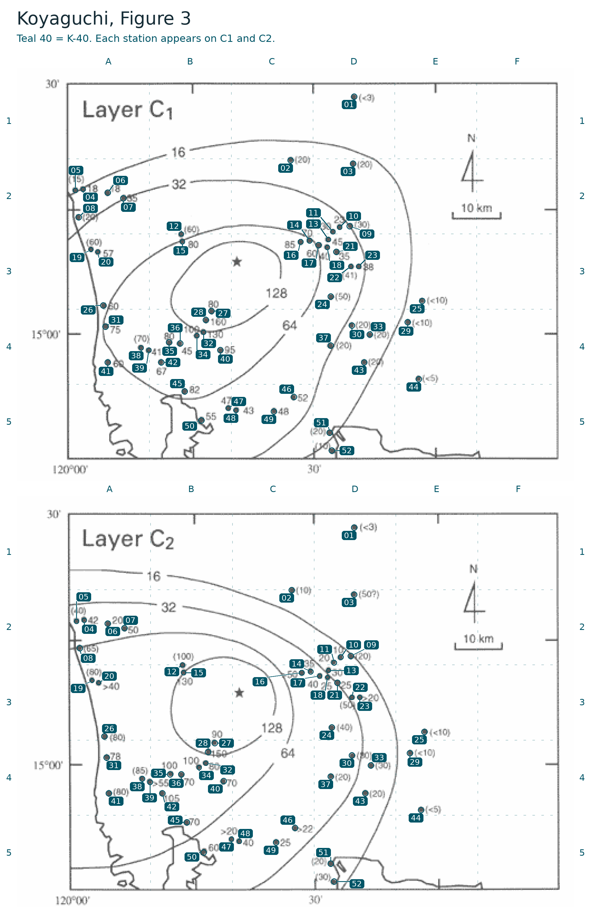
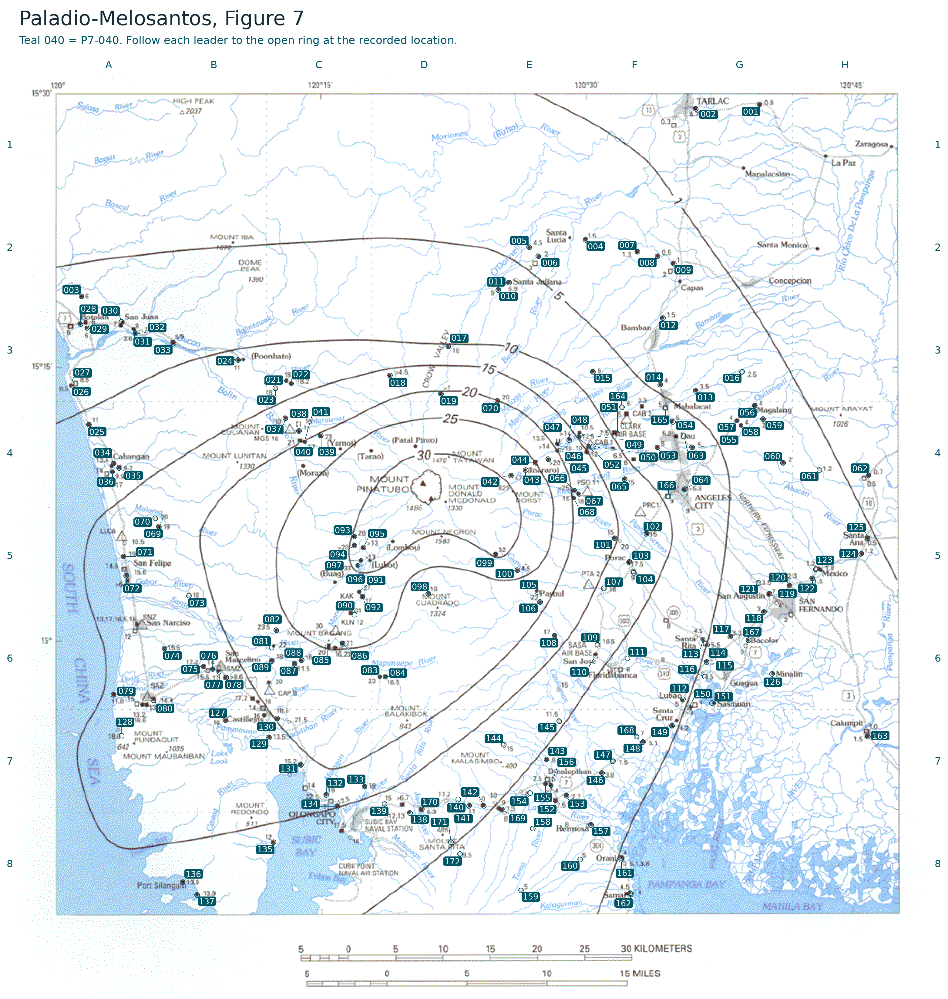

# Check the Pinatubo measurements by eye

Find an audit ID on either full map. Each numbered figure has a lookup by ID and links to the original-pixel reading sheets. [Koyaguchi Figure 3](#koyaguchi-figure-3) · [Paladio-Melosantos Figure 7](#paladio-melosantos-figure-7)

Three examples take about a minute to check. The [CAB-1 table entry and mapped section](field-check.md) give a measured 15 cm. On [K-03](visual/k3-01.png), 20 mm is clear and the other value carries a question mark, giving a 2 cm minimum. The [P7-056 symbol](visual/p7-07.png) is ambiguous and was excluded.

Find an evidence ID in the [row index](reading-index.csv), then open its sheet below. Each card shows the original pixels enlarged four times. The small teal marks in the margin point to the recorded pixel centre. On the sublayer sheets the left and right panels show the same site in C1 and C2. On the other sheets the second panel repeats the location with the margin marks.

P7 filled circles are independent Layer C field readings. Open circles are whole-section totals and bound Layer C from above. Squares report the Koyaguchi or Listanco survey. Triangles locate the sampled sections in Table 2. The section totals are printed in the table. A question mark records an unresolved reading. The [selection ledger](selection.csv) explains each fitting decision.

To check a coordinate, open the [worked CAB 1 map](visual/coordinate-check.png). Its triangle is at original pixel (628, 411). It lies 588 of 874 pixels eastward across the 0.75° longitude span, giving 120.50458° E. It lies 388 of 600.5 pixels southward across the 0.5° latitude span, giving 15.17694° N. Each reading card also prints its mapped location. The full-precision coordinates in the row index reflect the map transformation. [Original Figure 7](../../sources/pinatubo-1991/paladio-figure-7.gif) · [Coordinate audit and uncertainty](README.md#map-coordinates)

## Paladio-Melosantos, Table 2 and Figure 7

[Original image](../../sources/pinatubo-1991/paladio-figure-7.gif)

[Printed sample names, thicknesses and geographic coordinates](field-check.md)

- [P2-CAB-1 through P2-LLC-6](visual/p2-01.png)
- [P2-CAP-8 through P2-KLN-12](visual/p2-02.png)

## Koyaguchi, Figure 3

[Original image](../../sources/pinatubo-1991/koyaguchi-figure-3.gif)

Look up any ID below, then follow its teal number to the open ring on the map. **K-40** is in column **B**, row **4**. All 52 stations appear on both sublayer maps. The printed thicknesses are in millimetres. [Open the full-resolution map](visual/koyaguchi-figure-3-numbered.png)

Find any K ID by map square

| Reading sheet | Audit ID and map square |
|---|---|
| [K-01–K-08](visual/k3-01.png) | K-01 **D1** · K-02 **C2** · K-03 **D2** · K-04 **A2** · K-05 **A2** · K-06 **A2** · K-07 **A2** · K-08 **A2** |
| [K-09–K-16](visual/k3-02.png) | K-09 **D2** · K-10 **D2** · K-11 **D2** · K-12 **B3** · K-13 **D3** · K-14 **C3** · K-15 **B3** · K-16 **C3** |
| [K-17–K-24](visual/k3-03.png) | K-17 **D3** · K-18 **D3** · K-19 **A3** · K-20 **A3** · K-21 **D3** · K-22 **D3** · K-23 **D3** · K-24 **D3** |
| [K-25–K-32](visual/k3-04.png) | K-25 **E3** · K-26 **A3** · K-27 **B4** · K-28 **B4** · K-29 **E4** · K-30 **D4** · K-31 **A4** · K-32 **B4** |
| [K-33–K-40](visual/k3-05.png) | K-33 **D4** · K-34 **B4** · K-35 **B4** · K-36 **B4** · K-37 **D4** · K-38 **A4** · K-39 **A4** · K-40 **B4** |
| [K-41–K-48](visual/k3-06.png) | K-41 **A4** · K-42 **B4** · K-43 **D4** · K-44 **E4** · K-45 **B5** · K-46 **C5** · K-47 **B5** · K-48 **C5** |
| [K-49–K-52](visual/k3-07.png) | K-49 **C5** · K-50 **B5** · K-51 **D5** · K-52 **D5** |

Four C1 readings were reviewed against both original panels and the neighbouring Figure 7 labels. [Read the four decisions](koyaguchi-c1-review.md) · [Compare the original pixels](visual/koyaguchi-c1-review.png)

The mapped coordinate on each card comes from the C1 panel. Compare it with the independently registered C2 panel for every accepted pair. [Both sets of ticks, pixels and coordinates](../../../eruptions/pinatubo-1991-layer-c/results/source-checks/paired-map-coordinates/paired-coordinates.csv) · [Effect on the fitted volumes](../../../eruptions/pinatubo-1991-layer-c/results/source-checks/README.md#position-on-the-two-sublayer-maps)

- [K-01 through K-08](visual/k3-01.png)
- [K-09 through K-16](visual/k3-02.png)
- [K-17 through K-24](visual/k3-03.png)
- [K-25 through K-32](visual/k3-04.png)
- [K-33 through K-40](visual/k3-05.png)
- [K-41 through K-48](visual/k3-06.png)
- [K-49 through K-52](visual/k3-07.png)

## Paladio-Melosantos, Figure 7

[Original image](../../sources/pinatubo-1991/paladio-figure-7.gif)

Look up any ID below, then follow its teal number to the open ring on the map. **P7-040** is in column **C**, row **4**. All 172 indexed locations appear, including copied readings, place names and unresolved entries. The printed thicknesses are in centimetres. [Open the full-resolution map](visual/paladio-figure-7-numbered.png)

Find any P7 ID by map square

| Reading sheet | Audit ID and map square |
|---|---|
| [P7-001–P7-008](visual/p7-01.png) | P7-001 **G1** · P7-002 **G1** · P7-003 **A2** · P7-004 **F2** · P7-005 **E2** · P7-006 **E2** · P7-007 **F2** · P7-008 **F2** |
| [P7-009–P7-016](visual/p7-02.png) | P7-009 **F2** · P7-010 **E2** · P7-011 **E2** · P7-012 **F3** · P7-013 **G3** · P7-014 **F3** · P7-015 **F3** · P7-016 **G3** |
| [P7-017–P7-024](visual/p7-03.png) | P7-017 **D3** · P7-018 **D3** · P7-019 **D3** · P7-020 **E3** · P7-021 **C3** · P7-022 **C3** · P7-023 **C3** · P7-024 **B3** |
| [P7-025–P7-032](visual/p7-04.png) | P7-025 **A4** · P7-026 **A3** · P7-027 **A3** · P7-028 **A3** · P7-029 **A3** · P7-030 **A3** · P7-031 **A3** · P7-032 **A3** |
| [P7-033–P7-040](visual/p7-05.png) | P7-033 **B3** · P7-034 **A4** · P7-035 **A4** · P7-036 **A4** · P7-037 **C4** · P7-038 **C4** · P7-039 **C4** · P7-040 **C4** |
| [P7-041–P7-048](visual/p7-06.png) | P7-041 **C4** · P7-042 **E4** · P7-043 **E4** · P7-044 **E4** · P7-045 **E4** · P7-046 **E4** · P7-047 **E4** · P7-048 **E4** |
| [P7-049–P7-056](visual/p7-07.png) | P7-049 **E4** · P7-050 **F4** · P7-051 **F4** · P7-052 **E4** · P7-053 **F4** · P7-054 **F4** · P7-055 **G4** · P7-056 **G4** |
| [P7-057–P7-064](visual/p7-08.png) | P7-057 **G4** · P7-058 **G4** · P7-059 **G4** · P7-060 **G4** · P7-061 **H4** · P7-062 **H4** · P7-063 **F4** · P7-064 **F4** |
| [P7-065–P7-072](visual/p7-09.png) | P7-065 **F4** · P7-066 **E4** · P7-067 **E4** · P7-068 **E4** · P7-069 **A5** · P7-070 **A5** · P7-071 **A5** · P7-072 **A5** |
| [P7-073–P7-080](visual/p7-10.png) | P7-073 **B5** · P7-074 **B6** · P7-075 **B6** · P7-076 **B6** · P7-077 **B6** · P7-078 **B6** · P7-079 **A6** · P7-080 **A6** |
| [P7-081–P7-088](visual/p7-11.png) | P7-081 **C6** · P7-082 **C6** · P7-083 **D6** · P7-084 **D6** · P7-085 **C6** · P7-086 **C6** · P7-087 **C6** · P7-088 **C6** |
| [P7-089–P7-096](visual/p7-12.png) | P7-089 **C6** · P7-090 **C6** · P7-091 **C5** · P7-092 **C5** · P7-093 **C5** · P7-094 **C5** · P7-095 **C5** · P7-096 **C5** |
| [P7-097–P7-104](visual/p7-13.png) | P7-097 **C5** · P7-098 **D5** · P7-099 **E5** · P7-100 **E5** · P7-101 **F5** · P7-102 **F5** · P7-103 **F5** · P7-104 **F5** |
| [P7-105–P7-112](visual/p7-14.png) | P7-105 **E5** · P7-106 **E5** · P7-107 **F5** · P7-108 **E6** · P7-109 **F6** · P7-110 **F6** · P7-111 **F6** · P7-112 **F6** |
| [P7-113–P7-120](visual/p7-15.png) | P7-113 **G6** · P7-114 **G6** · P7-115 **G6** · P7-116 **G6** · P7-117 **G6** · P7-118 **G6** · P7-119 **G5** · P7-120 **G5** |
| [P7-121–P7-128](visual/p7-16.png) | P7-121 **G5** · P7-122 **H5** · P7-123 **H5** · P7-124 **H5** · P7-125 **H5** · P7-126 **G6** · P7-127 **B7** · P7-128 **A7** |
| [P7-129–P7-136](visual/p7-17.png) | P7-129 **C7** · P7-130 **C7** · P7-131 **C7** · P7-132 **C7** · P7-133 **C7** · P7-134 **C7** · P7-135 **C8** · P7-136 **B8** |
| [P7-137–P7-144](visual/p7-18.png) | P7-137 **B8** · P7-138 **D8** · P7-139 **D7** · P7-140 **D7** · P7-141 **D7** · P7-142 **E7** · P7-143 **E7** · P7-144 **E7** |
| [P7-145–P7-152](visual/p7-19.png) | P7-145 **E7** · P7-146 **F7** · P7-147 **F7** · P7-148 **F7** · P7-149 **F7** · P7-150 **G6** · P7-151 **G6** · P7-152 **E7** |
| [P7-153–P7-160](visual/p7-20.png) | P7-153 **E7** · P7-154 **E7** · P7-155 **E7** · P7-156 **E7** · P7-157 **F8** · P7-158 **E8** · P7-159 **E8** · P7-160 **E8** |
| [P7-161–P7-168](visual/p7-21.png) | P7-161 **F8** · P7-162 **F8** · P7-163 **H7** · P7-164 **F4** · P7-165 **F4** · P7-166 **F4** · P7-167 **G6** · P7-168 **F7** |
| [P7-169–P7-172](visual/p7-22.png) | P7-169 **E7** · P7-170 **D7** · P7-171 **D8** · P7-172 **D8** |

[Review of 32 Figure 7 entries with original crops and fitting decisions](paladio-figure-7-review.md)

- [P7-001 through P7-008](visual/p7-01.png)
- [P7-009 through P7-016](visual/p7-02.png)
- [P7-017 through P7-024](visual/p7-03.png)
- [P7-025 through P7-032](visual/p7-04.png)
- [P7-033 through P7-040](visual/p7-05.png)
- [P7-041 through P7-048](visual/p7-06.png)
- [P7-049 through P7-056](visual/p7-07.png)
- [P7-057 through P7-064](visual/p7-08.png)
- [P7-065 through P7-072](visual/p7-09.png)
- [P7-073 through P7-080](visual/p7-10.png)
- [P7-081 through P7-088](visual/p7-11.png)
- [P7-089 through P7-096](visual/p7-12.png)
- [P7-097 through P7-104](visual/p7-13.png)
- [P7-105 through P7-112](visual/p7-14.png)
- [P7-113 through P7-120](visual/p7-15.png)
- [P7-121 through P7-128](visual/p7-16.png)
- [P7-129 through P7-136](visual/p7-17.png)
- [P7-137 through P7-144](visual/p7-18.png)
- [P7-145 through P7-152](visual/p7-19.png)
- [P7-153 through P7-160](visual/p7-20.png)
- [P7-161 through P7-168](visual/p7-21.png)
- [P7-169 through P7-172](visual/p7-22.png)

## David and colleagues, Table 1 and Figure 3

[Original image](../../sources/pinatubo-1991/david-figure-3.gif)

- [Floridablanca through Telebastagen](visual/d1-01.png)

## Regional ashfall reports

[Nineteen labelled places on Figure 9](visual/distal-localities.png) · [Original figure and reporting qualifications](distal-reports.md)

## Offshore stations and airfields

The marine bulk-thickness table identifies 11 cores by cruise and station. Compare its values with our [side-by-side station crosswalk](marine-check.md). The original corrected marine map uses station numbers, including 03 and 04. A number at a marine dot identifies its station. Thickness comes from the published table. The [airfield audit](README.md#airfields-and-distal-reports) documents two additional accumulation bounds.

The SÜDMEER report identifies SO-114-23 as a 1 cm core. The PDF opens directly at the thickness statement, station chart and depth profiles in the [three-step verification guide](marine-check.md#südmeer-core-23).

## Other fall layers

[Separate layer A, B and D reading sheets and coordinate index](other-phases/README.md)
