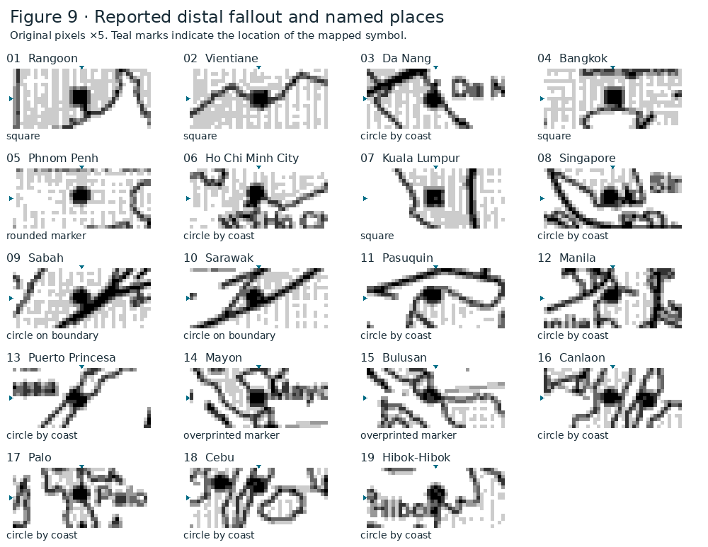

# What the distal reports establish

The climactic eruption deposited fine ash well beyond the measured marine cores. Paladio-Melosantos and colleagues mark localities where people reported fallout, alongside large cities with no report. The source gives no common reporting or detection threshold. The printed ash-cloud outlines describe transport aloft. Each source mark has its own reading and original pixel in the inventory. [Original Figure 9](../../sources/pinatubo-1991/paladio-figure-9.gif) · [All 19 labelled places](../../sources/pinatubo-1991/context/paladio-figure-9-localities.csv)

Singapore supplied a sample of very fine particles. Sabah and Sarawak supply state-level occurrence reports with unknown exact locations. At several Philippine localities, leaders and coastlines overlap the symbols. The audit retains each such qualification. The chapter discusses possible thicknesses for a distal isopach and records light fall reported outside the satellite cloud path. Neither gives a measured bed at a particular map dot. [Field synthesis and figure caption](https://pubs.usgs.gov/pinatubo/paladio/index.html)

## Contemporary reports with numbers

On June 18, field geologists reported 15–30 cm cumulative ash at Clark Air Base and in Olongapo. The bulletin also records an unconfirmed 35.5 cm in southwestern Luzon. The Clark summary overlaps field sections in and around the base, including two named survey sections. Olongapo is a town-wide range, and the southwestern report gives no exposure. These observations provide checks on thick proximal fallout without assigning a settlement-wide range to a single field point. [Contemporary field report](https://doi.org/10.5479/si.GVP.BGVN199105-273083) · [12 bulletin records](../../sources/pinatubo-1991/context/smithsonian-field-reports.csv) · [Named sections](field-check.md)

A subsequent bulletin gives an average ash thickness of **1–2 m within 3 km of the caldera rim**. The reported footprint and positions of individual measurements are unavailable. This is important proximal evidence, particularly because the nearest exact observation in the common input is about 8.7 km from the model vent. The same report gives pumice diameters at Clark and Olongapo and describes thicker pyroclastic-flow deposits separately. The model input preserves the distinction between site thickness, an areal summary and particle size. [Original report](https://doi.org/10.5479/si.GVP.BGVN199106-273083) · [Measured-site distances](coverage.csv)
