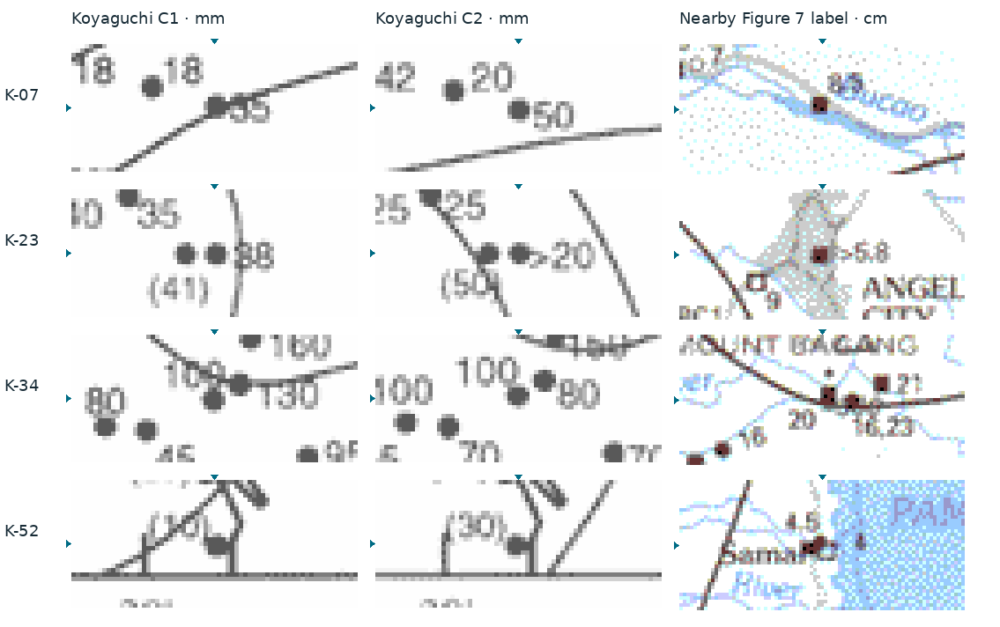

# Four rereadings of Koyaguchi Figure 3

On 22 November 2026 the project curator identified four C1 labels while inspecting the original map. A second reading of the printed characters, the paired C2 panel and nearby labels on Paladio-Melosantos Figure 7 supported all four. The curator approved entry into the Layer C observation table. In Figure 3, thicknesses are in millimetres and parentheses identify the June survey. [Original Figure 3 and caption](https://pubs.usgs.gov/pinatubo/koya/index.html) · [Original Figure 7 and caption](https://pubs.usgs.gov/pinatubo/paladio/index.html)

| Site | C1 before → after (mm) | C2 (mm) | Layer C before → after (cm) | What can be seen |
|---|---|---|---|---|
| K-07 | ? → **35** | 50 | ≥5.0 → **8.5** | The isopach crosses the label. Both digits can be followed. The nearby Figure 7 label appears to read 8.5. |
| K-23 | 88 → **38** | >20 | >10.8 → **>5.8** | The contour crosses the first digit. The nearby Angeles label reads >5.8, which also preserves the C2 inequality. |
| K-34 | ? → **100** | 100 | ≥10.0 → **20.0** | The contour crosses the end of 100. The nearby cluster has a 20 and a separate 21. |
| K-52 | ? → **(10)** | (30) | ≥3.0 → **4.0** | The June C1 label reads (10) where the shoreline crosses it. This is the least certain reading. The crowded Samal label supplies no independent check on the sum. |

The teal pointers locate each dot without covering the print. The first two columns enlarge the original pixels five times. The third enlarges the nearby Figure 7 pixels four times. Figure 7 includes republished Koyaguchi measurements. Its labels help check transcription, and the fit uses one observation per accepted pair. The four Figure 7 neighbours shown here retain their existing audit status.

All 194 accepted sites keep their original identities, order and coordinates. Three minimum thicknesses become measured totals. K-23 remains a lower bound. The reviewed input has 143 measured thicknesses, 23 lower bounds and 28 upper bounds. [Review ledger with original pixel coordinates](koyaguchi-c1-review.csv) · [Before-review input](../../../archive/2026-11-22-pinatubo-intake/pre-visual-review/input.csv) · [Accepted input](../../eruptions/Pinatubo_1991_layer_C.csv)
